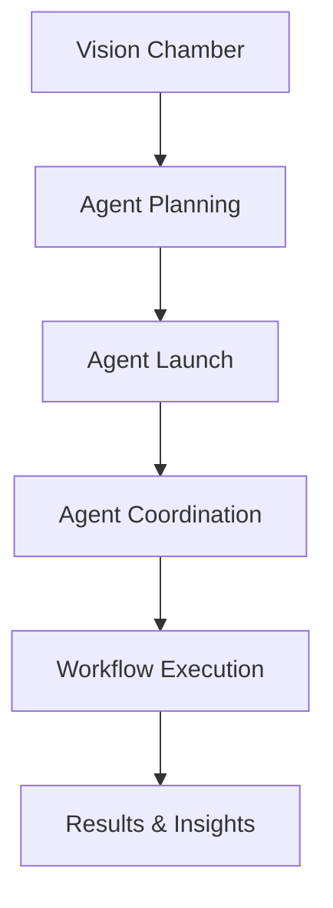

# starships.ai – AI-Powered Agent Orchestration

A comprehensive TypeScript monorepo for orchestrating AI-driven agents and workflows. Built with Next.js 15, Express.js, PostgreSQL, and advanced workflow automation for transforming vision into reality.

> **Project Status:** Production-ready with live waitlist system and operational core features.

## 🌟 Key Features

- **Vision Chamber**: AI-powered vision refinement with quality metrics and intelligent suggestions
- **Autopilot Workflow Engine**: DAG-based workflow execution with conditional routing and AI model integration
- **Multi-Agent Coordination**: Complex agent management with intelligent coordination
- **Starship Management**: Enhanced starship creation with vision integration and subscription tiers
- **Production-Ready**: Docker containerization, Kubernetes deployment, SSL certificates, and comprehensive monitoring

## 📚 Documentation

- **[ER Diagram](./docs/er-diagram.md)** - Database schema and relationships

---

## 🚀 Quick Start

### Prerequisites

- Node.js 20+
- pnpm 10.12.4+
- Docker (for PostgreSQL database)
- PostgreSQL 18 database

### Installation

```bash
git clone https://github.com/theingenuityco/starships.ai.git
cd starships.ai
pnpm install
```

### Configuration

1. Copy the environment template:

```bash
cp .env.example .env
```

2. Configure essential services:

- **PostgreSQL**: Start PostgreSQL 18 with Docker: `pnpm run postgres:install`
- **Database Schema**: Apply schema: `PGPASSWORD=password psql -h localhost -U postgres -d starships -f packages/models/migrations/000_postgresql_schema.sql`
- **JWT Authentication**: Built-in JWT token-based authentication system
- **OpenAI/Anthropic**: Add your API keys
- **Stripe**: Configure for payments (optional for development)

### PostgreSQL Database Setup

```bash
# Start PostgreSQL 18 container
pnpm run postgres:install

# Reset PostgreSQL container (if needed)
pnpm run postgres:reset

# Connect to PostgreSQL shell
pnpm run postgres:shell

# Create database backup
pnpm run postgres:backup
```

### Development

```bash
pnpm dev          # Start all packages in development mode
pnpm build        # Build all packages
pnpm type-check   # Run TypeScript checks
pnpm lint         # Run ESLint
```

---

## 📦 Package Architecture

| Package                                                          | Description                                                                                          |
| ---------------------------------------------------------------- | ---------------------------------------------------------------------------------------------------- |
| [`@starships/client`](./packages/client/README.md)               | Next.js 15 frontend with starship management, agent control, and conversation interfaces             |
| [`@starships/server`](./packages/server/README.md)               | Express.js API server with JWT authentication, Stripe billing, and comprehensive endpoints           |
| [`@starships/autopilot`](./packages/autopilot/README.md)         | Workflow execution engine with DAG-based flows, agent system, AI model integration, and tool calling |
| [`@starships/models`](./packages/models/README.md)               | PostgreSQL database models, repositories, migration system, and comprehensive data access layer      |
| [`@starships/reverse-proxy`](./packages/reverse-proxy/README.md) | Development reverse proxy for unified local development routing                                      |
| [`@starships/protocol`](./packages/protocol/README.md)           | Shared TypeScript types, domain models, and API contracts                                            |
| [`@starships/errors`](./packages/errors/README.md)               | Comprehensive error handling system with automatic categorization and developer-friendly API         |

---

## 🔧 Technology Stack

### Core Infrastructure

- **Monorepo**: pnpm Workspaces + Turborepo for optimized builds
- **Language**: TypeScript 5.8+ (strict mode)
- **Runtime**: Node.js 20+

### Frontend Stack

- **Framework**: Next.js 15 with App Router
- **UI**: Tailwind CSS + shadcn/ui components
- **State**: Zustand with persistence
- **Animations**: Framer Motion
- **React**: React 19

### Backend Stack

- **API**: Express.js 5+ with comprehensive middleware
- **Database**: PostgreSQL 18 relational database with connection pooling
- **Authentication**: Kinde OAuth with JWT
- **Payments**: Stripe with webhook idempotency

### AI & Workflow

- **Workflow Engine**: Custom DAG-based execution system
- **AI Integration**: OpenAI & Anthropic APIs
- **Agent Framework**: Multi-agent coordination system
- **Vision Processing**: AI-powered vision refinement

### DevOps & Deployment

- **Containerization**: Docker with multi-stage builds
- **Orchestration**: Kubernetes with production manifests
- **SSL**: Let's Encrypt with cert-manager
- **Monitoring**: Comprehensive health checks and metrics
- **CI/CD**: GitHub Actions with automated deployments

---

## 🌐 Core System Overview

### Agent Coordination Flow



### Current Implementation

**Authentication & Access**

- JWT-based authentication system
- Waitlist system for controlled early access
- User session management with secure token validation

**Starship Management**

- Complete starship lifecycle (create, update, delete)
- Subscription-based class system (Scout, Cruiser, Draught)
- Agent deployment and slot management
- Billing integration with automatic status updates

**Agent System**

- Agent marketplace with templates and custom agents
- Template-based agent creation for rapid deployment
- Agent deployment to starships with capacity management
- Comprehensive agent analytics and performance tracking

**Agent Orchestration**

- Agent creation and lifecycle management
- AI-powered agent orchestrators with chat interfaces
- Agent-specific communication and progress tracking
- Integration with autopilot workflow system

**Conversation System**

- Structured conversation management with metadata
- Message history and context preservation
- Agent-human communication interfaces
- Real-time chat with AI orchestrators

**Autopilot Workflow Engine**

- DAG-based workflow execution with conditional routing
- Extensible node system (HTTP, LLM, Agent, Conditional, etc.)
- AI agent state management and conversation persistence
- JSON-based workflow definitions with validation

**Payment & Billing System**

- Stripe subscription management with webhook handling
- Multiple pricing tiers (Scout free, Cruiser/Draught paid)
- Billing portal integration and payment retry flows
- Idempotent webhook processing with comprehensive error handling

**Database & Data Management**

- PostgreSQL 18 relational database with automated migrations
- Comprehensive repository pattern with 15+ repositories
- Entity serialization with class-transformer integration
- Performance monitoring and health checks

### API Examples

#### Create Starship

```bash
curl -X POST http://localhost:4000/api/v1/starships \
  -H "Authorization: Bearer $TOKEN" \
  -H "Content-Type: application/json" \
  -d '{
    "name": "Enterprise",
    "class": "cruiser"
  }'
```

#### Execute Workflow

```bash
curl -X POST http://localhost:4000/api/v1/workflows/execute \
  -H "Authorization: Bearer $TOKEN" \
  -H "Content-Type: application/json" \
  -d '{
    "starshipId": "starship-123",
    "workflowId": "workflow-456",
    "parameters": {
      "objective": "Analyze competitive landscape"
    }
  }'
```

#### Deploy Agent to Starship

```bash
curl -X POST http://localhost:4000/api/v1/starships/:starshipId/agents/:agentId \
  -H "Authorization: Bearer $TOKEN"
```

#### Execute Autopilot Workflow

```typescript
import { Workflow } from '@starships/autopilot';

const workflow = new Workflow()
  .addNode({
    ref: 'llm-task',
    type: 'llm',
    name: 'Generate Response',
    parameters: {
      model: 'anthropic/claude-3.5-sonnet',
      prompt: 'Analyze this data and provide insights',
      temperature: 0.7,
    },
  })
  .addEdge('start', 'llm-task');

const result = await workflow.execute(execution);
```

---

## 🐳 Production Deployment

### Docker Environment

```bash
# Build and run with Docker Compose
docker-compose up -d

# Or build individual services
docker build -t starships-client ./packages/client
docker build -t starships-server ./packages/server
```

### Kubernetes Deployment

```bash
# Deploy to production (after DNS and secrets configuration)
kubectl apply -f k8s/prod/

# Monitor deployment
kubectl get pods -n starships-prod --watch
kubectl logs -n starships-prod -l app=starships-ai --follow
```

### Production Features

- **Auto-scaling**: Horizontal Pod Autoscaler configured
- **SSL Certificates**: Automatic Let's Encrypt provisioning
- **Health Monitoring**: Comprehensive health checks and metrics
- **Load Balancing**: NGINX Ingress with production-ready configuration
- **Data Persistence**: 40GB PostgreSQL storage + 5GB session storage

---

## 🛡️ Security & Monitoring

### Security Features

- JWT authentication with Kinde integration
- Rate limiting and request validation
- CORS configuration for production
- Encrypted API key storage
- Security headers and XSS protection

### Monitoring & Health

- **Health Endpoints**: `/health`, `/health/detailed`
- **System Metrics**: Memory, CPU, server status
- **Database Monitoring**: PostgreSQL connection and query performance
- **Error Tracking**: Comprehensive error handling and logging

---

## 🧪 Development Workflow

### Available Scripts

```bash
# Development
pnpm dev          # Start all services in development
pnpm build        # Build all packages
pnpm type-check   # TypeScript compilation check
pnpm lint         # ESLint code quality check
pnpm format       # Prettier code formatting (client package)
pnpm test         # Run test suites (autopilot package)

# Deployment
pnpm start        # Start production server
pnpm deploy:staging     # Deploy to staging environment
pnpm deploy:production  # Deploy to production environment
```

### Testing

- **Unit Tests**: Jest configuration in autopilot package
- **Type Safety**: Strict TypeScript across all packages
- **API Testing**: Comprehensive endpoint testing

### VSCode Debugging

Simple and efficient debug configurations for development:

#### Debug Configurations

- **Debug Next.js Server** - Debug the Next.js server-side code with TypeScript support
- **Debug Next.js Client (Browser)** - Debug React components in Chrome with source maps
- **Debug Express Server** - Debug the Express.js backend with hot reloading
- **Debug Client (Full Stack)** - Launch Next.js server and browser debugging simultaneously
- **Debug Application (Full Stack)** - Launch all services (Express, Next.js server, and browser)
- **Attach Process** - Attach to any running Node.js process

#### Quick Start Debugging

1. **Client Development**:
   - Press `F5` and choose **"Debug Client (Full Stack)"**
   - Debugs both Next.js server and React browser code with breakpoints

2. **Full Application Development**:
   - Choose **"Debug Application (Full Stack)"** to debug all services
   - Includes Express backend, Next.js server, and browser client

3. **Individual Services**:
   - Choose **"Debug Next.js Server"** for server-side Next.js debugging
   - Choose **"Debug Next.js Client (Browser)"** for React component debugging
   - Choose **"Debug Express Server"** for backend-only debugging

4. **Auto-Attach from Terminal**:
   - Run `pnpm dev` in terminal - debugger auto-attaches
   - Or choose **"Attach Process"** to pick a running process

#### Debug Tips

- **Auto-Attach**: VSCode automatically detects and attaches to dev processes
- **Breakpoints**: Works seamlessly in `.ts` and `.tsx` files
- **Hot Reload**: Server restarts automatically maintain debug sessions
- **Source Maps**: Full TypeScript debugging support with accurate line numbers

---

## 🚧 Project Roadmap

### ✅ Completed (v3.14.3)

- ✅ JWT authentication with secure token validation
- ✅ Waitlist system with controlled early access
- ✅ Comprehensive starship management with billing
- ✅ Agent orchestration with AI-powered coordination
- ✅ Agent marketplace with templates and custom agents
- ✅ Conversation system with structured chat interfaces
- ✅ Autopilot workflow execution engine with advanced memory
- ✅ Stripe subscription management with webhook handling
- ✅ PostgreSQL database with automated migrations
- ✅ Production-ready error handling and monitoring
- ✅ Docker containerization and health checks

### 🚧 Active Development

- Advanced workflow node types and conditional logic
- Enhanced agent analytics and performance metrics
- Agent progress tracking and status updates
- Mobile-responsive interface optimizations
- Advanced conversation features and AI interactions

### 📋 Planned Features

- Team collaboration and shared starships
- Advanced workflow templates and marketplace
- Enterprise authentication integration
- Advanced analytics and reporting dashboard
- Mobile application (React Native)
- API rate limiting and advanced security features

---

## 🤝 Contributing

### Development Setup

1. Fork the repository
2. Clone and install dependencies: `pnpm install`
3. Copy environment template: `cp .env.example .env`
4. Start development: `pnpm dev`
5. Run type checks: `pnpm type-check`
6. Lint code: `pnpm lint`
7. Format code: `pnpm format` (in client package)

### Code Standards

- **TypeScript**: Strict mode enabled across all packages
- **ESLint**: Consistent code quality with Prettier integration
- **Prettier**: Automated code formatting with consistent style
- **Conventional Commits**: Clear commit message format
- **Package Isolation**: Clean dependency boundaries
- **Testing**: Unit tests for critical business logic

---

## 📞 Support & Community

### Getting Help

- **Documentation**: Check package-specific README files
- **Issues**: GitHub Issues for bug reports and feature requests
- **Discord**: [Join our community](https://discord.gg/HjAXxpsV)
- **Health Monitoring**: `/health` endpoint for system status

### System Status

- **Production**: [https://starships.ai](https://starships.ai)
- **Health Check**: [https://starships.ai/api/health](https://starships.ai/api/health)
- **Status Page**: Monitor uptime and performance metrics

---

## 📄 License

Proprietary - All rights reserved by The Ingenuity Labs Inc.

---

**🚀 Ready to transform your vision into reality?** Visit [starships.ai](https://starships.ai) to begin your journey.
