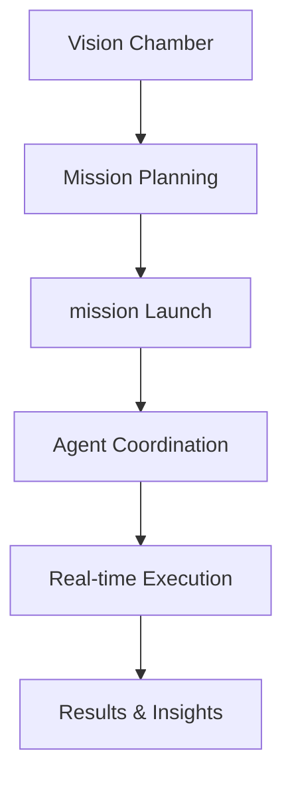

# starships.ai – AI-Powered Agent Orchestration

A comprehensive TypeScript monorepo for orchestrating AI-driven missions and missions. Built with Next.js 15, Express.js, Neo4j, and advanced workflow automation for transforming vision into reality.

> **Project Status:** Production-ready with live waitlist system and operational core features.

## 🌟 Key Features

- **Vision Chamber**: AI-powered vision refinement with quality metrics and intelligent suggestions
- **Mission Orchestration**: Advanced mission planning and execution with real-time chat interfaces
- **Autopilot Workflow Engine**: DAG-based workflow execution with conditional routing and AI model integration
- **Multi-Agent missions**: Complex mission management with real-time agent coordination
- **Starship Management**: Enhanced starship creation with vision integration and subscription tiers
- **Real-time Communication**: Socket.IO integration for live updates and progress tracking
- **Production-Ready**: Docker containerization, Kubernetes deployment, SSL certificates, and comprehensive monitoring

## 📚 Documentation

- **[Deployment Guide](./docs/DEPLOYMENT_GUIDE.md)** - Production deployment instructions
- **[Environment Configuration](./docs/ENVIRONMENT_CONFIGURATION.md)** - Environment variables setup guide
- **[Production Status](./docs/PRODUCTION_DEPLOYMENT_STATUS.md)** - Current deployment status
- **[ER Diagram](./docs/er-diagram.md)** - Database schema and relationships
- **[Waitlist Implementation](./docs/waitlist-implementation-plan.md)** - Early access system

---

## 🚀 Quick Start

### Prerequisites

- Node.js 20+
- pnpm 10.12.4+
- Docker (for Neo4j database)
- Neo4j database

### Installation

```bash
git clone https://github.com/theingenuityco/starships.ai.git
cd starships.ai
pnpm install
```

### Configuration

1. Copy the environment template:

```bash
cp .env.example .env
```

2. Configure essential services:

- **Neo4j**: Run with Docker: `docker run -p 7474:7474 -p 7687:7687 -e NEO4J_AUTH=neo4j/[NEO4J-PASSWORD] neo4j`
- **JWT Authentication**: Built-in JWT token-based authentication system
- **OpenAI/Anthropic**: Add your API keys
- **Stripe**: Configure for payments (optional for development)

### Development

```bash
pnpm dev          # Start all packages in development mode
pnpm build        # Build all packages
pnpm type-check   # Run TypeScript checks
pnpm lint         # Run ESLint
```

---

## 📦 Package Architecture

| Package                                                  | Description                                                                                      |
| -------------------------------------------------------- | ------------------------------------------------------------------------------------------------ |
| [`@starships/client`](./packages/client/README.md)       | Next.js 15 frontend with mission control UI, Vision Chamber, and real-time Socket.IO integration |
| [`@starships/server`](./packages/server/README.md)       | Express.js API server with Socket.IO, authentication, missions, missions, and Stripe webhooks    |
| [`@starships/autopilot`](./packages/autopilot/README.md) | Workflow execution engine with DAG-based flows, conditional routing, and AI model integration    |
| [`@starships/models`](./packages/models/)                | Neo4j database models, repositories, migration system, and data access patterns                  |
| [`@starships/protocol`](./packages/protocol/)            | Shared TypeScript types, interfaces, and Socket.IO event contracts                               |
| [`@starships/env-config`](./packages/env-config/)        | Centralized environment configuration with validation and type safety                            |

---

## 🔧 Technology Stack

### Core Infrastructure

- **Monorepo**: pnpm Workspaces + Turborepo for optimized builds
- **Language**: TypeScript 5.8+ (strict mode)
- **Runtime**: Node.js 20+

### Frontend Stack

- **Framework**: Next.js 15 with App Router
- **UI**: Tailwind CSS + shadcn/ui components
- **State**: Zustand with persistence
- **Real-time**: Socket.IO client
- **Animations**: Framer Motion
- **React**: React 19

### Backend Stack

- **API**: Express.js 5+ with comprehensive middleware
- **Database**: Neo4j graph database with driver
- **Real-time**: Socket.IO server
- **Authentication**: Kinde OAuth with JWT
- **Payments**: Stripe with webhook idempotency

### AI & Workflow

- **Workflow Engine**: Custom DAG-based execution system
- **AI Integration**: OpenAI & Anthropic APIs
- **Agent Framework**: Multi-agent coordination system
- **Vision Processing**: AI-powered vision refinement

### DevOps & Deployment

- **Containerization**: Docker with multi-stage builds
- **Orchestration**: Kubernetes with production manifests
- **SSL**: Let's Encrypt with cert-manager
- **Monitoring**: Comprehensive health checks and metrics
- **CI/CD**: GitHub Actions with automated deployments

---

## 🌐 Core System Overview

### Mission Control Flow



### Current Implementation

**Authentication & Access**

- Kinde OAuth integration with JWT tokens
- Waitlist system for controlled early access
- User session management with persistence

**Vision Chamber**

- AI-powered vision statement refinement
- Quality metrics (clarity, specificity, actionability)
- Intelligent suggestions and improvements
- Real-time collaboration features

**Mission System**

- Create and manage AI-driven missions
- Real-time chat with mission orchestrator
- Multi-phase mission execution
- Progress tracking and status updates

**Autopilot Workflows**

- DAG-based workflow execution engine
- Conditional routing with JSONata expressions
- Interactive user prompts and approvals
- Extensible node system (HTTP, LLM, Agent, etc.)

**Multi-Agent missions**

- Complex mission orchestration
- Real-time agent communication
- First Officer coordination system
- mission status monitoring

**Starship Management**

- Enhanced starship creation with vision integration
- Subscription-based class system (Scout, Cruiser, Dreadnought)
- Agent assignment and configuration
- Power management and mission limits

**Real-time Features**

- Socket.IO for live updates across all systems
- Mission progress streaming
- mission status broadcasting
- Vision refinement suggestions

**Payment System**

- Stripe subscription management
- Multiple pricing tiers with feature gates
- Webhook handling with idempotency
- Billing portal integration

### API Examples

#### Create Enhanced Starship with Vision

```bash
curl -X POST http://localhost:4000/api/starships/enhanced \
  -H "Authorization: Bearer $TOKEN" \
  -H "Content-Type: application/json" \
  -d '{
    "name": "Enterprise",
    "class": "cruiser",
    "vision": "To revolutionize AI-powered productivity through intelligent automation"
  }'
```

#### Start Multi-Agent mission

```bash
curl -X POST http://localhost:4000/api/starships/:starshipId/missions \
  -H "Authorization: Bearer $TOKEN" \
  -H "Content-Type: application/json" \
  -d '{
    "title": "Competitive Analysis",
    "objective": "Analyze top 10 AI productivity tools",
    "selectedAgents": ["research-agent", "analysis-agent"],
    "approvalRequired": true
  }'
```

#### Execute Autopilot Workflow

```typescript
import { Workflow } from '@starships/autopilot';

const workflow = new Workflow()
  .addNode({
    ref: 'llm-task',
    type: 'llm',
    name: 'Generate Response',
    parameters: {
      model: 'anthropic/claude-3.5-sonnet',
      prompt: 'Analyze this data and provide insights',
      temperature: 0.7,
    },
  })
  .addEdge('start', 'llm-task');

const result = await workflow.execute(execution);
```

---

## 🐳 Production Deployment

### Docker Environment

```bash
# Build and run with Docker Compose
docker-compose up -d

# Or build individual services
docker build -t starships-client ./packages/client
docker build -t starships-server ./packages/server
```

### Kubernetes Deployment

```bash
# Deploy to production (after DNS and secrets configuration)
kubectl apply -f k8s/prod/

# Monitor deployment
kubectl get pods -n starships-prod --watch
kubectl logs -n starships-prod -l app=starships-ai --follow
```

### Production Features

- **Auto-scaling**: Horizontal Pod Autoscaler configured
- **SSL Certificates**: Automatic Let's Encrypt provisioning
- **Health Monitoring**: Comprehensive health checks and metrics
- **Load Balancing**: NGINX Ingress with production-ready configuration
- **Data Persistence**: 40GB Neo4j storage + 5GB session storage

---

## 🛡️ Security & Monitoring

### Security Features

- JWT authentication with Kinde integration
- Rate limiting and request validation
- CORS configuration for production
- Encrypted API key storage
- Security headers and XSS protection

### Monitoring & Health

- **Health Endpoints**: `/health`, `/health/detailed`
- **Real-time Metrics**: Memory, CPU, connection counts
- **Database Monitoring**: Neo4j connection and query performance
- **Socket.IO Metrics**: Connected users and event tracking
- **Error Tracking**: Comprehensive error handling and logging

---

## 🧪 Development Workflow

### Available Scripts

```bash
# Development
pnpm dev          # Start all services in development
pnpm build        # Build all packages
pnpm type-check   # TypeScript compilation check
pnpm lint         # ESLint code quality check
pnpm format       # Prettier code formatting (client package)
pnpm test         # Run test suites (autopilot package)

# Deployment
pnpm start        # Start production server
pnpm deploy:staging     # Deploy to staging environment
pnpm deploy:production  # Deploy to production environment
```

### Testing

- **Unit Tests**: Jest configuration in autopilot package
- **Type Safety**: Strict TypeScript across all packages
- **API Testing**: Comprehensive endpoint testing
- **Integration**: Socket.IO event testing

---

## 🚧 Project Roadmap

### ✅ Completed (v3.14.3)

- ✅ Core authentication with Kinde OAuth
- ✅ Waitlist system with controlled access
- ✅ Vision Chamber with AI refinement
- ✅ Mission orchestration system
- ✅ Multi-agent mission framework
- ✅ Autopilot workflow execution engine
- ✅ Real-time Socket.IO communication
- ✅ Stripe payment processing
- ✅ Production Kubernetes deployment
- ✅ Docker containerization
- ✅ Neo4j graph database integration

### 🚧 Active Development

- Enhanced MCP tool integration
- Advanced workflow DSL capabilities
- Agent marketplace expansion
- Mobile-responsive optimizations
- Performance monitoring dashboard

### 📋 Planned Features

- Enterprise SSO integration
- Team collaboration features
- Advanced analytics and reporting
- Mobile application (React Native)
- Workflow template marketplace

---

## 🤝 Contributing

### Development Setup

1. Fork the repository
2. Clone and install dependencies: `pnpm install`
3. Copy environment template: `cp .env.example .env`
4. Start development: `pnpm dev`
5. Run type checks: `pnpm type-check`
6. Lint code: `pnpm lint`
7. Format code: `pnpm format` (in client package)

### Code Standards

- **TypeScript**: Strict mode enabled across all packages
- **ESLint**: Consistent code quality with Prettier integration
- **Prettier**: Automated code formatting with consistent style
- **Conventional Commits**: Clear commit message format
- **Package Isolation**: Clean dependency boundaries
- **Testing**: Unit tests for critical business logic

---

## 📞 Support & Community

### Getting Help

- **Documentation**: Check package-specific README files
- **Issues**: GitHub Issues for bug reports and feature requests
- **Discord**: [Join our community](https://discord.gg/HjAXxpsV)
- **Health Monitoring**: `/health` endpoint for system status

### System Status

- **Production**: [https://starships.ai](https://starships.ai)
- **Health Check**: [https://starships.ai/api/health](https://starships.ai/api/health)
- **Status Page**: Monitor uptime and performance metrics

---

## 📄 License

Proprietary - All rights reserved by The Ingenuity Labs Inc.

---

**🚀 Ready to transform your vision into reality?** Visit [starships.ai](https://starships.ai) to begin your journey.
