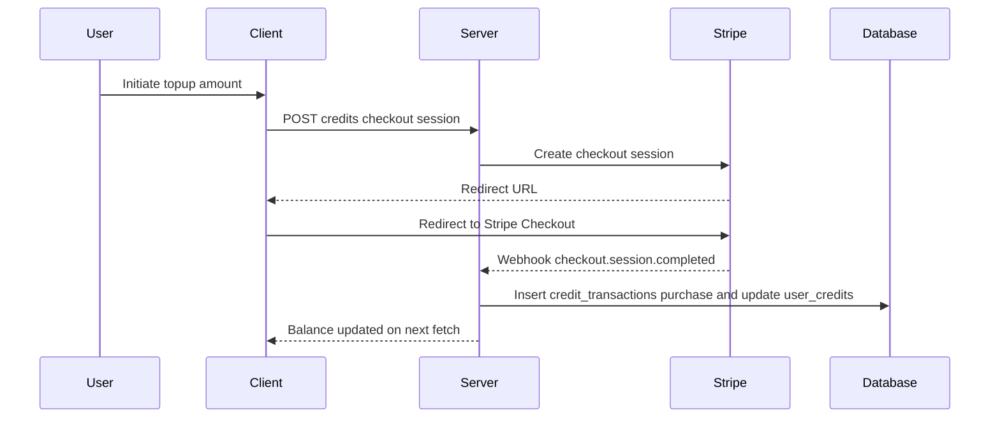
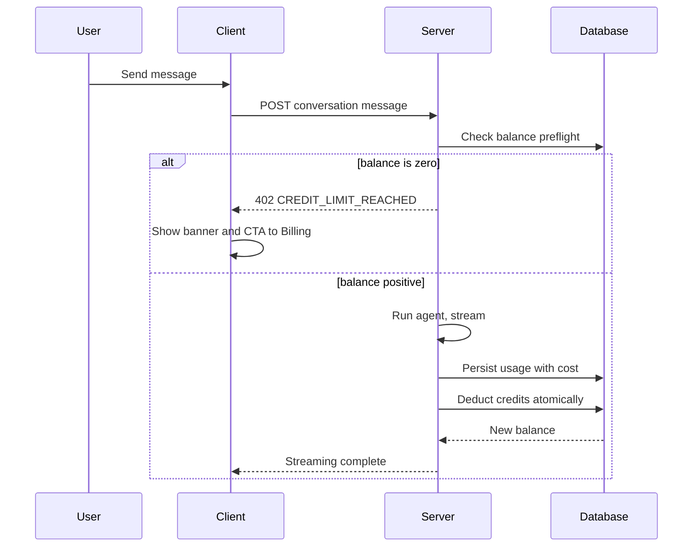

# Credit System Implementation (Aligned to Current DB Schema)

This document specifies a prepaid credit top-up system using Stripe, with real-time deduction against usage.cost and hard enforcement when credits are exhausted. It is aligned with the project's current PostgreSQL schema and conventions.

## TL;DR
- Prepaid credits at 1:1 USD, $20 minimum top-up.
- Real-time deduction at the user level across all starships.
- No expiration for purchased credits; future promo credits may expire.
- Enforce hard stop: when balance is 0, block chat, show banner, link to Profile → Billing.
- Stripe Checkout for purchase, Webhook for crediting balance.

## Alignment With Existing DB Schema
Your current schema (see [packages/models/migrations/000_postgresql_schema.sql](packages/models/migrations/000_postgresql_schema.sql)) uses:
- IDs as `VARCHAR(255)` (application-assigned), not generated UUIDs.
- Timestamps as `TIMESTAMP WITH TIME ZONE` (aka `TIMESTAMPTZ`).
- Monetary/usage precision as `DECIMAL(10,6)` for `usage.cost`.
- Snake_case column names and naming conventions for indexes.

All DDL below follows those patterns.

## New Tables (DDL)
Create a new migration file, e.g. `packages/models/migrations/0xx_credit_system.sql`.

```sql
-- Credits: user-level prepaid balance
CREATE TABLE user_credits (
  id VARCHAR(255) PRIMARY KEY,
  user_id VARCHAR(255) NOT NULL REFERENCES users(id) ON DELETE CASCADE,
  balance DECIMAL(12,6) NOT NULL DEFAULT 0 CHECK (balance >= 0),
  currency VARCHAR(3) NOT NULL DEFAULT 'USD',
  created_at TIMESTAMP WITH TIME ZONE NOT NULL DEFAULT NOW(),
  updated_at TIMESTAMP WITH TIME ZONE NOT NULL DEFAULT NOW(),
  UNIQUE (user_id)
);

-- Credits ledger: immutable transactions
CREATE TABLE credit_transactions (
  id VARCHAR(255) PRIMARY KEY,
  user_id VARCHAR(255) NOT NULL REFERENCES users(id) ON DELETE CASCADE,
  amount DECIMAL(12,6) NOT NULL,
  type VARCHAR(20) NOT NULL CHECK (type IN ('purchase','usage','refund','promo')),
  description TEXT,
  stripe_payment_id VARCHAR(255),
  usage_id VARCHAR(255) REFERENCES usage(id),
  expires_at TIMESTAMP WITH TIME ZONE,
  created_at TIMESTAMP WITH TIME ZONE NOT NULL DEFAULT NOW()
);

-- Indexes
CREATE INDEX idx_user_credits_user_id ON user_credits(user_id);
CREATE INDEX idx_credit_tx_user ON credit_transactions(user_id);
CREATE INDEX idx_credit_tx_created ON credit_transactions(created_at DESC);
CREATE INDEX idx_credit_tx_type ON credit_transactions(type);
CREATE UNIQUE INDEX ux_credit_tx_stripe ON credit_transactions(stripe_payment_id) WHERE stripe_payment_id IS NOT NULL;
```

Notes
- `balance` and `amount` use DECIMAL(12,6) to match usage precision, preventing rounding drift when deducting small costs.
- IDs remain application-assigned (string IDs), consistent with other tables.
- Timestamps use `TIMESTAMPTZ` for consistency.

## Models & Repositories (packages/models)
Add two entities and one repository following existing patterns:

- Entities
  - UserCreditEntity (maps to `user_credits`)
  - CreditTransactionEntity (maps to `credit_transactions`)
  - Validate with class-validator and expose snake_case via [serialization-helper](packages/models/src/helpers/serialization-helper.ts:1)

- Repository
  - CreditRepository with:
    - getBalance(userId)
    - ensureBalanceRow(userId)
    - topup(userId, amount, stripePaymentId)
    - deductIfSufficient(userId, amount) → atomic `UPDATE ... WHERE balance >= $1 RETURNING balance`
    - listTransactions(userId, {limit, offset})

Atomic deduction SQL
```sql
UPDATE user_credits
   SET balance = balance - $1,
       updated_at = NOW()
 WHERE user_id = $2
   AND balance >= $1
RETURNING balance;
```

## Server (packages/server)

### New Routes (billing/credits)
Create `packages/server/src/routes/billing.ts` and register in [server index](packages/server/src/index.ts:84):
- GET    `/api/v1/users/:userId/credits/balance` → { balance, currency }
- GET    `/api/v1/users/:userId/credits/transactions?page&limit`
- POST   `/api/v1/credits/checkout-session` { amount } → { id, url | sessionId }
- POST   `/api/v1/credits/webhook` (Stripe webhook)

Access control
- Use `jwtAuthMiddleware`; only allow users to access their own balances and transactions.

### Stripe Integration
- Server dependency: `stripe` (SDK)
- Env: `STRIPE_SECRET_KEY`, `STRIPE_WEBHOOK_SECRET`
- Create Checkout Session:
  - `mode: payment`
  - `amount: amount * 100`, `currency: 'usd'`
  - `metadata: { userId }`
  - success_url, cancel_url from client domain
- Webhook `checkout.session.completed`:
  - Verify signature
  - Extract `metadata.userId` and `amount_total/100`
  - Call `CreditRepository.topup(userId, amount, session.id)`
  - Idempotency via `ux_credit_tx_stripe` unique index

### Real-Time Deduction (usage hook)
Wire deduction right after usage persistence in [ConversationService.eventCallback](packages/server/src/services/ConversationService.ts:649):
1) Save usage via [UsageService.createUsageForTurn](packages/server/src/services/UsageService.ts:26)
2) Resolve `userId` = starship.ownerId via `getConversationStarship(conversationId)`
3) `ensureBalanceRow(userId)` then `deductIfSufficient(userId, usage.cost, usageId)`
4) If insufficient post-turn, do not interrupt current turn; next turn will be blocked by preflight

### Enforcement: Preflight Guard
In [conversations POST](packages/server/src/routes/conversations.ts:150), before calling `ConversationService.addConversationMessage(...)`:
- Get current balance for `req.user!.id`
- If `balance <= 0`, respond `402 Payment Required` with code `CREDIT_LIMIT_REACHED` and details `{ redirectPath: '/profile?tab=billing' }`

Example
```ts
const userId = req.user!.id;
const credits = await creditService.getBalance(userId);
if (credits <= 0) {
  return sendError(res, 'CREDIT_LIMIT_REACHED', 'Credit limit reached. Please top up to continue.', 402, {
    action: 'GO_TO_BILLING',
    redirectPath: '/profile?tab=billing',
  });
}
```

## Client (packages/client)

### Env & Stripe.js
- Env: `NEXT_PUBLIC_STRIPE_PUBLISHABLE_KEY`
- Dependency: `@stripe/stripe-js`
- Redirect to Checkout using session result from `/api/v1/credits/checkout-session`

### API Client
- Ensure `/api/v1/credits` endpoints are treated as authenticated in [api interceptors](packages/client/src/lib/api.ts:244)
- Update error extractor to read structured errors `{ error: { code, message } }` via [error-utils](packages/client/src/lib/error-utils.ts:21)

### Profile → Billing UI
Extend [profile page](packages/client/src/app/profile/page.tsx:63) to render:
- CreditBalanceCard (calls GET balance)
- CreditTopupForm (buttons: $20/$50/$100 + custom input, min $20 → POST checkout-session → Stripe.js redirect)
- CreditTransactionHistory (paginated)

### Conversation UI Behavior
In [ConversationMessageInput](packages/client/src/components/conversation/ConversationMessageInput.tsx:99):
- If POST returns 402 with code `CREDIT_LIMIT_REACHED`:
  - Show inline banner: "Credit limit reached. Please top up the balance."
  - Disable Send while `balance <= 0`
  - Link to `/profile?tab=billing`
- Optional: prefetch balance to disable proactively

## Error Codes (Shared)
Add `CREDIT_LIMIT_REACHED` to shared error codes (protocol) so both client/server share the type.

## Configuration
- Server env: `STRIPE_SECRET_KEY`, `STRIPE_WEBHOOK_SECRET`, `SERVER_URL`
- Client env: `NEXT_PUBLIC_STRIPE_PUBLISHABLE_KEY`
- Extend env loader/types in `packages/env`

## Observability & Security
- Structured logs for all credit transactions (type, amount, stripe_payment_id, usage_id)
- Stripe signature verification on webhook
- Idempotency on webhook with unique constraint
- Authorization via `jwtAuthMiddleware`

## Testing Plan
- Unit: repository atomic deduction, balance math, webhook idempotency
- Integration: webhook top-up flow, conversations POST 402 path, deduction after `content_complete`
- E2E: Top-up → balance increases → conversation allowed → balance reaches zero → next message blocked and UI banner shown

## Rollout Plan
1) Add migration with `user_credits`, `credit_transactions`
2) Implement entities, repository, and `CreditService`
3) Implement credits routes + Stripe integration; register routes in server index
4) Wire deduction in `ConversationService`
5) Add preflight guard in conversations POST
6) Build Billing UI and wire up Stripe Checkout
7) Add client error handling and banner flow for 402

## Mermaid Diagrams

Top-up Flow


Usage Deduction & Enforcement

