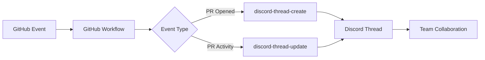

# GitHub-Discord Integration Documentation

## Overview

This integration automatically creates and manages Discord threads for GitHub pull requests, providing real-time synchronization of PR activities to Discord. Each PR gets its own private Discord thread where all activities are tracked and team members can collaborate.

## Features

### Automatic Thread Management
- **Thread Creation**: Private Discord threads are automatically created when PRs are opened
- **Thread Updates**: All PR activities are synced to the Discord thread in real-time
- **Thread Archival**: Threads are automatically archived when PRs are closed/merged
- **Thread Reactivation**: Threads are unarchived when PRs are reopened

### Synchronized Events
The following GitHub events are automatically synced to Discord:

1. **Pull Request Events**
   - PR opened/reopened
   - PR closed/merged
   - PR synchronized (new commits)
   - PR labeled/unlabeled

2. **Review Events**
   - Review submitted (approved, changes requested, commented)
   - Review edited
   - Review dismissed

3. **Comment Events**
   - PR comments created
   - PR comments edited
   - PR comments deleted

4. **CI/CD Events**
   - Workflow runs started
   - Workflow runs completed
   - Build status updates
   - Test results

## Architecture

### Components

```
.github/
├── actions/
│   ├── discord-thread-create/     # Action for creating Discord threads
│   │   ├── action.yml
│   │   ├── index.js
│   │   └── package.json
│   ├── discord-thread-update/     # Action for updating Discord threads
│   │   ├── action.yml
│   │   ├── index.js
│   │   └── package.json
├── scripts/
│   ├── discord-client.js          # Discord.js client wrapper
│   └── state-manager.js           # Thread state persistence
└── workflows/
    └── discord-pr-sync.yml         # Main workflow orchestrating the sync
```

### Data Flow



## Setup Guide

### Prerequisites

1. **Discord Bot Setup**
   - Create a Discord application at https://discord.com/developers/applications
   - Create a bot user and get the bot token
   - Enable the following intents:
     - GUILDS
     - GUILD_MESSAGES
     - MESSAGE_CONTENT
     - GUILD_MEMBERS

2. **Discord Server Setup**
   - Invite the bot to your Discord server with these permissions:
     - Send Messages
     - Create Private Threads
     - Send Messages in Threads
     - Manage Threads
     - Read Message History
     - Add Reactions
     - Use External Emojis
     - Mention Everyone (for role mentions)

3. **GitHub Repository Secrets**
   Configure the following secrets in your GitHub repository:

   | Secret Name | Description | Example |
   |------------|-------------|---------|
   | `DISCORD_BOT_TOKEN` | Discord bot token | `MTEyMzQ1Njc4OTAxMjM0NTY3OA.GAbcde.xxx` |
   | `DISCORD_GUILD_ID` | Discord server ID | `1234567890123456789` |
   | `DISCORD_CHANNEL_ID` | Channel for thread creation | `9876543210987654321` |
   | `DISCORD_DEV_ROLE_ID` | (Optional) Role to auto-invite | `1122334455667788990` |
   | `GITHUB_DISCORD_USER_MAP` | (Optional) GitHub to Discord user mapping | `{"octocat": "123456789012345678"}` |

### Installation

1. **Copy the integration files to your repository**:
   ```bash
   # Copy the entire .github directory structure
   cp -r .github/actions/* your-repo/.github/actions/
   cp -r .github/scripts/* your-repo/.github/scripts/
   cp .github/workflows/discord-pr-sync.yml your-repo/.github/workflows/
   ```

2. **Install dependencies for local development** (optional):
   ```bash
   cd .github/actions/discord-thread-create
   npm install
   
   cd ../discord-thread-update
   npm install
   ```

3. **Configure secrets in GitHub**:
   - Go to Settings → Secrets and variables → Actions
   - Add all required secrets listed above

4. **Test the integration**:
   - Create a test pull request
   - Verify a Discord thread is created
   - Make a comment and verify it appears in Discord

## Configuration

### Workflow Configuration

The main workflow file (`.github/workflows/discord-pr-sync.yml`) can be customized:

```yaml
# Customize which events trigger the sync
on:
  pull_request:
    types: 
      - opened      # Create thread when PR opens
      - reopened    # Reactivate thread when PR reopens
      - closed      # Archive thread when PR closes
      - synchronize # Update on new commits
      # Add more as needed
```

### User Mapping

Map GitHub usernames to Discord user IDs for automatic invitations:

```json
{
  "github-username": "discord-user-id",
  "octocat": "123456789012345678",
  "defunkt": "987654321098765432"
}
```

Store this as the `GITHUB_DISCORD_USER_MAP` secret.

### Thread Naming Convention

Threads are named using the format: `[emoji] PR #[number]: [title]`

Emojis indicate status:
- 🔒 Private thread indicator
- 🔵 Open PR
- ✅ Approved PR
- 🔴 Changes requested
- 🟣 Merged PR
- ❌ Closed PR
- 🚧 Draft PR

## Discord Thread Features

### Embed Messages

Each activity creates a rich embed with:
- **Title**: Event type with emoji indicator
- **Description**: Event details or comment body
- **Color**: Status-based color coding
- **Fields**: Contextual information (author, status, etc.)
- **Timestamp**: When the event occurred
- **Footer**: PR number and source

### Thread Management

- **Auto-archival**: Threads archive after 1 week of inactivity
- **Reactivation**: Threads unarchive on new activity
- **Private threads**: Only invited members can view/participate
- **Role invitations**: Automatically invite team roles

## State Management

The integration uses GitHub Actions artifacts to persist thread state:

```javascript
{
  "123": {  // PR number
    "threadId": "1234567890123456789",
    "threadUrl": "https://discord.com/channels/...",
    "createdAt": "2024-01-01T00:00:00Z",
    "lastUpdated": "2024-01-01T12:00:00Z",
    "lastEvent": "comment"
  }
}
```

### Fallback Mechanisms

1. **GitHub Actions Outputs**: Thread IDs saved as workflow outputs
2. **PR Comments**: Optional visible storage in PR comments
3. **Discord Search**: Searches for existing threads by name

## API Reference

### discord-thread-create Action

**Inputs:**
| Input | Required | Description |
|-------|----------|-------------|
| `discord-token` | Yes | Discord bot token |
| `guild-id` | Yes | Discord server ID |
| `channel-id` | Yes | Channel for thread creation |
| `pr-number` | Yes | Pull request number |
| `pr-title` | Yes | Pull request title |
| `pr-author` | Yes | Pull request author |
| `pr-url` | Yes | Pull request URL |
| `auto-invite-role-id` | No | Role to auto-invite |
| `github-discord-map` | No | User mapping JSON |

**Outputs:**
- `thread-id`: Created Discord thread ID
- `thread-url`: Discord thread URL

### discord-thread-update Action

**Inputs:**
| Input | Required | Description |
|-------|----------|-------------|
| `discord-token` | Yes | Discord bot token |
| `guild-id` | Yes | Discord server ID |
| `channel-id` | Yes | Discord channel ID |
| `pr-number` | Yes | Pull request number |
| `event-type` | Yes | Type of event |
| `event-data` | Yes | JSON event data |
| `status` | No | New PR status |

**Outputs:**
- `success`: Whether update was successful

## Troubleshooting

### Common Issues

1. **Thread not created**
   - Check bot has required permissions
   - Verify channel ID is correct
   - Ensure bot is in the server

2. **Updates not appearing**
   - Check workflow is running (Actions tab)
   - Verify thread exists for the PR
   - Check bot token is valid

3. **Members not invited**
   - Verify Discord user IDs in mapping
   - Check bot has permission to add members
   - Ensure members are in the server

### Debug Mode

Enable debug logging in workflows:

```yaml
env:
  ACTIONS_STEP_DEBUG: true
  ACTIONS_RUNNER_DEBUG: true
```

### Logs

Check logs in:
1. GitHub Actions workflow runs
2. Discord bot console (if self-hosted)
3. Action artifacts for state files

## Security Considerations

1. **Token Security**
   - Never commit Discord tokens
   - Use GitHub secrets for sensitive data
   - Rotate tokens regularly

2. **Permission Scope**
   - Grant minimum required permissions
   - Use private threads for sensitive PRs
   - Limit role auto-invitations

3. **Data Privacy**
   - Thread state stored in GitHub artifacts
   - No sensitive data in public workflows
   - PR content synced as-is to Discord

## Advanced Features

### Custom Event Handlers

Add custom event types in `discord-thread-update/index.js`:

```javascript
case 'custom_event':
  embed = {
    title: 'Custom Event',
    description: eventData.message,
    color: 0x00ff00,
    // ... custom fields
  };
  break;
```

### Webhook Integration

For additional notifications, add webhook support:

```javascript
const webhook = new WebhookClient({ url: WEBHOOK_URL });
await webhook.send({
  content: 'PR Update',
  embeds: [embed]
});
```

### Thread Templates

Create templates for different PR types:

```javascript
const templates = {
  'bug': { emoji: '🐛', color: 0xff0000 },
  'feature': { emoji: '✨', color: 0x00ff00 },
  'hotfix': { emoji: '🚨', color: 0xff9900 }
};
```

## Maintenance

### Regular Tasks

1. **Weekly**
   - Review archived threads
   - Check artifact storage usage
   - Monitor error rates

2. **Monthly**
   - Update dependencies
   - Review permissions
   - Audit user mappings

3. **Quarterly**
   - Rotate bot token
   - Review security settings
   - Update documentation

### Monitoring

Monitor integration health:

```yaml
- name: Health Check
  run: |
    # Check bot connection
    # Verify thread creation
    # Test state persistence
```

## Contributing

### Development Setup

1. Fork the repository
2. Create feature branch
3. Install dependencies
4. Make changes
5. Test locally
6. Submit pull request

### Testing

Test the integration:

```bash
# Unit tests
npm test

# Integration tests
npm run test:integration

# Manual testing
npm run dev
```

## Support

For issues or questions:

1. Check this documentation
2. Review [GitHub Issues](https://github.com/your-repo/issues)
3. Contact the development team
4. Join our Discord server

## License

This integration is provided under the MIT License. See LICENSE file for details.

## Changelog

### Version 1.0.0 (Current)
- Initial release
- Full PR lifecycle support
- Comment synchronization
- Review tracking
- CI status updates
- Label management
- State persistence
- Auto-invitations

### Roadmap
- [ ] Slash commands in Discord
- [ ] Two-way sync (Discord to GitHub)
- [ ] Custom notification rules
- [ ] Thread analytics
- [ ] Bulk operations
- [ ] Archive management
- [ ] Template system