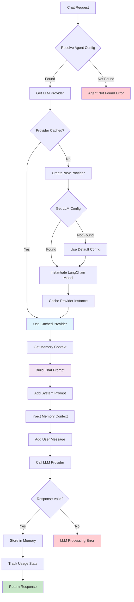
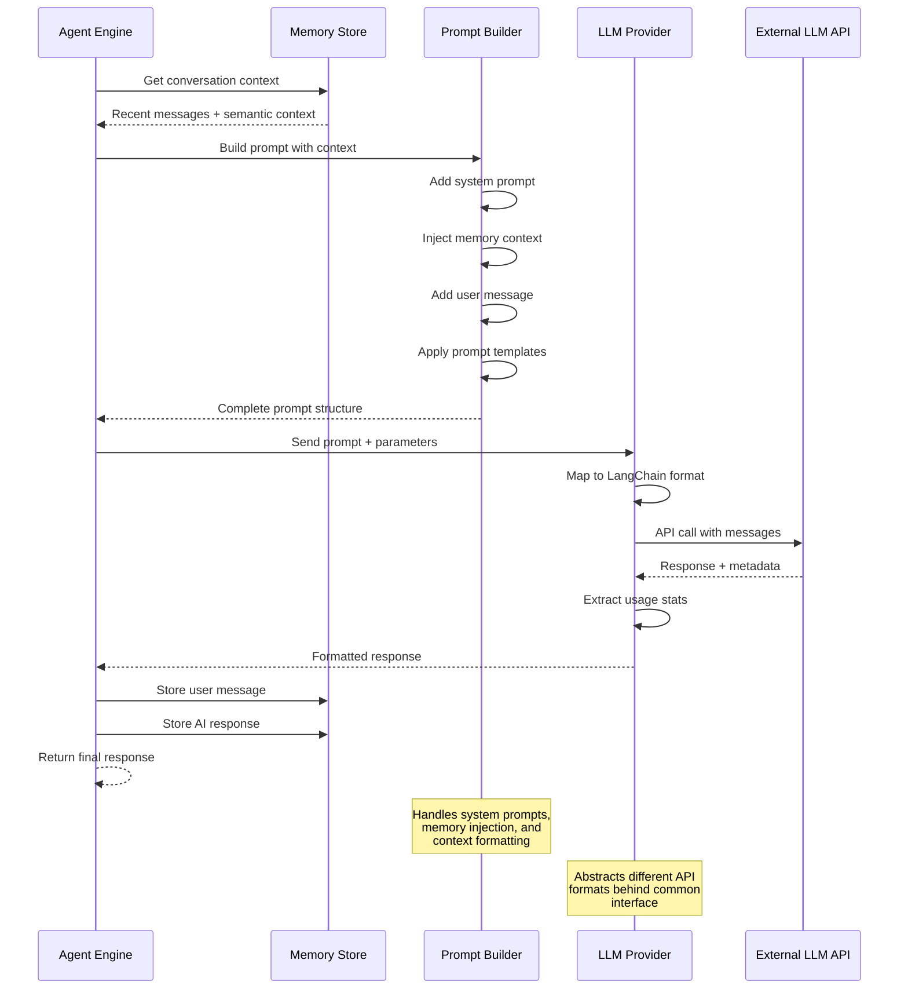

# AI Integration Architecture

## Overview

The Starships.ai AI integration layer abstracts multiple LLM providers behind a common interface, enabling seamless switching between OpenAI, Anthropic, and other providers. The system uses LangChain for workflow orchestration and implements advanced features like prompt engineering, streaming responses, and usage tracking.

## LLM Provider Architecture

```mermaid
graph TB
    subgraph "Provider Abstraction Layer"
        INTERFACE[LLMProvider Interface<br/>├ complete()<br/>├ stream()<br/>└ usage tracking]
    end
    
    subgraph "Provider Implementations"
        LANGCHAIN[LangChainProvider<br/>Universal Adapter]
        
        subgraph "LangChain Models"
            OPENAI_LC[ChatOpenAI<br/>GPT-4, GPT-3.5]
            ANTHROPIC_LC[ChatAnthropic<br/>Claude-3, Claude-2]
            CUSTOM_LC[Custom Models<br/>Extensible]
        end
    end
    
    subgraph "Provider Factory"
        FACTORY[ProviderFactory<br/>├ Cache Management<br/>├ Lazy Loading<br/>├ Fallback Handling<br/>└ Configuration]
    end
    
    subgraph "External Services"
        OPENAI_API[OpenAI API]
        ANTHROPIC_API[Anthropic API]
        EMBEDDINGS[Embedding Services]
    end
    
    subgraph "Configuration Store"
        NEO4J[(Neo4j)<br/>Agent → LLM Config]
        ENV[Environment Variables<br/>API Keys & Defaults]
    end
    
    INTERFACE -.-> LANGCHAIN
    LANGCHAIN --> OPENAI_LC
    LANGCHAIN --> ANTHROPIC_LC
    LANGCHAIN --> CUSTOM_LC
    
    FACTORY --> INTERFACE
    FACTORY --> NEO4J
    FACTORY --> ENV
    
    OPENAI_LC --> OPENAI_API
    ANTHROPIC_LC --> ANTHROPIC_API
    LANGCHAIN --> EMBEDDINGS
    
    style INTERFACE fill:#e3f2fd
    style FACTORY fill:#f3e5f5
    style NEO4J fill:#e8f5e8
    style ENV fill:#fff3e0
```

## Chat Processing Pipeline



## Prompt Engineering Flow



## LLM Provider Abstraction

### Provider Interface
```typescript
export interface LLMProvider {
  complete(prompt: LLMChatPrompt, opts?: { 
    stream?: boolean; 
    temperature?: number; 
    maxTokens?: number; 
  }): Promise<LLMResult>;
}

interface LLMChatPrompt {
  messages: Array<{ 
    role: "system" | "assistant" | "user"; 
    content: string 
  }>;
}

interface LLMResult {
  reply: string;
  usage?: UsageStats;
}

interface UsageStats {
  prompt_tokens: number;
  completion_tokens: number;
}
```

### LangChain Provider Implementation
```typescript
export class LangChainProvider implements LLMProvider {
  private model: ChatOpenAI | ChatAnthropic;

  constructor(llmConfig: LLM) {
    this.model = this.createModel(llmConfig);
  }

  private createModel(config: LLM): ChatOpenAI | ChatAnthropic {
    switch (config.provider) {
      case 'openai':
        return new ChatOpenAI({
          model: config.name,
          apiKey: process.env.OPENAI_API_KEY,
          temperature: config.temperature || 0.7,
          maxTokens: config.maxTokens || 4096,
        });
      
      case 'anthropic':
        return new ChatAnthropic({
          model: config.name,
          apiKey: process.env.ANTHROPIC_API_KEY,
          temperature: config.temperature || 0.7,
          maxTokens: config.maxTokens || 4096,
        });
      
      default:
        throw new Error(`Unsupported provider: ${config.provider}`);
    }
  }

  async complete(
    prompt: LLMChatPrompt, 
    opts?: { stream?: boolean; temperature?: number; maxTokens?: number }
  ): Promise<LLMResult> {
    // Runtime option overrides
    let modelToUse = this.model;
    if (opts?.temperature !== undefined || opts?.maxTokens !== undefined) {
      const runtimeOptions: any = {};
      if (opts.temperature !== undefined) runtimeOptions.temperature = opts.temperature;
      if (opts.maxTokens !== undefined) runtimeOptions.maxTokens = opts.maxTokens;
      
      if (this.model instanceof ChatOpenAI) {
        modelToUse = new ChatOpenAI({
          ...this.model.toJSON(),
          ...runtimeOptions,
        });
      } else if (this.model instanceof ChatAnthropic) {
        modelToUse = new ChatAnthropic({
          ...this.model.toJSON(),
          ...runtimeOptions,
        });
      }
    }

    // Map message format to LangChain message types
    const messages = prompt.messages.map(msg => {
      switch (msg.role) {
        case 'system':
          return new SystemMessage(msg.content);
        case 'user':
          return new HumanMessage(msg.content);
        case 'assistant':
          return new AIMessage(msg.content);
        default:
          throw new Error(`Unknown message role: ${msg.role}`);
      }
    });
    
    // Invoke model
    const result = await modelToUse.invoke(messages);
    
    // Extract usage information if available
    const usage = result.response_metadata?.usage ? {
      prompt_tokens: result.response_metadata.usage.prompt_tokens || 0,
      completion_tokens: result.response_metadata.usage.completion_tokens || 0,
    } : undefined;

    return {
      reply: result.content as string,
      usage
    };
  }
}
```

## Provider Factory Pattern

### Factory Implementation
```typescript
export class ProviderFactory {
  private static providers = new Map<string, LLMProvider>();
  private static agentRepository: AgentRepository;
  private static llmRepository: LLMRepository;

  static initialize(agentRepo: AgentRepository, llmRepo: LLMRepository) {
    this.agentRepository = agentRepo;
    this.llmRepository = llmRepo;
  }

  static async getProvider(agentId: string): Promise<LLMProvider> {
    // Check cache first
    if (this.providers.has(agentId)) {
      return this.providers.get(agentId)!;
    }

    try {
      // Get agent from repository
      const agent = await this.agentRepository.findById(agentId);
      if (!agent) {
        throw new Error(`Agent not found: ${agentId}`);
      }

      // Get LLM config
      const llm = await this.llmRepository.findById(agent.model);
      if (!llm) {
        // Fallback to default model from environment
        const defaultModel = {
          id: process.env.DEFAULT_MODEL_ID || 'default-openai-gpt4',
          name: process.env.DEFAULT_CHAT_MODEL || 'gpt-4',
          provider: (process.env.DEFAULT_PROVIDER as 'openai' | 'anthropic') || 'openai',
          temperature: parseFloat(process.env.DEFAULT_TEMPERATURE || '0.7'),
          maxTokens: parseInt(process.env.DEFAULT_MAX_TOKENS || '4096', 10),
        };
        
        const provider = new LangChainProvider(defaultModel);
        this.providers.set(agentId, provider);
        return provider;
      }

      // Create LangChain provider instance
      const provider = new LangChainProvider(llm);
      
      // Cache and return
      this.providers.set(agentId, provider);
      return provider;
    } catch (error) {
      throw new Error(`Failed to get provider for agent ${agentId}: ${error instanceof Error ? error.message : 'Unknown error'}`);
    }
  }

  static clearCache(agentId?: string) {
    if (agentId) {
      this.providers.delete(agentId);
    } else {
      this.providers.clear();
    }
  }
}
```

### Factory Benefits
- **Caching**: Providers cached per agent for performance
- **Lazy Loading**: Providers created only when needed
- **Fallback Handling**: Graceful degradation to environment defaults
- **Dynamic Configuration**: Runtime provider switching support

## Prompt Engineering

### Prompt Builder Implementation
```typescript
export function buildPrompt(
  systemPrompt: string | undefined, 
  memory: MemoryEntry[], 
  userMessage: string, 
  relevantContext: string = ""
) {
  const messages = [] as Array<{ 
    role: "system" | "assistant" | "user"; 
    content: string 
  }>;
  
  let finalSystemPrompt = systemPrompt || "";
  if (relevantContext) {
    finalSystemPrompt += `\n\nRelevant context from conversation history:\n${relevantContext}`;
  }
  
  if (finalSystemPrompt) {
    messages.push({ role: "system", content: finalSystemPrompt });
  }
  
  // Flatten memory into chat format
  memory.forEach((m) => messages.push({ 
    role: m.role, 
    content: m.content 
  }));
  
  messages.push({ role: "user", content: userMessage });
  return { messages };
}
```

### Advanced Prompt Patterns

#### Context Injection
```typescript
function injectContext(
  systemPrompt: string,
  contextData: {
    userProfile?: UserProfile;
    channelInfo?: ChannelInfo;
    relevantMemories?: MemoryEntry[];
    knowledgeBase?: KnowledgeEntry[];
  }
): string {
  let enhancedPrompt = systemPrompt;
  
  if (contextData.userProfile) {
    enhancedPrompt += `\n\nUser Context:\n`;
    enhancedPrompt += `- Name: ${contextData.userProfile.name}\n`;
    enhancedPrompt += `- Preferences: ${contextData.userProfile.preferences}\n`;
  }
  
  if (contextData.channelInfo) {
    enhancedPrompt += `\n\nChannel Context:\n`;
    enhancedPrompt += `- Channel: ${contextData.channelInfo.name}\n`;
    enhancedPrompt += `- Topic: ${contextData.channelInfo.topic}\n`;
  }
  
  if (contextData.relevantMemories?.length) {
    enhancedPrompt += `\n\nRelevant Conversation History:\n`;
    contextData.relevantMemories.forEach(memory => {
      enhancedPrompt += `${memory.role}: ${memory.content}\n`;
    });
  }
  
  return enhancedPrompt;
}
```

#### Dynamic Personality Injection
```typescript
function adaptPersonality(
  basePrompt: string,
  context: {
    timeOfDay?: 'morning' | 'afternoon' | 'evening' | 'night';
    userMood?: 'happy' | 'sad' | 'excited' | 'frustrated';
    conversationLength?: number;
  }
): string {
  let adaptedPrompt = basePrompt;
  
  // Time-based adaptation
  if (context.timeOfDay === 'morning') {
    adaptedPrompt += "\n\nSpeak with morning energy and enthusiasm.";
  } else if (context.timeOfDay === 'night') {
    adaptedPrompt += "\n\nAdopt a calm, relaxed tone suitable for evening conversation.";
  }
  
  // Mood adaptation
  if (context.userMood === 'frustrated') {
    adaptedPrompt += "\n\nBe extra patient and supportive. Focus on problem-solving.";
  } else if (context.userMood === 'excited') {
    adaptedPrompt += "\n\nMatch the user's enthusiasm while staying helpful.";
  }
  
  // Conversation length adaptation
  if (context.conversationLength && context.conversationLength > 20) {
    adaptedPrompt += "\n\nKeep responses concise as this is an extended conversation.";
  }
  
  return adaptedPrompt;
}
```

## Agent Management

### Agent Configuration
```typescript
interface AgentConfig {
  id: string;
  name: string;
  model: string;
  provider?: 'openai' | 'anthropic';
  systemPrompt?: string;
  temperature?: number;
  maxTokens?: number;
  capabilities?: AgentCapability[];
}

interface AgentCapability {
  type: 'function_calling' | 'image_generation' | 'web_search' | 'code_execution';
  enabled: boolean;
  config?: any;
}
```

### Agent Service Layer
```typescript
export class AgentService {
  private static isInitialized = false;

  static async initialize(): Promise<void> {
    if (this.isInitialized) {
      return;
    }

    const config: Neo4jConfig = {
      uri: process.env.NEO4J_URI || '[NEO4J-LOCAL-URL]',
      username: process.env.NEO4J_USERNAME || 'neo4j',
      [DEFAULT-PASSWORD]: process.env.NEO4J_PASSWORD || '[DEFAULT-PASSWORD]',
      database: process.env.NEO4J_DATABASE || 'neo4j'
    };

    const connection = createConnection(config);
    await connection.connect();
    await connection.initializeSchema();
    
    // Seed with default agents if none exist
    await this.seedDefaultAgents();
    
    this.isInitialized = true;
  }

  static async createAgent(config: Omit<AgentConfig, 'id'>): Promise<AgentConfig> {
    await this.initialize();
    
    const agentRepo = RepositoryFactory.getAgentRepository();
    const agent = await agentRepo.create(config);
    
    return this.convertToAgentConfig(agent);
  }

  private static async seedDefaultAgents(): Promise<void> {
    const agentRepo = RepositoryFactory.getAgentRepository();
    const existingAgents = await agentRepo.findAll();
    
    if (existingAgents.length > 0) {
      return; // Already seeded
    }

    // Default agents using environment configuration
    const defaultAgents = [
      {
        name: 'Assistant',
        model: env.DEFAULT_CHAT_MODEL,
        systemPrompt: 'You are a helpful AI assistant.'
      },
      {
        name: 'Code Helper',
        model: env.DEFAULT_CHAT_MODEL,
        systemPrompt: 'You are an expert software developer who helps with coding questions and provides clean, efficient solutions.'
      },
      {
        name: 'Creative Writer',
        model: env.DEFAULT_CHAT_MODEL,
        systemPrompt: 'You are a creative writing assistant who helps with storytelling, character development, and creative content.'
      }
    ];

    for (const agentData of defaultAgents) {
      await agentRepo.create(agentData);
    }
  }
}
```

## Chat Processing Flow

### Main Chat Function
```typescript
export async function chat(req: ChatRequest, store: LangChainMemoryStore): Promise<ChatResponse> {
  // Initialize provider factory if not already done
  const agentRepo = RepositoryFactory.getAgentRepository();
  const llmRepo = RepositoryFactory.getLLMRepository();
  ProviderFactory.initialize(agentRepo, llmRepo);
  
  // Get agent from repository
  const agent = await agentRepo.findById(req.agent_id);
  
  if (!agent) {
    throw new Error(`Agent ${req.agent_id} not found`);
  }

  const sessionKey = store.makeKey(req.agent_id, req.user_id, req.channel_id);
  const memory = await store.get(sessionKey);

  // Semantic search for relevant context when memory is large
  let relevantContext = "";
  if (memory.length > 10) {
    const searchResult = await store.semanticSearch(sessionKey, req.message, 5);
    if (searchResult.entries.length > 0) {
      relevantContext = searchResult.entries
        .map(entry => `${entry.role}: ${entry.content}`)
        .join('\n');
    }
  }

  const prompt = buildPrompt(agent.systemPrompt, memory, req.message, relevantContext);
  
  // Get provider and complete request
  const provider = await ProviderFactory.getProvider(req.agent_id);
  
  // Get LLM config for temperature and maxTokens
  const llm = await llmRepo.findById(agent.model);
  const opts = {
    stream: req.stream,
    temperature: llm?.temperature,
    maxTokens: llm?.maxTokens,
  };
  
  const result = await provider.complete(prompt, opts);

  // Persist memory
  const userTimestamp = Date.now();
  await store.append(sessionKey, { 
    role: "user", 
    content: req.message, 
    timestamp: userTimestamp 
  } as MemoryEntry);
  
  const assistantTimestamp = Date.now();
  await store.append(sessionKey, { 
    role: "assistant", 
    content: result.reply, 
    timestamp: assistantTimestamp 
  } as MemoryEntry);

  return { reply: result.reply, usage: result.usage };
}
```

### Error Handling in Chat Flow
```typescript
async function safeChatExecution(
  req: ChatRequest, 
  store: LangChainMemoryStore
): Promise<ChatResponse> {
  try {
    return await chat(req, store);
  } catch (error) {
    // Log error for debugging
    console.error('Chat execution failed:', {
      agentId: req.agent_id,
      userId: req.user_id,
      error: error instanceof Error ? error.message : 'Unknown error'
    });
    
    // Provider-specific error handling
    if (error instanceof Error) {
      if (error.message.includes('API key')) {
        throw new Error('AI service configuration error. Please contact support.');
      } else if (error.message.includes('rate limit')) {
        throw new Error('Service temporarily unavailable. Please try again in a moment.');
      } else if (error.message.includes('not found')) {
        throw new Error('Agent configuration not found. Please check agent ID.');
      }
    }
    
    // Generic fallback
    throw new Error('An unexpected error occurred. Please try again.');
  }
}
```

## Advanced Features

### Streaming Responses (Future)
```typescript
interface StreamingProvider extends LLMProvider {
  streamComplete(
    prompt: LLMChatPrompt, 
    opts?: StreamingOptions
  ): AsyncGenerator<StreamChunk, StreamComplete>;
}

interface StreamChunk {
  type: 'chunk';
  content: string;
  timestamp: number;
}

interface StreamComplete {
  type: 'complete';
  usage?: UsageStats;
  finishReason: 'stop' | 'length' | 'function_call';
}

// Implementation
async function* streamChat(
  req: ChatRequest, 
  store: LangChainMemoryStore
): AsyncGenerator<StreamChunk, StreamComplete> {
  const provider = await ProviderFactory.getProvider(req.agent_id) as StreamingProvider;
  
  let fullResponse = '';
  
  for await (const chunk of provider.streamComplete(prompt, { stream: true })) {
    if (chunk.type === 'chunk') {
      fullResponse += chunk.content;
      yield chunk;
    } else {
      // Persist complete response to memory
      await store.append(sessionKey, {
        role: 'assistant',
        content: fullResponse,
        timestamp: Date.now()
      });
      
      return chunk;
    }
  }
}
```

### Function Calling Support
```typescript
interface FunctionDefinition {
  name: string;
  description: string;
  parameters: {
    type: 'object';
    properties: Record<string, {
      type: string;
      description: string;
      enum?: string[];
    }>;
    required: string[];
  };
}

interface AgentWithFunctions extends AgentConfig {
  functions?: FunctionDefinition[];
  functionCallStrategy?: 'auto' | 'none' | string;
}

// Function execution
async function executeFunctionCall(
  functionName: string,
  args: any,
  context: ChatContext
): Promise<any> {
  const functions = {
    'get_weather': async (args: { location: string }) => {
      // Implementation for weather lookup
      return { temperature: 72, condition: 'sunny' };
    },
    
    'search_web': async (args: { query: string }) => {
      // Implementation for web search
      return { results: ['result1', 'result2'] };
    },
    
    'generate_image': async (args: { prompt: string }) => {
      // Implementation for image generation
      return { imageUrl: 'https://example.com/image.png' };
    }
  };
  
  const fn = functions[functionName as keyof typeof functions];
  if (!fn) {
    throw new Error(`Unknown function: ${functionName}`);
  }
  
  return await fn(args);
}
```

### Multi-Modal Support
```typescript
interface MultiModalMessage {
  role: 'user' | 'assistant' | 'system';
  content: (TextContent | ImageContent | AudioContent)[];
}

interface TextContent {
  type: 'text';
  text: string;
}

interface ImageContent {
  type: 'image';
  imageUrl: string;
  detail?: 'low' | 'high';
}

interface AudioContent {
  type: 'audio';
  audioUrl: string;
  transcript?: string;
}

// Multi-modal provider extension
class MultiModalProvider extends LangChainProvider {
  async completeMultiModal(
    messages: MultiModalMessage[],
    opts?: CompletionOptions
  ): Promise<LLMResult> {
    // Convert multi-modal messages to provider-specific format
    const convertedMessages = await this.convertToProviderFormat(messages);
    
    // Execute with multi-modal support
    return await this.executeMultiModal(convertedMessages, opts);
  }
  
  private async convertToProviderFormat(messages: MultiModalMessage[]): Promise<any[]> {
    return messages.map(msg => ({
      role: msg.role,
      content: msg.content.map(content => {
        switch (content.type) {
          case 'text':
            return { type: 'text', text: content.text };
          case 'image':
            return { 
              type: 'image_url', 
              image_url: { 
                url: content.imageUrl,
                detail: content.detail || 'auto'
              }
            };
          case 'audio':
            return {
              type: 'audio',
              audio_url: content.audioUrl
            };
        }
      })
    }));
  }
}
```

## Performance Optimization

### Provider Caching Strategy
```typescript
class OptimizedProviderFactory extends ProviderFactory {
  private static providerMetrics = new Map<string, ProviderMetrics>();
  
  static async getProvider(agentId: string): Promise<LLMProvider> {
    const startTime = Date.now();
    
    try {
      const provider = await super.getProvider(agentId);
      
      // Update metrics
      this.updateMetrics(agentId, {
        lastAccess: Date.now(),
        accessCount: this.getMetrics(agentId).accessCount + 1,
        averageResponseTime: this.calculateAverageResponseTime(agentId, startTime)
      });
      
      return provider;
    } catch (error) {
      this.updateMetrics(agentId, {
        errorCount: this.getMetrics(agentId).errorCount + 1
      });
      throw error;
    }
  }
  
  private static updateMetrics(agentId: string, updates: Partial<ProviderMetrics>) {
    const current = this.providerMetrics.get(agentId) || {
      accessCount: 0,
      errorCount: 0,
      averageResponseTime: 0,
      lastAccess: 0
    };
    
    this.providerMetrics.set(agentId, { ...current, ...updates });
  }
}

interface ProviderMetrics {
  accessCount: number;
  errorCount: number;
  averageResponseTime: number;
  lastAccess: number;
}
```

### Request Batching
```typescript
class BatchProcessor {
  private pendingRequests: Map<string, ChatRequest[]> = new Map();
  private batchTimeout: number = 100; // ms
  
  async processBatch(agentId: string, request: ChatRequest): Promise<ChatResponse> {
    return new Promise((resolve, reject) => {
      // Add to batch
      if (!this.pendingRequests.has(agentId)) {
        this.pendingRequests.set(agentId, []);
        
        // Schedule batch processing
        setTimeout(() => {
          this.executeBatch(agentId);
        }, this.batchTimeout);
      }
      
      this.pendingRequests.get(agentId)!.push({
        ...request,
        resolve,
        reject
      });
    });
  }
  
  private async executeBatch(agentId: string) {
    const requests = this.pendingRequests.get(agentId) || [];
    this.pendingRequests.delete(agentId);
    
    const provider = await ProviderFactory.getProvider(agentId);
    
    // Execute requests in parallel
    const promises = requests.map(req => 
      this.executeRequest(provider, req).catch(error => ({ error }))
    );
    
    const results = await Promise.all(promises);
    
    // Resolve/reject individual requests
    results.forEach((result, index) => {
      const request = requests[index];
      if ('error' in result) {
        request.reject(result.error);
      } else {
        request.resolve(result);
      }
    });
  }
}
```

## Configuration Management

### Environment-based Configuration
```typescript
interface AIConfiguration {
  // Provider settings
  defaultProvider: 'openai' | 'anthropic';
  fallbackProvider?: 'openai' | 'anthropic';
  
  // Model defaults
  defaultChatModel: string;
  defaultEmbeddingModel: string;
  defaultTemperature: number;
  defaultMaxTokens: number;
  
  // Performance settings
  providerCacheSize: number;
  requestTimeout: number;
  retryAttempts: number;
  
  // Feature flags
  enableFunctionCalling: boolean;
  enableStreaming: boolean;
  enableMultiModal: boolean;
}

export const aiConfig: AIConfiguration = {
  defaultProvider: (process.env.DEFAULT_PROVIDER as 'openai' | 'anthropic') || 'openai',
  fallbackProvider: process.env.FALLBACK_PROVIDER as 'openai' | 'anthropic',
  
  defaultChatModel: process.env.DEFAULT_CHAT_MODEL || 'gpt-4',
  defaultEmbeddingModel: process.env.DEFAULT_EMBEDDING_MODEL || 'text-embedding-3-small',
  defaultTemperature: parseFloat(process.env.DEFAULT_TEMPERATURE || '0.7'),
  defaultMaxTokens: parseInt(process.env.DEFAULT_MAX_TOKENS || '4096', 10),
  
  providerCacheSize: parseInt(process.env.PROVIDER_CACHE_SIZE || '100', 10),
  requestTimeout: parseInt(process.env.REQUEST_TIMEOUT || '30000', 10),
  retryAttempts: parseInt(process.env.RETRY_ATTEMPTS || '3', 10),
  
  enableFunctionCalling: process.env.ENABLE_FUNCTION_CALLING === 'true',
  enableStreaming: process.env.ENABLE_STREAMING === 'true',
  enableMultiModal: process.env.ENABLE_MULTIMODAL === 'true',
};
```

### Provider-specific Configuration
```typescript
interface ProviderConfig {
  openai: {
    apiKey: string;
    baseURL?: string;
    organization?: string;
    models: {
      chat: string[];
      embedding: string[];
      image?: string[];
    };
    limits: {
      requestsPerMinute: number;
      tokensPerMinute: number;
    };
  };
  
  anthropic: {
    apiKey: string;
    baseURL?: string;
    models: {
      chat: string[];
    };
    limits: {
      requestsPerMinute: number;
      tokensPerMinute: number;
    };
  };
}

export const providerConfigs: ProviderConfig = {
  openai: {
    apiKey: process.env.OPENAI_API_KEY!,
    baseURL: process.env.OPENAI_BASE_URL,
    organization: process.env.OPENAI_ORGANIZATION,
    models: {
      chat: ['gpt-4', 'gpt-3.5-turbo', 'gpt-4-turbo'],
      embedding: ['text-embedding-3-small', 'text-embedding-3-large'],
      image: ['dall-e-3', 'dall-e-2']
    },
    limits: {
      requestsPerMinute: 500,
      tokensPerMinute: 10000
    }
  },
  
  anthropic: {
    apiKey: process.env.ANTHROPIC_API_KEY!,
    baseURL: process.env.ANTHROPIC_BASE_URL,
    models: {
      chat: ['claude-3-sonnet', 'claude-3-haiku', 'claude-3-opus']
    },
    limits: {
      requestsPerMinute: 100,
      tokensPerMinute: 5000
    }
  }
};
``` 