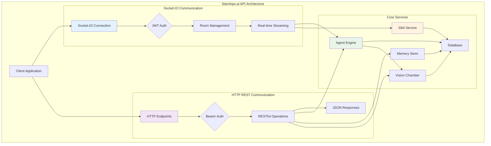
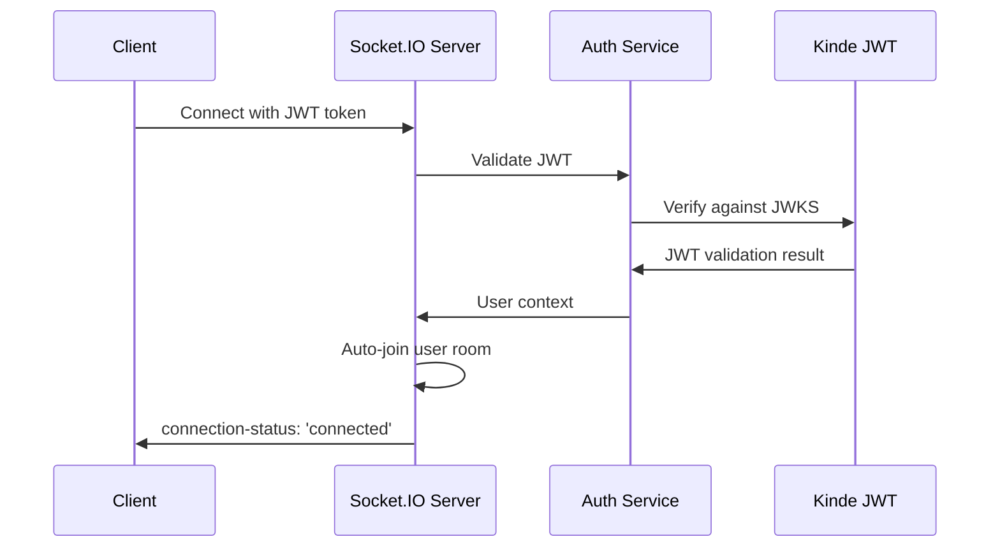
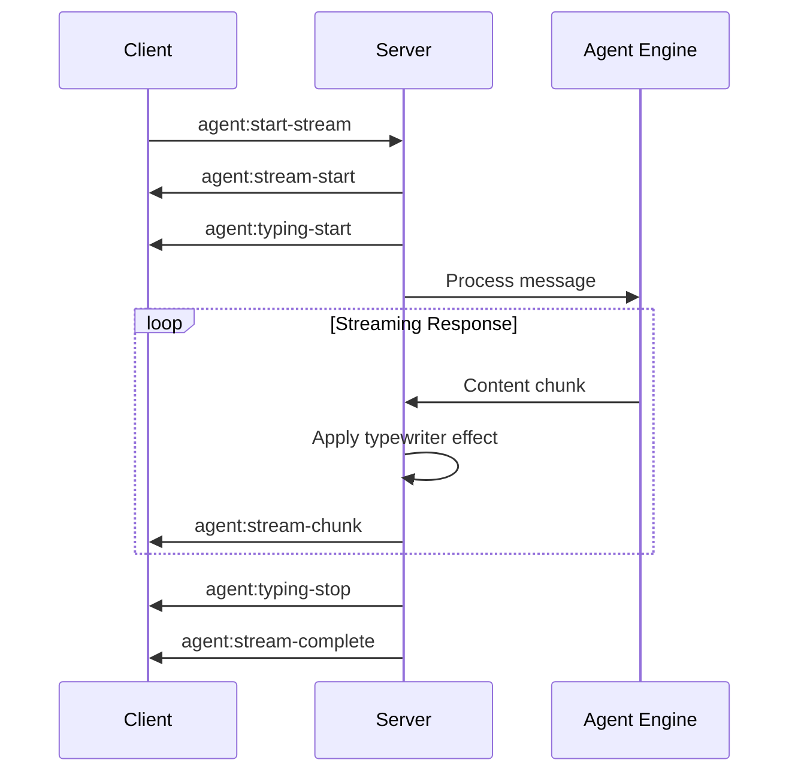
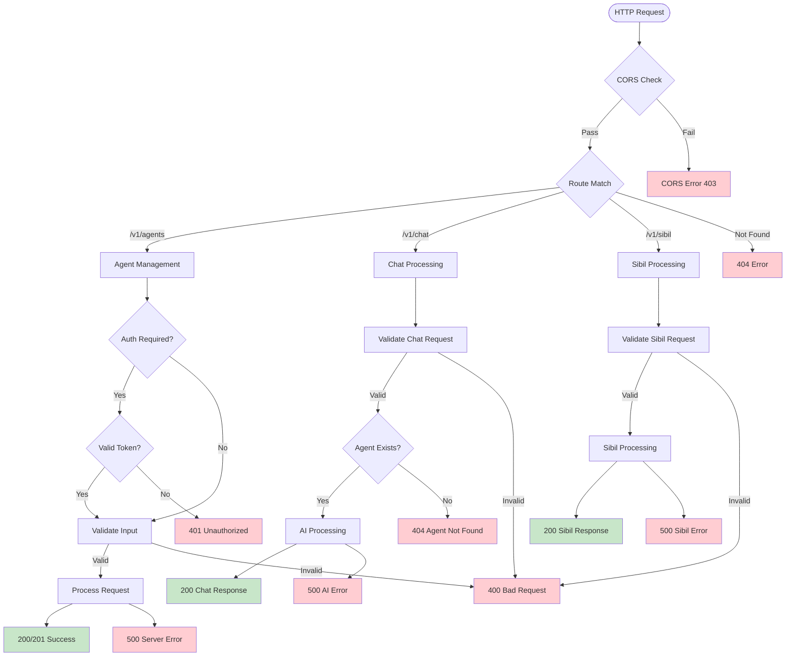

# API Design Documentation

## Overview

The Starships.ai API provides two primary communication methods: **Socket.IO real-time communication** and **HTTP REST endpoints**. Both methods offer full access to the platform's capabilities, allowing developers to choose the approach that best fits their use case.

The API architecture integrates seamlessly with the **Vision Chamber** consciousness management system, enabling constraint-based agent behavior guidance across all communication methods. For detailed consciousness management patterns, see [`vision-chamber-architecture.md`](vision-chamber-architecture.md).

## Communication Methods

### Socket.IO Real-time Communication
- **Best for**: Interactive applications, real-time streaming, typewriter effects
- **Features**: WebSocket connections, room-based sessions, live streaming, typing indicators
- **Authentication**: JWT tokens via Socket.IO handshake
- **Supported Operations**: Agent chat, Sibil chat, real-time streaming

### HTTP REST API
- **Best for**: Simple integrations, batch operations, stateless interactions
- **Features**: RESTful endpoints, JSON responses, standard HTTP methods
- **Authentication**: Bearer tokens, public endpoints
- **Supported Operations**: Agent CRUD, basic chat, memory management

## Architecture Overview



---

# Socket.IO Real-time Communication

## Overview

Socket.IO provides real-time, bidirectional communication with advanced features like room-based sessions, streaming responses, and typewriter effects.

## Connection and Authentication

### Establishing Connection

```typescript
import { io } from 'socket.io-client';

const socket = io('https://api.starships.ai', {
  auth: { token: jwtToken },
  transports: ['websocket', 'polling']
});
```

### Authentication Flow



### Connection State Management

```typescript
interface SocketConnectionState {
  connected: boolean;
  authenticated: boolean;
  room_joined: boolean;
  user_id?: string;
  connection_id?: string;
  last_ping?: number;
}
```

## Room-based Session Management

### Room Architecture

The Socket.IO implementation uses structured rooms for session isolation:

#### User Rooms
- **Format**: `user:${userId}`
- **Purpose**: Personal communication channel
- **Auto-join**: Automatic on connection
- **Usage**: General notifications, status updates

#### Agent Rooms
- **Format**: `agent:${agentId}:${userId}`
- **Purpose**: Agent-specific chat sessions
- **Dynamic**: Created when joining agent conversations
- **Isolation**: Each user-agent pair has separate context

### Room Management

```typescript
// Join agent room
socket.emit('agent:join-room', userId, agentId);

// Leave agent room
socket.emit('agent:leave-room', userId, agentId);

// Join sibil room
socket.emit('sibil:join-room', userId);

// Leave sibil room
socket.emit('sibil:leave-room', userId);
```

## Real-time Streaming

### Agent Chat Streaming

#### Stream Request
```typescript
interface AgentSocketRequest {
  agent_id: string;
  session_id: string;
  message: string;
  stream_id: string;
  typewriter_enabled?: boolean;
  typing_speed?: number; // chars per second (default: 75)
  user_id: string; // From auth context
}

// Start streaming
socket.emit('agent:start-stream', request);
```

#### Stream Response Flow


#### Event Handling
```typescript
// Stream events
socket.on('agent:stream-start', (streamId, agentId) => {
  console.log('Stream started:', streamId);
});

socket.on('agent:stream-chunk', (chunk: AgentSocketStreamChunk) => {
  if (chunk.typewriter?.type === 'character') {
    accumulatedContent += chunk.typewriter.content;
    updateUI(accumulatedContent);
  }
});

socket.on('agent:stream-complete', (response: AgentChatResponse) => {
  finalizeMessage(response);
});

socket.on('agent:stream-error', (error: AgentStreamError) => {
  handleError(error);
});
```

### Sibil Chat Streaming

#### Stream Request
```typescript
interface SibilSocketRequest {
  provider: 'openai' | 'anthropic';
  model?: string;
  message: string;
  user_id: string;
  session_id?: string;
  stream_id: string;
  typewriter_enabled?: boolean;
  typing_speed?: number;
}

// Start streaming
socket.emit('sibil:start-stream', request);
```

#### Advanced Content Handling
```typescript
interface SibilSocketStreamChunk {
  stream_id: string;
  type: 'content' | 'structured' | 'complete' | 'error';
  content?: string;
  structured_content?: ContentBlock[];
  typewriter?: TypewriterChunk;
  timestamp: number;
}
```

## Typewriter Effects

### Configuration
```typescript
interface TypewriterChunk {
  type: 'character' | 'word' | 'line' | 'complete';
  content: string;
  position: number;
  total_length?: number;
  delay?: number; // milliseconds
  is_code?: boolean;
  is_markdown?: boolean;
}
```

### Features
- **Speed Control**: Configurable characters per second
- **Content Detection**: Automatic code/markdown detection
- **Position Tracking**: Character position within response
- **Smart Formatting**: Context-aware content rendering

## Socket.IO Event Reference

### Agent Events

| Event | Direction | Description |
|-------|-----------|-------------|
| `agent:start-stream` | Client → Server | Start agent chat stream |
| `agent:stop-stream` | Client → Server | Stop active stream |
| `agent:join-room` | Client → Server | Join agent room |
| `agent:leave-room` | Client → Server | Leave agent room |
| `agent:stream-start` | Server → Client | Stream initiation confirmed |
| `agent:stream-chunk` | Server → Client | Streaming content chunk |
| `agent:stream-complete` | Server → Client | Stream completion |
| `agent:stream-error` | Server → Client | Stream error |
| `agent:typing-start` | Server → Client | Typing indicator start |
| `agent:typing-stop` | Server → Client | Typing indicator stop |

### Sibil Events

| Event | Direction | Description |
|-------|-----------|-------------|
| `sibil:start-stream` | Client → Server | Start Sibil chat stream |
| `sibil:stop-stream` | Client → Server | Stop active stream |
| `sibil:join-room` | Client → Server | Join Sibil room |
| `sibil:leave-room` | Client → Server | Leave Sibil room |
| `sibil:stream-start` | Server → Client | Stream initiation confirmed |
| `sibil:stream-chunk` | Server → Client | Streaming content chunk |
| `sibil:stream-complete` | Server → Client | Stream completion |
| `sibil:stream-error` | Server → Client | Stream error |
| `sibil:typing-start` | Server → Client | Typing indicator start |
| `sibil:typing-stop` | Server → Client | Typing indicator stop |

### Common Events

| Event | Direction | Description |
|-------|-----------|-------------|
| `connection-status` | Server → Client | Connection state updates |

## Error Handling

### Error Types
```typescript
interface StreamError {
  stream_id?: string;
  error_code: 'INVALID_REQUEST' | 'AGENT_NOT_FOUND' | 'SERVER_ERROR';
  message: string;
  timestamp: number;
  recoverable: boolean;
}
```

### Reconnection Strategy
- **Max Attempts**: 5 with exponential backoff
- **Initial Delay**: 1 second
- **Backoff Multiplier**: 2x per attempt
- **Auto-recovery**: Room re-joining on reconnection

## Client Integration Example

```typescript
import SocketClient from '@/lib/socket-client';
import { agentSocketAPI } from '@/lib/agent-socket-api';

// Initialize connection
const socketClient = SocketClient.getInstance();
await socketClient.connect(jwtToken, userId);

// Agent streaming
const { abort } = agentSocketAPI.sendMessageStream(
  agentId,
  { sessionId, message },
  {
    onChunk: (chunk, accumulated) => {
      updateUI(accumulated);
    },
    onComplete: (message) => {
      finalizeMessage(message);
    },
    onError: (error) => {
      handleError(error);
    }
  }
);

// Abort stream if needed
// abort();
```

---

# HTTP REST API

## Overview

The HTTP REST API provides traditional request-response communication with full CRUD operations for agents and basic chat functionality.

## Base URL Structure

```
https://api.starships.ai/v1/
```

## Authentication

### Bearer Token Authentication
Administrative endpoints require Bearer token authentication:

```http
Authorization: Bearer <REDEPLOY_SECRET>
```

### JWT Authentication
Some endpoints support JWT authentication:

```http
Authorization: Bearer <JWT_TOKEN>
```

### Public Endpoints
- All `/v1/*` endpoints are public and do not require authentication
- Rate limiting and access control are planned for future versions

## Request Processing Flow



## Agent Management

### `GET /v1/agents`
Retrieve all available agents.

**Request:**
```http
GET /v1/agents
```

**Response:**
```json
[
  {
    "id": "agent-123",
    "name": "Assistant",
    "model": "gpt-4",
    "systemPrompt": "You are a helpful AI assistant.",
    "category": "general",
    "tags": ["assistant", "general"],
    "isPublic": true,
    "usageCount": 42
  }
]
```

### `GET /v1/agents/:id`
Retrieve a specific agent by ID.

**Request:**
```http
GET /v1/agents/agent-123
```

**Response:**
```json
{
  "id": "agent-123",
  "name": "Assistant",
  "model": "gpt-4",
  "systemPrompt": "You are a helpful AI assistant.",
  "category": "general",
  "tags": ["assistant", "general"],
  "isPublic": true,
  "usageCount": 42
}
```

### `POST /v1/agents`
Create a new agent.

**Request:**
```http
POST /v1/agents
Content-Type: application/json

{
  "name": "Custom Agent",
  "model": "gpt-4",
  "systemPrompt": "You are a specialized assistant...",
  "category": "general",
  "tags": ["custom", "specialized"],
  "isPublic": true
}
```

**Response (201):**
```json
{
  "id": "agent-789",
  "name": "Custom Agent",
  "model": "gpt-4",
  "systemPrompt": "You are a specialized assistant...",
  "category": "general",
  "tags": ["custom", "specialized"],
  "isPublic": true,
  "usageCount": 0
}
```

### `PUT /v1/agents/:id`
Update an existing agent.

**Request:**
```http
PUT /v1/agents/agent-123
Content-Type: application/json

{
  "name": "Updated Assistant",
  "systemPrompt": "You are an updated helpful AI assistant.",
  "tags": ["assistant", "updated"]
}
```

**Response:**
```json
{
  "id": "agent-123",
  "name": "Updated Assistant",
  "model": "gpt-4",
  "systemPrompt": "You are an updated helpful AI assistant.",
  "category": "general",
  "tags": ["assistant", "updated"],
  "isPublic": true,
  "usageCount": 42
}
```

### `DELETE /v1/agents/:id`
Delete an agent.

**Request:**
```http
DELETE /v1/agents/agent-123
```

**Response (204):**
```
No content
```

## Chat Operations

### `POST /v1/chat`
Send a message to an agent and receive a response.

**Request:**
```http
POST /v1/chat
Content-Type: application/json

{
  "agent_id": "agent-123",
  "user_id": "user-456",
  "channel_id": "channel-789",
  "message": "Hello, how can you help me?",
  "stream": false
}
```

**Response:**
```json
{
  "reply": "Hello! I'm here to help you with any questions or tasks you have. What would you like assistance with?",
  "usage": {
    "prompt_tokens": 45,
    "completion_tokens": 28
  }
}
```

### `DELETE /v1/chat/:sessionKey/memory`
Clear conversation memory for a specific session.

**Request:**
```http
DELETE /v1/chat/agent-123:user-456:channel-789/memory
```

**Response:**
```json
{
  "message": "Memory cleared successfully"
}
```

## Sibil Operations

### `POST /v1/sibil/chat`
Send a message to Sibil and receive a response.

**Request:**
```http
POST /v1/sibil/chat
Content-Type: application/json

{
  "provider": "openai",
  "model": "gpt-4",
  "message": "Explain quantum computing",
  "user_id": "user-456",
  "session_id": "sibil-session-123"
}
```

**Response:**
```json
{
  "content": "Quantum computing is a revolutionary approach to computation...",
  "structured_content": [
    {
      "type": "markdown",
      "content": "# Quantum Computing\n\nQuantum computing is...",
      "metadata": {}
    }
  ],
  "provider": "openai",
  "model": "gpt-4",
  "usage": {
    "prompt_tokens": 12,
    "completion_tokens": 156
  }
}
```

## Memory Management

### `POST /v1/memory/reset`
Reset conversation memory for a session.

**Request:**
```http
POST /v1/memory/reset
Content-Type: application/json

{
  "agent_id": "agent-123",
  "user_id": "user-456",
  "channel_id": "channel-789"
}
```

**Response (204):**
```
No content
```

## Administrative Endpoints

### `POST /redeploy`
Webhook endpoint for application redeployment.

**Authentication:** Bearer token required

**Request:**
```http
POST /redeploy
Authorization: Bearer <REDEPLOY_SECRET>
```

**Response:**
```json
{
  "message": "Redeployment triggered"
}
```

## Request/Response Patterns

### Content Type
All API endpoints expect and return JSON data:
```http
Content-Type: application/json
```

### Error Response Format
```json
{
  "error": "Human-readable error message",
  "code": "ERROR_CODE",
  "details": {
    "field": "validation details"
  }
}
```

### HTTP Status Codes

| Code | Usage |
|------|-------|
| `200` | Successful GET/PUT operations |
| `201` | Successful resource creation |
| `204` | Successful operation with no content |
| `400` | Bad request (validation errors) |
| `401` | Unauthorized (missing/invalid auth) |
| `404` | Resource not found |
| `500` | Internal server error |

## Client Examples

### JavaScript/TypeScript
```typescript
const client = {
  baseURL: 'https://api.starships.ai/v1',
  
  async chat(request: ChatRequest): Promise<ChatResponse> {
    const response = await fetch(`${this.baseURL}/chat`, {
      method: 'POST',
      headers: { 'Content-Type': 'application/json' },
      body: JSON.stringify(request)
    });
    
    if (!response.ok) {
      throw new Error(`API Error: ${response.status}`);
    }
    
    return response.json();
  }
};
```

### Python
```python
import requests

class StarshipsClient:
    def __init__(self, base_url="https://api.starships.ai/v1"):
        self.base_url = base_url
    
    def chat(self, agent_id, user_id, message, channel_id=None):
        payload = {
            "agent_id": agent_id,
            "user_id": user_id,
            "message": message
        }
        if channel_id:
            payload["channel_id"] = channel_id
            
        response = requests.post(
            f"{self.base_url}/chat",
            json=payload
        )
        response.raise_for_status()
        return response.json()
```

---

# Choosing the Right Method

## Socket.IO vs HTTP REST

### Use Socket.IO When:
- **Real-time interaction** is required
- **Streaming responses** with typewriter effects
- **Live chat** applications
- **Interactive interfaces** with immediate feedback
- **Persistent connections** are beneficial
- **Room-based sessions** are needed

### Use HTTP REST When:
- **Simple integrations** with existing systems
- **Batch operations** or one-off requests
- **Stateless interactions** are preferred
- **Standard HTTP tooling** is required
- **Caching** is important
- **Load balancing** across multiple instances

## Performance Considerations

### Socket.IO
- **Pros**: Real-time, persistent connections, efficient for multiple operations
- **Cons**: More complex setup, connection management overhead

### HTTP REST
- **Pros**: Simple, stateless, cacheable, widely supported
- **Cons**: Higher latency for multiple operations, no real-time updates

## Authentication Comparison

| Feature | Socket.IO | HTTP REST |
|---------|-----------|-----------|
| **Method** | JWT in handshake | Bearer token in headers |
| **Persistence** | Session-based | Per-request |
| **Security** | WebSocket + JWT | HTTPS + Bearer |
| **Complexity** | Medium | Low |

---

# Session Management

## Session Key Format
Both methods use consistent session keys:
```
{agent_id}:{user_id}:{channel_id?}
```

Examples:
- `agent-123:user-456` (direct message)
- `agent-123:user-456:channel-789` (channel message)

## Memory Isolation
Each session maintains isolated memory:
- **Buffer Memory**: Recent conversation context
- **Vector Memory**: Semantic search across conversation history
- **Automatic Cleanup**: Memory cleared on session deletion

---

# Versioning and Compatibility

## Current Version
- **API Version**: v1
- **Socket.IO Version**: 4.x
- **Compatibility**: Both methods maintain feature parity

## Future Roadmap
- **v2 Features**: Advanced streaming, multi-modal support
- **Deprecation Policy**: 6-month notice for breaking changes
- **Migration Path**: Gradual feature rollout with backward compatibility

---

# Error Handling

## Common Error Patterns

### Authentication Errors
```json
{
  "error": "Authentication failed",
  "code": "AUTH_ERROR",
  "details": {
    "reason": "Invalid JWT token"
  }
}
```

### Validation Errors
```json
{
  "error": "Validation failed",
  "code": "VALIDATION_ERROR",
  "details": {
    "agent_id": "Required field missing"
  }
}
```

### Rate Limiting (Future)
```json
{
  "error": "Rate limit exceeded",
  "code": "RATE_LIMIT_EXCEEDED",
  "details": {
    "limit": 100,
    "reset_time": "2024-01-01T00:00:00Z"
  }
}
```

---

# Security and Best Practices

## Authentication
- **JWT Tokens**: Use secure, time-limited tokens
- **Token Refresh**: Implement automatic token refresh
- **Secure Storage**: Store tokens securely on client side

## Connection Security
- **HTTPS/WSS**: Always use encrypted connections
- **Origin Validation**: Validate request origins
- **Rate Limiting**: Implement appropriate rate limits

## Data Handling
- **Input Validation**: Validate all inputs server-side
- **Output Sanitization**: Sanitize responses appropriately
- **Memory Management**: Clean up sessions and temporary data

This documentation provides comprehensive coverage of both Socket.IO and HTTP REST approaches, allowing developers to choose the method that best fits their specific use case while maintaining consistency across the platform.