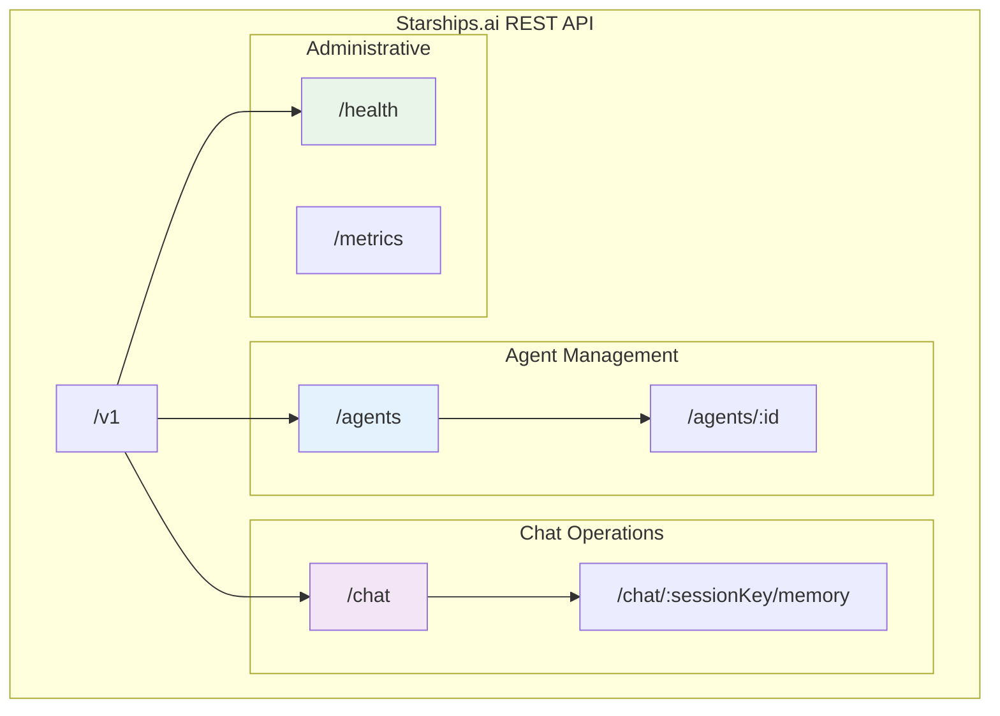
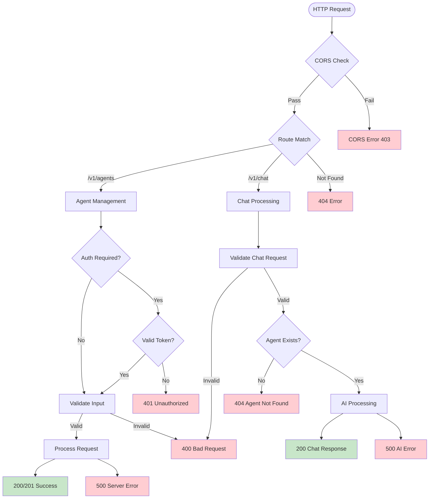

# API Design Documentation

## Overview

The Starships.ai API follows RESTful principles with a focus on simplicity, consistency, and extensibility. The API is versioned using URL path versioning (`/v1/`) and provides JSON-based communication for all endpoints.

## API Structure Overview



## Request Processing Flow



## Base URL Structure

```
[API-DOMAIN-URL]/v1/
```

## Authentication

### Bearer Token Authentication
Administrative endpoints require Bearer token authentication:

```http
Authorization: Bearer <REDEPLOY_SECRET>
```

### Public Endpoints
- All `/v1/*` endpoints are public and do not require authentication
- Rate limiting and access control are planned for future versions

## Core API Endpoints

### Agent Management

#### `GET /v1/agents`
Retrieve all available agents.

**Request:**
```http
GET /v1/agents
```

**Response:**
```json
[
  {
    "id": "agent-123",
    "name": "Assistant",
    "model": "gpt-4",
    "systemPrompt": "You are a helpful AI assistant."
  },
  {
    "id": "agent-456",
    "name": "Code Helper",
    "model": "gpt-4",
    "systemPrompt": "You are an expert software developer..."
  }
]
```

#### `GET /v1/agents/:id`
Retrieve a specific agent by ID.

**Request:**
```http
GET /v1/agents/agent-123
```

**Response:**
```json
{
  "id": "agent-123",
  "name": "Assistant",
  "model": "gpt-4",
  "systemPrompt": "You are a helpful AI assistant."
}
```

**Error Response (404):**
```json
{
  "error": "Agent not found"
}
```

#### `POST /v1/agents`
Create a new agent.

**Request:**
```http
POST /v1/agents
Content-Type: application/json

{
  "name": "Custom Agent",
  "model": "gpt-4",
  "systemPrompt": "You are a specialized assistant..."
}
```

**Response (201):**
```json
{
  "id": "agent-789",
  "name": "Custom Agent",
  "model": "gpt-4",
  "systemPrompt": "You are a specialized assistant..."
}
```

**Validation Error (400):**
```json
{
  "error": "name and model are required"
}
```

#### `PUT /v1/agents/:id`
Update an existing agent.

**Request:**
```http
PUT /v1/agents/agent-123
Content-Type: application/json

{
  "name": "Updated Assistant",
  "systemPrompt": "You are an updated helpful AI assistant."
}
```

**Response:**
```json
{
  "id": "agent-123",
  "name": "Updated Assistant",
  "model": "gpt-4",
  "systemPrompt": "You are an updated helpful AI assistant."
}
```

#### `DELETE /v1/agents/:id`
Delete an agent.

**Request:**
```http
DELETE /v1/agents/agent-123
```

**Response (204):**
```
No content
```

### Chat Operations

#### `POST /v1/chat`
Send a message to an agent and receive a response.

**Request:**
```http
POST /v1/chat
Content-Type: application/json

{
  "agent_id": "agent-123",
  "user_id": "user-456",
  "channel_id": "channel-789",  // optional
  "message": "Hello, how can you help me?",
  "stream": false               // optional
}
```

**Response:**
```json
{
  "reply": "Hello! I'm here to help you with any questions or tasks you have. What would you like assistance with?",
  "usage": {
    "prompt_tokens": 45,
    "completion_tokens": 28
  }
}
```

**Validation Error (400):**
```json
{
  "error": "agent_id is required and must be a string"
}
```

**Agent Not Found (404):**
```json
{
  "error": "Agent agent-123 not found"
}
```

#### `DELETE /v1/chat/:sessionKey/memory`
Clear conversation memory for a specific session.

**Request:**
```http
DELETE /v1/chat/agent-123:user-456:channel-789/memory
```

**Response:**
```json
{
  "message": "Memory cleared successfully"
}
```

### Memory Management

#### `POST /v1/memory/reset`
Reset conversation memory for a session.

**Request:**
```http
POST /v1/memory/reset
Content-Type: application/json

{
  "agent_id": "agent-123",
  "user_id": "user-456",
  "channel_id": "channel-789"  // optional
}
```

**Response (204):**
```
No content
```

### Administrative Endpoints

#### `POST /redeploy`
Webhook endpoint for application redeployment.

**Authentication:** Bearer token required

**Request:**
```http
POST /redeploy
Authorization: Bearer <REDEPLOY_SECRET>
```

**Response:**
```json
{
  "message": "Redeployment triggered"
}
```

## Request/Response Patterns

### Content Type
All API endpoints expect and return JSON data:
```http
Content-Type: application/json
```

### Error Response Format
All error responses follow a consistent structure:

```json
{
  "error": "Human-readable error message",
  "code": "ERROR_CODE",      // optional
  "details": {               // optional
    "field": "validation details"
  }
}
```

### HTTP Status Codes

| Code | Usage |
|------|-------|
| `200` | Successful GET/PUT operations |
| `201` | Successful resource creation |
| `204` | Successful operation with no content |
| `400` | Bad request (validation errors) |
| `401` | Unauthorized (missing/invalid auth) |
| `404` | Resource not found |
| `500` | Internal server error |

## Validation Patterns

### Request Validation Middleware
All endpoints implement validation middleware:

```typescript
const validateChatRequest = (req: any, res: any, next: any) => {
  const { agent_id, user_id, message } = req.body;
  
  if (!agent_id || typeof agent_id !== 'string') {
    return res.status(400).json({ 
      error: 'agent_id is required and must be a string' 
    });
  }
  
  if (!user_id || typeof user_id !== 'string') {
    return res.status(400).json({ 
      error: 'user_id is required and must be a string' 
    });
  }
  
  if (!message || typeof message !== 'string') {
    return res.status(400).json({ 
      error: 'message is required and must be a string' 
    });
  }
  
  next();
};
```

### Field Validation Rules

#### Agent Fields
- `name`: Required string, 1-100 characters
- `model`: Required string, valid model identifier
- `systemPrompt`: Optional string, max 2000 characters

#### Chat Fields
- `agent_id`: Required string, valid UUID format
- `user_id`: Required string, 1-100 characters
- `channel_id`: Optional string, 1-100 characters
- `message`: Required string, 1-10000 characters
- `stream`: Optional boolean, defaults to false

## Session Management

### Session Key Format
Session keys follow the pattern:
```
{agent_id}:{user_id}:{channel_id?}
```

Examples:
- `agent-123:user-456` (direct message)
- `agent-123:user-456:channel-789` (channel message)

### Memory Isolation
Each session maintains isolated memory:
- **Buffer Memory**: Recent conversation context
- **Vector Memory**: Semantic search across conversation history
- **Automatic Cleanup**: Memory cleared on session deletion

## Versioning Strategy

### URL Path Versioning
Current version: `/v1/`

### Version Compatibility
- **Backward Compatibility**: Minor version changes maintain compatibility
- **Breaking Changes**: Major version increments for breaking changes
- **Deprecation Policy**: 6-month notice for deprecated endpoints

### Future Versions
- `/v2/` planned for advanced features:
  - Streaming chat responses
  - WebSocket connections
  - Advanced memory management
  - Multi-modal support

## Rate Limiting (Future)

### Planned Rate Limits
- **Chat Endpoint**: 100 requests/minute per user
- **Agent Management**: 10 requests/minute per IP
- **Memory Operations**: 50 requests/minute per session

### Rate Limit Headers
```http
X-RateLimit-Limit: 100
X-RateLimit-Remaining: 95
X-RateLimit-Reset: 1640995200
```

## CORS Configuration

### Allowed Origins
```typescript
app.use(cors({
  origin: process.env.ALLOWED_ORIGINS?.split(',') || '*',
  methods: ['GET', 'POST', 'PUT', 'DELETE', 'OPTIONS'],
  allowedHeaders: ['Content-Type', 'Authorization']
}));
```

### Development vs Production
- **Development**: All origins allowed (`*`)
- **Production**: Specific domain whitelist

## Security Headers

### Security Middleware (Future)
```typescript
app.use(helmet({
  contentSecurityPolicy: {
    directives: {
      defaultSrc: ["'self'"],
      scriptSrc: ["'self'", "'unsafe-inline'"]
    }
  }
}));
```

## Streaming Support (Future)

### Server-Sent Events
For real-time chat responses:

```http
POST /v1/chat
Accept: text/event-stream

{
  "agent_id": "agent-123",
  "user_id": "user-456",
  "message": "Tell me a story",
  "stream": true
}
```

**Response:**
```
data: {"type":"start","id":"msg-123"}
data: {"type":"delta","content":"Once upon"}
data: {"type":"delta","content":" a time"}
data: {"type":"end","usage":{"prompt_tokens":10,"completion_tokens":5}}
```

## API Client Examples

### JavaScript/TypeScript
```typescript
const client = {
  baseURL: '[API-DOMAIN-URL]/v1',
  
  async chat(request: ChatRequest): Promise<ChatResponse> {
    const response = await fetch(`${this.baseURL}/chat`, {
      method: 'POST',
      headers: { 'Content-Type': 'application/json' },
      body: JSON.stringify(request)
    });
    
    if (!response.ok) {
      throw new Error(`API Error: ${response.status}`);
    }
    
    return response.json();
  }
};
```

### Python
```python
import requests

class StarshipsClient:
    def __init__(self, base_url="[API-DOMAIN-URL]/v1"):
        self.base_url = base_url
    
    def chat(self, agent_id, user_id, message, channel_id=None):
        payload = {
            "agent_id": agent_id,
            "user_id": user_id,
            "message": message
        }
        if channel_id:
            payload["channel_id"] = channel_id
            
        response = requests.post(
            f"{self.base_url}/chat",
            json=payload
        )
        response.raise_for_status()
        return response.json()
```

## Extension Patterns

### Custom Middleware
```typescript
// Custom authentication middleware
const customAuth = (req: Request, res: Response, next: NextFunction) => {
  const token = req.headers.authorization?.replace('Bearer ', '');
  
  if (!isValidToken(token)) {
    return res.status(401).json({ error: 'Invalid token' });
  }
  
  req.user = decodeToken(token);
  next();
};

// Apply to protected routes
app.use('/v1/admin/*', customAuth);
```

### Plugin System (Future)
```typescript
interface APIPlugin {
  name: string;
  version: string;
  routes: Route[];
  middleware?: Middleware[];
}

// Register plugin
app.use(loadPlugin('custom-analytics'));
``` 