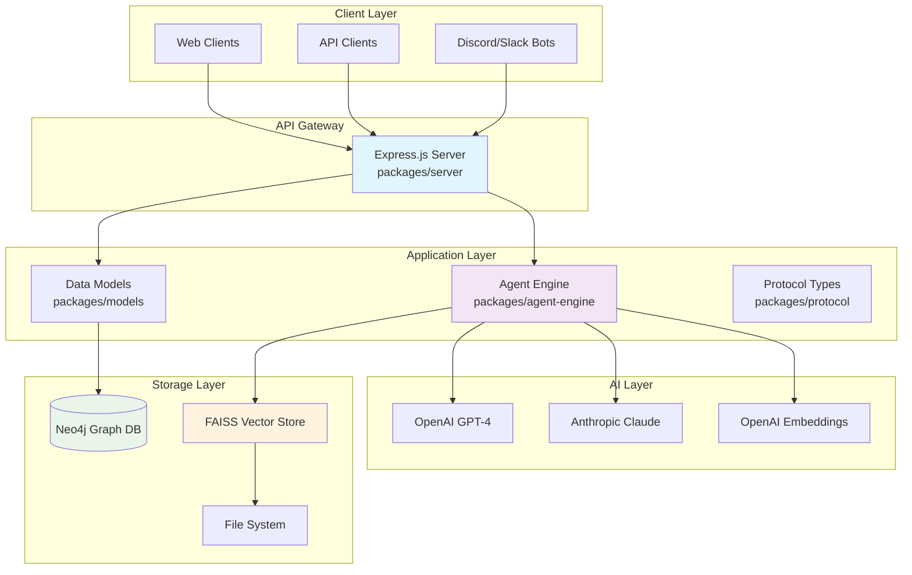
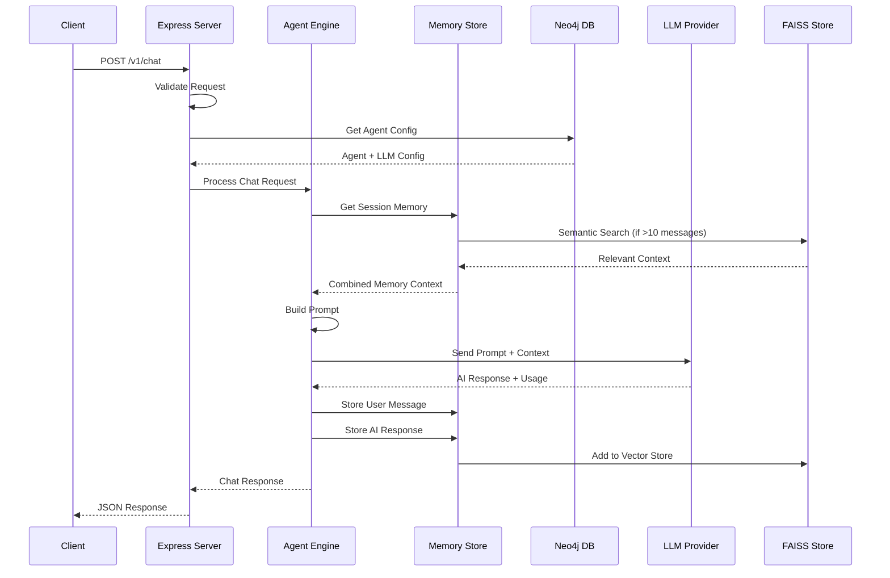
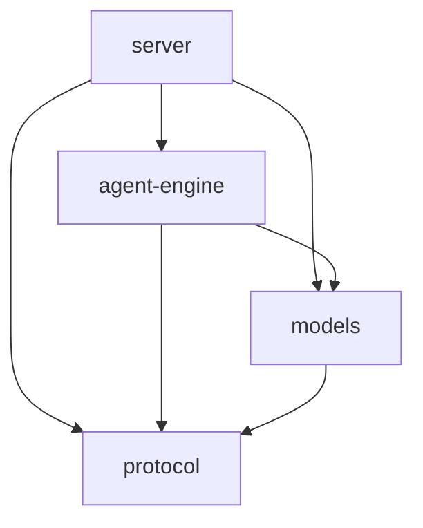

# Architecture Overview

## System Overview

Starships.ai is a TypeScript monorepo that provides a flexible, multi-channel AI agent platform with persistent memory and Neo4j-backed storage. The system follows a microservice-oriented architecture with clear separation of concerns across multiple packages.

## High-Level System Architecture



## Chat Processing Data Flow



## Package Structure

```
starships.ai/
├── packages/
│   ├── server/           # Express.js HTTP API server
│   ├── agent-engine/     # Core AI chat logic and memory management
│   ├── models/           # Neo4j database models and repositories
│   └── protocol/         # Shared TypeScript interfaces and types
├── docs/                 # Documentation
└── data/                 # Runtime data (FAISS indices, etc.)
```

### Package Dependencies



## Core Architectural Patterns

### 1. Repository Pattern
- **Location**: `packages/models/src/repositories/`
- **Purpose**: Abstract database operations with clean interfaces
- **Implementation**: Each entity (Agent, User, Channel, LLM) has its own repository
- **Factory**: `RepositoryFactory` provides singleton instances

```typescript
// Repository interface
interface Repository<T> {
  findAll(): Promise<T[]>;
  findById(id: string): Promise<T | null>;
  create(entity: Omit<T, 'id' | 'createdAt'>): Promise<T>;
  update(id: string, updates: Partial<T>): Promise<T | null>;
  delete(id: string): Promise<boolean>;
}

// Usage
const agentRepo = RepositoryFactory.getAgentRepository();
const agent = await agentRepo.findById('agent-123');
```

### 2. Factory Pattern
- **LLM Provider Factory**: Creates and caches LLM providers per agent
- **Repository Factory**: Provides singleton repository instances
- **Connection Factory**: Manages Neo4j database connections

### 3. Strategy Pattern
- **LLM Providers**: Abstracts different AI providers (OpenAI, Anthropic) behind common interface
- **Memory Storage**: Supports different memory backends through consistent interface

### 4. Singleton Pattern
- **Neo4j Connection**: Single database connection per application instance
- **Memory Store**: Shared LangChainMemoryStore instance across all sessions
- **Repository Instances**: Cached repository instances

## Data Flow Architecture

### Chat Request Flow
1. **HTTP Request** → `server/routes/chat.ts`
2. **Validation** → Request validation middleware
3. **Agent Resolution** → Fetch agent configuration from Neo4j
4. **Memory Retrieval** → Load conversation history + semantic search
5. **Prompt Building** → Combine system prompt, memory, and context
6. **LLM Processing** → Route to appropriate provider (OpenAI/Anthropic)
7. **Memory Persistence** → Store user message and AI response
8. **HTTP Response** → Return AI response with usage stats

### Memory Management Flow
1. **Session Key Generation** → `agent:user:channel` composite key
2. **Buffer Memory** → LangChain BufferMemory for recent messages
3. **Vector Storage** → FAISS embeddings for semantic search
4. **Semantic Search** → Find relevant context when memory > 10 entries
5. **Memory Persistence** → Dual storage (buffer + vector)

## Technology Stack

### Runtime & Language
- **Node.js 20+** with **TypeScript 5** (strict mode)
- **Project References** for monorepo type checking
- **ESLint + Prettier** for code quality

### Web Framework
- **Express.js 5** with TypeScript types
- **CORS** enabled for cross-origin requests
- **JSON middleware** for request parsing

### Database Layer
- **Neo4j** graph database with Cypher queries
- **neo4j-driver** for database connectivity
- **Connection pooling** and transaction management

### AI Integration
- **LangChain** for AI workflow orchestration
- **OpenAI** and **Anthropic** provider support
- **FAISS** for vector similarity search
- **Embedding models** for semantic memory

### Development Tools
- **pnpm Workspaces** for monorepo dependency management
- **Turborepo** for task orchestration and caching
- **tsx** for TypeScript execution in development
- **Jest** for testing with coverage reporting

## Scalability Considerations

### Horizontal Scaling
- **Stateless API servers** can be load-balanced
- **Shared Neo4j database** provides consistent state
- **FAISS indexes** stored on persistent volumes

### Memory Management
- **Session-based isolation** prevents memory leaks between users
- **Vector index optimization** with periodic cleanup
- **Provider caching** reduces initialization overhead

### Performance Optimizations
- **Repository caching** with singleton pattern
- **Lazy provider initialization** 
- **Semantic search filtering** (relevance threshold > 0.7)
- **Connection pooling** for database operations

## Extension Points

### Adding New LLM Providers
1. Implement `LLMProvider` interface in `agent-engine/llm/`
2. Add provider configuration to `models/types.ts`
3. Update `LangChainProvider` factory method

### Adding New Repository Types
1. Define entity interface in `models/types.ts`
2. Create repository implementation in `models/repositories/`
3. Add to `RepositoryFactory`
4. Update database schema initialization

### Adding New API Endpoints
1. Create route handler in `server/routes/`
2. Add validation middleware
3. Update service layer if needed
4. Add corresponding protocol types

## Configuration Management

### Environment-based Configuration
- **Development**: Local .env file
- **Production**: Environment variables or secrets management
- **Testing**: In-memory defaults with test overrides

### Feature Flags
- **Provider selection** via environment variables
- **Model defaults** configurable per deployment
- **Memory backend** selection (currently FAISS only)

## Security Considerations

### API Security
- **Bearer token authentication** for admin endpoints
- **Request validation** prevents injection attacks
- **CORS configuration** controls origin access

### Database Security
- **Parameterized queries** prevent Cypher injection
- **Connection encryption** with Neo4j bolt protocol
- **Credential management** via environment variables

### AI Provider Security
- **API key isolation** per provider
- **Rate limiting** (future enhancement)
- **Content filtering** (future enhancement) 