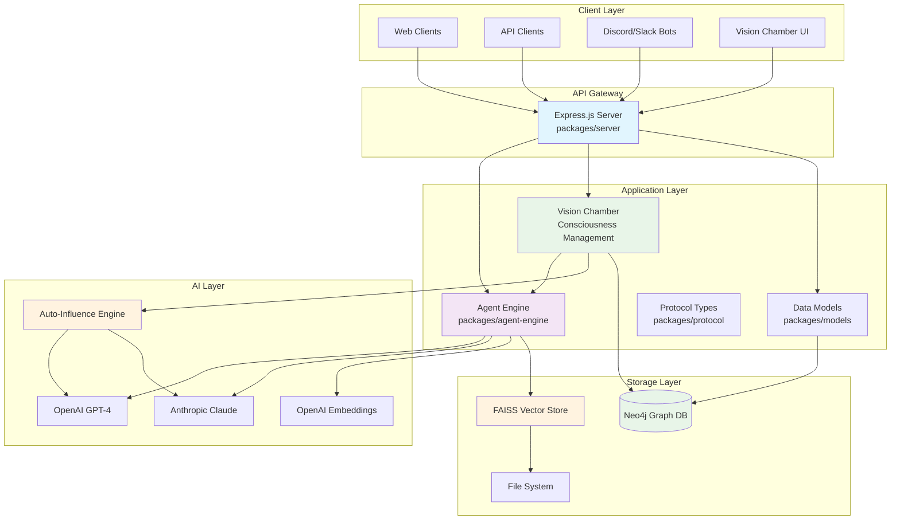
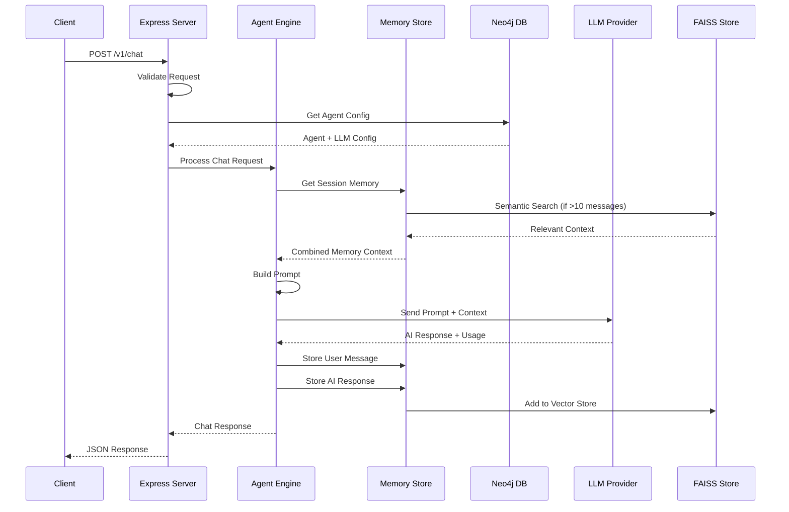
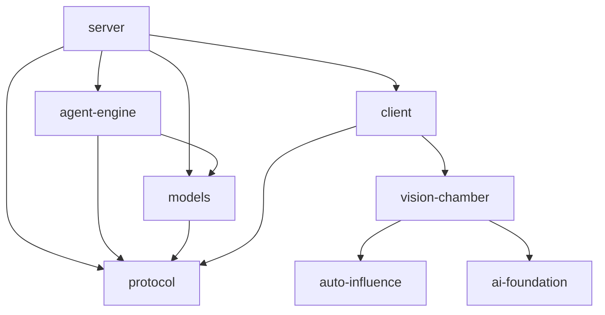
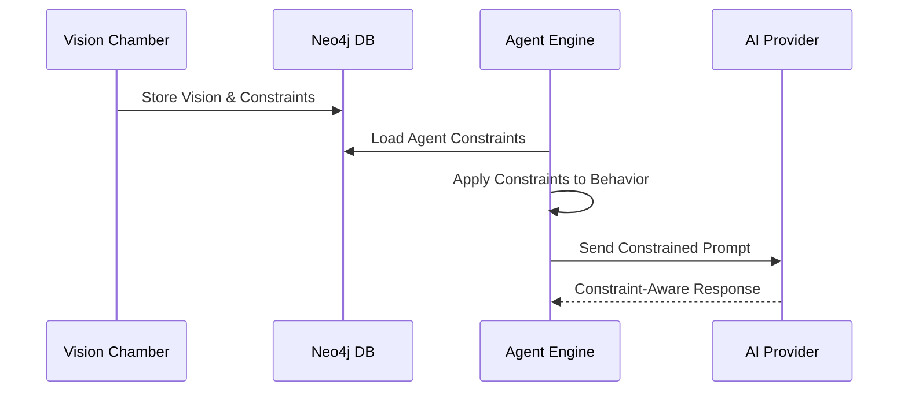
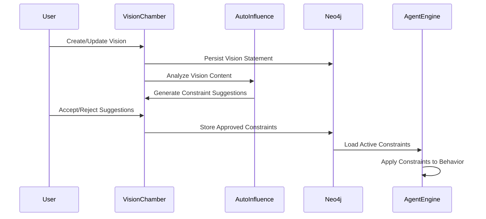

# Architecture Overview

## System Overview

Starships.ai is a TypeScript monorepo that provides a flexible, multi-channel AI agent platform with persistent memory, Neo4j-backed storage, and advanced consciousness management capabilities. The system follows a microservice-oriented architecture with clear separation of concerns across multiple packages.

The platform features a sophisticated **Vision Chamber** system that enables constraint-based AI consciousness management, allowing users to define mission visions, establish operational constraints, and receive AI-powered suggestions for system refinement. This consciousness layer guides agent behavior through a robust constraint framework integrated with the Neo4j data layer.

## High-Level System Architecture



## Chat Processing Data Flow



## Package Structure

```
starships.ai/
├── packages/
│   ├── server/           # Express.js HTTP API server
│   ├── agent-engine/     # Core AI chat logic and memory management
│   ├── models/           # Neo4j database models and repositories
│   ├── protocol/         # Shared TypeScript interfaces and types
│   └── client/           # Frontend application with Vision Chamber
│       └── src/components/vision-chamber/  # Vision Chamber components
├── docs/                 # Documentation
└── data/                 # Runtime data (FAISS indices, etc.)
```

### Package Dependencies



## Core Architectural Patterns

### 1. Repository Pattern
- **Location**: `packages/models/src/repositories/`
- **Purpose**: Abstract database operations with clean interfaces
- **Implementation**: Each entity (Agent, User, Channel, LLM) has its own repository
- **Factory**: `RepositoryFactory` provides singleton instances

```typescript
// Repository interface
interface Repository<T> {
  findAll(): Promise<T[]>;
  findById(id: string): Promise<T | null>;
  create(entity: Omit<T, 'id' | 'createdAt'>): Promise<T>;
  update(id: string, updates: Partial<T>): Promise<T | null>;
  delete(id: string): Promise<boolean>;
}

// Usage
const agentRepo = RepositoryFactory.getAgentRepository();
const agent = await agentRepo.findById('agent-123');
```

### 2. Factory Pattern
- **LLM Provider Factory**: Creates and caches LLM providers per agent
- **Repository Factory**: Provides singleton repository instances
- **Connection Factory**: Manages Neo4j database connections

### 3. Strategy Pattern
- **LLM Providers**: Abstracts different AI providers (OpenAI, Anthropic) behind common interface
- **Memory Storage**: Supports different memory backends through consistent interface

### 4. Singleton Pattern
- **Neo4j Connection**: Single database connection per application instance
- **Memory Store**: Shared LangChainMemoryStore instance across all sessions
- **Repository Instances**: Cached repository instances

## Data Flow Architecture

### Chat Request Flow
1. **HTTP Request** → `server/routes/chat.ts`
2. **Validation** → Request validation middleware
3. **Agent Resolution** → Fetch agent configuration from Neo4j
4. **Memory Retrieval** → Load conversation history + semantic search
5. **Prompt Building** → Combine system prompt, memory, and context
6. **LLM Processing** → Route to appropriate provider (OpenAI/Anthropic)
7. **Memory Persistence** → Store user message and AI response
8. **HTTP Response** → Return AI response with usage stats

### Memory Management Flow
1. **Session Key Generation** → `agent:user:channel` composite key
2. **Buffer Memory** → LangChain BufferMemory for recent messages
3. **Vector Storage** → FAISS embeddings for semantic search
4. **Semantic Search** → Find relevant context when memory > 10 entries
5. **Memory Persistence** → Dual storage (buffer + vector)

## Vision Chamber Architecture

### Consciousness Management System
The Vision Chamber is a sophisticated consciousness management system that serves as the foundational layer for constraint-based AI behavior. It enables users to define their starship's mission vision, establish operational constraints, and receive AI-powered suggestions for system refinement.

### Core Components

#### Vision Core
- **Vision Statement Management**: Create, edit, and refine mission vision statements
- **Confidence Scoring**: Real-time assessment of vision clarity and completeness
- **Refinement History**: Track evolution of vision statements over time

#### Constraints Grid
- **Constraint Management**: Full CRUD operations for operational constraints
- **Categorization**: Four constraint types (Resource, Ethical, Technical, Business)
- **Severity Assessment**: Four levels (Low, Medium, High, Critical)
- **Advanced Filtering**: Multi-dimensional organization and search

#### Auto-Influence Engine
- **Vision Analysis**: Pattern recognition for improvement opportunities
- **Constraint Suggestions**: AI-powered constraint generation from vision content
- **Confidence Scoring**: Quality assessment of suggestions
- **Real-time Processing**: Debounced analysis for optimal performance

### Integration with Platform Components

#### Agent Engine Integration

The Vision Chamber integrates deeply with the Agent Engine to provide constraint-based behavior management. For comprehensive technical details, see [`vision-chamber-architecture.md`](vision-chamber-architecture.md).



#### Data Layer Integration
- **Neo4j Storage**: Vision statements and constraints persisted as graph nodes
- **Constraint Relationships**: Graph-based constraint dependencies and hierarchies
- **Version Tracking**: Historical vision and constraint evolution
- **Cross-Agent Sharing**: Constraint inheritance and propagation

#### AI Foundation Integration
- **MCP Protocol**: Future integration with Model Context Protocol
- **Agent Orchestration**: Multi-agent consciousness coordination
- **Consciousness Monitoring**: Real-time awareness of system state
- **Predictive Constraints**: AI-driven constraint evolution

### Vision Chamber Data Flow



### State Management Architecture

The Vision Chamber uses **Zustand** for state management with the following patterns:

#### Core State Structure
```typescript
interface VisionChamberState {
  vision: {
    statement: string;
    confidence: number;
    lastUpdated: Date;
  };
  constraints: Constraint[];
  suggestions: InfluenceSuggestion[];
  loading: boolean;
  error: string | null;
}
```

#### Key Actions
- `updateVisionAPI(statement: string)`: Updates vision with backend sync
- `createConstraint(data: ConstraintFormData)`: Creates new constraint
- `acceptSuggestion(suggestionId: string)`: Processes AI suggestions
- `loadConstraints()`: Syncs constraints from Neo4j

### Technology Stack

#### Frontend Technologies
- **React 18**: Component-based UI architecture
- **TypeScript**: Type-safe development
- **Zustand**: Lightweight state management
- **Tailwind CSS**: Utility-first styling

#### Backend Integration
- **Express.js**: RESTful API endpoints
- **Neo4j**: Graph database for consciousness data
- **WebSocket**: Real-time consciousness updates (future)

#### AI Integration
- **Auto-Influence Engine**: Pattern-based suggestion generation
- **OpenAI/Anthropic**: Future AI-powered analysis
- **MCP Protocol**: Agent communication framework

### Future Enhancements

#### Phase 1: Advanced Features
- Advanced constraint filtering and bulk operations
- Vision history and rollback capabilities
- Export/import functionality for consciousness profiles

#### Phase 2: AI Integration
- Full MCP server integration for real-time agent communication
- LangGraph workflow orchestration for complex consciousness tasks
- Predictive constraint suggestions based on agent behavior

#### Phase 3: Autonomous Consciousness
- Multi-agent orchestration and consciousness coordination
- Autonomous consciousness evolution based on operational feedback
- Advanced monitoring and analytics dashboard

### Cross-Reference
For detailed technical implementation, component specifications, and development guidelines, see: [`vision-chamber-architecture.md`](vision-chamber-architecture.md)

## Technology Stack

### Runtime & Language
- **Node.js 20+** with **TypeScript 5** (strict mode)
- **Project References** for monorepo type checking
- **ESLint + Prettier** for code quality

### Web Framework
- **Express.js 5** with TypeScript types
- **CORS** enabled for cross-origin requests
- **JSON middleware** for request parsing

### Frontend Technologies
- **React 18** with TypeScript for component architecture
- **Next.js** for server-side rendering and routing
- **Tailwind CSS** for utility-first styling
- **Zustand** for lightweight state management

### Database Layer
- **Neo4j** graph database with Cypher queries
- **neo4j-driver** for database connectivity
- **Connection pooling** and transaction management

### AI Integration
- **LangChain** for AI workflow orchestration
- **OpenAI** and **Anthropic** provider support
- **FAISS** for vector similarity search
- **Embedding models** for semantic memory
- **Auto-Influence Engine** for consciousness analysis

### Vision Chamber Stack
- **Zustand** for Vision Chamber state management
- **React Hook Form** for constraint form handling
- **Pattern Recognition** for vision analysis
- **Real-time Debouncing** for performance optimization
- **MCP Protocol** interfaces for future AI integration

### Development Tools
- **pnpm Workspaces** for monorepo dependency management
- **Turborepo** for task orchestration and caching
- **tsx** for TypeScript execution in development
- **Jest** for testing with coverage reporting

## Scalability Considerations

### Horizontal Scaling
- **Stateless API servers** can be load-balanced
- **Shared Neo4j database** provides consistent state
- **FAISS indexes** stored on persistent volumes

### Memory Management
- **Session-based isolation** prevents memory leaks between users
- **Vector index optimization** with periodic cleanup
- **Provider caching** reduces initialization overhead

### Performance Optimizations
- **Repository caching** with singleton pattern
- **Lazy provider initialization** 
- **Semantic search filtering** (relevance threshold > 0.7)
- **Connection pooling** for database operations

## Extension Points

### Adding New LLM Providers
1. Implement `LLMProvider` interface in `agent-engine/llm/`
2. Add provider configuration to `models/types.ts`
3. Update `LangChainProvider` factory method

### Adding New Repository Types
1. Define entity interface in `models/types.ts`
2. Create repository implementation in `models/repositories/`
3. Add to `RepositoryFactory`
4. Update database schema initialization

### Adding New API Endpoints
1. Create route handler in `server/routes/`
2. Add validation middleware
3. Update service layer if needed
4. Add corresponding protocol types

### Adding New Vision Chamber Constraint Types
1. **Update Type Definition**:
   ```typescript
   // In vision-chamber/shared/types.ts
   type ConstraintType = 'resource' | 'ethical' | 'technical' | 'business' | 'new_type';
   ```

2. **Add Category Configuration**:
   ```typescript
   // In ConstraintCreator.tsx
   const CATEGORIES = [
     // ... existing categories
     {
       type: 'new_type' as const,
       label: 'New Type',
       icon: NewIcon,
       description: 'Description of new type',
       examples: ['Example 1', 'Example 2', 'Example 3']
     }
   ];
   ```

3. **Update Auto-Influence Patterns**:
   ```typescript
   // In auto-influence.ts
   const CONSTRAINT_SUGGESTION_PATTERNS = {
     // ... existing patterns
     new_type: [
       {
         triggers: ['trigger1', 'trigger2'],
         template: 'Template for new type: {resource}',
         severity: 'medium' as const
       }
     ]
   };
   ```

### Extending Vision Chamber AI Foundation
1. **Add New Agent Types**:
   ```typescript
   // In ai-foundation.ts
   interface AgentDefinition {
     type: 'vision_analyst' | 'constraint_monitor' | 'consciousness_coordinator' | 'new_agent_type';
     capabilities: AgentCapability[];
   }
   ```

2. **Define Agent Capabilities**:
   ```typescript
   export interface NewAgentCapability extends AgentCapability {
     category: 'new_category';
     specialFeatures: string[];
   }
   ```

3. **Create Integration Hooks**:
   ```typescript
   export interface UseNewAgentHook {
     agentState: any;
     agentActions: any;
     executeAgent: (request: any) => Promise<any>;
   }
   ```

### Adding New Consciousness Management Features
1. **Create new Vision Chamber components** in `packages/client/src/components/vision-chamber/`
2. **Extend Zustand store** with new state slices and actions
3. **Update Neo4j schema** for new consciousness data structures
4. **Add API endpoints** for new consciousness management features

## Configuration Management

### Environment-based Configuration
- **Development**: Local .env file
- **Production**: Environment variables or secrets management
- **Testing**: In-memory defaults with test overrides

### Feature Flags
- **Provider selection** via environment variables
- **Model defaults** configurable per deployment
- **Memory backend** selection (currently FAISS only)

## Security Considerations

### API Security
- **Bearer token authentication** for admin endpoints
- **Request validation** prevents injection attacks
- **CORS configuration** controls origin access

### Database Security
- **Parameterized queries** prevent Cypher injection
- **Connection encryption** with Neo4j bolt protocol
- **Credential management** via environment variables

### AI Provider Security
- **API key isolation** per provider
- **Rate limiting** (future enhancement)
- **Content filtering** (future enhancement) 