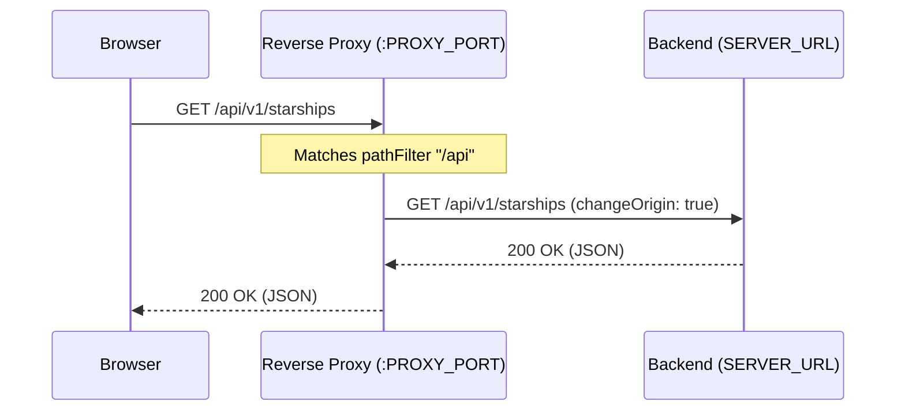
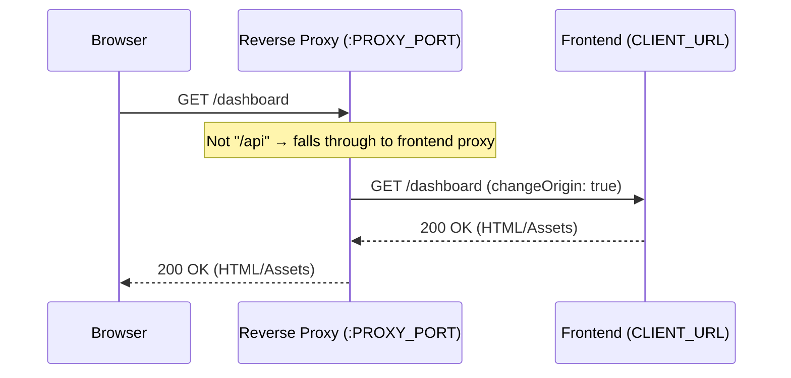
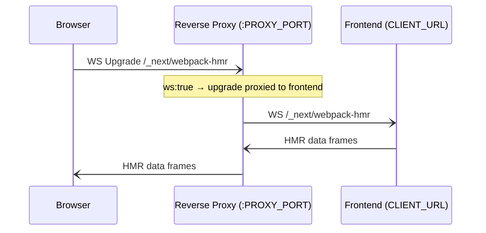

# Reverse Proxy Architecture (Development)

This diagram documents how the development reverse proxy routes requests between the Next.js client and the Express server, reflecting the current implementation in [`packages/reverse-proxy/src/index.ts`](packages/reverse-proxy/src/index.ts).

- Proxy port: `PROXY_PORT` (default: 8080)
- Frontend target: `CLIENT_URL` (default: http://localhost:3000)
- Backend target: `SERVER_URL` (default: http://localhost:4000)
- Health check: `/_proxy/health`
- WebSockets: enabled for both API and frontend (e.g., Next.js HMR)

## High-level Flow

```mermaid
flowchart TD
  Browser([Browser]) -->|HTTP/WS| Proxy[Reverse Proxy : PROXY_PORT]

  subgraph Routing
    direction LR
    Proxy -->|"/api/*"| Backend[Express Backend : SERVER_URL]
    Proxy -->|"everything else"| Frontend[Next.js Frontend : CLIENT_URL]
  end

  %% Health check endpoint served by the proxy itself
  Browser -->|GET "/_proxy/health"| Proxy

  %% WebSocket notes
  note over Browser,Proxy: WebSocket upgrade supported (ws:true)
  note over Proxy,Frontend: Next.js HMR (/_next/webpack-hmr) proxied to frontend
```

- `/api/*` → forwarded to Backend at `SERVER_URL` (path preserved)
- `/_proxy/health` → handled by the proxy itself
- All other paths (`/*`) → forwarded to Frontend at `CLIENT_URL`
- WebSockets are enabled for both API and frontend (notably Next.js HMR)

## Request Sequence Examples

### API request (/api/\*)



### Frontend request (/\*)



### Next.js HMR WebSocket (example)



## Health Check

- Endpoint: `GET /_proxy/health`
- Served by the proxy itself; returns status, uptime, timestamp, and configured target URLs.

Example:

```json
{
  "status": "healthy",
  "uptime": 123.456,
  "timestamp": "2025-01-01T00:00:00.000Z",
  "routes": {
    "frontend": "http://localhost:3000",
    "backend": "http://localhost:4000"
  }
}
```

## Configuration Summary

- `PROXY_PORT`: Port for the proxy to listen on (default `8080`)
- `CLIENT_URL`: Target for non-API routes (default `http://localhost:3000`)
- `SERVER_URL`: Target for API routes (default `http://localhost:4000`)

These are loaded via the central env configuration used by the repo and referenced in [`packages/reverse-proxy/src/index.ts`](packages/reverse-proxy/src/index.ts).
