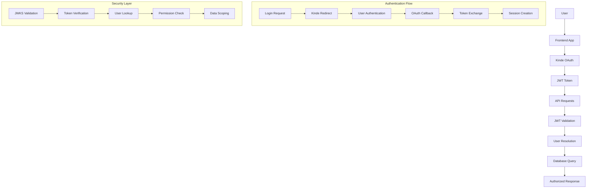
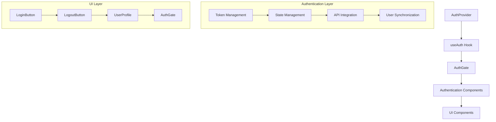
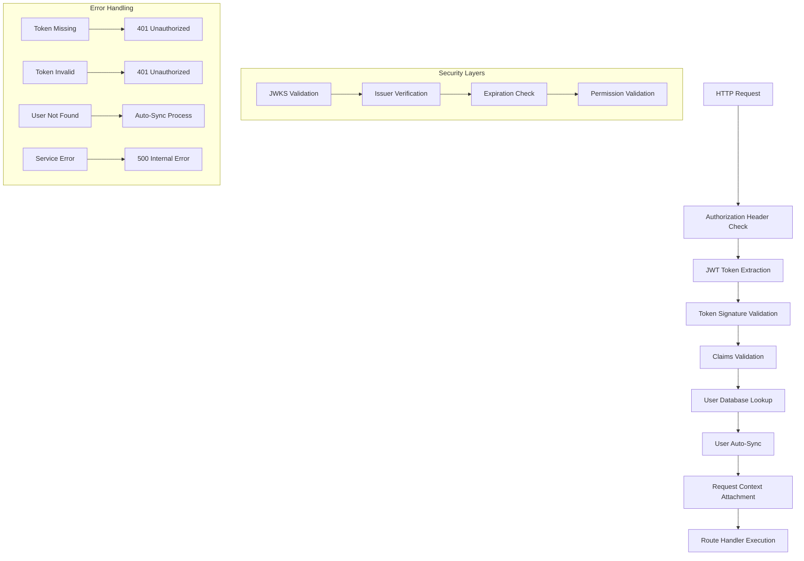
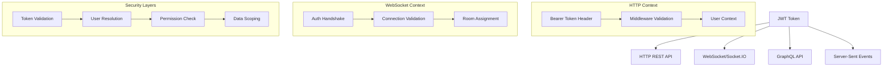

# Authentication Integration Architecture

## 🎯 Document Focus

This guide covers authentication architecture and advanced integration patterns:
- **System architecture** - High-level design and patterns
- **Advanced security** - Comprehensive security implementation
- **Complex integration** - Advanced scenarios and patterns
- **Performance optimization** - Scaling and optimization strategies

## 📋 When to Use This Guide

- Understanding authentication architecture
- Implementing advanced security features
- Integrating with complex systems
- Performance tuning and optimization

## 📚 Related Documentation

- [Kinde Implementation Guide](kinde-auth-implementation.md) - Setup and basic usage
- [API Design Documentation](api-design.md) - API authentication patterns

## Table of Contents

1. [Authentication Architecture](#authentication-architecture)
2. [Frontend Authentication Components](#frontend-authentication-components)
3. [Backend Authentication Integration](#backend-authentication-integration)
4. [Authentication in Different Contexts](#authentication-in-different-contexts)
5. [User Management Integration](#user-management-integration)
6. [Security Implementation](#security-implementation)
7. [Error Handling and Edge Cases](#error-handling-and-edge-cases)
8. [API Reference](#api-reference)
9. [Testing and Troubleshooting](#testing-and-troubleshooting)
10. [Code Examples and Integration Patterns](#code-examples-and-integration-patterns)

---

## 1. Authentication Architecture

### System Architecture Overview

The Starships.ai platform uses **Kinde** as the primary identity provider, implementing a modern OAuth 2.0 / OpenID Connect flow with JWT token-based authentication across all platform components, including the **Vision Chamber** consciousness management system.

#### Vision Chamber Integration
The Vision Chamber integrates seamlessly with the authentication system to provide user-scoped consciousness management:
- **Consciousness Data Scoping**: Vision statements and constraints are automatically scoped to authenticated users
- **Agent Behavior Guidance**: Vision Chamber constraints guide agent interactions through authenticated sessions
- **Real-time Updates**: Consciousness modifications are synchronized across user sessions with proper authentication

For detailed Vision Chamber architecture and consciousness management patterns, see [`vision-chamber-architecture.md`](vision-chamber-architecture.md).



### JWT Token Flow and Lifecycle

1. **Initial Authentication**: User redirects to Kinde hosted login
2. **Token Issuance**: Kinde returns JWT access token and refresh token
3. **Token Storage**: Tokens securely stored in browser (httpOnly cookies)
4. **API Authentication**: Access token included in Authorization header
5. **Token Validation**: Server validates token signature using Kinde's JWKS
6. **User Resolution**: User identity resolved from database using Kinde ID
7. **Token Refresh**: Automatic refresh when tokens expire

> **For basic setup and configuration, see [Kinde Implementation Guide](kinde-auth-implementation.md#configuration-setup)**

### Authentication State Management

The authentication state is managed through multiple layers:

- **Frontend**: [`useAuth.ts`](packages/client/src/hooks/useAuth.ts) hook provides unified state
- **Backend**: [`auth.ts`](packages/server/src/middleware/auth.ts) middleware validates tokens
- **Database**: User synchronization between Kinde and Neo4j
- **Real-time**: Socket.IO authentication using same JWT tokens

### Security Architecture Principles

- **Zero Trust Architecture**: Server never trusts client-sent user identities
- **Token-Based Security**: All API calls protected with JWT validation
- **Automatic User Scoping**: Data automatically scoped to authenticated user
- **Secure Token Storage**: Tokens stored in secure, httpOnly cookies
- **CSRF Protection**: Built-in CSRF protection via Kinde
- **Session Management**: Automatic session cleanup on logout

---

## 2. Frontend Authentication Components

### Component Architecture Patterns

The frontend authentication system follows a layered architecture with clear separation of concerns:



> **For basic component usage and setup, see [Essential Components](kinde-auth-implementation.md#essential-components)**

### Advanced Authentication Patterns

#### Conditional Rendering Strategy

**Pattern**: Progressive Enhancement with Authentication States
```typescript
interface AuthStateProps {
  children: React.ReactNode
  fallback?: React.ReactNode
  requireAuth?: boolean
  requireSync?: boolean
}

export function AuthGuard({
  children,
  fallback,
  requireAuth = true,
  requireSync = false
}: AuthStateProps) {
  const { isAuthenticated, syncedUser, isLoading } = useAuth()
  
  if (isLoading) return <LoadingSpinner />
  if (requireAuth && !isAuthenticated) return fallback || <LoginPrompt />
  if (requireSync && !syncedUser) return <SyncIndicator />
  
  return <>{children}</>
}
```

#### Token Provider Architecture

**Pattern**: Centralized Token Management
```typescript
class TokenManager {
  private cache = new Map<string, TokenData>()
  private provider: TokenProvider | null = null
  
  setProvider(provider: TokenProvider) {
    this.provider = provider
  }
  
  async getToken(): Promise<string | null> {
    if (!this.provider) return null
    
    const cached = this.cache.get('access_token')
    if (cached && !this.isExpired(cached)) {
      return cached.token
    }
    
    const fresh = await this.provider.getToken()
    if (fresh) {
      this.cache.set('access_token', {
        token: fresh,
        expires: Date.now() + 55 * 60 * 1000 // 55 minutes
      })
    }
    
    return fresh
  }
}
```

#### Authentication State Management

**Pattern**: Centralized State with Context
```typescript
interface AuthContextValue {
  // Authentication state
  isAuthenticated: boolean
  isLoading: boolean
  
  // User data
  kindeUser: KindeUser | null
  syncedUser: SyncedUser | null
  
  // Token management
  getToken: () => Promise<string | null>
  refreshToken: () => Promise<void>
  
  // Actions
  login: (redirectTo?: string) => void
  logout: () => void
}

const AuthContext = createContext<AuthContextValue | undefined>(undefined)

export function useAuth(): AuthContextValue {
  const context = useContext(AuthContext)
  if (!context) {
    throw new Error('useAuth must be used within AuthProvider')
  }
  return context
}
```

---

## 3. Backend Authentication Integration

### Authentication Middleware Architecture

The backend authentication system implements a layered security approach with multiple validation stages:



### Advanced Middleware Patterns

#### Layered Authentication Strategy

**Pattern**: Multi-Stage Token Validation
```typescript
interface AuthenticationStage {
  name: string
  validate: (context: AuthContext) => Promise<AuthResult>
  required: boolean
}

class AuthenticationPipeline {
  private stages: AuthenticationStage[] = []
  
  addStage(stage: AuthenticationStage): this {
    this.stages.push(stage)
    return this
  }
  
  async execute(req: Request, res: Response): Promise<AuthResult> {
    const context: AuthContext = {
      request: req,
      token: this.extractToken(req),
      user: null,
      claims: null
    }
    
    for (const stage of this.stages) {
      const result = await stage.validate(context)
      if (result.failed && stage.required) {
        return result
      }
      Object.assign(context, result.context)
    }
    
    return { success: true, context }
  }
}

// Usage
const authPipeline = new AuthenticationPipeline()
  .addStage({
    name: 'token-extraction',
    validate: async (ctx) => this.extractAndValidateToken(ctx),
    required: true
  })
  .addStage({
    name: 'user-lookup',
    validate: async (ctx) => this.lookupUser(ctx),
    required: true
  })
  .addStage({
    name: 'permission-check',
    validate: async (ctx) => this.checkPermissions(ctx),
    required: false
  })
```

#### JWT Validation Architecture

**Pattern**: Secure Token Verification with Caching
```typescript
class JWTValidator {
  private jwksCache = new Map<string, JWKSet>()
  private validatedTokens = new LRUCache<string, TokenValidationResult>({
    max: 1000,
    ttl: 5 * 60 * 1000 // 5 minutes
  })
  
  async validateToken(token: string): Promise<TokenValidationResult> {
    // Check cache first
    const cached = this.validatedTokens.get(token)
    if (cached && !this.isExpired(cached)) {
      return cached
    }
    
    // Validate token signature
    const jwks = await this.getJWKS()
    const { payload } = await jwtVerify(token, jwks, {
      issuer: this.issuerUrl,
      audience: this.expectedAudience
    })
    
    const result = {
      valid: true,
      payload,
      claims: this.extractClaims(payload),
      expiresAt: payload.exp * 1000
    }
    
    // Cache the result
    this.validatedTokens.set(token, result)
    return result
  }
  
  private async getJWKS(): Promise<JWKSet> {
    const cached = this.jwksCache.get(this.issuerUrl)
    if (cached && !this.isJWKSExpired(cached)) {
      return cached
    }
    
    const jwks = await this.fetchJWKS()
    this.jwksCache.set(this.issuerUrl, jwks)
    return jwks
  }
}
```

#### Database Integration Patterns

**Pattern**: User Resolution with Auto-Sync
```typescript
class UserResolver {
  private userCache = new Map<string, User>()
  
  async resolveUser(kindeId: string, claims: JWTClaims): Promise<User> {
    // Check cache first
    const cached = this.userCache.get(kindeId)
    if (cached && this.isCacheValid(cached)) {
      return cached
    }
    
    // Look up in database
    let user = await this.userRepository.findByKindeId(kindeId)
    
    if (!user) {
      // Auto-sync user from Kinde claims
      user = await this.syncUserFromClaims(kindeId, claims)
    } else if (this.shouldUpdateUser(user, claims)) {
      // Update user data if needed
      user = await this.updateUserFromClaims(user, claims)
    }
    
    // Cache the result
    this.userCache.set(kindeId, user)
    return user
  }
  
  private async syncUserFromClaims(kindeId: string, claims: JWTClaims): Promise<User> {
    const userData = {
      kindeId,
      email: claims.email,
      username: claims.name || claims.email.split('@')[0],
      displayName: claims.name,
      avatar: claims.picture
    }
    
    return await this.userRepository.create(userData)
  }
}
```

> **For basic middleware implementation, see [Development Workflow](kinde-auth-implementation.md#development-workflow)**

---

## 4. Authentication in Different Contexts

### Cross-Platform Authentication Architecture

The authentication system supports multiple communication protocols and contexts with unified security principles:



### HTTP REST API Authentication Patterns

#### Advanced Token Management

**Pattern**: Intelligent Token Caching and Refresh
```typescript
class TokenManager {
  private tokenCache = new Map<string, CachedToken>()
  private refreshPromises = new Map<string, Promise<string>>()
  
  async getValidToken(userId: string): Promise<string | null> {
    const cached = this.tokenCache.get(userId)
    
    // Return cached token if valid
    if (cached && this.isTokenValid(cached)) {
      return cached.token
    }
    
    // Check if refresh is already in progress
    const refreshPromise = this.refreshPromises.get(userId)
    if (refreshPromise) {
      return await refreshPromise
    }
    
    // Start refresh process
    const promise = this.refreshToken(userId)
    this.refreshPromises.set(userId, promise)
    
    try {
      const newToken = await promise
      this.cacheToken(userId, newToken)
      return newToken
    } finally {
      this.refreshPromises.delete(userId)
    }
  }
}
```

#### Request Interceptor Architecture

**Pattern**: Layered Request Processing
```typescript
interface RequestInterceptor {
  name: string
  priority: number
  process: (config: RequestConfig) => Promise<RequestConfig>
}

class RequestPipeline {
  private interceptors: RequestInterceptor[] = []
  
  addInterceptor(interceptor: RequestInterceptor): this {
    this.interceptors.push(interceptor)
    this.interceptors.sort((a, b) => a.priority - b.priority)
    return this
  }
  
  async process(config: RequestConfig): Promise<RequestConfig> {
    let processedConfig = config
    
    for (const interceptor of this.interceptors) {
      processedConfig = await interceptor.process(processedConfig)
    }
    
    return processedConfig
  }
}

// Usage
const pipeline = new RequestPipeline()
  .addInterceptor({
    name: 'auth-token',
    priority: 1,
    process: async (config) => {
      const token = await this.tokenManager.getValidToken()
      if (token) {
        config.headers.Authorization = `Bearer ${token}`
      }
      return config
    }
  })
  .addInterceptor({
    name: 'retry-on-auth-failure',
    priority: 2,
    process: async (config) => {
      // Add retry logic for auth failures
      return config
    }
  })
```

### Socket.IO Authentication Patterns

#### Advanced Connection Management

**Pattern**: Authenticated Connection Pool
```typescript
class AuthenticatedConnectionPool {
  private connections = new Map<string, AuthenticatedSocket>()
  private userSockets = new Map<string, Set<string>>()
  
  async authenticateConnection(socket: Socket): Promise<boolean> {
    try {
      const token = this.extractToken(socket)
      const user = await this.validateToken(token)
      
      // Create authenticated socket wrapper
      const authSocket = new AuthenticatedSocket(socket, user)
      this.connections.set(socket.id, authSocket)
      
      // Track user connections
      if (!this.userSockets.has(user.id)) {
        this.userSockets.set(user.id, new Set())
      }
      this.userSockets.get(user.id)!.add(socket.id)
      
      return true
    } catch (error) {
      console.error('[SOCKET] Authentication failed:', error)
      return false
    }
  }
  
  broadcastToUser(userId: string, event: string, data: any): void {
    const socketIds = this.userSockets.get(userId)
    if (!socketIds) return
    
    for (const socketId of socketIds) {
      const connection = this.connections.get(socketId)
      if (connection && connection.isActive()) {
        connection.emit(event, data)
      }
    }
  }
}
```

#### Real-time Authentication Events

**Pattern**: Live Authentication Status
```typescript
class AuthenticationEventSystem {
  private eventHandlers = new Map<string, EventHandler[]>()
  
  on(event: AuthEvent, handler: EventHandler): void {
    if (!this.eventHandlers.has(event)) {
      this.eventHandlers.set(event, [])
    }
    this.eventHandlers.get(event)!.push(handler)
  }
  
  emit(event: AuthEvent, data: any): void {
    const handlers = this.eventHandlers.get(event)
    if (handlers) {
      handlers.forEach(handler => handler(data))
    }
  }
  
  // Real-time authentication events
  onTokenExpired(callback: (userId: string) => void): void {
    this.on('token:expired', callback)
  }
  
  onUserAuthenticated(callback: (user: User) => void): void {
    this.on('user:authenticated', callback)
  }
  
  onUserDisconnected(callback: (userId: string) => void): void {
    this.on('user:disconnected', callback)
  }
}
```

> **For basic setup and configuration, see [Configuration Setup](kinde-auth-implementation.md#configuration-setup)**

---

## 5. User Management Integration

### User Creation and Synchronization

#### User Sync Process

**Implementation in [`UserService.ts`](packages/server/src/services/UserService.ts)**:
```typescript
static async syncUser(kindeData: KindeUserData): Promise<User> {
  const userRepo = RepositoryFactory.getUserRepository()
  
  try {
    // Try to find existing user by Kinde ID
    let existingUser = await userRepo.findByKindeId(kindeData.kindeId)
    
    if (existingUser) {
      // Update existing user
      return await userRepo.update(existingUser.id, {
        email: kindeData.email,
        displayName: kindeData.name,
        avatar: kindeData.avatar,
        username: kindeData.name || existingUser.username
      })
    }
    
    // Check by email (migration case)
    existingUser = await userRepo.findByEmail(kindeData.email)
    
    if (existingUser) {
      // Link existing user to Kinde
      return await userRepo.update(existingUser.id, {
        kindeId: kindeData.kindeId,
        displayName: kindeData.name,
        avatar: kindeData.avatar
      })
    }
    
    // Create new user
    return await userRepo.create({
      kindeId: kindeData.kindeId,
      email: kindeData.email,
      username: kindeData.name || kindeData.email.split('@')[0],
      displayName: kindeData.name,
      avatar: kindeData.avatar
    })
  } catch (error) {
    console.error('[USER-SYNC] Failed to sync user:', error)
    throw new Error(`Failed to sync user: ${error}`)
  }
}
```

### Profile Data Management

#### User Profile Structure

**Database Schema**:
```cypher
CREATE (u:User {
  id: "uuid-v4",                    // Internal ID
  kindeId: "kinde_user_id",         // Kinde user ID
  username: "john_doe",             // Username/handle
  email: "john@example.com",        // Email from Kinde
  displayName: "John Doe",          // Full name
  avatar: "https://avatar-url",     // Profile picture
  createdAt: "2024-01-01T00:00:00Z" // Creation timestamp
})
```

#### Profile Update Flow

**Client-Side Usage**:
```typescript
const { syncedUser, userId, userName, userEmail, userAvatar } = useAuth()

// Use synced user data for UI
<UserProfile
  name={userName}
  email={userEmail}
  avatar={userAvatar}
  userId={userId}
/>
```

### Permission and Role Handling

#### Role-Based Access Control (Future Enhancement)

**Planned Structure**:
```typescript
interface UserRole {
  id: string
  name: string
  permissions: Permission[]
}

interface Permission {
  id: string
  resource: string
  action: string
  scope: string
}
```

### Account Linking and Management

#### Multiple Identity Providers

**Current Implementation**: Single Kinde provider
**Future Enhancement**: Support for multiple OAuth providers

```typescript
interface UserIdentity {
  provider: 'kinde' | 'google' | 'github'
  providerId: string
  email: string
  verified: boolean
}
```

---

## 6. Security Implementation

### JWT Token Validation

#### Token Structure and Claims

**JWT Header**:
```json
{
  "alg": "RS256",
  "typ": "JWT",
  "kid": "key-id"
}
```

**JWT Payload**:
```json
{
  "sub": "kinde_user_id",
  "email": "user@example.com",
  "name": "John Doe",
  "picture": "https://avatar-url",
  "iss": "https://starships.kinde.com",
  "aud": "client_id",
  "iat": 1640995200,
  "exp": 1640998800
}
```

#### JWKS Validation Process

**Implementation**:
```typescript
// Kinde JWKS endpoint
const kindeIssuerUrl = process.env.KINDE_ISSUER_URL || 'https://starships.kinde.com'
const JWKS = createRemoteJWKSet(new URL(`${kindeIssuerUrl}/.well-known/jwks`))

// Token verification
const { payload } = await jwtVerify(token, JWKS, {
  issuer: kindeIssuerUrl,
  // audience: clientId (optional for Kinde)
})
```

### CSRF Protection

#### Built-in CSRF Protection

**Kinde Features**:
- State parameter validation
- Origin verification
- Secure cookie settings
- PKCE (Proof Key for Code Exchange)

### Session Security

#### Secure Token Storage

**Cookie Configuration**:
```typescript
// Kinde automatically configures secure cookies
{
  httpOnly: true,
  secure: true, // HTTPS only
  sameSite: 'lax',
  maxAge: 86400000 // 24 hours
}
```

#### Session Invalidation

**Logout Process**:
```typescript
// Client-side logout
<LogoutLink>
  <Button>Sign Out</Button>
</LogoutLink>

// Server-side session cleanup
// Handled automatically by Kinde
```

### Rate Limiting Considerations

#### API Rate Limiting

**Implementation Strategy**:
```typescript
// Express rate limiting middleware
import rateLimit from 'express-rate-limit'

const authLimiter = rateLimit({
  windowMs: 15 * 60 * 1000, // 15 minutes
  max: 5, // limit each IP to 5 requests per windowMs
  message: 'Too many authentication attempts'
})

app.use('/api/auth', authLimiter)
```

### Token Refresh Strategies

#### Automatic Token Refresh

**Refresh Logic**:
```typescript
// Monitor token expiration
const tokenExpiry = jwt.decode(token).exp * 1000
const refreshThreshold = 5 * 60 * 1000 // 5 minutes

if (Date.now() > tokenExpiry - refreshThreshold) {
  // Trigger token refresh
  await refreshToken()
}
```

---

## 7. Error Handling and Edge Cases

### Authentication Failures

#### Common Failure Scenarios

**Token Validation Failures**:
```typescript
// 1. Expired token
if (error?.name === 'JWTExpired') {
  res.status(401).json({ error: 'Token expired' })
}

// 2. Invalid signature
if (error?.name === 'JWTInvalid') {
  res.status(401).json({ error: 'Invalid token' })
}

// 3. Key mismatch
if (error?.message?.includes('JWKSNoMatchingKey')) {
  res.status(401).json({ error: 'Token signature verification failed' })
}
```

**User Sync Failures**:
```typescript
// Handle user sync errors
try {
  user = await UserService.syncUser(kindeData)
} catch (syncError) {
  console.error('[AUTH] Failed to auto-sync user:', syncError)
  res.status(500).json({ 
    error: 'Failed to sync user',
    details: syncError.message 
  })
}
```

### Token Expiration Handling

#### Automatic Refresh Flow

**Client-Side Handling**:
```typescript
// Response interceptor for token refresh
api.interceptors.response.use(
  response => response,
  async error => {
    const originalRequest = error.config
    
    if (error.response?.status === 401 && !originalRequest._retry) {
      originalRequest._retry = true
      
      try {
        // Trigger token refresh
        await refreshToken()
        
        // Retry original request
        return api(originalRequest)
      } catch (refreshError) {
        // Redirect to login
        window.location.href = '/api/auth/login'
      }
    }
    
    return Promise.reject(error)
  }
)
```

### Network Connectivity Issues

#### Offline Handling

**Connection Status**:
```typescript
// Monitor network status
useEffect(() => {
  const handleOnline = () => {
    // Retry authentication
    if (isAuthenticated) {
      verifyTokenStatus()
    }
  }
  
  const handleOffline = () => {
    // Show offline indicator
    setNetworkStatus('offline')
  }
  
  window.addEventListener('online', handleOnline)
  window.addEventListener('offline', handleOffline)
  
  return () => {
    window.removeEventListener('online', handleOnline)
    window.removeEventListener('offline', handleOffline)
  }
}, [isAuthenticated])
```

### Fallback Authentication Methods

#### Graceful Degradation

**Fallback Strategies**:
```typescript
// Multiple token retrieval methods
async function getAccessToken() {
  try {
    // Primary method
    let token = await getToken()
    if (token) return token
    
    // Fallback to raw token
    token = getAccessTokenRaw()
    if (token) return token
    
    // Fallback to stored token
    token = accessTokenRaw
    if (token) return token
    
    // No token available
    return null
  } catch (error) {
    console.error('[AUTH] Failed to get access token:', error)
    return null
  }
}
```

---

## 8. Development Guidelines

### Setting up Kinde in Development

#### Environment Configuration

**Required Environment Variables**:
```env
# packages/client/.env.local
KINDE_CLIENT_ID=your_kinde_client_id
KINDE_CLIENT_SECRET=your_kinde_client_secret
KINDE_ISSUER_URL=https://your_subdomain.kinde.com
KINDE_SITE_URL=http://localhost:3000
KINDE_POST_LOGIN_REDIRECT_URL=http://localhost:3000/command-deck
KINDE_POST_LOGOUT_REDIRECT_URL=http://localhost:3000
KINDE_DEBUG_MODE=true

# Backend API Configuration
NEXT_PUBLIC_API_URL=http://localhost:4000
```

**Backend Environment Variables**:
```env
# packages/server/.env
KINDE_ISSUER_URL=https://your_subdomain.kinde.com
KINDE_CLIENT_ID=your_kinde_client_id

# Database connection
NEO4J_URI=bolt://localhost:7687
NEO4J_USERNAME=neo4j
NEO4J_PASSWORD=your_password
```

#### Kinde Dashboard Setup

**Application Configuration**:
1. Create a Kinde application
2. Set allowed callback URLs:
   - `http://localhost:3000/api/auth/kinde_callback` (development)
   - `https://yourdomain.com/api/auth/kinde_callback` (production)
3. Set allowed logout URLs:
   - `http://localhost:3000` (development)
   - `https://yourdomain.com` (production)

### Testing Authentication Flows

#### Manual Testing Steps

**1. Basic Authentication Flow**:
```bash
# Start development server
pnpm dev

# Visit application
open http://localhost:3000

# Test login flow
# 1. Click "Enter Command Deck"
# 2. Complete Kinde authentication
# 3. Verify redirect to command deck
# 4. Check user profile display
```

**2. API Authentication Testing**:
```bash
# Test authenticated API call
curl -H "Authorization: Bearer <token>" http://localhost:4000/api/v1/agents

# Expected: 200 OK with user's agents
# Without token: 401 Unauthorized
```

**3. Token Validation Testing**:
```bash
# Test invalid token
curl -H "Authorization: Bearer invalid_token" http://localhost:4000/api/v1/agents

# Expected: 401 Unauthorized
```

#### Automated Testing

**Unit Tests for Auth Components**:
```typescript
// tests/auth/AuthGate.test.tsx
import { render, screen } from '@testing-library/react'
import { AuthGate } from '@/components/auth/AuthGate'

describe('AuthGate', () => {
  it('shows login UI when not authenticated', () => {
    // Mock useAuth hook
    jest.mock('@/hooks/useAuth', () => ({
      useAuth: () => ({
        isAuthenticated: false,
        isLoading: false
      })
    }))
    
    render(
      <AuthGate>
        <div>Protected Content</div>
      </AuthGate>
    )
    
    expect(screen.getByText('Welcome to Starships.ai')).toBeInTheDocument()
  })
})
```

**Integration Tests for Auth Flow**:
```typescript
// tests/auth/auth-flow.test.tsx
import { render, waitFor } from '@testing-library/react'
import { AuthProvider } from '@/providers/auth-provider'

describe('Authentication Flow', () => {
  it('completes full authentication flow', async () => {
    // Test full flow from login to protected content
    // Mock Kinde responses
    // Verify token storage
    // Verify API calls include tokens
  })
})
```

### Debugging Authentication Issues

#### Debug Mode Configuration

**Enable Debug Logging**:
```env
KINDE_DEBUG_MODE=true
```

**Console Logging**:
```typescript
// Check authentication state
console.log('[AUTH] Authentication state:', {
  isAuthenticated,
  isLoading,
  user,
  token: token ? 'Present' : 'Missing'
})

// Check API requests
console.log('[API] Request interceptor:', {
  url: config.url,
  headers: config.headers,
  hasToken: !!config.headers.Authorization
})
```

#### Common Debug Scenarios

**1. Token Not Being Set**:
```typescript
// Check token provider setup
useEffect(() => {
  console.log('[AUTH] Token provider setup:', {
    isAuthenticated,
    kindeLoading,
    hasGetToken: !!getToken
  })
}, [isAuthenticated, kindeLoading, getToken])
```

**2. API Calls Failing**:
```typescript
// Check request headers
api.interceptors.request.use(config => {
  console.log('[API] Request headers:', config.headers)
  return config
})
```

**3. User Not Syncing**:
```typescript
// Check sync process
const { syncedUser, syncError } = useAuth()
console.log('[USER-SYNC] Sync state:', {
  syncedUser,
  syncError
})
```

---

## 9. API Reference

### Authentication Endpoints

#### POST /api/auth/login
**Description**: Initiates OAuth login flow
**Parameters**: None
**Response**: Redirect to Kinde login page

#### GET /api/auth/callback
**Description**: Handles OAuth callback
**Parameters**: 
- `code`: Authorization code from Kinde
- `state`: State parameter for CSRF protection
**Response**: Redirect to post-login URL

#### POST /api/auth/logout
**Description**: Terminates user session
**Parameters**: None
**Response**: Redirect to logout URL

#### GET /api/auth/health
**Description**: Health check for authentication configuration
**Response**:
```json
{
  "apiPath": "/api/auth",
  "redirectURL": "http://localhost:3000/api/auth/kinde_callback",
  "postLoginRedirectURL": "http://localhost:3000/command-deck",
  "issuerURL": "https://your-subdomain.kinde.com",
  "clientID": "your_client_id",
  "clientSecret": "Set correctly",
  "postLogoutRedirectURL": "http://localhost:3000"
}
```

### Token Structure and Claims

#### Access Token Claims

**Standard Claims**:
```json
{
  "sub": "kinde_user_id",           // Subject (user ID)
  "iss": "https://starships.kinde.com", // Issuer
  "aud": "client_id",               // Audience
  "iat": 1640995200,                // Issued at
  "exp": 1640998800,                // Expiration
  "auth_time": 1640995200           // Authentication time
}
```

**User Claims**:
```json
{
  "email": "user@example.com",
  "email_verified": true,
  "name": "John Doe",
  "given_name": "John",
  "family_name": "Doe",
  "picture": "https://avatar-url",
  "locale": "en"
}
```

### Error Response Formats

#### Authentication Errors

**401 Unauthorized**:
```json
{
  "error": "Missing or invalid Authorization header",
  "timestamp": "2024-01-01T00:00:00Z",
  "path": "/api/v1/agents"
}
```

**403 Forbidden**:
```json
{
  "error": "Insufficient permissions",
  "required_permission": "agents:read",
  "timestamp": "2024-01-01T00:00:00Z"
}
```

**500 Internal Server Error**:
```json
{
  "error": "Authentication service error",
  "details": "Failed to verify token signature",
  "timestamp": "2024-01-01T00:00:00Z"
}
```

### Integration Examples

#### React Component Integration

**Basic Authentication Check**:
```typescript
import { useAuth } from '@/hooks/useAuth'

function MyComponent() {
  const { isAuthenticated, user, isLoading } = useAuth()
  
  if (isLoading) return <LoadingSpinner />
  if (!isAuthenticated) return <LoginPrompt />
  
  return (
    <div>
      <h1>Welcome, {user.name}!</h1>
      <UserDashboard userId={user.id} />
    </div>
  )
}
```

#### API Client Integration

**Authenticated API Calls**:
```typescript
import { agentAPI } from '@/lib/api'

async function fetchUserAgents() {
  try {
    // Token automatically included via interceptor
    const agents = await agentAPI.getAll()
    return agents
  } catch (error) {
    if (error.response?.status === 401) {
      // Handle authentication error
      redirectToLogin()
    }
    throw error
  }
}
```

#### Socket.IO Integration

**Authenticated Socket Connection**:
```typescript
import { io } from 'socket.io-client'
import { useAuth } from '@/hooks/useAuth'

function useSocketConnection() {
  const { getToken } = useAuth()
  
  useEffect(() => {
    const connectSocket = async () => {
      const token = await getToken()
      
      const socket = io('http://localhost:4000', {
        auth: { token }
      })
      
      socket.on('connect', () => {
        console.log('Connected to socket server')
      })
      
      socket.on('connect_error', (error) => {
        console.error('Socket connection failed:', error)
      })
      
      return socket
    }
    
    connectSocket()
  }, [getToken])
}
```

---

## 10. Testing and Troubleshooting

### Authentication Testing Strategy

#### Unit Testing

**Component Testing**:
```typescript
// jest.config.js
module.exports = {
  setupFilesAfterEnv: ['<rootDir>/tests/setup.ts'],
  testEnvironment: 'jsdom'
}

// tests/setup.ts
import '@testing-library/jest-dom'
import { server } from './mocks/server'

beforeAll(() => server.listen())
afterEach(() => server.resetHandlers())
afterAll(() => server.close())
```

**Auth Component Tests**:
```typescript
// tests/components/auth/AuthGate.test.tsx
import { render, screen } from '@testing-library/react'
import { AuthGate } from '@/components/auth/AuthGate'

// Mock useAuth hook
jest.mock('@/hooks/useAuth')

describe('AuthGate', () => {
  it('renders login UI when not authenticated', () => {
    (useAuth as jest.Mock).mockReturnValue({
      isAuthenticated: false,
      isLoading: false
    })
    
    render(
      <AuthGate>
        <div>Protected Content</div>
      </AuthGate>
    )
    
    expect(screen.getByText('Welcome to Starships.ai')).toBeInTheDocument()
    expect(screen.queryByText('Protected Content')).not.toBeInTheDocument()
  })

  it('renders protected content when authenticated', () => {
    (useAuth as jest.Mock).mockReturnValue({
      isAuthenticated: true,
      isLoading: false
    })
    
    render(
      <AuthGate>
        <div>Protected Content</div>
      </AuthGate>
    )
    
    expect(screen.getByText('Protected Content')).toBeInTheDocument()
  })
})
```

**API Integration Tests**:
```typescript
// tests/api/auth.test.ts
import { agentAPI } from '@/lib/api'
import { setupServer } from 'msw/node'
import { rest } from 'msw'

const server = setupServer(
  rest.get('/api/v1/agents', (req, res, ctx) => {
    const auth = req.headers.get('Authorization')
    
    if (!auth || !auth.startsWith('Bearer ')) {
      return res(ctx.status(401), ctx.json({ error: 'Unauthorized' }))
    }
    
    return res(ctx.json([{ id: '1', name: 'Test Agent' }]))
  })
)

describe('API Authentication', () => {
  it('includes authorization header in requests', async () => {
    // Mock token provider
    setTokenProvider(async () => 'mock-token')
    
    const agents = await agentAPI.getAll()
    
    expect(agents).toHaveLength(1)
    expect(agents[0].name).toBe('Test Agent')
  })
})
```

#### Integration Testing

**End-to-End Auth Flow**:
```typescript
// tests/e2e/auth-flow.test.ts
import { test, expect } from '@playwright/test'

test.describe('Authentication Flow', () => {
  test('complete login flow', async ({ page }) => {
    // Navigate to protected page
    await page.goto('/command-deck')
    
    // Should redirect to login
    await expect(page).toHaveURL(/\/api\/auth\/login/)
    
    // Complete Kinde authentication
    await page.fill('[data-testid="email"]', 'test@example.com')
    await page.fill('[data-testid="password"]', 'password')
    await page.click('[data-testid="submit"]')
    
    // Should redirect to command deck
    await expect(page).toHaveURL('/command-deck')
    
    // Verify user profile is displayed
    await expect(page.locator('[data-testid="user-profile"]')).toBeVisible()
  })
})
```

#### Performance Testing

**Token Validation Performance**:
```typescript
// tests/performance/auth.test.ts
import { authMiddleware } from '@/middleware/auth'

describe('Auth Middleware Performance', () => {
  it('validates tokens quickly', async () => {
    const start = performance.now()
    
    // Mock request with valid token
    const req = {
      headers: { authorization: 'Bearer valid-token' }
    }
    
    await authMiddleware(req, res, next)
    
    const end = performance.now()
    const duration = end - start
    
    // Should complete in under 100ms
    expect(duration).toBeLessThan(100)
  })
})
```

### Common Issues and Solutions

#### Issue: "Missing or invalid Authorization header"

**Symptoms**:
- API calls return 401 Unauthorized
- Frontend shows authentication errors
- Console shows missing token warnings

**Debugging Steps**:
```typescript
// 1. Check token provider setup
const { isAuthenticated, kindeLoading } = useAuth()
console.log('[DEBUG] Auth state:', { isAuthenticated, kindeLoading })

// 2. Check token retrieval
const token = await getToken()
console.log('[DEBUG] Token:', token ? 'Present' : 'Missing')

// 3. Check API interceptor
api.interceptors.request.use(config => {
  console.log('[DEBUG] Request headers:', config.headers)
  return config
})
```

**Solutions**:
1. **Timing Issue**: Token provider set before auth complete
   ```typescript
   // Fix: Only set provider after loading complete
   useEffect(() => {
     if (!kindeLoading) {
       setTokenProvider(async () => {
         // Token retrieval logic
       })
     }
   }, [kindeLoading])
   ```

2. **Token Method Issue**: Wrong token retrieval method
   ```typescript
   // Fix: Try multiple methods
   let token = await getToken()
   if (!token) token = getAccessTokenRaw()
   if (!token) token = accessTokenRaw
   ```

#### Issue: "Token expired" or "Invalid token"

**Symptoms**:
- Intermittent 401 errors
- Authentication works initially but fails later
- Token validation errors in server logs

**Debugging Steps**:
```typescript
// 1. Check token expiration
const decoded = jwt.decode(token)
console.log('[DEBUG] Token expiry:', new Date(decoded.exp * 1000))

// 2. Check token format
console.log('[DEBUG] Token parts:', token.split('.').length)

// 3. Check server logs
// Look for JWT validation errors
```

**Solutions**:
1. **Token Refresh**: Implement automatic refresh
   ```typescript
   // Response interceptor for token refresh
   api.interceptors.response.use(
     response => response,
     async error => {
       if (error.response?.status === 401) {
         // Trigger token refresh
         await refreshToken()
         // Retry request
         return api(error.config)
       }
       return Promise.reject(error)
     }
   )
   ```

#### Issue: User not syncing to backend

**Symptoms**:
- User can login but API calls fail
- User not found in database
- Sync errors in console

**Debugging Steps**:
```typescript
// 1. Check sync process
const { syncedUser, syncError } = useAuth()
console.log('[DEBUG] Sync state:', { syncedUser, syncError })

// 2. Check backend logs
// Look for user sync errors

// 3. Check database connection
// Verify Neo4j is running and accessible
```

**Solutions**:
1. **Auto-sync in middleware**: Ensure middleware creates users
   ```typescript
   if (!user) {
     user = await UserService.syncUser({
       kindeId: payload.sub,
       email: payload.email,
       name: payload.name
     })
   }
   ```

#### Issue: Socket.IO authentication failures

**Symptoms**:
- Socket connections fail
- "Authentication token required" errors
- Real-time features not working

**Debugging Steps**:
```typescript
// 1. Check token passing
const socket = io('http://localhost:4000', {
  auth: { token: await getToken() }
})

// 2. Check server logs
// Look for socket auth errors

// 3. Check connection state
socket.on('connect_error', (error) => {
  console.error('[DEBUG] Socket error:', error)
})
```

**Solutions**:
1. **Token in auth object**: Pass token correctly
   ```typescript
   const socket = io('http://localhost:4000', {
     auth: {
       token: await getToken()
     }
   })
   ```

### Diagnostic Tools

#### Authentication Health Check

**Frontend Health Check**:
```typescript
// utils/authHealthCheck.ts
export async function checkAuthHealth() {
  const health = {
    isAuthenticated: false,
    hasToken: false,
    tokenValid: false,
    userSynced: false,
    apiWorking: false
  }
  
  try {
    const { isAuthenticated, syncedUser } = useAuth()
    health.isAuthenticated = isAuthenticated
    health.userSynced = !!syncedUser
    
    const token = await getToken()
    health.hasToken = !!token
    
    if (token) {
      // Test API call
      const response = await api.get('/api/v1/health')
      health.apiWorking = response.status === 200
      health.tokenValid = true
    }
  } catch (error) {
    console.error('[HEALTH] Auth health check failed:', error)
  }
  
  return health
}
```

**Backend Health Check**:
```typescript
// routes/health.ts
export const healthCheck = async (req: Request, res: Response) => {
  const health = {
    auth: {
      middleware: 'working',
      database: 'connected',
      kinde: 'accessible'
    },
    timestamp: new Date().toISOString()
  }
  
  try {
    // Test database connection
    const userCount = await UserService.getUserCount()
    health.auth.database = `${userCount} users`
    
    // Test Kinde JWKS
    const jwksResponse = await fetch(`${kindeIssuerUrl}/.well-known/jwks`)
    health.auth.kinde = jwksResponse.ok ? 'accessible' : 'error'
    
    res.json(health)
  } catch (error) {
    res.status(500).json({ ...health, error: error.message })
  }
}
```

#### Token Validation Tool

**Token Debugger**:
```typescript
// utils/tokenDebugger.ts
export function debugToken(token: string) {
  try {
    const parts = token.split('.')
    if (parts.length !== 3) {
      throw new Error('Invalid JWT format')
    }
    
    const header = JSON.parse(atob(parts[0]))
    const payload = JSON.parse(atob(parts[1]))
    
    return {
      header,
      payload,
      isExpired: Date.now() > payload.exp * 1000,
      expiresAt: new Date(payload.exp * 1000),
      issuer: payload.iss,
      subject: payload.sub
    }
  } catch (error) {
    return { error: error.message }
  }
}
```

---

## 11. Code Examples and Integration Patterns

### Complete Authentication Setup

#### Frontend Setup

**1. Provider Configuration**:
```typescript
// app/layout.tsx
import { AuthProvider } from '@/providers/auth-provider'
import { TooltipProvider } from '@/components/ui/tooltip'

export default function RootLayout({ children }: { children: React.ReactNode }) {
  return (
    <html>
      <body>
        <ThemeProvider>
          <AuthProvider>
            <QueryProvider>
              <TooltipProvider>
                <ClientLayout>{children}</ClientLayout>
              </TooltipProvider>
            </QueryProvider>
          </AuthProvider>
        </ThemeProvider>
      </body>
    </html>
  )
}
```

**2. Client Layout with Auth Gate**:
```typescript
// app/client-layout.tsx
import { AuthGate } from '@/components/auth/AuthGate'
import { useAuth } from '@/hooks/useAuth'

export function ClientLayout({ children }: { children: React.ReactNode }) {
  const { isAuthenticated } = useAuth()
  
  return (
    <AuthGate>
      <div className="app-layout">
        <Navigation />
        <main>{children}</main>
      </div>
    </AuthGate>
  )
}
```

**3. API Client Configuration**:
```typescript
// lib/api.ts
import axios from 'axios'

const api = axios.create({
  baseURL: process.env.NEXT_PUBLIC_API_URL,
  timeout: 10000
})

// Token provider setup
let getTokenFunction: (() => Promise<string | null>) | null = null

export const setTokenProvider = (tokenProvider: () => Promise<string | null>) => {
  getTokenFunction = tokenProvider
}

// Request interceptor for authentication
api.interceptors.request.use(
  async (config) => {
    if (getTokenFunction) {
      const token = await getTokenFunction()
      if (token) {
        config.headers.Authorization = `Bearer ${token}`
      }
    }
    return config
  },
  (error) => Promise.reject(error)
)

// Response interceptor for error handling
api.interceptors.response.use(
  (response) => response,
  async (error) => {
    if (error.response?.status === 401) {
      // Handle token expiration
      console.error('[API] Authentication failed')
      // Could trigger token refresh or redirect to login
    }
    return Promise.reject(error)
  }
)
```

#### Backend Setup

**1. Express Server Configuration**:
```typescript
// server/index.ts
import express from 'express'
import { authMiddleware } from './middleware/auth'
import { agentRoutes } from './routes/agents'
import { chatRoutes } from './routes/chat'

const app = express()

// Apply auth middleware to protected routes
app.use('/api/v1/agents', authMiddleware, agentRoutes)
app.use('/api/v1/chat', authMiddleware, chatRoutes)
app.use('/api/v1/memory', authMiddleware, memoryRoutes)

// Public routes (no auth required)
app.use('/api/v1/users/sync', userRoutes)
app.use('/api/v1/health', healthRoutes)

app.listen(4000, () => {
  console.log('[SERVER] Server running on port 4000')
})
```

**2. Route Handler with User Context**:
```typescript
// routes/agents.ts
import { Router } from 'express'
import { AgentService } from '../services/AgentService'

const router = Router()

// Get user's agents
router.get('/', async (req, res) => {
  try {
    // req.user is available from auth middleware
    const agents = await AgentService.getAgentsByUser(req.user.id)
    res.json(agents)
  } catch (error) {
    res.status(500).json({ error: error.message })
  }
})

// Create new agent
router.post('/', async (req, res) => {
  try {
    const agent = await AgentService.createAgent({
      ...req.body,
      authorId: req.user.id // Automatically set from auth
    })
    res.status(201).json(agent)
  } catch (error) {
    res.status(400).json({ error: error.message })
  }
})

export { router as agentRoutes }
```

### Advanced Integration Patterns

#### Custom Hook for Protected Resources

**useProtectedResource Hook**:
```typescript
// hooks/useProtectedResource.ts
import { useAuth } from '@/hooks/useAuth'
import { useQuery } from '@tanstack/react-query'

export function useProtectedResource<T>(
  key: string,
  fetcher: () => Promise<T>,
  options?: { enabled?: boolean }
) {
  const { isAuthenticated, isLoading } = useAuth()
  
  return useQuery({
    queryKey: [key],
    queryFn: fetcher,
    enabled: isAuthenticated && !isLoading && (options?.enabled ?? true),
    retry: (failureCount, error) => {
      // Don't retry on auth errors
      if (error.response?.status === 401) return false
      return failureCount < 3
    }
  })
}

// Usage
function AgentList() {
  const { data: agents, isLoading, error } = useProtectedResource(
    'agents',
    () => agentAPI.getAll()
  )
  
  if (isLoading) return <LoadingSpinner />
  if (error) return <ErrorMessage error={error} />
  
  return (
    <div>
      {agents?.map(agent => (
        <AgentCard key={agent.id} agent={agent} />
      ))}
    </div>
  )
}
```

#### Socket.IO with Authentication

**Authenticated Socket Hook**:
```typescript
// hooks/useAuthenticatedSocket.ts
import { useEffect, useState } from 'react'
import { io, Socket } from 'socket.io-client'
import { useAuth } from '@/hooks/useAuth'

export function useAuthenticatedSocket(namespace?: string) {
  const [socket, setSocket] = useState<Socket | null>(null)
  const [isConnected, setIsConnected] = useState(false)
  const { getToken, isAuthenticated } = useAuth()
  
  useEffect(() => {
    let socketInstance: Socket | null = null
    
    const connect = async () => {
      if (!isAuthenticated) return
      
      try {
        const token = await getToken()
        if (!token) return
        
        const url = namespace 
          ? `${process.env.NEXT_PUBLIC_API_URL}/${namespace}`
          : process.env.NEXT_PUBLIC_API_URL
        
        socketInstance = io(url, {
          auth: { token }
        })
        
        socketInstance.on('connect', () => {
          setIsConnected(true)
          console.log('[SOCKET] Connected')
        })
        
        socketInstance.on('disconnect', () => {
          setIsConnected(false)
          console.log('[SOCKET] Disconnected')
        })
        
        socketInstance.on('connect_error', (error) => {
          console.error('[SOCKET] Connection error:', error)
        })
        
        setSocket(socketInstance)
      } catch (error) {
        console.error('[SOCKET] Setup error:', error)
      }
    }
    
    connect()
    
    return () => {
      if (socketInstance) {
        socketInstance.disconnect()
      }
    }
  }, [isAuthenticated, namespace, getToken])
  
  return { socket, isConnected }
}

// Usage
function ChatInterface({ agentId }: { agentId: string }) {
  const { socket, isConnected } = useAuthenticatedSocket('chat')
  
  useEffect(() => {
    if (!socket || !isConnected) return
    
    // Join agent room
    socket.emit('join-agent-room', { agentId })
    
    // Listen for messages
    socket.on('agent-message', (data) => {
      console.log('[CHAT] Received message:', data)
    })
    
    return () => {
      socket.emit('leave-agent-room', { agentId })
    }
  }, [socket, isConnected, agentId])
  
  const sendMessage = (message: string) => {
    if (socket && isConnected) {
      socket.emit('user-message', { agentId, message })
    }
  }
  
  return (
    <div>
      {isConnected ? (
        <ChatMessages onSend={sendMessage} />
      ) : (
        <div>Connecting...</div>
      )}
    </div>
  )
}
```

#### Error Boundary for Auth Errors

**AuthErrorBoundary Component**:
```typescript
// components/auth/AuthErrorBoundary.tsx
import React from 'react'
import { Button } from '@/components/ui/button'

interface AuthErrorBoundaryState {
  hasError: boolean
  error?: Error
  isAuthError: boolean
}

export class AuthErrorBoundary extends React.Component<
  { children: React.ReactNode },
  AuthErrorBoundaryState
> {
  constructor(props: { children: React.ReactNode }) {
    super(props)
    this.state = { hasError: false, isAuthError: false }
  }
  
  static getDerivedStateFromError(error: Error): AuthErrorBoundaryState {
    const isAuthError = error.message.includes('401') || 
                       error.message.includes('Unauthorized') ||
                       error.message.includes('Authentication failed')
    
    return {
      hasError: true,
      error,
      isAuthError
    }
  }
  
  componentDidCatch(error: Error, errorInfo: React.ErrorInfo) {
    console.error('[AUTH] Error boundary caught error:', error, errorInfo)
  }
  
  render() {
    if (this.state.hasError) {
      if (this.state.isAuthError) {
        return (
          <div className="flex flex-col items-center justify-center min-h-screen">
            <h2 className="text-2xl font-bold mb-4">Authentication Error</h2>
            <p className="text-muted-foreground mb-4">
              Your session has expired. Please sign in again.
            </p>
            <Button onClick={() => window.location.href = '/api/auth/login'}>
              Sign In
            </Button>
          </div>
        )
      }
      
      return (
        <div className="flex flex-col items-center justify-center min-h-screen">
          <h2 className="text-2xl font-bold mb-4">Something went wrong</h2>
          <Button onClick={() => this.setState({ hasError: false })}>
            Try Again
          </Button>
        </div>
      )
    }
    
    return this.props.children
  }
}

// Usage
function App() {
  return (
    <AuthErrorBoundary>
      <AuthProvider>
        <AppContent />
      </AuthProvider>
    </AuthErrorBoundary>
  )
}
```

#### Conditional Rendering Based on Auth State

**AuthGuard Component**:
```typescript
// components/auth/AuthGuard.tsx
import { ReactNode } from 'react'
import { useAuth } from '@/hooks/useAuth'

interface AuthGuardProps {
  children: ReactNode
  fallback?: ReactNode
  requireAuth?: boolean
  requireUser?: boolean
}

export function AuthGuard({ 
  children, 
  fallback, 
  requireAuth = true,
  requireUser = false
}: AuthGuardProps) {
  const { isAuthenticated, syncedUser, isLoading } = useAuth()
  
  if (isLoading) {
    return <div>Loading...</div>
  }
  
  if (requireAuth && !isAuthenticated) {
    return fallback || <div>Please sign in to access this content</div>
  }
  
  if (requireUser && !syncedUser) {
    return fallback || <div>User data not available</div>
  }
  
  return <>{children}</>
}

// Usage examples
function ProtectedComponent() {
  return (
    <AuthGuard>
      <div>This content requires authentication</div>
    </AuthGuard>
  )
}

function UserSpecificComponent() {
  return (
    <AuthGuard requireUser>
      <div>This content requires user data</div>
    </AuthGuard>
  )
}

function OptionalAuthComponent() {
  return (
    <AuthGuard 
      requireAuth={false} 
      fallback={<div>Sign in for more features</div>}
    >
      <div>This content works for all users</div>
    </AuthGuard>
  )
}
```

### Performance Optimizations

#### Memoized Auth Context

**Optimized Auth Provider**:
```typescript
// providers/optimized-auth-provider.tsx
import { createContext, useContext, useMemo, ReactNode } from 'react'
import { useAuth } from '@/hooks/useAuth'

interface AuthContextValue {
  isAuthenticated: boolean
  user: any
  userId: string
  isLoading: boolean
}

const AuthContext = createContext<AuthContextValue | undefined>(undefined)

export function OptimizedAuthProvider({ children }: { children: ReactNode }) {
  const auth = useAuth()
  
  // Memoize the context value to prevent unnecessary re-renders
  const value = useMemo(() => ({
    isAuthenticated: auth.isAuthenticated,
    user: auth.syncedUser || auth.kindeUser,
    userId: auth.userId,
    isLoading: auth.isLoading
  }), [auth.isAuthenticated, auth.syncedUser, auth.kindeUser, auth.userId, auth.isLoading])
  
  return (
    <AuthContext.Provider value={value}>
      {children}
    </AuthContext.Provider>
  )
}

export function useOptimizedAuth() {
  const context = useContext(AuthContext)
  if (!context) {
    throw new Error('useOptimizedAuth must be used within OptimizedAuthProvider')
  }
  return context
}
```

#### Token Caching Strategy

**Token Cache Implementation**:
```typescript
// utils/tokenCache.ts
class TokenCache {
  private cache = new Map<string, { token: string; expires: number }>()
  
  set(key: string, token: string, expiresIn: number) {
    const expires = Date.now() + expiresIn * 1000
    this.cache.set(key, { token, expires })
  }
  
  get(key: string): string | null {
    const cached = this.cache.get(key)
    if (!cached) return null
    
    if (Date.now() > cached.expires) {
      this.cache.delete(key)
      return null
    }
    
    return cached.token
  }
  
  clear() {
    this.cache.clear()
  }
}

export const tokenCache = new TokenCache()

// Usage in API client
api.interceptors.request.use(async (config) => {
  // Try cache first
  let token = tokenCache.get('access_token')
  
  if (!token && getTokenFunction) {
    token = await getTokenFunction()
    if (token) {
      // Cache for 55 minutes (assuming 1 hour expiry)
      tokenCache.set('access_token', token, 55 * 60)
    }
  }
  
  if (token) {
    config.headers.Authorization = `Bearer ${token}`
  }
  
  return config
})
```

This comprehensive authentication integration documentation provides complete coverage of the Kinde authentication system implemented in the Starships.ai platform. It includes detailed explanations, code examples, testing strategies, troubleshooting guides, and advanced integration patterns that will help developers understand, maintain, and extend the authentication system effectively.