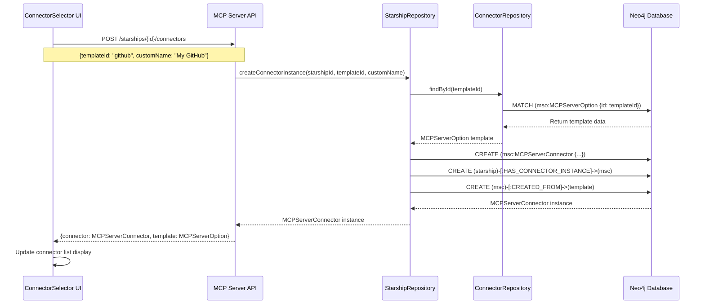
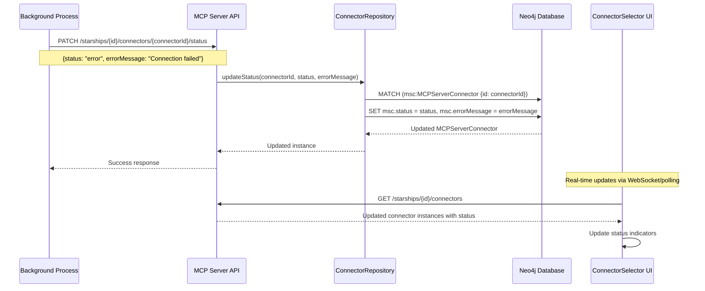
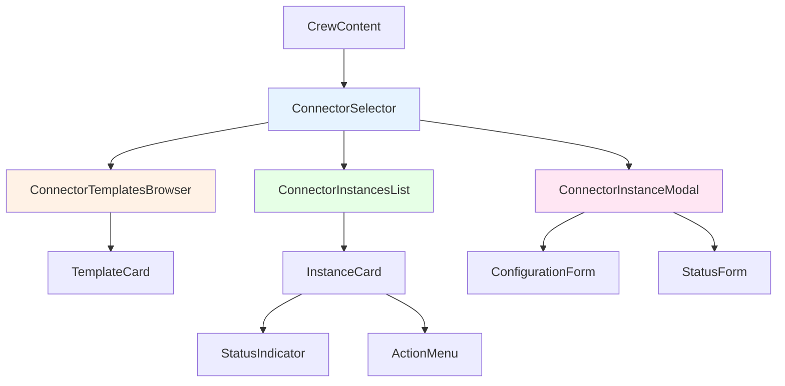
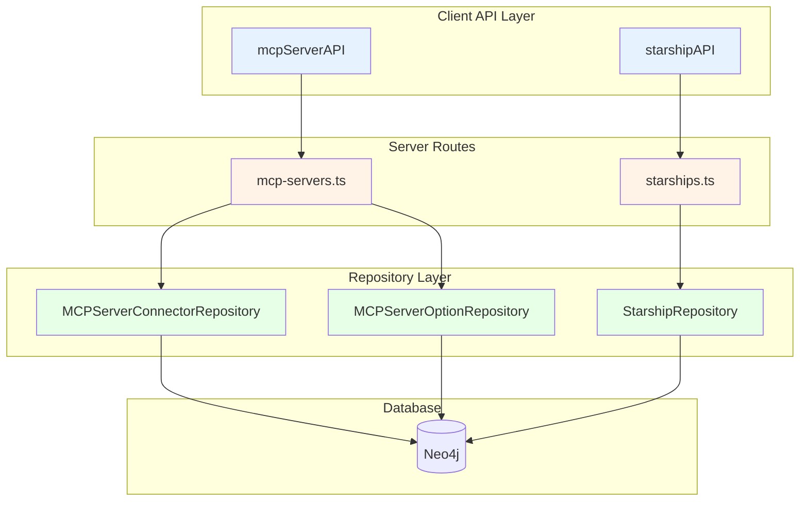
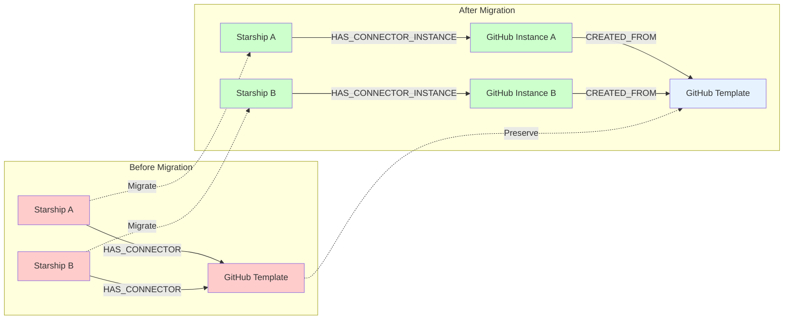

# MCP Server Connector Instance Architecture

## Current vs. Proposed Architecture

### Current System (Template Sharing)

```mermaid
graph TD
    U1[User 1 - Starship A] -->|HAS_CONNECTOR| MSO1[MCPServerOption: GitHub]
    U2[User 2 - Starship B] -->|HAS_CONNECTOR| MSO1
    U3[User 3 - Starship C] -->|HAS_CONNECTOR| MSO2[MCPServerOption: Puppeteer]
    U1 -->|HAS_CONNECTOR| MSO2

    MSO1 --> |Shared Config| CONFIG1[command: docker<br/>args: [run, github-mcp]<br/>env: {API_KEY: required}]
    MSO2 --> |Shared Config| CONFIG2[command: npx<br/>args: [@puppeteer/mcp]<br/>env: {}]

    style MSO1 fill:#ffcccc
    style MSO2 fill:#ffcccc
    style CONFIG1 fill:#ffe6e6
    style CONFIG2 fill:#ffe6e6
```

**Problems:**

- Shared configuration across all starships
- No individual customization
- No instance-specific status tracking
- Difficult to manage per-starship settings

### Proposed System (Instance-Based)

```mermaid
graph TD
    subgraph "Templates (Shared)"
        MSO1[MCPServerOption: GitHub<br/>Template]
        MSO2[MCPServerOption: Puppeteer<br/>Template]
    end

    subgraph "User 1 - Starship A"
        SA[Starship A]
        MSC1[MCPServerConnector<br/>GitHub Instance A<br/>Status: Active<br/>Custom Env: {API_KEY: user1_key}]
        MSC2[MCPServerConnector<br/>Puppeteer Instance A<br/>Status: Error<br/>Error: Connection timeout]
    end

    subgraph "User 2 - Starship B"
        SB[Starship B]
        MSC3[MCPServerConnector<br/>GitHub Instance B<br/>Status: Active<br/>Custom Env: {API_KEY: user2_key}]
    end

    subgraph "User 3 - Starship C"
        SC[Starship C]
        MSC4[MCPServerConnector<br/>Puppeteer Instance C<br/>Status: Inactive<br/>Custom Name: Web Scraper]
    end

    SA -->|HAS_CONNECTOR_INSTANCE| MSC1
    SA -->|HAS_CONNECTOR_INSTANCE| MSC2
    SB -->|HAS_CONNECTOR_INSTANCE| MSC3
    SC -->|HAS_CONNECTOR_INSTANCE| MSC4

    MSC1 -->|CREATED_FROM| MSO1
    MSC2 -->|CREATED_FROM| MSO2
    MSC3 -->|CREATED_FROM| MSO1
    MSC4 -->|CREATED_FROM| MSO2

    style MSO1 fill:#e6f3ff
    style MSO2 fill:#e6f3ff
    style MSC1 fill:#ccffcc
    style MSC2 fill:#ffcccc
    style MSC3 fill:#ccffcc
    style MSC4 fill:#ffffcc
```

**Benefits:**

- Individual instances per starship
- Custom configuration per instance
- Independent status tracking
- Personalized naming and settings

## Data Flow Architecture

### Connector Instance Creation Flow



### Connector Instance Status Update Flow



## Database Schema Evolution

### Before (Current)

```cypher
// Current relationship structure
(Starship)-[:HAS_CONNECTOR {connectedAt: datetime, isActive: boolean}]->(MCPServerOption)
```

### After (Proposed)

```cypher
// New relationship structure
(Starship)-[:HAS_CONNECTOR_INSTANCE {createdAt: datetime}]->(MCPServerConnector)
(MCPServerConnector)-[:CREATED_FROM {createdAt: datetime}]->(MCPServerOption)

// MCPServerConnector node properties
MCPServerConnector {
  id: string,
  starshipId: string,
  templateId: string,
  name: string,
  command: string,
  args: [string],
  env: string,
  status: enum,
  isActive: boolean,
  connectedAt: datetime,
  lastUsed: datetime,
  errorMessage: string,
  customConfig: string,
  createdAt: datetime,
  updatedAt: datetime
}
```

## Component Architecture

### UI Component Hierarchy



### API Layer Structure



## Migration Strategy Visualization

### Phase 1: Schema Migration



### Migration Cypher Query

```cypher
// Step 1: Create connector instances from existing relationships
MATCH (s:Starship)-[r:HAS_CONNECTOR]->(mso:MCPServerOption)
CREATE (msc:MCPServerConnector {
  id: randomUUID(),
  starshipId: s.id,
  templateId: mso.id,
  name: mso.name,
  command: mso.command,
  args: mso.args,
  env: mso.env,
  status: 'active',
  isActive: coalesce(r.isActive, true),
  connectedAt: coalesce(r.connectedAt, datetime()),
  createdAt: datetime(),
  updatedAt: datetime()
})

// Step 2: Create new relationships
CREATE (s)-[:HAS_CONNECTOR_INSTANCE {createdAt: datetime()}]->(msc)
CREATE (msc)-[:CREATED_FROM {createdAt: datetime()}]->(mso)

// Step 3: Remove old relationships (after validation)
DELETE r
```

This architecture provides a clear separation between templates and instances, enabling personalized connector management while maintaining the flexibility of the template system.
