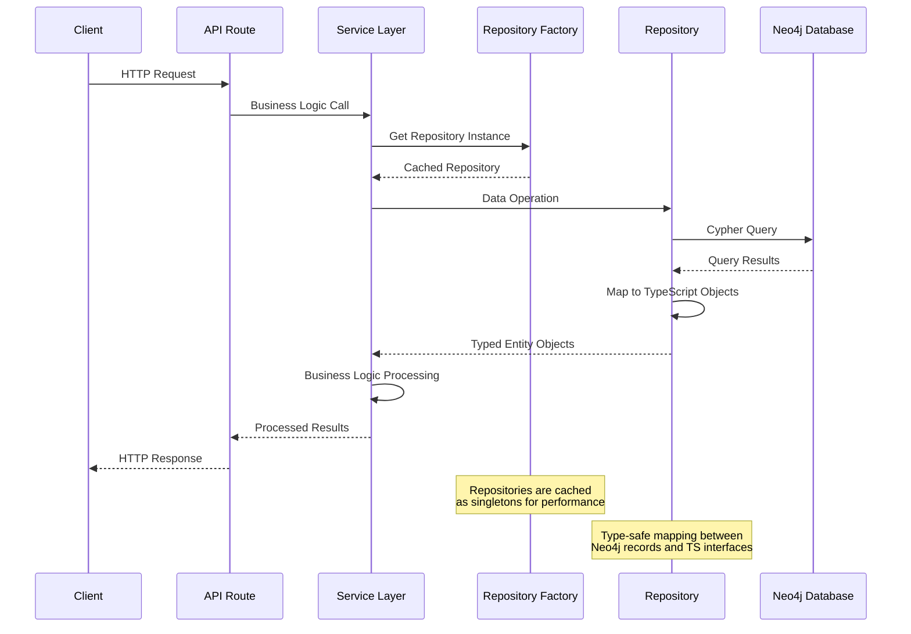

# Data Layer Architecture

## Overview

The Starships.ai data layer uses Neo4j as a graph database to model relationships between agents, users, channels, and LLM configurations. The implementation follows the Repository pattern for clean data access abstraction and uses the neo4j-driver for connection management.

## Neo4j Graph Schema

```mermaid
graph TB
    subgraph "Core Entities"
        AGENT[Agent<br/>├ id: string<br/>├ name: string<br/>├ model: string<br/>├ systemPrompt: string<br/>└ createdAt: datetime]
        
        USER[User<br/>├ id: string<br/>├ username: string<br/>├ email: string<br/>└ createdAt: datetime]
        
        CHANNEL[Channel<br/>├ id: string<br/>├ name: string<br/>├ type: string<br/>├ guildId: string<br/>└ createdAt: datetime]
        
        LLM[LLM<br/>├ id: string<br/>├ name: string<br/>├ provider: enum<br/>├ maxTokens: number<br/>├ temperature: number<br/>├ embeddingModel: string<br/>├ supportsStreaming: boolean<br/>├ supportsTools: boolean<br/>└ costPer1kTokens: number]
    end
    
    subgraph "Relationships"
        AGENT -.->|USES_MODEL| LLM
        AGENT -.->|DEPLOYED_IN<br/>{deployedAt}| CHANNEL
        USER -.->|INTERACTS_WITH<br/>{lastInteraction, messageCount}| AGENT
        USER -.->|ACTIVE_IN<br/>{joinedAt, role}| CHANNEL
    end
    
    style AGENT fill:#e3f2fd
    style USER fill:#f3e5f5
    style CHANNEL fill:#e8f5e8
    style LLM fill:#fff3e0
```

## Repository Pattern Architecture

```mermaid
graph TD
    subgraph "Client Layer"
        API[Express API Routes]
        SERVICE[Service Layer]
    end
    
    subgraph "Repository Layer"
        FACTORY[RepositoryFactory<br/>Singleton Provider]
        
        subgraph "Repository Implementations"
            AGENT_REPO[AgentRepository]
            USER_REPO[UserRepository]
            CHANNEL_REPO[ChannelRepository]
            LLM_REPO[LLMRepository]
        end
        
        subgraph "Base Interfaces"
            BASE_REPO[Repository&lt;T&gt;<br/>├ findAll()<br/>├ findById()<br/>├ create()<br/>├ update()<br/>└ delete()]
        end
    end
    
    subgraph "Database Layer"
        CONNECTION[Neo4j Connection<br/>Connection Pool]
        NEO4J[(Neo4j Database)]
    end
    
    API --> SERVICE
    SERVICE --> FACTORY
    
    FACTORY --> AGENT_REPO
    FACTORY --> USER_REPO
    FACTORY --> CHANNEL_REPO
    FACTORY --> LLM_REPO
    
    AGENT_REPO -.-> BASE_REPO
    USER_REPO -.-> BASE_REPO
    CHANNEL_REPO -.-> BASE_REPO
    LLM_REPO -.-> BASE_REPO
    
    AGENT_REPO --> CONNECTION
    USER_REPO --> CONNECTION
    CHANNEL_REPO --> CONNECTION
    LLM_REPO --> CONNECTION
    
    CONNECTION --> NEO4J
    
    style FACTORY fill:#e3f2fd
    style BASE_REPO fill:#f3e5f5
    style CONNECTION fill:#e8f5e8
    style NEO4J fill:#fff3e0
```

## Data Flow Patterns



## Graph Database Model

### Node Types

#### Agent Node
```cypher
CREATE (a:Agent {
  id: "agent-123",
  name: "Assistant",
  model: "gpt-4",
  systemPrompt: "You are a helpful AI assistant.",
  createdAt: "2024-01-01T00:00:00Z"
})
```

#### LLM Node
```cypher
CREATE (l:LLM {
  id: "llm-openai-gpt4",
  name: "gpt-4",
  provider: "openai",
  maxTokens: 4096,
  temperature: 0.7,
  embeddingModel: "text-embedding-3-small",
  supportsStreaming: true,
  supportsTools: true,
  costPer1kTokens: 0.03
})
```

#### User Node
```cypher
CREATE (u:User {
  id: "user-456",
  username: "john_doe",
  email: "john@example.com",
  createdAt: "2024-01-01T00:00:00Z"
})
```

#### Channel Node
```cypher
CREATE (c:Channel {
  id: "channel-789",
  name: "general",
  type: "text",
  guildId: "guild-123",
  createdAt: "2024-01-01T00:00:00Z"
})
```

### Relationship Types

#### Agent-LLM Relationship
```cypher
MATCH (a:Agent {id: "agent-123"}), (l:LLM {id: "llm-openai-gpt4"})
CREATE (a)-[:USES_MODEL]->(l)
```

#### Agent-Channel Deployment
```cypher
MATCH (a:Agent {id: "agent-123"}), (c:Channel {id: "channel-789"})
CREATE (a)-[:DEPLOYED_IN {deployedAt: "2024-01-01T00:00:00Z"}]->(c)
```

#### User-Agent Interaction
```cypher
MATCH (u:User {id: "user-456"}), (a:Agent {id: "agent-123"})
CREATE (u)-[:INTERACTS_WITH {
  lastInteraction: "2024-01-01T12:00:00Z",
  messageCount: 15
}]->(a)
```

#### User-Channel Membership
```cypher
MATCH (u:User {id: "user-456"}), (c:Channel {id: "channel-789"})
CREATE (u)-[:ACTIVE_IN {
  joinedAt: "2024-01-01T00:00:00Z",
  role: "member"
}]->(c)
```

## TypeScript Type Definitions

### Core Entity Types
```typescript
interface Agent {
  id: string;
  name: string;
  model: string;
  systemPrompt?: string;
  createdAt: string;
}

interface LLM {
  id: string;
  name: string;
  provider: 'openai' | 'anthropic';
  maxTokens?: number;
  temperature?: number;
  embeddingModel?: string;
  supportsStreaming?: boolean;
  supportsTools?: boolean;
  costPer1kTokens?: number;
}

interface User {
  id: string;
  username: string;
  email?: string;
  createdAt: string;
}

interface Channel {
  id: string;
  name: string;
  type: string;
  guildId?: string;
  createdAt: string;
}
```

### Relationship Types
```typescript
interface ActiveInRelationship {
  type: 'ACTIVE_IN';
  properties?: {
    joinedAt?: string;
    role?: string;
  };
}

interface InteractsWithRelationship {
  type: 'INTERACTS_WITH';
  properties?: {
    lastInteraction?: string;
    messageCount?: number;
  };
}

interface DeployedInRelationship {
  type: 'DEPLOYED_IN';
  properties?: {
    deployedAt?: string;
  };
}
```

## Repository Pattern Implementation

### Base Repository Interface
```typescript
interface Repository<T> {
  findAll(): Promise<T[]>;
  findById(id: string): Promise<T | null>;
  create(entity: Omit<T, 'id' | 'createdAt'>): Promise<T>;
  update(id: string, updates: Partial<T>): Promise<T | null>;
  delete(id: string): Promise<boolean>;
}
```

### Agent Repository Implementation
```typescript
export class AgentRepository implements AgentRepositoryInterface {
  async findAll(): Promise<Agent[]> {
    const connection = getConnection();
    const result = await connection.executeQuery<{ a: Agent }>(
      'MATCH (a:Agent) RETURN a ORDER BY a.createdAt DESC'
    );
    return result.map(record => record.a);
  }

  async findById(id: string): Promise<Agent | null> {
    const connection = getConnection();
    const result = await connection.executeQuery<{ a: Agent }>(
      'MATCH (a:Agent) WHERE a.id = $id RETURN a',
      { id }
    );
    return result.length > 0 ? result[0].a : null;
  }

  async create(entity: Omit<Agent, 'id' | 'createdAt'>): Promise<Agent> {
    const connection = getConnection();
    const id = uuidv4();
    const createdAt = new Date().toISOString();
    
    const result = await connection.executeWrite<{ a: Agent }>(
      `CREATE (a:Agent {
        id: $id,
        name: $name,
        model: $model,
        systemPrompt: $systemPrompt,
        createdAt: $createdAt
      }) RETURN a`,
      { id, createdAt, ...entity }
    );
    
    return result[0].a;
  }

  async findByChannel(channelId: string): Promise<Agent[]> {
    const connection = getConnection();
    const result = await connection.executeQuery<{ a: Agent }>(
      `MATCH (a:Agent)-[:DEPLOYED_IN]->(c:Channel)
       WHERE c.id = $channelId
       RETURN a ORDER BY a.createdAt DESC`,
      { channelId }
    );
    return result.map(record => record.a);
  }
}
```

### Repository Factory Pattern
```typescript
export class RepositoryFactory {
  private static agentRepo: AgentRepository;
  private static userRepo: UserRepository;
  private static channelRepo: ChannelRepository;
  private static llmRepo: LLMRepository;

  static getAgentRepository(): AgentRepository {
    if (!this.agentRepo) {
      this.agentRepo = new AgentRepository();
    }
    return this.agentRepo;
  }

  static getUserRepository(): UserRepository {
    if (!this.userRepo) {
      this.userRepo = new UserRepository();
    }
    return this.userRepo;
  }

  static getChannelRepository(): ChannelRepository {
    if (!this.channelRepo) {
      this.channelRepo = new ChannelRepository();
    }
    return this.channelRepo;
  }

  static getLLMRepository(): LLMRepository {
    if (!this.llmRepo) {
      this.llmRepo = new LLMRepository();
    }
    return this.llmRepo;
  }
}
```

## Connection Management

### Neo4j Connection Class
```typescript
export class Neo4jConnection {
  private driver: Driver | null = null;
  private config: Neo4jConfig;

  constructor(config: Neo4jConfig) {
    this.config = config;
  }

  async connect(): Promise<void> {
    if (this.driver) {
      return; // Already connected
    }

    try {
      this.driver = neo4j.driver(
        this.config.uri,
        auth.basic(this.config.username, this.config.password)
      );

      await this.driver.verifyConnectivity();
    } catch (error) {
      console.error('Failed to connect to Neo4j:', error);
      throw error;
    }
  }

  getSession(): Session {
    if (!this.driver) {
      throw new Error('Neo4j driver is not connected. Call connect() first.');
    }
    
    return this.driver.session({
      database: this.config.database || 'neo4j'
    });
  }

  async executeQuery<T = any>(cypher: string, parameters: any = {}): Promise<T[]> {
    const session = this.getSession();
    
    try {
      const result = await session.executeRead((tx: ManagedTransaction) => 
        tx.run(cypher, parameters)
      );
      
      return result.records.map(record => {
        const obj = record.toObject();
        // Extract properties from Neo4j nodes
        const processedObj: any = {};
        for (const [key, value] of Object.entries(obj)) {
          if (value && typeof value === 'object' && value.properties) {
            // This is a Neo4j node, extract its properties
            processedObj[key] = value.properties;
          } else {
            // This is a regular value or relationship
            processedObj[key] = value;
          }
        }
        return processedObj as T;
      });
    } finally {
      await session.close();
    }
  }

  async executeWrite<T = any>(cypher: string, parameters: any = {}): Promise<T[]> {
    const session = this.getSession();
    
    try {
      const result = await session.executeWrite((tx: ManagedTransaction) => 
        tx.run(cypher, parameters)
      );
      
      return result.records.map(record => {
        const obj = record.toObject();
        // Extract properties from Neo4j nodes
        const processedObj: any = {};
        for (const [key, value] of Object.entries(obj)) {
          if (value && typeof value === 'object' && value.properties) {
            // This is a Neo4j node, extract its properties
            processedObj[key] = value.properties;
          } else {
            // This is a regular value or relationship
            processedObj[key] = value;
          }
        }
        return processedObj as T;
      });
    } finally {
      await session.close();
    }
  }
}
```

### Connection Factory
```typescript
let connectionInstance: Neo4jConnection | null = null;

export function createConnection(config: Neo4jConfig): Neo4jConnection {
  if (!connectionInstance) {
    connectionInstance = new Neo4jConnection(config);
  }
  return connectionInstance;
}

export function getConnection(): Neo4jConnection {
  if (!connectionInstance) {
    throw new Error('Neo4j connection not initialized. Call createConnection() first.');
  }
  return connectionInstance;
}
```

## Schema Initialization

### Database Constraints
```typescript
async initializeSchema(): Promise<void> {
  const session = this.getSession();
  
  try {
    // Create constraints for unique IDs
    const constraints = [
      'CREATE CONSTRAINT agent_id_unique IF NOT EXISTS FOR (a:Agent) REQUIRE a.id IS UNIQUE',
      'CREATE CONSTRAINT llm_id_unique IF NOT EXISTS FOR (l:LLM) REQUIRE l.id IS UNIQUE',
      'CREATE CONSTRAINT user_id_unique IF NOT EXISTS FOR (u:User) REQUIRE u.id IS UNIQUE',
      'CREATE CONSTRAINT channel_id_unique IF NOT EXISTS FOR (c:Channel) REQUIRE c.id IS UNIQUE',
    ];

    for (const constraint of constraints) {
      await session.run(constraint);
    }
  } finally {
    await session.close();
  }
}
```

### Database Indexes
```typescript
// Create indexes for common queries
const indexes = [
  'CREATE INDEX agent_name_index IF NOT EXISTS FOR (a:Agent) ON (a.name)',
  'CREATE INDEX user_username_index IF NOT EXISTS FOR (u:User) ON (u.username)',
  'CREATE INDEX user_email_index IF NOT EXISTS FOR (u:User) ON (u.email)',
  'CREATE INDEX channel_guild_index IF NOT EXISTS FOR (c:Channel) ON (c.guildId)',
  'CREATE INDEX llm_provider_index IF NOT EXISTS FOR (l:LLM) ON (l.provider)',
];

for (const index of indexes) {
  await session.run(index);
}
```

## Query Patterns

### Common Cypher Queries

#### Find Agents by User Interaction
```cypher
MATCH (u:User)-[r:INTERACTS_WITH]->(a:Agent)
WHERE u.id = $userId
RETURN a, r.lastInteraction, r.messageCount
ORDER BY r.lastInteraction DESC
```

#### Find Available LLM Models
```cypher
MATCH (l:LLM)
WHERE l.provider = $provider
RETURN l
ORDER BY l.costPer1kTokens ASC
```

#### Complex Multi-hop Query
```cypher
MATCH (u:User)-[:ACTIVE_IN]->(c:Channel)<-[:DEPLOYED_IN]-(a:Agent)-[:USES_MODEL]->(l:LLM)
WHERE u.id = $userId AND c.guildId = $guildId
RETURN a, l, c
ORDER BY a.name
```

### Dynamic Query Building
```typescript
async update(id: string, updates: Partial<Agent>): Promise<Agent | null> {
  const connection = getConnection();
  
  // Build SET clause dynamically
  const setClause = Object.keys(updates)
    .filter(key => key !== 'id' && key !== 'createdAt')
    .map(key => `a.${key} = $${key}`)
    .join(', ');
  
  if (!setClause) {
    return this.findById(id);
  }

  const result = await connection.executeWrite<{ a: Agent }>(
    `MATCH (a:Agent) WHERE a.id = $id
     SET ${setClause}
     RETURN a`,
    { id, ...updates }
  );
  
  return result.length > 0 ? result[0].a : null;
}
```

## Performance Considerations

### Query Optimization
```cypher
-- Use EXPLAIN to analyze query performance
EXPLAIN MATCH (a:Agent)-[:DEPLOYED_IN]->(c:Channel)
WHERE c.guildId = $guildId
RETURN a, c

-- Use PROFILE for detailed execution statistics
PROFILE MATCH (u:User)-[:INTERACTS_WITH]->(a:Agent)
WHERE u.email = $email
RETURN a
ORDER BY a.createdAt DESC
LIMIT 10
```

### Connection Pooling
```typescript
// Configure connection pool settings
const driver = neo4j.driver(uri, auth, {
  maxConnectionPoolSize: 100,
  connectionAcquisitionTimeout: 60000,
  maxTransactionRetryTime: 15000,
});
```

### Batch Operations
```typescript
async createBatch(entities: Omit<Agent, 'id' | 'createdAt'>[]): Promise<Agent[]> {
  const connection = getConnection();
  const now = new Date().toISOString();
  
  const cypher = `
    UNWIND $agents AS agent
    CREATE (a:Agent {
      id: randomUUID(),
      name: agent.name,
      model: agent.model,
      systemPrompt: agent.systemPrompt,
      createdAt: $createdAt
    })
    RETURN a
  `;
  
  const result = await connection.executeWrite<{ a: Agent }>(
    cypher,
    { agents: entities, createdAt: now }
  );
  
  return result.map(record => record.a);
}
```

## Data Validation

### Input Validation
```typescript
private validateAgent(agent: Partial<Agent>): void {
  if (agent.name && (agent.name.length < 1 || agent.name.length > 100)) {
    throw new Error('Agent name must be 1-100 characters');
  }
  
  if (agent.model && !this.isValidModel(agent.model)) {
    throw new Error('Invalid model identifier');
  }
  
  if (agent.systemPrompt && agent.systemPrompt.length > 2000) {
    throw new Error('System prompt must be less than 2000 characters');
  }
}

private isValidModel(model: string): boolean {
  const validModels = ['gpt-4', 'gpt-3.5-turbo', 'claude-3-sonnet', 'claude-3-haiku'];
  return validModels.includes(model);
}
```

### Database Constraints
```cypher
-- Ensure required fields are present
CREATE CONSTRAINT agent_name_required IF NOT EXISTS 
FOR (a:Agent) REQUIRE a.name IS NOT NULL

-- Validate enum values
CREATE CONSTRAINT llm_provider_enum IF NOT EXISTS 
FOR (l:LLM) REQUIRE l.provider IN ['openai', 'anthropic']

-- Ensure positive values
CREATE CONSTRAINT llm_tokens_positive IF NOT EXISTS 
FOR (l:LLM) REQUIRE l.maxTokens > 0
```

## Error Handling

### Connection Error Recovery
```typescript
async executeQueryWithRetry<T>(
  cypher: string, 
  parameters: any = {}, 
  maxRetries: number = 3
): Promise<T[]> {
  let lastError: Error;
  
  for (let attempt = 1; attempt <= maxRetries; attempt++) {
    try {
      return await this.executeQuery<T>(cypher, parameters);
    } catch (error) {
      lastError = error as Error;
      
      if (this.isRetryableError(error) && attempt < maxRetries) {
        await this.delay(attempt * 1000); // Exponential backoff
        continue;
      }
      
      throw error;
    }
  }
  
  throw lastError!;
}

private isRetryableError(error: any): boolean {
  const retryableCodes = [
    'Neo.TransientError.General.DatabaseUnavailable',
    'Neo.TransientError.Network.CommunicationError',
  ];
  
  return retryableCodes.some(code => error.code?.includes(code));
}
```

### Transaction Management
```typescript
async executeInTransaction<T>(
  operations: (tx: ManagedTransaction) => Promise<T>
): Promise<T> {
  const session = this.getSession();
  
  try {
    return await session.executeWrite(operations);
  } catch (error) {
    console.error('Transaction failed:', error);
    throw error;
  } finally {
    await session.close();
  }
}
```

## Neo4j Data Extraction

### Important: Property Extraction Pattern

Neo4j returns node data wrapped in metadata. When using `RETURN a` (where `a` is a node alias), the result structure looks like:

```json
{
  "a": {
    "identity": { "low": 0, "high": 0 },
    "labels": ["Agent"],
    "properties": {
      "id": "agent-123",
      "name": "Assistant", 
      "model": "gpt-4",
      "systemPrompt": "You are helpful...",
      "createdAt": "2024-01-01T00:00:00Z"
    },
    "elementId": "4:..."
  }
}
```

**Critical**: The actual entity data is in the `properties` field, not the root object.

### Common Pitfall: Empty Objects

❌ **Wrong - This returns empty objects:**
```typescript
return result.records.map(record => record.toObject() as T);
// This gives you: { identity: {...}, labels: [...], properties: {...} }
```

✅ **Correct - Extract properties from nodes:**
```typescript
return result.records.map(record => {
  const obj = record.toObject();
  const processedObj: any = {};
  for (const [key, value] of Object.entries(obj)) {
    if (value && typeof value === 'object' && value.properties) {
      // This is a Neo4j node, extract its properties
      processedObj[key] = value.properties;
    } else {
      // This is a regular value or relationship
      processedObj[key] = value;
    }
  }
  return processedObj as T;
});
```

This pattern ensures that:
- **Node data**: `record.a` becomes the actual agent properties
- **Relationships**: Remain as-is for relationship queries
- **Scalar values**: Remain unchanged (counts, strings, etc.)

## Testing Strategies

### Repository Testing
```typescript
describe('AgentRepository', () => {
  let repository: AgentRepository;
  let testAgent: Agent;

  beforeEach(async () => {
    repository = new AgentRepository();
    testAgent = await repository.create({
      name: 'Test Agent',
      model: 'gpt-4',
      systemPrompt: 'Test prompt'
    });
  });

  afterEach(async () => {
    await repository.delete(testAgent.id);
  });

  it('should create and retrieve agent', async () => {
    const retrieved = await repository.findById(testAgent.id);
    expect(retrieved).toBeDefined();
    expect(retrieved!.name).toBe('Test Agent');
  });

  it('should update agent properties', async () => {
    const updated = await repository.update(testAgent.id, {
      name: 'Updated Agent'
    });
    expect(updated!.name).toBe('Updated Agent');
  });
});
```

### Integration Testing
```typescript
describe('Database Integration', () => {
  beforeAll(async () => {
    const config = {
      uri: 'bolt://localhost:7687',
      username: 'neo4j',
      password: 'test-password',
      database: 'test'
    };
    
    const connection = createConnection(config);
    await connection.connect();
    await connection.initializeSchema();
  });

  afterAll(async () => {
    const connection = getConnection();
    await connection.disconnect();
  });

  it('should handle complex queries', async () => {
    // Test complex multi-node operations
  });
});
```

## Migration Strategies

### Schema Evolution
```typescript
interface Migration {
  version: string;
  description: string;
  up: (connection: Neo4jConnection) => Promise<void>;
  down: (connection: Neo4jConnection) => Promise<void>;
}

const migrations: Migration[] = [
  {
    version: '1.0.0',
    description: 'Initial schema',
    up: async (connection) => {
      await connection.initializeSchema();
    },
    down: async (connection) => {
      await connection.executeWrite('MATCH (n) DETACH DELETE n');
    }
  },
  {
    version: '1.1.0',
    description: 'Add LLM cost tracking',
    up: async (connection) => {
      await connection.executeWrite(`
        MATCH (l:LLM)
        SET l.costPer1kTokens = CASE 
          WHEN l.provider = 'openai' THEN 0.03
          WHEN l.provider = 'anthropic' THEN 0.015
          ELSE 0.01
        END
      `);
    },
    down: async (connection) => {
      await connection.executeWrite('MATCH (l:LLM) REMOVE l.costPer1kTokens');
    }
  }
];
```

### Data Seeding
```typescript
async seedDefaultData(): Promise<void> {
  const connection = getConnection();
  
  // Check if data already exists
  const existingCount = await connection.executeQuery<{ count: number }>(
    'MATCH (a:Agent) RETURN count(a) as count'
  );
  
  if (existingCount[0].count > 0) {
    return; // Already seeded
  }

  // Seed default LLM configurations
  await connection.executeWrite(`
    CREATE (:LLM {
      id: 'openai-gpt4',
      name: 'gpt-4',
      provider: 'openai',
      maxTokens: 4096,
      temperature: 0.7,
      supportsStreaming: true,
      costPer1kTokens: 0.03
    })
  `);

  // Seed default agents
  await connection.executeWrite(`
    CREATE (:Agent {
      id: randomUUID(),
      name: 'Assistant',
      model: 'gpt-4',
      systemPrompt: 'You are a helpful AI assistant.',
      createdAt: datetime()
    })
  `);
}
```

## Monitoring and Observability

### Performance Metrics
```typescript
interface DatabaseMetrics {
  connectionPoolSize: number;
  activeConnections: number;
  queryLatency: number;
  errorRate: number;
  transactionCount: number;
}

async getMetrics(): Promise<DatabaseMetrics> {
  const connection = getConnection();
  
  return {
    connectionPoolSize: await this.getConnectionPoolSize(),
    activeConnections: await this.getActiveConnections(),
    queryLatency: await this.getAverageQueryLatency(),
    errorRate: await this.getErrorRate(),
    transactionCount: await this.getTransactionCount()
  };
}
```

### Query Logging
```typescript
async executeQuery<T>(cypher: string, parameters: any = {}): Promise<T[]> {
  const startTime = Date.now();
  
  try {
    const result = await this.session.run(cypher, parameters);
    const duration = Date.now() - startTime;
    
    console.log(`Query executed in ${duration}ms: ${cypher}`);
    
    return result.records.map(record => record.toObject() as T);
  } catch (error) {
    console.error(`Query failed after ${Date.now() - startTime}ms:`, error);
    throw error;
  }
}
``` 