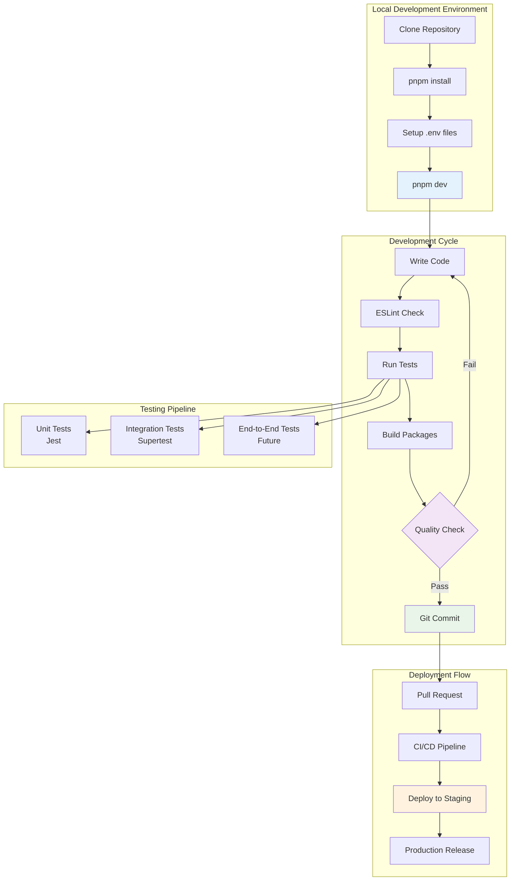
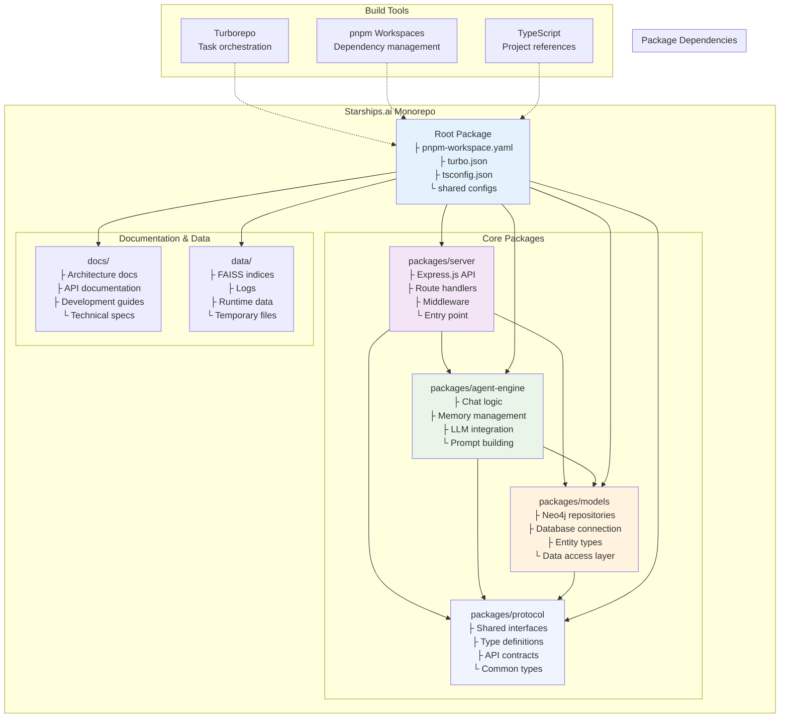
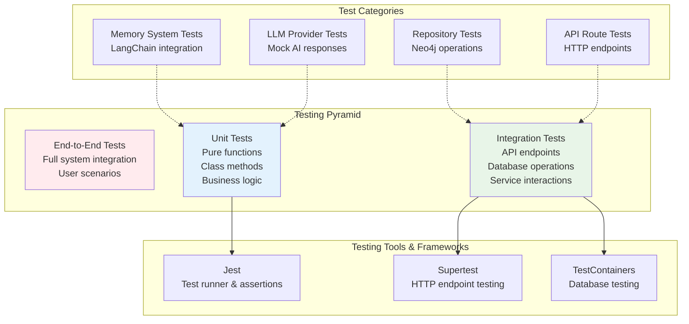

# Development Guide

## Getting Started

### Prerequisites

- **Node.js**: Version 20 or higher
- **pnpm**: Package manager (v8.10.5 or higher)
- **Neo4j**: Graph database (local or cloud instance)
- **Git**: Version control

## Development Workflow Overview



## Monorepo Structure & Dependencies



## Testing Strategy



### Environment Setup

1. **Clone the repository**
   ```bash
   git clone https://github.com/your-org/starships.ai.git
   cd starships.ai
   ```

2. **Install dependencies**
   ```bash
   pnpm install
   ```

3. **Configure environment**
   ```bash
   cp .env.example .env
   # Edit .env with your configuration
   ```

4. **Start development servers**
   ```bash
   pnpm dev
   ```

### Project Structure

```
starships.ai/
├── packages/
│   ├── server/          # Express.js HTTP API server
│   ├── agent-engine/    # AI chat logic and memory management
│   ├── models/          # Neo4j data layer and repositories
│   └── protocol/        # Shared TypeScript interfaces
├── docs/               # Technical documentation
├── data/              # Runtime data (FAISS indices, logs)
├── .env               # Environment configuration
├── turbo.json         # Turborepo build configuration
└── pnpm-workspace.yaml # Workspace configuration
```

## Coding Standards

### TypeScript Configuration

All packages use strict TypeScript configuration:

```json
{
  "compilerOptions": {
    "strict": true,
    "noImplicitAny": true,
    "noImplicitReturns": true,
    "noUnusedLocals": true,
    "noUnusedParameters": true,
    "exactOptionalPropertyTypes": true
  }
}
```

### Code Style Guidelines

#### Naming Conventions

```typescript
// PascalCase for classes and interfaces
class AgentRepository implements AgentRepositoryInterface {}

// camelCase for variables and functions
const agentRepository = new AgentRepository();
async function createAgent(config: AgentConfig): Promise<Agent> {}

// SCREAMING_SNAKE_CASE for constants
const DEFAULT_TEMPERATURE = 0.7;

// kebab-case for files and directories
agent-repository.ts
memory-system.md
```

#### Import Organization

```typescript
// 1. Node.js built-ins
import path from 'path';
import fs from 'fs';

// 2. External libraries
import express from 'express';
import { v4 as uuidv4 } from 'uuid';

// 3. Internal packages (workspace deps)
import { AgentRepository } from '@starships/models';
import type { ChatRequest } from '@starships/protocol';

// 4. Relative imports
import { buildPrompt } from './prompt/builder';
import { env } from '../config/environment';
```

#### Function Documentation

```typescript
/**
 * Creates a new AI agent with the specified configuration.
 * 
 * @param config - Agent configuration including name, model, and system prompt
 * @returns Promise resolving to the created agent
 * @throws Error if model ID is invalid or database operation fails
 * 
 * @example
 * ```typescript
 * const agent = await AgentService.createAgent({
 *   name: 'Assistant',
 *   model: 'gpt-4',
 *   systemPrompt: 'You are a helpful assistant.'
 * });
 * ```
 */
async function createAgent(config: CreateAgentConfig): Promise<Agent> {
  // Implementation...
}
```

### Error Handling Patterns

#### Service Layer Error Handling

```typescript
export class AgentService {
  static async createAgent(config: CreateAgentConfig): Promise<Agent> {
    try {
      const agentRepo = RepositoryFactory.getAgentRepository();
      const llmRepo = RepositoryFactory.getLLMRepository();
      
      // Validate model exists
      const llm = await llmRepo.findById(config.model);
      if (!llm) {
        throw new ValidationError(`Invalid model ID: ${config.model}`);
      }
      
      const agent = await agentRepo.create({
        name: config.name,
        model: config.model,
        systemPrompt: config.systemPrompt || this.getDefaultSystemPrompt(),
      });
      
      return agent;
    } catch (error) {
      if (error instanceof ValidationError) {
        throw error; // Re-throw validation errors
      }
      
      // Wrap unexpected errors
      throw new ServiceError('Failed to create agent', { cause: error });
    }
  }
}
```

#### API Route Error Handling

```typescript
router.post("/", validateChatRequest, async (req, res) => {
  try {
    const result = await agentChat(req.body, store);
    res.json(result);
  } catch (error) {
    console.error('Chat error:', error);
    
    // Determine appropriate status code
    const statusCode = error instanceof ValidationError ? 400 :
                      error instanceof NotFoundError ? 404 :
                      500;
    
    res.status(statusCode).json({ 
      error: error.message,
      code: error.constructor.name 
    });
  }
});
```

### Validation Patterns

#### Input Validation

```typescript
function validateChatRequest(req: Request, res: Response, next: NextFunction) {
  const { agent_id, user_id, message } = req.body;
  
  const errors: string[] = [];
  
  if (!agent_id || typeof agent_id !== 'string') {
    errors.push('agent_id is required and must be a string');
  }
  
  if (!user_id || typeof user_id !== 'string') {
    errors.push('user_id is required and must be a string');
  }
  
  if (!message || typeof message !== 'string') {
    errors.push('message is required and must be a string');
  }
  
  if (errors.length > 0) {
    return res.status(400).json({ 
      error: 'Validation failed',
      details: errors 
    });
  }
  
  next();
}
```

#### Type Guards

```typescript
function isValidAgent(obj: any): obj is Agent {
  return typeof obj === 'object' &&
         typeof obj.id === 'string' &&
         typeof obj.name === 'string' &&
         typeof obj.model === 'string' &&
         (obj.systemPrompt === undefined || typeof obj.systemPrompt === 'string');
}

function assertValidAgent(obj: any): asserts obj is Agent {
  if (!isValidAgent(obj)) {
    throw new ValidationError('Invalid agent object');
  }
}
```

## Testing Practices

### Test Structure

```
packages/server/tests/
├── unit/              # Unit tests for individual functions/classes
│   ├── agents.spec.ts
│   ├── chat.spec.ts
│   └── memory.spec.ts
├── integration/       # Integration tests for API endpoints
│   ├── api.spec.ts
│   └── database.spec.ts
├── mocks/            # Test mocks and fixtures
│   └── @starships/
└── testUtils.ts      # Shared test utilities
```

### Unit Testing Patterns

```typescript
describe('AgentRepository', () => {
  let repository: AgentRepository;
  let mockConnection: jest.Mocked<Neo4jConnection>;

  beforeEach(() => {
    mockConnection = createMockConnection();
    (getConnection as jest.Mock).mockReturnValue(mockConnection);
    repository = new AgentRepository();
  });

  describe('findById', () => {
    it('should return agent when found', async () => {
      // Arrange
      const agentData = { id: 'test-id', name: 'Test Agent' };
      mockConnection.executeQuery.mockResolvedValue([{ a: agentData }]);

      // Act
      const result = await repository.findById('test-id');

      // Assert
      expect(result).toEqual(agentData);
      expect(mockConnection.executeQuery).toHaveBeenCalledWith(
        'MATCH (a:Agent) WHERE a.id = $id RETURN a',
        { id: 'test-id' }
      );
    });

    it('should return null when not found', async () => {
      // Arrange
      mockConnection.executeQuery.mockResolvedValue([]);

      // Act
      const result = await repository.findById('nonexistent');

      // Assert
      expect(result).toBeNull();
    });
  });
});
```

### Integration Testing

```typescript
describe('POST /v1/chat', () => {
  let app: Application;
  let mockStore: jest.Mocked<LangChainMemoryStore>;

  beforeEach(() => {
    mockStore = createMockMemoryStore();
    app = createTestApp(mockStore);
  });

  it('should return chat response', async () => {
    // Arrange
    const chatRequest = {
      agent_id: 'agent-1',
      user_id: 'user-1',
      message: 'Hello'
    };
    
    (mockChat as jest.Mock).mockResolvedValue({ reply: 'Hi there!' });

    // Act & Assert
    const response = await request(app)
      .post('/v1/chat')
      .send(chatRequest)
      .expect(200);

    expect(response.body).toEqual({ reply: 'Hi there!' });
    expect(mockChat).toHaveBeenCalledWith(chatRequest, mockStore);
  });

  it('should handle validation errors', async () => {
    // Act & Assert
    await request(app)
      .post('/v1/chat')
      .send({ message: 'Hello' }) // Missing required fields
      .expect(400);
  });
});
```

### Test Utilities

```typescript
// testUtils.ts
export function createMockConnection(): jest.Mocked<Neo4jConnection> {
  return {
    connect: jest.fn(),
    disconnect: jest.fn(),
    executeQuery: jest.fn(),
    executeWrite: jest.fn(),
    getSession: jest.fn(),
  } as any;
}

export function createTestApp(mockStore?: LangChainMemoryStore): Application {
  const app = express();
  app.use(express.json());
  
  // Override store with mock
  if (mockStore) {
    jest.doMock('../src/store', () => ({
      default: () => mockStore
    }));
  }
  
  return app;
}

export function createMockAgent(overrides: Partial<Agent> = {}): Agent {
  return {
    id: 'test-agent-id',
    name: 'Test Agent',
    model: 'gpt-4',
    systemPrompt: 'You are a test assistant.',
    createdAt: new Date().toISOString(),
    ...overrides,
  };
}
```

## Development Workflows

### Monorepo Management

#### Turborepo Commands

```bash
# Build all packages
pnpm build

# Run tests across all packages
pnpm test

# Lint all packages
pnpm lint

# Development mode with watch
pnpm dev

# Build specific package
pnpm turbo run build --filter=server

# Run command in specific package
pnpm --filter @starships/server dev
```

#### Package Dependencies

```json
// packages/server/package.json
{
  "dependencies": {
    "@starships/agent-engine": "workspace:*",
    "@starships/models": "workspace:*",
    "@starships/protocol": "workspace:*"
  }
}
```

### Git Workflow

#### Branch Naming

```bash
feature/agent-memory-improvements
bugfix/chat-validation-error
chore/update-dependencies
docs/api-documentation
```

#### Commit Messages

Follow conventional commits:

```bash
feat(agent): add support for custom system prompts
fix(memory): resolve vector store initialization issue
docs(api): update chat endpoint documentation
chore(deps): update langchain to v0.3.29
test(chat): add integration tests for streaming
```

#### Pre-commit Hooks

```json
// package.json
{
  "husky": {
    "hooks": {
      "pre-commit": "lint-staged"
    }
  },
  "lint-staged": {
    "*.{ts,tsx}": [
      "eslint --fix",
      "prettier --write"
    ]
  }
}
```

### Database Development

#### Local Neo4j Setup

```bash
# Using Docker
docker run \
  --name neo4j \
  -p 7474:7474 -p 7687:7687 \
  -e NEO4J_AUTH=neo4j/password \
  neo4j:latest

# Or using Neo4j Desktop
# Download from https://neo4j.com/desktop/
```

#### Schema Management

```typescript
// Development seeding
async function seedDevelopmentData(): Promise<void> {
  const agentRepo = RepositoryFactory.getAgentRepository();
  const llmRepo = RepositoryFactory.getLLMRepository();

  // Create default LLM models
  const gpt4 = await llmRepo.create({
    name: 'gpt-4',
    provider: 'openai',
    maxTokens: 4096,
    temperature: 0.7,
  });

  // Create development agents
  await agentRepo.create({
    name: 'Dev Assistant',
    model: gpt4.id,
    systemPrompt: 'You are a development assistant for Starships.ai.',
  });
}
```

### Environment Management

#### Development Environment

```bash
# .env.development
NODE_ENV=development
PORT=4000
NEO4J_URI=bolt://localhost:7687
NEO4J_USERNAME=neo4j
NEO4J_PASSWORD=password
OPENAI_API_KEY=sk-dev-key...
DEFAULT_PROVIDER=openai
```

#### Production Environment

```bash
# .env.production
NODE_ENV=production
PORT=4000
NEO4J_URI=bolt://production-neo4j:7687
NEO4J_USERNAME=starships
NEO4J_PASSWORD=secure-password
OPENAI_API_KEY=sk-prod-key...
```

### Debugging

#### VSCode Configuration

```json
// .vscode/launch.json
{
  "version": "0.2.0",
  "configurations": [
    {
      "name": "Debug Server",
      "type": "node",
      "request": "launch",
      "program": "${workspaceFolder}/packages/server/src/index.ts",
      "envFile": "${workspaceFolder}/.env",
      "runtimeArgs": ["-r", "tsx/cjs"],
      "console": "integratedTerminal",
      "restart": true,
      "runtimeExecutable": "node"
    }
  ]
}
```

#### Logging Strategy

```typescript
// Use structured logging
import { logger } from './utils/logger';

logger.info('Chat request received', {
  agentId: req.agent_id,
  userId: req.user_id,
  messageLength: req.message.length,
});

logger.error('Provider initialization failed', {
  agentId,
  provider: llm.provider,
  error: error.message,
});
```

## Performance Guidelines

### Database Query Optimization

```typescript
// ✅ Good: Use indexed fields
async findByUsername(username: string): Promise<User | null> {
  return await this.connection.executeQuery(
    'MATCH (u:User) WHERE u.username = $username RETURN u',
    { username }
  );
}

// ❌ Bad: Full table scan
async findByPartialName(name: string): Promise<User[]> {
  return await this.connection.executeQuery(
    'MATCH (u:User) WHERE u.name CONTAINS $name RETURN u',
    { name }
  );
}
```

### Memory Management

```typescript
// ✅ Good: Close resources properly
async function processChat(sessionKey: string): Promise<void> {
  const session = connection.getSession();
  try {
    await session.run(query, parameters);
  } finally {
    await session.close();
  }
}

// ✅ Good: Implement caching
class CachedRepository {
  private cache = new Map<string, Agent>();
  
  async findById(id: string): Promise<Agent | null> {
    if (this.cache.has(id)) {
      return this.cache.get(id)!;
    }
    
    const agent = await super.findById(id);
    if (agent) {
      this.cache.set(id, agent);
    }
    return agent;
  }
}
```

### API Performance

```typescript
// ✅ Good: Implement request validation
const validateChatRequest = [
  body('agent_id').isUUID().withMessage('Invalid agent ID'),
  body('user_id').isString().isLength({ min: 1 }).withMessage('User ID required'),
  body('message').isString().isLength({ max: 10000 }).withMessage('Message too long'),
];

// ✅ Good: Use compression middleware
app.use(compression());

// ✅ Good: Implement rate limiting
const limiter = rateLimit({
  windowMs: 15 * 60 * 1000, // 15 minutes
  max: 100, // limit each IP to 100 requests per windowMs
});
app.use('/v1/', limiter);
```

## Security Best Practices

### Input Sanitization

```typescript
// ✅ Good: Sanitize user inputs
function sanitizeMessage(message: string): string {
  return message
    .trim()
    .replace(/[<>]/g, '') // Remove potential HTML
    .slice(0, 10000); // Limit length
}

// ✅ Good: Validate UUIDs
function isValidUUID(str: string): boolean {
  const uuidRegex = /^[0-9a-f]{8}-[0-9a-f]{4}-[1-5][0-9a-f]{3}-[89ab][0-9a-f]{3}-[0-9a-f]{12}$/i;
  return uuidRegex.test(str);
}
```

### Environment Variable Management

```typescript
// ✅ Good: Validate required environment variables
function validateEnvironment(): EnvironmentConfig {
  const required = ['NEO4J_URI', 'NEO4J_USERNAME', 'NEO4J_PASSWORD'];
  const missing = required.filter(key => !process.env[key]);
  
  if (missing.length > 0) {
    throw new Error(`Missing required environment variables: ${missing.join(', ')}`);
  }
  
  return {
    neo4jUri: process.env.NEO4J_URI!,
    neo4jUsername: process.env.NEO4J_USERNAME!,
    neo4jPassword: process.env.NEO4J_PASSWORD!,
  };
}
```

## Release Process

### Version Management

```bash
# Update version in all packages
pnpm changeset version

# Create changeset for new features
pnpm changeset

# Build and test before release
pnpm build
pnpm test

# Publish to registry (if applicable)
pnpm changeset publish
```

### Docker Build

```bash
# Build production image
docker build -t starships.ai:latest .

# Run with environment file
docker run --env-file .env -p 4000:4000 starships.ai:latest

# Multi-stage build optimization
docker build --target runtime -t starships.ai:runtime .
```

### Deployment Checklist

- [ ] All tests passing
- [ ] Environment variables configured
- [ ] Database schema up to date
- [ ] API documentation updated
- [ ] Performance benchmarks acceptable
- [ ] Security audit completed
- [ ] Monitoring and logging configured 