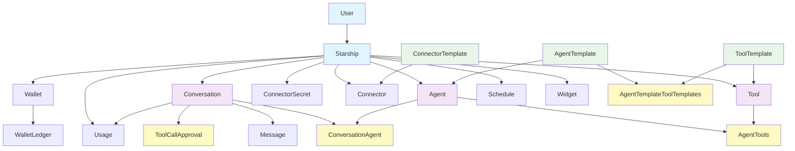

# Starships.ai Entity Relationship Diagram

## Overview

This ER diagram reflects the **actual implemented database schema** as defined by the TypeScript migrations in `packages/models/src/migrations/*.ts`.

**Note:** Workflows/blueprints/executions tables were intentionally removed; complex workflow state is stored as JSONB (e.g. `agents.blueprint`, `tools.blueprint`).

## Comprehensive Data Model

```mermaid
erDiagram
    %% ------------------------------------------------------------------------
    %% Auth / Users
    %% ------------------------------------------------------------------------
    users {
        string id PK
        string email UK
        string display_name
        string avatar
        string password
        string stripe_customer_id UK
        boolean email_verified
        boolean has_password
        string[] auth_methods
        string primary_auth_method "password|oauth"
        timestamp last_login_at
        boolean is_instance_admin
        timestamp created_at
        timestamp updated_at
    }

    oauth_accounts {
        string id PK
        string user_id FK
        string provider "google|github"
        string provider_user_id
        string email
        jsonb profile_data
        timestamp created_at
        timestamp updated_at
    }

    oauth_auth_codes {
        string id PK
        string code UK
        string user_id FK
        string email
        boolean consumed
        timestamp created_at
        timestamp expires_at
    }

    email_verification_tokens {
        string id PK
        string token UK
        string user_id FK
        string email
        boolean consumed
        timestamp created_at
        timestamp expires_at
    }

    password_reset_tokens {
        string id PK
        string token UK
        string user_id FK
        string email
        boolean consumed
        timestamp created_at
        timestamp expires_at
    }

    email_change_tokens {
        string id PK
        string token UK
        string user_id FK
        string old_email
        string new_email
        boolean consumed
        timestamp created_at
        timestamp expires_at
    }

    %% ------------------------------------------------------------------------
    %% Starships + Runtime State
    %% ------------------------------------------------------------------------
    starships {
        string id PK
        string slug "Unique per owner"
        string owner_id FK
        string name
        int max_agents
        string ship_class "scout|frigate|cruiser"
        int max_concurrent_turns
        string status "active|inactive"
        timestamp created_at
        timestamp updated_at
    }

    conversations {
        string id PK
        string title
        string status "active|paused|completed|archived"
        jsonb state
        string parent_conversation_id FK
        string starship_id FK
        timestamp created_at
        timestamp updated_at
    }

    messages {
        string id PK
        string role "system|user|assistant|tool"
        text content
        string message_type "user_input|agent_response|system_notification|system_instruction|workflow_output|error|tool_result"
        text reasoning
        jsonb tool_calls
        string tool_call_id
        string agent_id FK
        string agent_name
        string[] attachment_ids
        string starship_id FK
        string conversation_id FK
        timestamp created_at
        timestamp updated_at
    }

    attachments {
        string id PK
        string starship_id FK
        string message_id FK
        string filename
        string mime_type
        bigint size_bytes
        string s3_key "UK (starship_id, s3_key)"
        int image_width
        int image_height
        timestamp created_at
    }

    %% Encrypted per-starship secret store (renamed from environments)
    connector_secrets {
        string id PK
        string starship_id FK
        string connector_id FK
        string key "UK (starship_id, key)"
        text encrypted_value
        string description
        string created_by
        timestamp created_at
        timestamp updated_at
    }

    platform_secrets {
        string id PK
        string key UK
        text encrypted_value
        string description
        timestamp created_at
        timestamp updated_at
        string created_by
        string updated_by
    }

    %% ------------------------------------------------------------------------
    %% Agents / Tools (templates + instances)
    %% ------------------------------------------------------------------------
    agent_templates {
        string id PK
        string slug UK
        string name
        text description
        string category
        boolean is_public
        int usage_count
        string[] tags
        text system_prompt
        string model
        float temperature
        int max_tokens
        int timeout
        jsonb state
        jsonb blueprint
        string icon
        string[] preview_prompts
        string version
        string avatar_s3_key
        string avatar_mime_type
        timestamp avatar_updated_at
        jsonb reasoning
        timestamp created_at
        timestamp updated_at
    }

    agents {
        string id PK
        string slug
        string name
        string description
        string category
        string model
        float temperature
        int max_tokens
        int timeout
        text system_prompt
        string[] preview_prompts
        jsonb state
        jsonb blueprint
        jsonb reasoning
        string starship_id FK
        string source_template_id FK
        string published_template_id FK
        string version
        timestamp template_snapshot_at
        string publication_status "draft|pending_approval|published|rejected"
        string publication_requested_by FK
        string publication_approved_by FK
        timestamp publication_approved_at
        string publication_version_bump "patch|minor|major"
        string publication_requested_version
        text publication_changelog
        string avatar_attachment_id FK
        text avatar_prompt
        timestamp deployed_at
        timestamp created_at
        timestamp updated_at
    }

    tool_templates {
        string id PK
        string slug UK
        string name
        text description
        jsonb parameters
        jsonb blueprint
        jsonb transforms
        jsonb mutations
        text condition
        string category
        boolean is_public
        int usage_count
        string[] tags
        text example_usage
        boolean requires_api_key
        jsonb configuration_fields
        string version
        timestamp created_at
        timestamp updated_at
    }

    tools {
        string id PK
        string name
        string slug
        text description
        jsonb parameters
        jsonb blueprint
        jsonb transforms
        jsonb mutations
        text condition
        jsonb configuration
        boolean is_enabled
        string status "draft|active"
        string starship_id FK
        string source_template_id FK
        string published_template_id FK
        string version
        timestamp template_snapshot_at
        string publication_status "draft|pending_approval|published|rejected"
        string publication_requested_by FK
        string publication_approved_by FK
        timestamp publication_approved_at
        string publication_version_bump "patch|minor|major"
        string publication_requested_version
        text publication_changelog
        timestamp deployed_at
        timestamp created_at
        timestamp updated_at
    }

    agent_tools {
        string agent_id PK FK
        string tool_id PK FK
        string permission "allow|ask|deny"
        timestamp created_at
    }

    agent_template_tool_templates {
        string agent_template_id PK FK
        string tool_template_id PK FK
        timestamp created_at
    }

    conversation_agents {
        string conversation_id PK FK
        string agent_id PK FK
        timestamp linked_at
    }

    %% ------------------------------------------------------------------------
    %% Connectors + Catalog
    %% ------------------------------------------------------------------------
    connector_templates {
        string id PK
        string slug
        string provider
        string name
        text description
        string auth_type "oauth2|api_key|basic|platform_jwt|none"
        boolean is_enabled
        string version
        string category
        int usage_count
        string base_url
        jsonb auth_json
        jsonb variables_json
        jsonb endpoints_json
        jsonb rate_limit_json
        jsonb metadata_schema_json
        timestamp created_at
        timestamp updated_at
    }

    connectors {
        string id PK
        string starship_id FK
        string provider
        string status "disconnected|pending|connected|error"
        jsonb metadata
        text last_error
        string template_id FK
        string version
        timestamp created_at
        timestamp updated_at
    }

    %% ------------------------------------------------------------------------
    %% Scheduling
    %% ------------------------------------------------------------------------
    schedules {
        string id PK
        string starship_id FK
        string agent_id FK
        string owner_user_id FK
        text prompt
        string cron_expression
        string timezone
        timestamp next_run_at
        boolean is_active
        boolean is_recurring
        timestamp last_run_at
        string last_run_conversation_id FK
        timestamp ends_at
        int max_occurrences
        int run_count
        timestamp created_at
        timestamp updated_at
    }

    %% ------------------------------------------------------------------------
    %% Widgets
    %% ------------------------------------------------------------------------
    widgets {
        string id PK
        string name
        string slug
        string description
        string widget_type
        jsonb props
        string starship_id FK
        timestamp created_at
        timestamp updated_at
    }

    %% ------------------------------------------------------------------------
    %% Billing / Credits
    %% ------------------------------------------------------------------------
    wallets {
        string id PK
        string starship_id UK FK
        string currency "USD|CREDITS"
        decimal balance
        timestamp created_at
        timestamp updated_at
    }

    topups {
        string id PK
        string wallet_id FK
        decimal amount_usd
        string status "pending|completed|failed|cancelled"
        string stripe_session_id
        string stripe_payment_intent
        string stripe_charge_id
        string idempotency_key UK
        timestamp created_at
        timestamp updated_at
    }

    ledger_entries {
        string id PK
        string wallet_id FK
        string type "TOPUP|USAGE|REFUND|ADJUSTMENT"
        decimal amount
        decimal balance_after
        jsonb meta
        timestamp created_at
    }

    wallet_ledger {
        string id PK
        string wallet_id FK
        string type "TOPUP|USAGE|REFUND|ADJUSTMENT"
        decimal amount
        decimal balance_after
        jsonb meta
        timestamp created_at
    }

    usage {
        string id PK
        string starship_id FK
        string conversation_id FK
        int prompt_tokens
        int completion_tokens
        int total_tokens
        string model
        decimal cost
        timestamp billed_at
        string billed_ledger_id FK
        timestamp created_at
    }

    promo_redemptions {
        string id PK
        string user_id FK
        string promo_code
        string stripe_coupon_id
        string stripe_promotion_id
        decimal reward_amount
        string status "success|failed"
        text message
        timestamp redeemed_at
    }

    starship_subscriptions {
        string id PK
        string starship_id UK FK
        string user_id FK
        string stripe_customer_id
        string stripe_subscription_id UK
        string status
        timestamp current_period_start
        timestamp current_period_end
        boolean cancel_at_period_end
        timestamp created_at
        timestamp updated_at
    }

    starship_turn_leases {
        string id PK
        string starship_id FK
        string conversation_id
        timestamp expires_at
        timestamp created_at
    }

    %% ------------------------------------------------------------------------
    %% Tool-call approvals (ask-first)
    %% ------------------------------------------------------------------------
    tool_call_approvals {
        string id PK
        string starship_id FK
        string conversation_id FK
        string agent_id FK
        string tool_slug
        string tool_call_id
        jsonb args_json
        string status "pending|approved|denied|expired"
        timestamp created_at
        timestamp decided_at
    }

    %% ------------------------------------------------------------------------
    %% Relationships (FK-driven)
    %% ------------------------------------------------------------------------
    users ||--o{ oauth_accounts : "oauth_links"
    users ||--o{ oauth_auth_codes : "auth_codes"
    users ||--o{ email_verification_tokens : "email_verify"
    users ||--o{ password_reset_tokens : "password_reset"
    users ||--o{ email_change_tokens : "email_change"
    users ||--o{ starships : "owns"
    users ||--o{ promo_redemptions : "redeems"
    users ||--o{ schedules : "owns"
    users ||--o{ starship_subscriptions : "subscribes"
    users ||--o{ agents : "requested_agent_publish"
    users ||--o{ agents : "approved_agent_publish"
    users ||--o{ tools : "requested_tool_publish"
    users ||--o{ tools : "approved_tool_publish"

    starships ||--o{ agents : "hosts"
    starships ||--o{ tools : "hosts"
    starships ||--o{ conversations : "contains"
    starships ||--o{ messages : "contains"
    starships ||--o{ attachments : "stores"
    starships ||--o{ connector_secrets : "secrets"
    starships ||--o{ connectors : "connects"
    starships ||--o{ schedules : "schedules"
    starships ||--o{ widgets : "has"
    starships ||--|| wallets : "wallet"
    starships ||--o{ usage : "tracks_usage"
    starships ||--o{ starship_turn_leases : "leases"
    starships ||--o{ starship_subscriptions : "subscription"
    starships ||--o{ tool_call_approvals : "approvals"

    conversations ||--o{ conversations : "parent_of"

    agent_templates ||--o{ agents : "source_for"
    agent_templates ||--o{ agents : "published_template"
    tool_templates ||--o{ tools : "source_for"
    tool_templates ||--o{ tools : "published_template"
    agents ||--o{ agent_tools : "uses"
    tools ||--o{ agent_tools : "used_by"
    conversations ||--o{ messages : "contains"
    conversations ||--o{ usage : "tracks_usage"
    conversations ||--o{ conversation_agents : "involves"
    agents ||--o{ conversation_agents : "participates_in"
    conversations ||--o{ tool_call_approvals : "approvals"

    attachments }o--|| messages : "message"
    attachments ||--o{ agents : "avatar"
    messages }o--|| conversations : "conversation"
    messages }o--|| agents : "agent"
    agents }o--|| starships : "starship"
    tools }o--|| starships : "starship"

    connector_templates ||--o{ connectors : "instantiated_as"
    connectors ||--o{ connector_secrets : "secrets"

    schedules }o--|| starships : "starship"
    schedules }o--|| agents : "agent"
    schedules }o--|| users : "owner"
    schedules }o--|| conversations : "last_run"

    widgets }o--|| starships : "starship"

    wallets ||--o{ topups : "topups"
    wallets ||--o{ ledger_entries : "legacy_ledger"
    wallets ||--o{ wallet_ledger : "credits_ledger"
    usage }o--|| ledger_entries : "billed_ledger"

    starship_subscriptions }o--|| users : "user"
    starship_subscriptions }o--|| starships : "starship"
    starship_turn_leases }o--|| starships : "starship"

    tool_call_approvals }o--|| starships : "starship"
    tool_call_approvals }o--|| conversations : "conversation"
    tool_call_approvals }o--|| agents : "agent"

```

## Concise Core Domain Model



## Key Relationships and Constraints

### Core Business Logic

- **Starship Management**: Configurable AI platforms with agent deployment limits
- **Agent Deployment**: Agents are deployed to specific starships with `starship_id` FK
- **Tool Deployment**: Tools are deployed to specific starships and linked to agents via junction table
- **Template System**: Both agents and tools use templates for rapid deployment
- **Connector System**: Starships can instantiate `connectors` from `connector_templates`, storing encrypted per-starship secrets in `connector_secrets`

### Data Flow Patterns

- **Message Threading**: Messages maintain conversation history with proper role-based threading
- **Template Instantiation**: `AgentTemplate` → `Agent` and `ToolTemplate` → `Tool` creation flows
- **Agent-Tool Relationships**: Many-to-many relationships through `agent_tools` junction table
- **Blueprint Storage**: Complex objects (agent/tool blueprints) stored as JSONB for flexibility
- **Ask-first Tools**: `tool_call_approvals` stores approvals/denials for tool calls that require confirmation

### Schema Evolution

- **JSONB Storage**: Complex objects (agent state, tool blueprints, metadata) stored as JSONB for flexibility
- **Removed Tables**: `workflows`, `blueprints`, `executions`, `nodes`, and `edges` tables removed - data stored as JSONB within agent/tool blueprints
- **Encrypted Secrets**: Per-starship encrypted secrets live in `connector_secrets` (renamed from `environments`)
- **Conversation Agents**: Many-to-many relationship between conversations and agents via junction table
- **Credits/Billing**: Credits are tracked via `wallets` + `wallet_ledger`; legacy USD-era history remains in `ledger_entries`

### Technical Implementation Notes

- **PostgreSQL Relationships**: Schema uses foreign keys and JOIN operations for relationships
- **Agent State Management**: Agent runtime state stored as JSONB for flexible state tracking
- **Tool Configuration**: Tools support flexible configuration via JSONB blueprint field
- **Usage Tracking**: Comprehensive token usage tracking for analytics
- **Full-text Search**: GIN indexes on concatenated text fields for efficient search across all major entities
- **Junction Tables**: Proper many-to-many relationships via `agent_tools`, `agent_template_tool_templates`, and `conversation_agents`

### Migration Changes (v2.1.0)

- **Removed Tables**: `workflows`, `blueprints`, and `executions` tables removed
- **Encrypted Secrets**: `environments` renamed to `connector_secrets` in later migrations
- **Credits**: Legacy USD wallets migrated to `currency='CREDITS'` and new credit ledger stored in `wallet_ledger`
- **Nodes/Edges Tables**: Previously removed - data stored as JSONB within agent/tool blueprints
