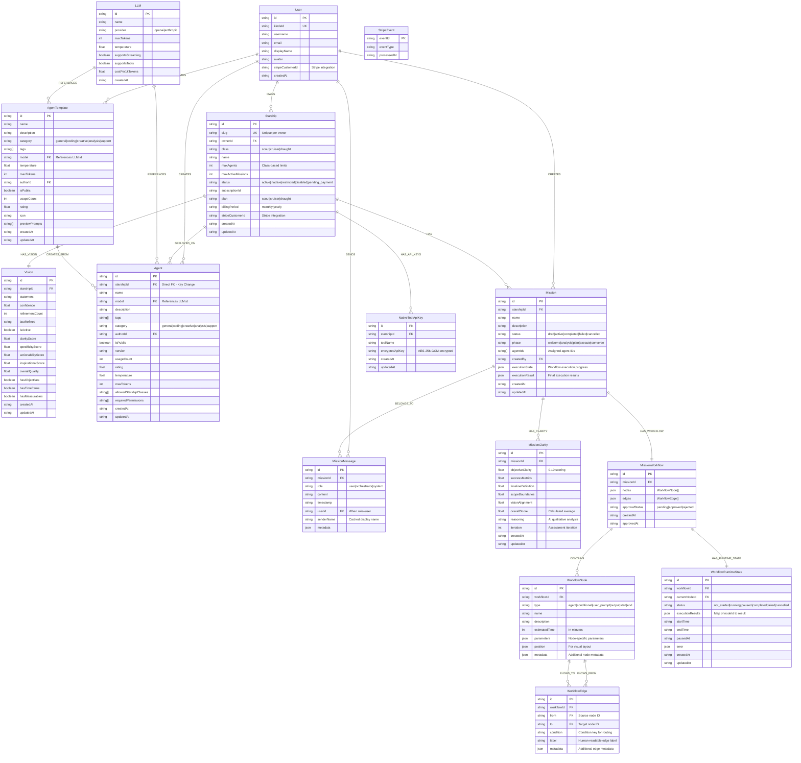
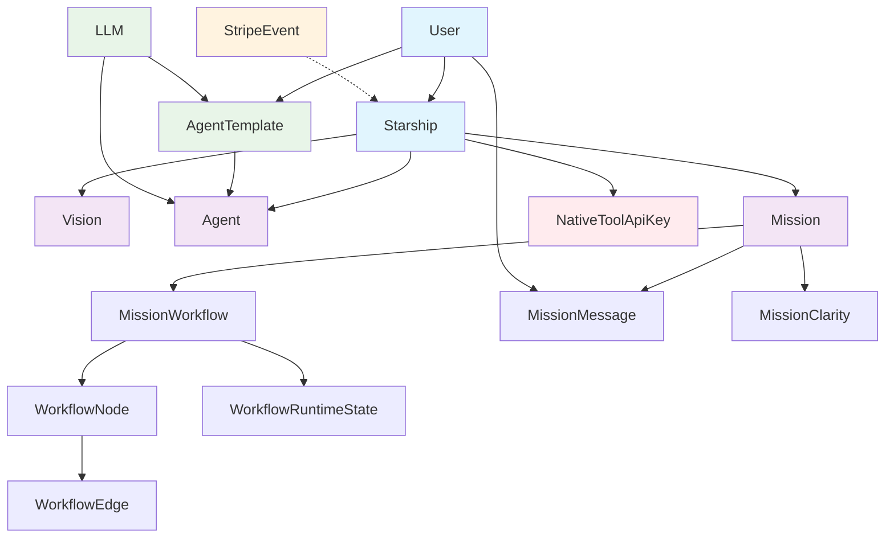

# Starships.ai Entity Relationship Diagram

## Comprehensive Data Model

## Concise Core Domain Model

## Key Relationships and Constraints

### Core Business Logic
- **Starship Classes**: Scout (3 agents, 3 missions), Cruiser (5 agents, 6 missions), Draught (10 agents, 10 missions)
- **Vision**: Each starship has exactly one vision that can be refined over time
- **Agent Deployment**: Agents are deployed to specific starships via `starshipId` FK
- **Mission Assignment**: Missions belong to starships and reference assigned agent IDs as arrays

### Data Flow Patterns
- **Workflow Execution**: `Mission` → `MissionWorkflow` → `WorkflowRuntimeState` tracks execution progress
- **Message Threading**: `MissionMessage` entities belong to missions and maintain conversation history
- **Clarity Assessment**: `MissionClarity` provides AI-driven mission assessment with 5-dimensional scoring
- **Template System**: `AgentTemplate` → `Agent` creation flow with usage tracking

### Security & Integration
- **API Key Management**: `NativeToolApiKey` stores encrypted tool credentials per starship
- **Stripe Integration**: `StripeEvent` ensures webhook idempotency; `User.stripeCustomerId` and `Starship.stripeCustomerId` link to Stripe
- **Authentication**: `User.kindeId` provides external auth integration

### Technical Implementation Notes
- **Neo4j Relationships**: Repository code maintains both FK references and Neo4j relationship patterns
- **JSON Storage**: Complex objects (workflow parameters, execution results, metadata) stored as JSON
- **Soft References**: Agent IDs in missions stored as string arrays for flexibility
- **Encryption**: Native tool API keys use AES-256-GCM encryption
- **Slug Generation**: Starship slugs are auto-generated with collision handling