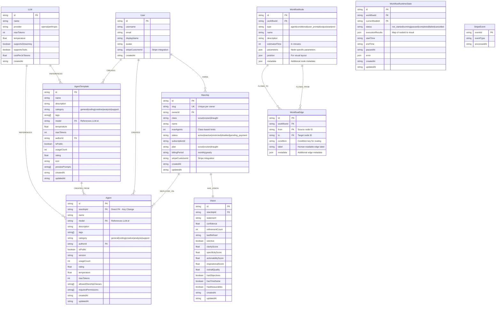
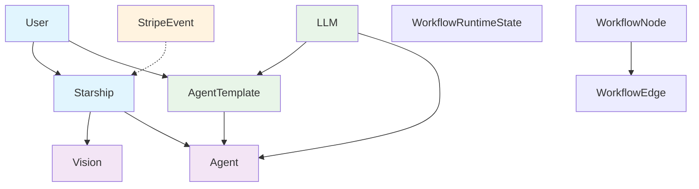

# Starships.ai Entity Relationship Diagram

## Comprehensive Data Model

## Concise Core Domain Model

## Key Relationships and Constraints

### Core Business Logic

- **Starship Classes**: Scout (3 agents, 3 missions), Cruiser (5 agents, 6 missions), Draught (10 agents, 10 missions)
- **Vision**: Each starship has exactly one vision that can be refined over time
- **Agent Deployment**: Agents are deployed to specific starships via `starshipId` FK

### Data Flow Patterns

- **Workflow Execution**: Workflow runtime state tracks execution progress
- **Message Threading**: Message entities maintain conversation history with proper threading
- **Template System**: `AgentTemplate` → `Agent` creation flow with usage tracking

### Security & Integration

- **Stripe Integration**: `StripeEvent` ensures webhook idempotency; `User.stripeCustomerId` and `Starship.stripeCustomerId` link to Stripe

### Technical Implementation Notes

- **PostgreSQL Relationships**: Repository code uses foreign keys and JOIN operations for relationships
- **JSON Storage**: Complex objects (workflow parameters, execution results, metadata) stored as JSONB
- **Soft References**: Agent IDs in missions stored as string arrays for flexibility
- **Slug Generation**: Starship slugs are auto-generated with collision handling
