# Starships.ai Entity Relationship Diagram

## Comprehensive Data Model

```mermaid
erDiagram
    %% Core User and Starship System
    users {
        string id PK
        string email UK
        string display_name
        string avatar
        string password
        string stripe_customer_id UK
        timestamp created_at
        timestamp updated_at
    }

    starships {
        string id PK
        string slug UK "Unique per owner"
        string owner_id FK
        string class "scout|cruiser|draught"
        string name
        int max_agents "Class-based limits"
        string status "active|inactive|restricted|disabled|pending_payment"
        string subscription_id UK
        string plan "scout|cruiser|draught"
        string billing_period "monthly|yearly"
        string stripe_customer_id
        timestamp created_at
        timestamp updated_at
    }

    %% Agent Templates and Agents
    agent_templates {
        string id PK
        string slug UK
        string name
        text description
        string category
        boolean is_public
        int usage_count
        jsonb tags
        text system_prompt
        string model
        decimal temperature
        int max_tokens
        int timeout
        jsonb blueprint
        timestamp created_at
        timestamp updated_at
    }

    agents {
        string id PK
        string name
        string description
        string model
        decimal temperature
        int max_tokens
        int timeout
        text system_prompt
        jsonb state "Agent runtime state"
        jsonb blueprint "Agent workflow blueprint"
        string starship_id FK
        string template_id FK
        timestamp deployed_at
        timestamp created_at
        timestamp updated_at
    }

    %% Tool Templates and Tools
    tool_templates {
        string id PK
        string slug UK
        string name
        text description
        string category
        boolean is_public
        int usage_count
        jsonb tags
        jsonb blueprint
        timestamp created_at
        timestamp updated_at
    }

    tools {
        string id PK
        string name
        string slug
        text description
        boolean is_enabled
        jsonb blueprint
        string starship_id FK
        string template_id FK
        timestamp deployed_at
        timestamp created_at
        timestamp updated_at
    }

    %% Workflow and Blueprint System
    workflows {
        string id PK
        string name
        string author_id FK
        text description
        string category
        string version
        int usage_count
        boolean is_public
        jsonb tags
        decimal rating
        string execution_mode "simple|workflow"
        jsonb allowed_starship_classes
        int timeout
        jsonb blueprint "Workflow definition with nodes and edges"
        string starship_id FK
        timestamp deployed_at
        timestamp created_at
        timestamp updated_at
    }

    blueprints {
        string id PK
        string name
        text description
        string category
        string version
        int usage_count
        boolean is_public
        jsonb tags
        jsonb metadata
        timestamp created_at
        timestamp updated_at
    }

    %% Execution System
    executions {
        string id PK
        string workflow_id FK
        string status "pending|running|completed|failed|cancelled|paused"
        jsonb result
        text error_message
        jsonb metadata
        timestamp started_at
        timestamp completed_at
        timestamp created_at
        timestamp updated_at
    }

    %% Conversation and Message System
    conversations {
        string id PK
        string title
        string status "active|paused|completed|archived"
        string starship_id FK
        timestamp created_at
        timestamp updated_at
    }

    messages {
        string id PK
        string role "system|user|assistant|tool"
        text content
        string message_type "user_input|agent_response|system_notification|system_instruction|workflow_output|error|tool_result"
        text reasoning
        jsonb tool_calls
        string tool_call_id
        string starship_id FK
        string conversation_id FK
        timestamp created_at
        timestamp updated_at
    }

    %% Environment Variables
    environments {
        string id PK
        string starship_id FK
        string key
        text encrypted_value
        string description
        string created_by
        timestamp created_at
        timestamp updated_at
    }

    %% Usage Tracking
    usage {
        string id PK
        string starship_id FK
        string conversation_id FK
        int prompt_tokens
        int completion_tokens
        int total_tokens
        string model
        string provider
        decimal cost
        timestamp created_at
    }

    %% Waitlist System
    waitlist {
        string email PK
        string status "pending|approved|rejected"
        text notes
        timestamp created_at
    }

    %% Payment Integration
    stripe_events {
        string event_id PK
        string event_type
        timestamp processed_at
        jsonb data
    }

    %% Junction Tables for Many-to-Many Relationships
    agent_tools {
        string agent_id PK FK
        string tool_id PK FK
        timestamp created_at
    }

    agent_template_tool_templates {
        string agent_template_id PK FK
        string tool_template_id PK FK
        timestamp created_at
    }

    conversation_agents {
        string conversation_id PK FK
        string agent_id PK FK
        timestamp linked_at
    }

    %% Primary Relationships
    users ||--o{ starships : "owns"
    users ||--o{ workflows : "authors"

    %% Starship Relationships
    starships ||--o{ agents : "hosts"
    starships ||--o{ tools : "hosts"
    starships ||--o{ workflows : "deployed_to"
    starships ||--o{ conversations : "contains"
    starships ||--o{ messages : "belongs_to"
    starships ||--o{ environments : "has_vars"
    starships ||--o{ usage : "tracks_usage"

    %% Agent System Relationships
    agent_templates ||--o{ agents : "instantiated_from"
    agents ||--o{ agent_tools : "uses"
    tools ||--o{ agent_tools : "used_by"
    agent_templates ||--o{ agent_template_tool_templates : "uses_template"
    tool_templates ||--o{ agent_template_tool_templates : "used_by_template"

    %% Tool System Relationships
    tool_templates ||--o{ tools : "instantiated_from"

    %% Workflow and Execution
    workflows ||--o{ executions : "executed_as"

    %% Conversation System
    conversations ||--o{ messages : "contains"
    conversations ||--o{ conversation_agents : "involves"
    agents ||--o{ conversation_agents : "participates_in"
    conversations ||--o{ usage : "tracks_usage"

```

## Concise Core Domain Model

```mermaid
graph TD
    %% Core Entities
    U[User] --> S[Starship]
    S --> A[Agent]
    S --> T[Tool]
    S --> W[Workflow]
    S --> C[Conversation]
    S --> E[Environment]

    %% Template System
    U --> AT[AgentTemplate]
    AT --> A
    TT[ToolTemplate] --> T

    %% Conversation System
    C --> M[Message]
    C --> CA[ConversationAgent]
    A --> CA

    %% Workflow System
    W --> EX[Execution]
    W --> B[Blueprint]

    %% Usage Tracking
    S --> US[Usage]
    C --> US

    %% Junction Tables
    A --> AGT[AgentTools]
    T --> AGT
    AT --> ATTT[AgentTemplateToolTemplates]
    TT --> ATTT

    %% Payment Integration
    SE[StripeEvent] -.-> S
    WL[Waitlist] -.-> U

    %% Styling
    classDef primary fill:#e1f5fe
    classDef secondary fill:#f3e5f5
    classDef system fill:#e8f5e8
    classDef junction fill:#fff9c4
    classDef integration fill:#fff3e0

    class U,S primary
    class A,T,W,C secondary
    class AT,TT,B system
    class AGT,ATTT,CA junction
    class SE,WL integration
```



## Key Relationships and Constraints

### Core Business Logic

- **Starship Classes**: Scout (3 agents), Cruiser (5 agents), Draught (10 agents)
- **Agent Deployment**: Agents are deployed to specific starships with `starship_id` FK
- **Tool Deployment**: Tools are deployed to specific starships and linked to agents via junction table
- **Template System**: Both agents and tools use templates for rapid deployment

### Data Flow Patterns

- **Workflow Execution**: Workflows contain blueprints as JSONB, executions track progress
- **Message Threading**: Messages maintain conversation history with proper role-based threading
- **Template Instantiation**: `AgentTemplate` → `Agent` and `ToolTemplate` → `Tool` creation flows
- **Agent-Tool Relationships**: Many-to-many relationships through `agent_tools` junction table

### Schema Evolution

- **JSONB Storage**: Complex objects (blueprints, agent state, metadata) stored as JSONB for flexibility
- **Removed Tables**: `nodes` and `edges` tables removed - data now stored within blueprint JSONB
- **Environment Security**: Environment variables stored with encryption via `encrypted_value` field
- **Conversation Agents**: Many-to-many relationship between conversations and agents

### Technical Implementation Notes

- **PostgreSQL Relationships**: Repository code uses foreign keys and JOIN operations for relationships
- **Blueprint Storage**: Workflow blueprints contain nodes and edges as JSONB for better performance
- **Agent State Management**: Agent runtime state stored as JSONB for flexible state tracking
- **Tool Configuration**: Tools support flexible configuration via JSONB blueprint field
- **Usage Tracking**: Comprehensive token usage tracking for billing and analytics
- **Full-text Search**: GIN indexes on concatenated text fields for efficient search

### Migration Changes (v2.0.0)

- **Environment Table**: Updated to use `encrypted_value` instead of `value` + `is_encrypted`
- **Environment Table**: Added `description` and `created_by` fields
- **Nodes/Edges Tables**: Completely removed - replaced with JSONB storage in blueprints
- **Blueprint Structure**: Simplified to contain nodes and edges as embedded JSONB data
- **Repository Alignment**: Schema now matches the actual repository implementations
