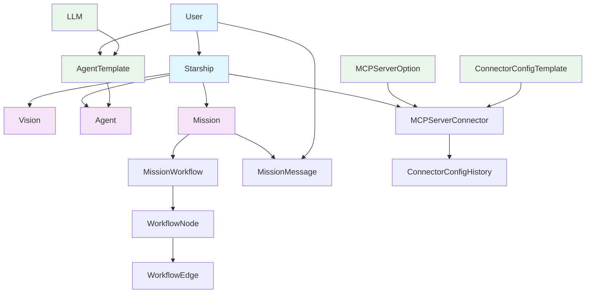
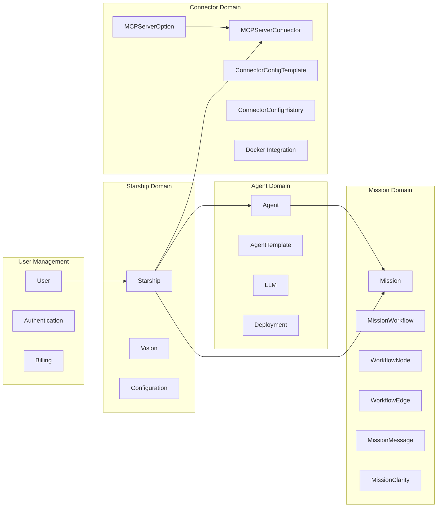
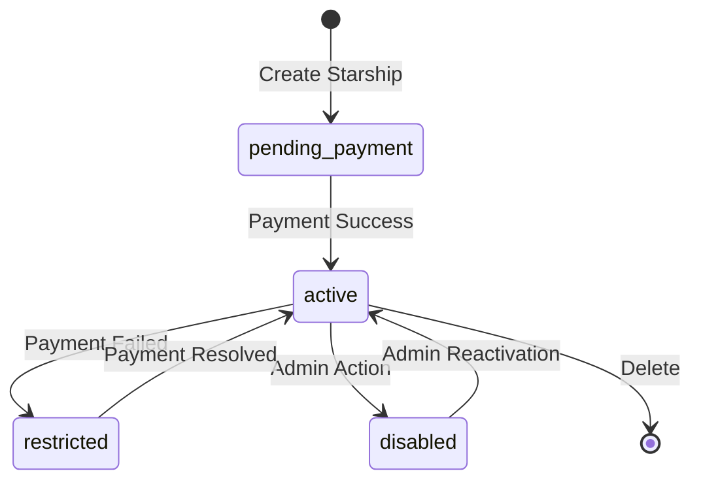
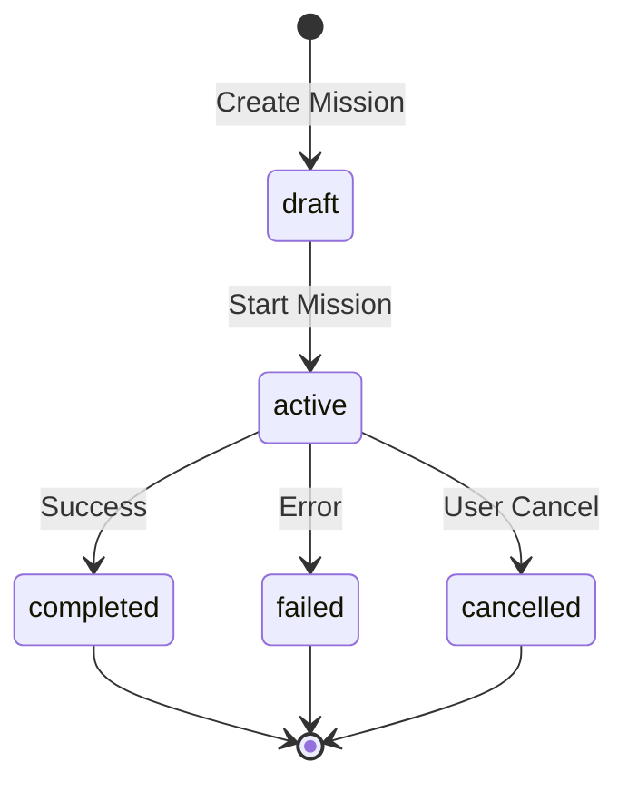
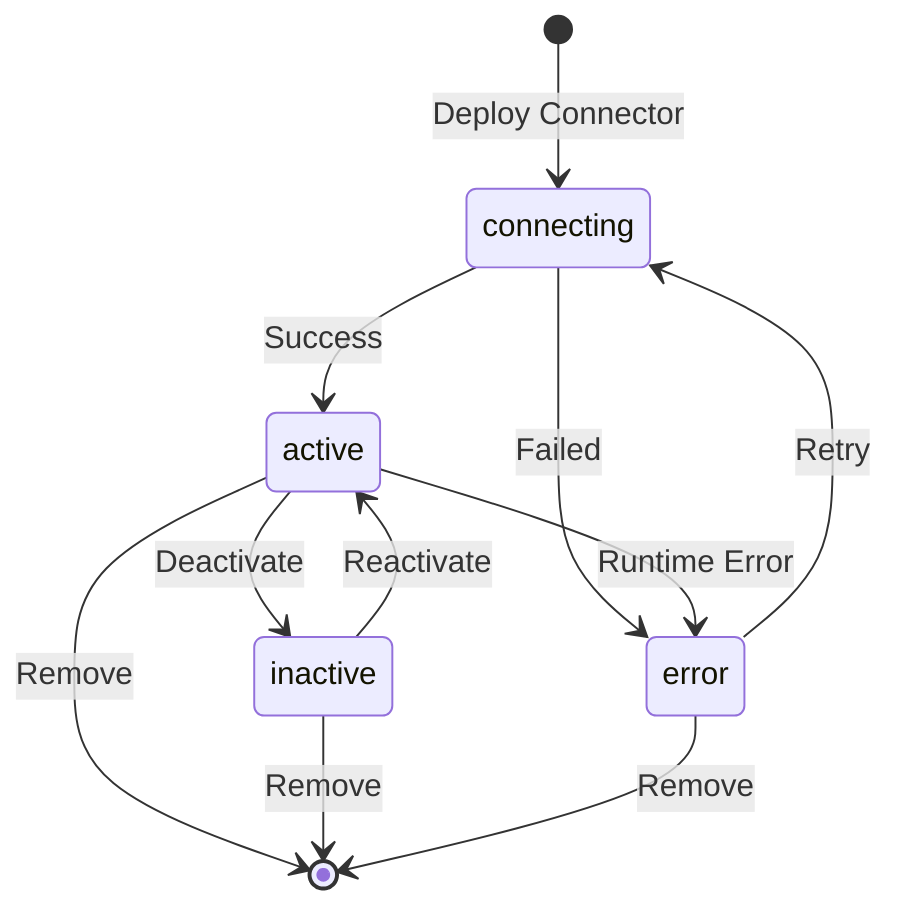

# Starships.ai - Visual ER Diagram

## Mermaid Entity Relationship Diagram

```mermaid
erDiagram
    %% Core User and Starship System
    User {
        string id PK
        string kindeId UK
        string username
        string email
        string displayName
        string avatar
        string stripeCustomerId
        string createdAt
    }

    Starship {
        string id PK
        string slug UK
        string ownerId FK
        string class
        string name
        int maxAgents
        int maxActiveMissions
        string status
        string subscriptionId
        string plan
        string billingPeriod
        string stripeCustomerId
        string createdAt
        string updatedAt
    }

    Vision {
        string id PK
        string starshipId FK
        string statement
        float confidence
        int refinementCount
        string lastRefined
        boolean isActive
        float clarityScore
        float specificityScore
        float actionabilityScore
        float inspirationalScore
        float overallQuality
        boolean hasObjectives
        boolean hasTimeframe
        boolean hasMeasurables
        string createdAt
        string updatedAt
    }

    %% AI Agent System
    LLM {
        string id PK
        string name
        string provider
        int maxTokens
        float temperature
        boolean supportsStreaming
        boolean supportsTools
        float costPer1kTokens
        string createdAt
    }

    AgentTemplate {
        string id PK
        string name
        string description
        string category
        string[] tags
        string systemPrompt
        string model FK
        float temperature
        int maxTokens
        string authorId FK
        boolean isPublic
        int usageCount
        float rating
        string icon
        string[] previewPrompts
        string createdAt
        string updatedAt
    }

    Agent {
        string id PK
        string starshipId FK
        string name
        string model
        string systemPrompt
        string description
        string[] tags
        string category
        string authorId FK
        boolean isPublic
        string version
        int usageCount
        float rating
        float temperature
        int maxTokens
        string customInstructions
        string[] allowedStarshipClasses
        string[] requiredPermissions
        string createdAt
        string updatedAt
    }

    %% Mission System
    Mission {
        string id PK
        string starshipId FK
        string name
        string description
        string status
        string phase
        string[] agentIds
        string createdBy FK
        json executionState
        json executionResult
        string createdAt
        string updatedAt
    }

    MissionMessage {
        string id PK
        string missionId FK
        string role
        string content
        string timestamp
        string userId FK
        string senderName
        json metadata
    }

    MissionClarity {
        string id PK
        string missionId FK
        float objectiveClarity
        float successMetrics
        float timelineDefinition
        float scopeBoundaries
        float visionAlignment
        float overallScore
        string reasoning
        int iteration
        string createdAt
        string updatedAt
    }

    %% Workflow System
    MissionWorkflow {
        string id PK
        string missionId FK
        string approvalStatus
        string createdAt
        string approvedAt
    }

    WorkflowNode {
        string id PK
        string type
        string name
        string description
        json parameters
    }

    WorkflowEdge {
        string id PK
        string from FK
        string to FK
        string condition
        string label
    }

    WorkflowRuntimeState {
        string id PK
        string workflowId FK
        string currentNodeId FK
        string status
        json executionResults
        string startTime
        string endTime
        string pausedAt
        json error
        string createdAt
        string updatedAt
    }

    %% MCP Connector System
    MCPServerOption {
        string id PK
        string name
        string slug UK
        string command
        string[] args
        string env
    }

    MCPServerConnector {
        string id PK
        string starshipId FK
        string templateId FK
        string status
        boolean isActive
        string connectedAt
        string lastUsed
        string errorMessage
        string env
        string configTemplateId FK
        int configVersion
        string dockerServiceName
        string dockerStatus
        string dockerContainerId
        string dockerHealthStatus
        string dockerLastHealthCheck
        string dockerNetworkName
        string dockerImageName
        string dockerErrorMessage
        int dockerPort
        boolean httpBridgeEnabled
        string internalUrl
        string bridgeVersion
        string lastToolsSync
        string availableTools
        string availableResources
        string bridgeCapabilities
        string createdAt
        string updatedAt
    }

    ConnectorConfigTemplate {
        string id PK
        string name
        string description
        string category
        string[] tags
        json config
        boolean isPublic
        string authorId FK
        int usageCount
        string createdAt
        string updatedAt
    }

    ConnectorConfigHistory {
        string id PK
        string connectorId FK
        json config
        string changedBy FK
        string changeSummary
        string changeReason
        string createdAt
    }

    %% Primary Relationships
    User ||--o{ Starship : "OWNS"
    User ||--o{ Agent : "CREATES"
    User ||--o{ AgentTemplate : "CREATES"
    User ||--o{ Mission : "CREATES"
    User ||--o{ MissionMessage : "SENDS"
    User ||--o{ ConnectorConfigTemplate : "CREATES"
    User ||--o{ ConnectorConfigHistory : "CHANGES"

    %% Starship Relationships
    Starship ||--|| Vision : "HAS_VISION"
    Starship ||--o{ Agent : "DEPLOYED_ON"
    Starship ||--o{ Mission : "HAS"
    Starship ||--o{ MCPServerConnector : "HAS_CONNECTOR_INSTANCE"

    %% Agent System Relationships
    LLM ||--o{ AgentTemplate : "REFERENCES"
    AgentTemplate ||--o{ Agent : "CREATES_FROM"

    %% Mission Relationships
    Mission ||--|| MissionWorkflow : "HAS_WORKFLOW"
    Mission ||--o{ MissionMessage : "BELONGS_TO"
    Mission ||--o{ MissionClarity : "HAS"

    %% Workflow Relationships
    MissionWorkflow ||--o{ WorkflowNode : "CONTAINS"
    MissionWorkflow ||--|| WorkflowRuntimeState : "HAS"
    WorkflowNode ||--o{ WorkflowEdge : "FLOWS_FROM"
    WorkflowNode ||--o{ WorkflowEdge : "FLOWS_TO"

    %% Connector Relationships
    MCPServerOption ||--o{ MCPServerConnector : "CREATED_FROM"
    ConnectorConfigTemplate ||--o{ MCPServerConnector : "USES"
    MCPServerConnector ||--o{ ConnectorConfigHistory : "HAS"
```

## Simplified Core Domain Model

## Domain Boundaries

## Key Entity States and Lifecycle

This visual representation helps understand:

1. **Entity Relationships**: Clear connections between all major entities
2. **Domain Boundaries**: Logical groupings of related functionality
3. **Lifecycle Management**: State transitions for key entities
4. **Data Flow**: How information moves through the system
5. **Complexity Areas**: Where the most intricate relationships exist (Mission/Workflow system)

The diagram shows that Starships.ai is built around a **starship-centric architecture** where users own starships that serve as containers for agents, missions, and connectors, with sophisticated workflow orchestration and real-time collaboration features.