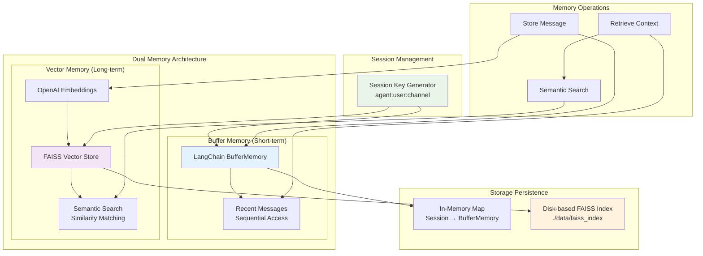
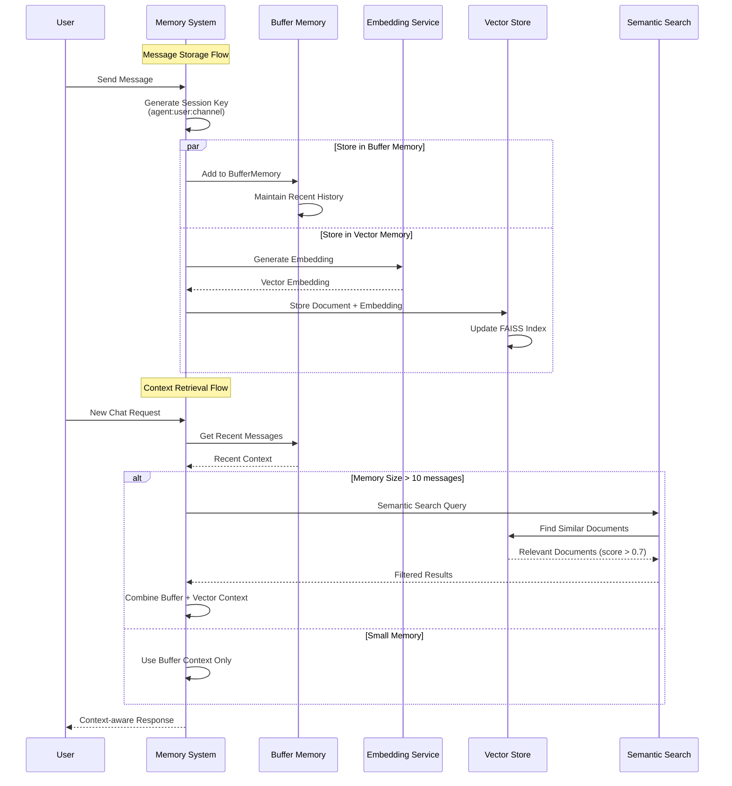
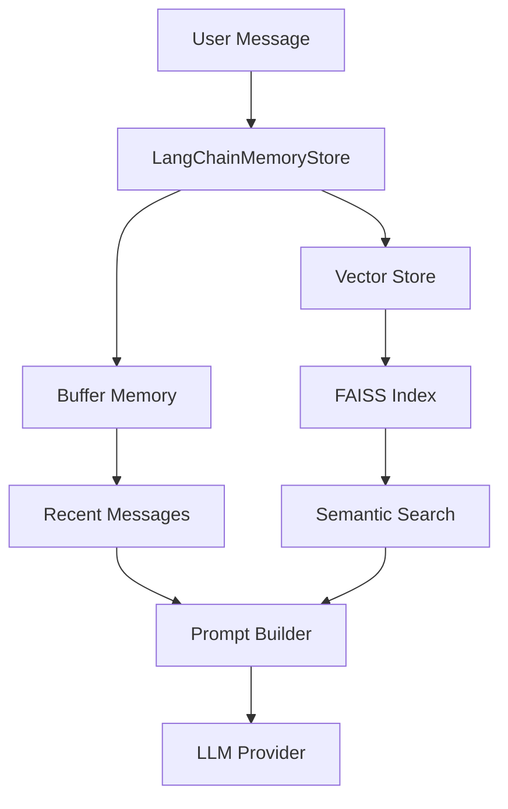

# Memory System Architecture

## Overview

The Starships.ai memory system implements a dual-memory architecture that combines short-term buffer memory with long-term vector storage for semantic search. This design provides both immediate context access and intelligent retrieval of relevant historical information.

## Memory System Architecture Overview



## Memory Lifecycle Flow



## Dual-Memory Architecture

### System Components



### Component Responsibilities

| Component | Purpose | Storage Duration | Retrieval Method |
|-----------|---------|------------------|------------------|
| **Buffer Memory** | Immediate conversation context | Session-based | Sequential access |
| **Vector Store** | Long-term semantic memory | Persistent | Similarity search |
| **FAISS Index** | Vector similarity search | Persistent on disk | Cosine similarity |
| **Session Keys** | Memory isolation | Per conversation | Key-based lookup |

## Buffer Memory Implementation

### LangChain BufferMemory
```typescript
import { BufferMemory } from "langchain/memory";
import { HumanMessage, AIMessage } from "@langchain/core/messages";

class LangChainMemoryStore {
  private bufferMemories = new Map<SessionKey, BufferMemory>();
  
  async append(sessionKey: SessionKey, entry: MemoryEntry): Promise<void> {
    let bufferMemory = this.bufferMemories.get(sessionKey);
    if (!bufferMemory) {
      bufferMemory = new BufferMemory({
        returnMessages: true,
        memoryKey: "chat_history",
      });
      this.bufferMemories.set(sessionKey, bufferMemory);
    }

    // Add to buffer memory
    if (entry.role === "user") {
      await bufferMemory.chatHistory.addMessage(new HumanMessage(entry.content));
    } else if (entry.role === "assistant") {
      await bufferMemory.chatHistory.addMessage(new AIMessage(entry.content));
    }
  }
}
```

### Memory Entry Structure
```typescript
interface MemoryEntry {
  role: "user" | "assistant" | "system";
  content: string;
  timestamp?: number;
}

interface EnhancedMemoryEntry extends MemoryEntry {
  embedding?: number[];
  importance?: number;
  summary?: string;
}
```

## Vector Storage System

### FAISS Integration
```typescript
import { FaissStore } from "@langchain/community/vectorstores/faiss";
import { OpenAIEmbeddings } from "@langchain/openai";
import { Document } from "@langchain/core/documents";

class LangChainMemoryStore {
  private vectorStore: FaissStore | null = null;
  private embeddings: OpenAIEmbeddings;
  private indexPath: string;

  constructor() {
    this.embeddings = new OpenAIEmbeddings({
      apiKey: process.env.OPENAI_API_KEY,
      model: process.env.DEFAULT_EMBEDDING_MODEL || "text-embedding-3-small",
    });
    this.indexPath = process.env.FAISS_INDEX_PATH || "./data/faiss_index";
  }
}
```

### Document Storage Pattern
```typescript
private async addToVectorStore(sessionKey: SessionKey, entry: MemoryEntry): Promise<void> {
  const doc = new Document({
    pageContent: entry.content,
    metadata: {
      sessionKey,
      role: entry.role,
      timestamp: entry.timestamp || Date.now(),
      id: uuidv4(),
    },
  });

  await this.vectorStore!.addDocuments([doc]);
}
```

## Session Management

### Session Key Generation
```typescript
makeKey(agentId: string, userId: string, channelId?: string): SessionKey {
  return channelId ? `${agentId}:${userId}:${channelId}` : `${agentId}:${userId}`;
}
```

### Session Isolation
- **Per-Agent**: Different agents maintain separate memory spaces
- **Per-User**: Each user has isolated conversations with agents
- **Per-Channel**: Channel-based conversations are isolated from DMs
- **Memory Boundaries**: No cross-contamination between sessions

### Session Examples
```typescript
// Direct message session
const dmSession = store.makeKey("agent-123", "user-456");
// Result: "agent-123:user-456"

// Channel message session
const channelSession = store.makeKey("agent-123", "user-456", "channel-789");
// Result: "agent-123:user-456:channel-789"
```

## Semantic Search Implementation

### Search Trigger Logic
```typescript
// Semantic search for relevant context when memory is large
let relevantContext = "";
if (memory.length > 10) {
  const searchResult = await store.semanticSearch(sessionKey, req.message, 5);
  if (searchResult.entries.length > 0) {
    relevantContext = searchResult.entries
      .map(entry => `${entry.role}: ${entry.content}`)
      .join('\n');
  }
}
```

### Similarity Search Algorithm
```typescript
async semanticSearch(sessionKey: SessionKey, query: string, limit: number = 5): Promise<MemorySearchResult> {
  const results = await this.vectorStore.similaritySearchWithScore(query, limit);
  
  // Filter by session key and minimum relevance score
  const filteredResults = results.filter(([doc, score]) => 
    doc.metadata.sessionKey === sessionKey && score > 0.7
  );

  const entries: EnhancedMemoryEntry[] = filteredResults.map(([doc]) => ({
    role: doc.metadata.role,
    content: doc.pageContent,
    timestamp: doc.metadata.timestamp,
    importance: 1 - (doc.metadata.timestamp ? (Date.now() - doc.metadata.timestamp) / (1000 * 60 * 60 * 24) : 0),
  }));

  return { entries, relevanceScores: filteredResults.map(([, score]) => score) };
}
```

### Relevance Filtering
- **Minimum Score**: 0.7 cosine similarity threshold
- **Session Filtering**: Only return results from the current session
- **Temporal Decay**: Importance decreases over time
- **Result Limiting**: Configurable maximum results (default: 5)

## Memory Lifecycle

### Memory Creation Flow
1. **User Message Received** → Creates new session if needed
2. **Buffer Storage** → Immediate storage in LangChain BufferMemory
3. **Vector Storage** → Asynchronous embedding generation and FAISS storage
4. **Index Update** → FAISS index updated with new document

### Memory Retrieval Flow
1. **Context Request** → Check buffer memory for recent messages
2. **Semantic Search** → Search vector store for relevant historical context
3. **Result Merging** → Combine buffer and vector results
4. **Context Building** → Format context for prompt injection

### Memory Cleanup
```typescript
async clear(sessionKey: SessionKey): Promise<void> {
  // Clear buffer memory
  this.bufferMemories.delete(sessionKey);
  
  // Clear vector store (requires index rebuild due to FAISS limitations)
  const allDocs = await this.getAllDocuments();
  const filteredDocs = allDocs.filter(doc => doc.metadata.sessionKey !== sessionKey);
  
  if (filteredDocs.length > 0) {
    this.vectorStore = await FaissStore.fromDocuments(filteredDocs, this.embeddings);
  } else {
    const emptyDoc = new Document({ pageContent: "Initial document", metadata: {} });
    this.vectorStore = await FaissStore.fromDocuments([emptyDoc], this.embeddings);
  }
  
  await this.saveIndex();
}
```

## Performance Optimizations

### Vector Index Management
```typescript
async saveIndex(): Promise<void> {
  if (this.vectorStore) {
    try {
      await this.vectorStore.save(this.indexPath);
    } catch (error) {
      console.error("Failed to save vector index:", error);
    }
  }
}
```

### Lazy Initialization
- **Vector Store**: Initialize only when first needed
- **Embeddings**: Create embedding client on first use
- **Index Loading**: Load existing index from disk on startup

### Caching Strategies
- **Buffer Memory**: In-memory Map for fast access
- **Provider Caching**: LLM providers cached per agent
- **Index Persistence**: FAISS index saved to disk for persistence

## Configuration Options

### Environment Variables
```bash
# Embedding model configuration
DEFAULT_EMBEDDING_MODEL=text-embedding-3-small
OPENAI_API_KEY=your-openai-key

# Vector store configuration
FAISS_INDEX_PATH=./data/faiss_index

# Memory behavior
SEMANTIC_SEARCH_THRESHOLD=0.7
MAX_BUFFER_SIZE=50
VECTOR_SEARCH_LIMIT=5
```

### Embedding Models
| Model | Dimensions | Use Case |
|-------|------------|----------|
| `text-embedding-3-small` | 1536 | General purpose, cost-effective |
| `text-embedding-3-large` | 3072 | Higher accuracy, more expensive |
| `text-embedding-ada-002` | 1536 | Legacy model, good compatibility |

## Error Handling

### Graceful Degradation
```typescript
async semanticSearch(sessionKey: SessionKey, query: string, limit: number = 5): Promise<MemorySearchResult> {
  if (!this.vectorStore) {
    return { entries: [], relevanceScores: [] };
  }

  try {
    const results = await this.vectorStore.similaritySearchWithScore(query, limit);
    // Process results...
  } catch (error) {
    console.error("Semantic search failed:", error);
    return { entries: [], relevanceScores: [] };
  }
}
```

### Failure Recovery
- **Vector Store Initialization**: Create empty store if loading fails
- **Embedding Failures**: Continue with buffer memory only
- **Index Corruption**: Rebuild from scratch if needed
- **Memory Isolation**: Session failures don't affect other sessions

## Monitoring and Observability

### Memory Usage Metrics
```typescript
interface MemoryMetrics {
  bufferSessions: number;
  vectorDocuments: number;
  indexSize: number;
  searchLatency: number;
  embeddingCalls: number;
}
```

### Performance Monitoring
- **Search Latency**: Track semantic search response times
- **Index Size**: Monitor FAISS index growth
- **Memory Usage**: Buffer memory per session
- **Cache Hit Rates**: Provider and repository cache effectiveness

## Future Enhancements

### Planned Features
1. **Memory Summarization**: Automatic summarization of old conversations
2. **Importance Scoring**: Machine learning-based importance scoring
3. **Memory Compression**: Compress old memories to save space
4. **Cross-Session Memory**: Allow agents to remember across sessions
5. **Memory Analytics**: Detailed memory usage analytics

### Advanced Search Features
```typescript
interface AdvancedSearchOptions {
  timeRange?: { start: Date; end: Date };
  importance?: { min: number; max: number };
  messageTypes?: ('user' | 'assistant' | 'system')[];
  contentFilters?: string[];
}
```

### Memory Optimization
- **Hierarchical Memory**: Multiple memory levels with different retention
- **Adaptive Thresholds**: Dynamic relevance thresholds based on context
- **Memory Consolidation**: Merge similar memories to reduce redundancy
- **Temporal Indexing**: Time-based memory organization

## Troubleshooting Guide

### Common Issues

#### Vector Store Initialization Fails
```bash
# Check FAISS index directory
ls -la ./data/faiss_index/

# Verify embedding model access
curl -H "Authorization: Bearer $OPENAI_API_KEY" \
  https://api.openai.com/v1/models
```

#### Memory Not Persisting
- Verify FAISS_INDEX_PATH is writable
- Check if saveIndex() is being called
- Ensure graceful shutdown handlers are working

#### Semantic Search Returns No Results
- Check relevance threshold (default: 0.7)
- Verify session key generation
- Confirm embedding model is working

#### High Memory Usage
- Monitor buffer memory growth
- Check for memory leaks in session management
- Consider implementing memory limits

### Debug Commands
```typescript
// Check memory stats
const stats = await store.getMemoryStats(sessionKey);

// Verify vector store health
const indexHealth = await store.checkIndexHealth();

// Test semantic search
const testResults = await store.semanticSearch(sessionKey, "test query", 1);
``` 