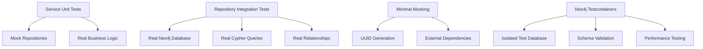

# Jest Testing Plan for @starships/models

## Overview

This document outlines a comprehensive testing strategy for the `@starships/models` package, which serves as the Neo4j-based data layer for the Starships platform. The plan covers unit tests, integration tests, mocking strategies, and implementation phases to achieve robust test coverage.

## 🚀 Live Status & Progress Tracking

### Implementation Status Overview
> **Last Updated**: 2025-07-16 00:28 UTC
> **Current Phase**: Phase 2 - Repository Integration Tests
> **Overall Progress**: 45% Complete

### 📊 Phase Progress Tracker

#### Phase 1: Foundation Setup
**Status**: ✅ Complete | **Target**: Week 1 | **Progress**: 5/5

- [x] **Jest Configuration Setup**
  - [x] Add test dependencies to [`package.json`](packages/models/package.json)
  - [x] Create [`jest.config.js`](packages/models/jest.config.js) for service tests
  - [x] Create [`jest.integration.config.js`](packages/models/jest.integration.config.js) for integration tests
  - [x] Add test scripts to package.json

- [x] **Neo4j Testcontainers Setup**
  - [x] Configure Testcontainers dependencies
  - [x] Create [`tests/helpers/neo4j-testcontainer.ts`](packages/models/tests/helpers/neo4j-testcontainer.ts)
  - [x] Setup global setup/teardown files
  - [x] Test container connectivity

- [x] **Minimal Mocking Strategy**
  - [x] Create [`tests/__mocks__/uuid.ts`](packages/models/tests/__mocks__/uuid.ts)
  - [x] Setup predictable UUID generation
  - [x] Configure mock reset utilities
  - [x] Document mocking guidelines

- [x] **Test Structure Creation**
  - [x] Create test directory structure
  - [x] Setup [`tests/setup.ts`](packages/models/tests/setup.ts)
  - [x] Setup [`tests/integration-setup.ts`](packages/models/tests/integration-setup.ts)
  - [x] Create fixture directories

- [x] **Connection Layer Unit Tests**
  - [x] Create [`connection.test.ts`](packages/models/tests/unit/connection.test.ts) with mocked neo4j-driver
  - [x] Test connection management, session handling, schema initialization
  - [x] Test error scenarios and recovery
  - [x] Add Repository Factory reset method implementation

#### Phase 2: Repository Integration Tests
**Status**: 🔄 Partially Complete | **Target**: Week 2 | **Progress**: 7/12

- [x] **Core Repository Tests** (Real Neo4j Database)
  - [x] [`AgentRepository.test.ts`](packages/models/tests/integration/repositories/agent-repository.test.ts)
  - [x] [`UserRepository.test.ts`](packages/models/tests/integration/repositories/user-repository.test.ts)
  - [x] [`ChannelRepository.test.ts`](packages/models/tests/integration/repositories/channel-repository.test.ts)
  - [x] [`LLMRepository.test.ts`](packages/models/tests/integration/repositories/llm-repository.test.ts)
  - [x] [`StarshipRepository.test.ts`](packages/models/tests/integration/repositories/starship-repository.test.ts)
  - [x] [`CodexRepository.test.ts`](packages/models/tests/integration/repositories/codex-repository.test.ts)
  - [x] [`VisionRepository.test.ts`](packages/models/tests/integration/repositories/vision-repository.test.ts)
  - [❌] [`ConstraintRepository.test.ts`](packages/models/tests/integration/repositories/constraint-repository.test.ts) - **Missing**
  - [❌] [`ConceptRepository.test.ts`](packages/models/tests/integration/repositories/concept-repository.test.ts) - **Missing**
  - [❌] [`MetaAnchorRepository.test.ts`](packages/models/tests/integration/repositories/meta-anchor-repository.test.ts) - **Missing**

- [ ] **Graph Operations & Performance**
  - [ ] Real relationship creation and traversal tests
  - [ ] Constraint and schema validation tests

#### Phase 3: Service Layer & Workflows
**Status**: ❌ Not Started | **Target**: Week 3 | **Progress**: 0/4

- [❌] **Service Unit Tests** (Repository Mocking) - **No service layer tests implemented**
  - [❌] [`aether-core-service.test.ts`](packages/models/tests/unit/services/aether-core-service.test.ts) - **Missing**
  - [❌] [`repository-factory.test.ts`](packages/models/tests/unit/repository-factory.test.ts) - **Missing**
  - [❌] **Directory `tests/unit/services/` doesn't exist**

- [❌] **End-to-End Workflow Tests** - **No workflow integration tests**
  - [❌] [`agent-deployment.test.ts`](packages/models/tests/integration/workflows/agent-deployment.test.ts) - **Missing**
  - [❌] [`codex-versioning.test.ts`](packages/models/tests/integration/workflows/codex-versioning.test.ts) - **Missing**
  - [❌] [`aether-core-workflows.test.ts`](packages/models/tests/integration/workflows/aether-core-workflows.test.ts) - **Missing**

- [❌] **Performance & Load Testing** - **No performance tests**
  - [❌] [`performance.test.ts`](packages/models/tests/integration/performance.test.ts) - **Missing**

#### Phase 4: CI/CD & Quality Gates
**Status**: ❌ Not Started | **Target**: Week 4 | **Progress**: 0/4

- [❌] **GitHub Actions Setup** - **No GitHub Actions workflow**
  - [❌] Create [`.github/workflows/models-test.yml`](.github/workflows/models-test.yml) - **Missing**
  - [❌] Configure Neo4j services in CI - **Not configured**
  - [❌] Setup coverage reporting - **No coverage reporting**

- [❌] **Quality Gates** - **No quality gates configured**
  - [❌] Configure coverage thresholds (85%+ overall) - **Not configured**
  - [❌] Setup pre-commit hooks - **Not setup**
  - [❌] Performance benchmark gates - **Not implemented**

- [❌] **Documentation & Optimization** - **Documentation incomplete**
  - [❌] Update README with testing instructions - **Not updated**
  - [❌] Performance optimization review - **Not performed**

- [❌] **Final Validation** - **No performance testing**
  - [❌] End-to-end test suite validation - **Not validated**
  - [❌] Documentation completeness check - **Not performed**

### 📈 Success Metrics Tracking

#### Coverage Targets
- [ ] **Overall Coverage**: Target 85%+ (Current: 0%)
- [ ] **Repository Layer**: Target 95%+ (Current: 0%)  
- [ ] **Service Layer**: Target 90%+ (Current: 0%)
- [ ] **Connection Layer**: Target 90%+ (Current: 0%)

#### Performance Benchmarks (Realistic with Testcontainers)
- [ ] **Unit Test Suite**: < 30 seconds (Current: N/A)
- [ ] **Integration Test Suite**: < 5 minutes (Current: N/A)
- [ ] **Individual Repository Operations**: < 500ms (Current: N/A)
- [ ] **Bulk Operations (100 records)**: < 30 seconds (Current: N/A)

#### Quality Metrics
- [ ] **Zero flaky tests** (Current: N/A)
- [ ] **Consistent test execution** (Current: N/A)
- [ ] **Clear error messages** (Current: N/A)
- [ ] **Comprehensive edge case coverage** (Current: N/A)

### 🔄 Weekly Checkpoint Template
```
## Week [X] Checkpoint - [Date]
**Phase**: [Current Phase]
**Completed**: [X/Y] tasks
**Blockers**: [Any issues encountered]
**Next Week Focus**: [Key objectives]

### Key Achievements
- [ ] Achievement 1
- [ ] Achievement 2

### Lessons Learned
- Insight 1
- Insight 2

### Performance Metrics
- Test execution time: [X]s
- Coverage achieved: [X]%
- Issues discovered: [X]
```

### 📝 Update Instructions
To update this status section:
1. Mark completed items with ✅
2. Update progress percentages 
3. Add weekly checkpoint entries
4. Update "Last Updated" timestamp
5. Note any blockers or learnings in checkpoint sections
## Current State Analysis

### Existing Testing Infrastructure
- **Root Package**: Turbo orchestration with `test` script
- **Client Package**: Jest 29.7.0 with TypeScript support
- **Models Package**: **No testing setup currently**

### Package Dependencies Analysis
```json
// Current models/package.json
{
  "dependencies": {
    "@starships/protocol": "workspace:*",
    "neo4j-driver": "^5.27.0",
    "uuid": "^11.1.0"
  },
  "devDependencies": {
    "@types/uuid": "^10.0.0",
    "tsx": "^4.7.0"
  }
}
```

### Code Structure to Test
```
src/
├── connection.ts           # Neo4j connection management
├── index.ts               # Main exports
├── types.ts               # Type definitions
├── repositories/          # Data access layer
│   ├── index.ts          # RepositoryFactory
│   ├── AgentRepository.ts
│   ├── UserRepository.ts
│   ├── ChannelRepository.ts
│   ├── LLMRepository.ts
│   ├── StarshipRepository.ts
│   ├── CodexRepository.ts
│   ├── VisionRepository.ts
│   ├── ConstraintRepository.ts
│   ├── ConceptRepository.ts
│   └── MetaAnchorRepository.ts
└── services/
    └── AetherCoreService.ts  # Business logic layer
```

## Testing Strategy

### 1. Test Architecture



### 2. Test Categories

#### 2.1 Repository Integration Tests (Primary - 60%)
- **Real Neo4j Database**: Testcontainers-based instances
- **Graph Operations**: Real Cypher queries, relationships, constraints
- **Schema Validation**: Constraint enforcement, index behavior
- **Performance Testing**: Query optimization, bulk operations

#### 2.2 Service Unit Tests (30%)
- **Business Logic**: Real orchestration logic
- **Repository Mocking**: Mock data access layer for isolation
- **Error Handling**: Service-level validation and error scenarios

#### 2.3 Utility Tests (10%)
- **Type Safety**: TypeScript interface compliance
- **Pure Functions**: Data transformation, validation helpers
- **Factory Pattern**: Singleton behavior testing

## Implementation Plan

### Phase 1: Jest Configuration Setup

#### 1.1 Package Dependencies
```json
// Add to packages/models/package.json
{
  "scripts": {
    "test": "jest",
    "test:watch": "jest --watch",
    "test:coverage": "jest --coverage",
    "test:integration": "jest --config jest.integration.config.js",
    "test:service": "jest --testPathIgnorePatterns=integration"
  },
  "devDependencies": {
    "jest": "^29.7.0",
    "@types/jest": "^29.5.5",
    "ts-jest": "^29.1.1",
    "jest-environment-node": "^29.7.0",
    "testcontainers": "^11.2.1",
    "@testcontainers/neo4j": "^11.2.1",
    "@types/node": "^20.9.1"
  }
}
```

#### 1.2 Jest Configuration Files

**jest.config.js** (Service Unit Tests)
```javascript
module.exports = {
  preset: 'ts-jest',
  testEnvironment: 'node',
  roots: ['<rootDir>/src', '<rootDir>/tests'],
  testMatch: ['**/__tests__/**/*.ts', '**/?(*.)+(spec|test).ts'],
  testPathIgnorePatterns: ['/node_modules/', '/dist/', '/tests/integration/'],
  collectCoverageFrom: [
    'src/**/*.ts',
    '!src/**/*.d.ts',
    '!src/index.ts'
  ],
  coverageDirectory: 'coverage',
  coverageReporters: ['text', 'lcov', 'html'],
  coverageThreshold: {
    global: {
      branches: 80,
      functions: 85,
      lines: 85,
      statements: 85
    }
  },
  setupFilesAfterEnv: ['<rootDir>/tests/setup.ts'],
  moduleNameMapping: {
    '^@/(.*)$': '<rootDir>/src/$1'
  }
};
```

**jest.integration.config.js** (Integration Tests with Real Neo4j)
```javascript
module.exports = {
  preset: 'ts-jest',
  testEnvironment: 'node',
  roots: ['<rootDir>/tests/integration'],
  testMatch: ['**/integration/**/*.test.ts'],
  setupFilesAfterEnv: ['<rootDir>/tests/integration-setup.ts'],
  testTimeout: 60000, // Longer timeout for real database operations
  maxWorkers: 1, // Sequential execution for database tests
  globalSetup: '<rootDir>/tests/helpers/neo4j-setup.ts',
  globalTeardown: '<rootDir>/tests/helpers/neo4j-teardown.ts'
};
```

### Phase 2: Test Structure

```
packages/models/
├── tests/
│   ├── setup.ts                    # Jest setup for service tests
│   ├── integration-setup.ts        # Jest setup for integration tests
│   ├── __mocks__/                  # Minimal mocks only
│   │   └── uuid.ts                # UUID mock for predictable IDs
│   ├── fixtures/                   # Test data
│   │   ├── agents.ts              # Sample agent data
│   │   ├── users.ts               # Sample user data
│   │   ├── starships.ts           # Sample starship data
│   │   ├── codex.ts               # Sample codex data
│   │   └── relationships.ts       # Sample relationship data
│   ├── helpers/                    # Test utilities
│   │   ├── neo4j-setup.ts         # Global Neo4j container setup
│   │   ├── neo4j-teardown.ts      # Global Neo4j container cleanup
│   │   ├── neo4j-testcontainer.ts # Testcontainer management
│   │   ├── data-builders.ts       # Fluent test data builders
│   │   └── custom-matchers.ts     # Custom Jest matchers
│   ├── unit/                       # Service unit tests (30%)
│   │   ├── services/               # Service tests with mocked repositories
│   │   │   └── aether-core-service.test.ts
│   │   ├── connection.test.ts      # Connection unit tests with mocked driver
│   │   └── repository-factory.test.ts  # RepositoryFactory tests
│   └── integration/                # Repository integration tests (60%)
│       ├── repositories/           # Real Neo4j database tests
│       │   ├── agent-repository.test.ts
│       │   ├── user-repository.test.ts
│       │   ├── channel-repository.test.ts
│       │   ├── llm-repository.test.ts
│       │   ├── starship-repository.test.ts
│       │   ├── codex-repository.test.ts
│       │   ├── vision-repository.test.ts
│       │   ├── constraint-repository.test.ts
│       │   ├── concept-repository.test.ts
│       │   └── meta-anchor-repository.test.ts
│       ├── workflows/              # End-to-end workflows
│       │   ├── agent-deployment.test.ts
│       │   ├── codex-versioning.test.ts
│       │   └── aether-core-workflows.test.ts
│       ├── schema-validation.test.ts
│       └── performance.test.ts
├── jest.config.js
└── jest.integration.config.js
```

### Phase 3: Minimal Mocking Strategy

#### 3.1 What We DON'T Mock (Real Database Approach)
- **Neo4j Driver**: Use real Testcontainers-based Neo4j instances
- **Database Connections**: Real connections for integration tests
- **Cypher Queries**: Real query execution and results
- **Graph Relationships**: Real relationship creation and traversal
- **Constraints & Indexes**: Real database constraint enforcement

#### 3.2 What We DO Mock (Minimal Strategic Mocking)

**UUID Generation** - `tests/__mocks__/uuid.ts`
```typescript
let mockId = 1;

export const v4 = jest.fn(() => {
  return `test-uuid-${mockId++}`;
});

export const resetMockId = () => {
  mockId = 1;
};
```

**Repository Layer (Service Tests Only with Static Method Reset)**
```typescript
// tests/unit/services/aether-core-service.test.ts
beforeEach(() => {
  jest.resetModules(); // Reset static state
  jest.mock('@/repositories', () => ({
    RepositoryFactory: {
      getStarshipRepository: () => mockStarshipRepo,
      getCodexRepository: () => mockCodexRepo,
      getVisionRepository: () => mockVisionRepo,
      getConstraintRepository: () => mockConstraintRepo,
      getConceptRepository: () => mockConceptRepo,
      getMetaAnchorRepository: () => mockMetaAnchorRepo,
      resetAll: jest.fn() // Mock the reset method
    }
  }));
});
```

#### 3.3 Neo4j Testcontainer Setup

**tests/helpers/neo4j-testcontainer.ts**
```typescript
import { Neo4jContainer } from '@testcontainers/neo4j';

export class Neo4jTestContainer {
  private static container: Neo4jContainer;
  
  static async start() {
    this.container = new Neo4jContainer('neo4j:5.0')
      .withAuth('neo4j', 'test[DEFAULT-PASSWORD]')
      .withDatabase('testdb')
      .withExposedPorts(7687);
    
    await this.container.start();
    
    return {
      uri: this.container.getBoltUri(),
      username: 'neo4j',
      [DEFAULT-PASSWORD]: 'test[DEFAULT-PASSWORD]',
      database: 'testdb'
    };
  }
  
  static async stop() {
    await this.container?.stop();
  }
}
```

#### 3.4 Test Setup Files

**tests/setup.ts** (Service Unit Tests)
```typescript
import { v4 } from 'uuid';

// Mock UUID for predictable IDs
jest.mock('uuid');

beforeEach(() => {
  // Reset UUID counter for each test
  let idCounter = 1;
  (v4 as jest.Mock).mockImplementation(() => `test-uuid-${idCounter++}`);
  
  // Reset repository factory state
  const { RepositoryFactory } = require('@/repositories');
  RepositoryFactory.resetAll?.();
});
```

**tests/integration-setup.ts** (Integration Tests)
```typescript
import { Neo4jTestContainer } from './helpers/neo4j-testcontainer';
import { createConnection } from '@/connection';

let testConnection: any;

beforeAll(async () => {
  const config = await Neo4jTestContainer.start();
  testConnection = createConnection(config);
  await testConnection.connect();
  await testConnection.initializeSchema();
});

afterAll(async () => {
  await testConnection?.disconnect();
  await Neo4jTestContainer.stop();
});

afterEach(async () => {
  // Clean slate for each test
  await testConnection.executeWrite('MATCH (n) DETACH DELETE n');
});
```

### Phase 4: Test Categories and Examples

#### 4.1 Repository Integration Tests (Real Neo4j)

**tests/unit/connection.test.ts**
```typescript
import { Neo4jConnection } from '@/connection';
import neo4j from 'neo4j-driver';

jest.mock('neo4j-driver');

describe('Neo4jConnection', () => {
  let connection: Neo4jConnection;
  const mockConfig = {
    uri: '[NEO4J-LOCAL-URL]',
    username: 'neo4j',
    [DEFAULT-PASSWORD]: '[DEFAULT-PASSWORD]',
    database: 'test'
  };

  beforeEach(() => {
    connection = new Neo4jConnection(mockConfig);
  });

  describe('connect()', () => {
    it('should establish connection successfully', async () => {
      await connection.connect();
      expect(neo4j.driver).toHaveBeenCalledWith(
        mockConfig.uri,
        expect.any(Object)
      );
    });

    it('should handle connection failures', async () => {
      const mockError = new Error('Connection failed');
      (neo4j.driver as jest.Mock).mockImplementation(() => {
        throw mockError;
      });

      await expect(connection.connect()).rejects.toThrow('Connection failed');
    });

    it('should not create multiple connections', async () => {
      await connection.connect();
      await connection.connect();
      expect(neo4j.driver).toHaveBeenCalledTimes(1);
    });
  });

  describe('executeQuery()', () => {
    it('should execute read queries and process results', async () => {
      const mockResult = {
        records: [
          {
            toObject: () => ({
              a: { properties: { id: '1', name: 'Test Agent' } }
            })
          }
        ]
      };

      mockSession.executeRead.mockResolvedValue(mockResult);
      await connection.connect();

      const result = await connection.executeQuery(
        'MATCH (a:Agent) RETURN a',
        { limit: 10 }
      );

      expect(result).toEqual([
        { a: { id: '1', name: 'Test Agent' } }
      ]);
    });
  });

  describe('initializeSchema()', () => {
    it('should create all constraints and indexes', async () => {
      await connection.connect();
      await connection.initializeSchema();

      // Verify constraint creation calls
      expect(mockSession.run).toHaveBeenCalledWith(
        expect.stringContaining('CREATE CONSTRAINT agent_id_unique')
      );
      
      // Verify index creation calls
      expect(mockSession.run).toHaveBeenCalledWith(
        expect.stringContaining('CREATE INDEX agent_name_index')
      );
    });
  });
});
```

#### 4.2 Repository Layer Tests

**tests/unit/repositories/agent-repository.test.ts**
```typescript
import { AgentRepository } from '@/repositories/AgentRepository';
import { getConnection } from '@/connection';
import { Agent } from '@/types';

jest.mock('@/connection');

const mockConnection = {
  executeQuery: jest.fn(),
  executeWrite: jest.fn(),
};

(getConnection as jest.Mock).mockReturnValue(mockConnection);

describe('AgentRepository', () => {
  let repository: AgentRepository;
  const mockAgent: Agent = {
    id: 'test-uuid-1',
    name: 'Test Agent',
    model: 'gpt-4',
    systemPrompt: 'You are a helpful assistant',
    createdAt: '2023-01-01T00:00:00.000Z'
  };

  beforeEach(() => {
    repository = new AgentRepository();
  });

  describe('findAll()', () => {
    it('should return all agents ordered by creation date', async () => {
      mockConnection.executeQuery.mockResolvedValue([
        { a: mockAgent }
      ]);

      const result = await repository.findAll();

      expect(mockConnection.executeQuery).toHaveBeenCalledWith(
        'MATCH (a:Agent) RETURN a ORDER BY a.createdAt DESC'
      );
      expect(result).toEqual([mockAgent]);
    });
  });

  describe('findById()', () => {
    it('should return agent when found', async () => {
      mockConnection.executeQuery.mockResolvedValue([
        { a: mockAgent }
      ]);

      const result = await repository.findById('test-uuid-1');

      expect(mockConnection.executeQuery).toHaveBeenCalledWith(
        'MATCH (a:Agent) WHERE a.id = $id RETURN a',
        { id: 'test-uuid-1' }
      );
      expect(result).toEqual(mockAgent);
    });

    it('should return null when agent not found', async () => {
      mockConnection.executeQuery.mockResolvedValue([]);

      const result = await repository.findById('nonexistent');

      expect(result).toBeNull();
    });
  });

  describe('create()', () => {
    it('should create agent with generated ID and timestamp', async () => {
      const agentData = {
        name: 'New Agent',
        model: 'gpt-4',
        systemPrompt: 'You are helpful'
      };

      mockConnection.executeWrite.mockResolvedValue([]);

      const result = await repository.create(agentData);

      expect(result.id).toBe('test-uuid-1');
      expect(result.createdAt).toBeValidISODate();
      expect(result.name).toBe(agentData.name);
      
      expect(mockConnection.executeWrite).toHaveBeenCalledWith(
        'CREATE (a:Agent $props) RETURN a',
        { props: result }
      );
    });
  });

  describe('findByStarship()', () => {
    it('should return agents deployed on specific starship', async () => {
      mockConnection.executeQuery.mockResolvedValue([
        { a: mockAgent }
      ]);

      const result = await repository.findByStarship('starship-1');

      expect(mockConnection.executeQuery).toHaveBeenCalledWith(
        'MATCH (a:Agent)-[:DEPLOYED_ON]->(s:Starship) WHERE s.id = $starshipId RETURN a ORDER BY a.name',
        { starshipId: 'starship-1' }
      );
      expect(result).toEqual([mockAgent]);
    });
  });

  describe('update()', () => {
    it('should update agent properties', async () => {
      const updates = { name: 'Updated Agent' };
      const updatedAgent = { ...mockAgent, ...updates };

      mockConnection.executeWrite.mockResolvedValue([
        { a: updatedAgent }
      ]);

      const result = await repository.update('test-uuid-1', updates);

      expect(mockConnection.executeWrite).toHaveBeenCalledWith(
        'MATCH (a:Agent) WHERE a.id = $id SET a += $updates RETURN a',
        { id: 'test-uuid-1', updates }
      );
      expect(result).toEqual(updatedAgent);
    });
  });

  describe('delete()', () => {
    it('should delete agent and return true on success', async () => {
      mockConnection.executeWrite.mockResolvedValue([
        { deletedCount: 1 }
      ]);

      const result = await repository.delete('test-uuid-1');

      expect(mockConnection.executeWrite).toHaveBeenCalledWith(
        'MATCH (a:Agent) WHERE a.id = $id DETACH DELETE a RETURN count(a) as deletedCount',
        { id: 'test-uuid-1' }
      );
      expect(result).toBe(true);
    });

    it('should return false when agent not found', async () => {
      mockConnection.executeWrite.mockResolvedValue([
        { deletedCount: 0 }
      ]);

      const result = await repository.delete('nonexistent');
      expect(result).toBe(false);
    });
  });
});
```

#### 4.3 Service Layer Tests

**tests/unit/services/aether-core-service.test.ts**
```typescript
import { AetherCoreService } from '@/services/AetherCoreService';
import { RepositoryFactory } from '@/repositories';

jest.mock('@/repositories');

const mockStarshipRepo = {
  create: jest.fn(),
  getDeployedAgents: jest.fn(),
};

const mockCodexRepo = {
  create: jest.fn(),
  findActiveByStarship: jest.fn(),
  createVersion: jest.fn(),
};

const mockVisionRepo = {
  create: jest.fn(),
  findByCodex: jest.fn(),
};

const mockConstraintRepo = {
  findByCodex: jest.fn(),
};

(RepositoryFactory.getStarshipRepository as jest.Mock).mockReturnValue(mockStarshipRepo);
(RepositoryFactory.getCodexRepository as jest.Mock).mockReturnValue(mockCodexRepo);
(RepositoryFactory.getVisionRepository as jest.Mock).mockReturnValue(mockVisionRepo);

describe('AetherCoreService', () => {
  describe('initializeStarship()', () => {
    it('should create starship with initial codex and vision', async () => {
      const mockStarship = {
        id: 'starship-1',
        ownerId: 'user-1',
        name: 'Test Ship',
        class: 'scout',
        maxAgents: 3
      };

      const mockCodex = {
        id: 'codex-1',
        starshipId: 'starship-1',
        version: 'v1.0',
        isActive: true
      };

      mockStarshipRepo.create.mockResolvedValue(mockStarship);
      mockCodexRepo.create.mockResolvedValue(mockCodex);
      mockVisionRepo.create.mockResolvedValue({});

      const result = await AetherCoreService.initializeStarship('user-1', {
        name: 'Test Ship',
        class: 'scout'
      });

      expect(result.starship).toEqual(mockStarship);
      expect(result.codex).toEqual(mockCodex);
      
      expect(mockStarshipRepo.create).toHaveBeenCalledWith({
        ownerId: 'user-1',
        name: 'Test Ship',
        class: 'scout',
        powerLevel: 85,
        activeExpeditions: 0,
        sibilInsights: 0,
        maxAgents: 3,
        status: 'active',
        updatedAt: expect.any(String)
      });
    });
  });

  describe('getProjection()', () => {
    it('should return telos projection with business constraints', async () => {
      const mockCodex = { id: 'codex-1' };
      const mockVision = { statement: 'Build amazing AI' };
      const mockConstraints = [
        { type: 'business', isActive: true, description: 'Budget limit' },
        { type: 'technical', isActive: true, description: 'Tech limit' }
      ];

      mockCodexRepo.findActiveByStarship.mockResolvedValue(mockCodex);
      mockVisionRepo.findByCodex.mockResolvedValue(mockVision);
      mockConstraintRepo.findByCodex.mockResolvedValue(mockConstraints);

      const result = await AetherCoreService.getProjection('starship-1', 'telos');

      expect(result.vision).toBe('Build amazing AI');
      expect(result.constraints).toHaveLength(1);
      expect(result.constraints[0].type).toBe('business');
    });
  });

  describe('isAgentDeployedOnStarship()', () => {
    it('should return true when agent is deployed', async () => {
      const mockAgents = [
        { id: 'agent-1', name: 'Agent 1' },
        { id: 'agent-2', name: 'Agent 2' }
      ];

      mockStarshipRepo.getDeployedAgents.mockResolvedValue(mockAgents);

      const result = await AetherCoreService.isAgentDeployedOnStarship(
        'starship-1', 
        'agent-1'
      );

      expect(result).toBe(true);
    });

    it('should return false when agent is not deployed', async () => {
      mockStarshipRepo.getDeployedAgents.mockResolvedValue([]);

      const result = await AetherCoreService.isAgentDeployedOnStarship(
        'starship-1', 
        'agent-1'
      );

      expect(result).toBe(false);
    });

    it('should handle errors gracefully', async () => {
      mockStarshipRepo.getDeployedAgents.mockRejectedValue(
        new Error('Database error')
      );

      const result = await AetherCoreService.isAgentDeployedOnStarship(
        'starship-1', 
        'agent-1'
      );

      expect(result).toBe(false);
    });
  });
});
```

#### 4.4 Integration Tests

**tests/integration/repository-workflows.test.ts**
```typescript
import { Neo4jConnection, createConnection } from '@/connection';
import { AgentRepository } from '@/repositories/AgentRepository';
import { StarshipRepository } from '@/repositories/StarshipRepository';
import { setupTestDatabase, cleanupTestDatabase } from '../helpers/test-database';

describe('Repository Integration Workflows', () => {
  let connection: Neo4jConnection;
  let agentRepo: AgentRepository;
  let starshipRepo: StarshipRepository;

  beforeAll(async () => {
    await setupTestDatabase();
    connection = createConnection({
      uri: process.env.NEO4J_TEST_URI || '[NEO4J-LOCAL-URL]',
      username: 'neo4j',
      [DEFAULT-PASSWORD]: 'test[DEFAULT-PASSWORD]',
      database: 'testdb'
    });
    await connection.connect();
    await connection.initializeSchema();

    agentRepo = new AgentRepository();
    starshipRepo = new StarshipRepository();
  });

  afterAll(async () => {
    await cleanupTestDatabase();
    await connection.disconnect();
  });

  afterEach(async () => {
    // Clean up test data after each test
    await connection.executeWrite('MATCH (n) DETACH DELETE n');
  });

  describe('Agent-Starship Deployment Workflow', () => {
    it('should deploy and manage agents on starships', async () => {
      // Create starship
      const starship = await starshipRepo.create({
        ownerId: 'user-1',
        name: 'Test Ship',
        class: 'scout',
        powerLevel: 85,
        activeExpeditions: 0,
        sibilInsights: 0,
        status: 'active',
        updatedAt: new Date().toISOString()
      });

      // Create agent
      const agent = await agentRepo.create({
        name: 'Test Agent',
        model: 'gpt-4',
        systemPrompt: 'You are helpful'
      });

      // Deploy agent to starship
      await starshipRepo.deployAgent(starship.id, agent.id);

      // Verify deployment
      const deployedAgents = await starshipRepo.getDeployedAgents(starship.id);
      expect(deployedAgents).toHaveLength(1);
      expect(deployedAgents[0].id).toBe(agent.id);

      // Check available slots
      const availableSlots = await starshipRepo.getAvailableSlots(starship.id);
      expect(availableSlots).toBe(2); // Scout class has 3 max agents

      // Remove agent
      const removed = await starshipRepo.removeAgent(starship.id, agent.id);
      expect(removed).toBe(true);

      // Verify removal
      const remainingAgents = await starshipRepo.getDeployedAgents(starship.id);
      expect(remainingAgents).toHaveLength(0);
    });

    it('should enforce starship agent limits', async () => {
      const starship = await starshipRepo.create({
        ownerId: 'user-1',
        name: 'Scout Ship',
        class: 'scout',
        powerLevel: 85,
        activeExpeditions: 0,
        sibilInsights: 0,
        status: 'active',
        updatedAt: new Date().toISOString()
      });

      // Create and deploy 3 agents (scout limit)
      for (let i = 1; i <= 3; i++) {
        const agent = await agentRepo.create({
          name: `Agent ${i}`,
          model: 'gpt-4'
        });
        await starshipRepo.deployAgent(starship.id, agent.id);
      }

      // Try to deploy 4th agent (should fail)
      const extraAgent = await agentRepo.create({
        name: 'Extra Agent',
        model: 'gpt-4'
      });

      await expect(
        starshipRepo.deployAgent(starship.id, extraAgent.id)
      ).rejects.toThrow('No available agent slots');
    });
  });
});
```

### Phase 5: Test Data Management

#### 5.1 Test Fixtures

**tests/fixtures/agents.ts**
```typescript
import { Agent } from '@/types';

export const mockAgents: Partial<Agent>[] = [
  {
    name: 'Strategic Advisor',
    model: 'gpt-4',
    systemPrompt: 'You are a strategic business advisor with expertise in technology and innovation.'
  },
  {
    name: 'Technical Specialist',
    model: 'claude-3',
    systemPrompt: 'You are a senior software engineer with deep knowledge of system architecture.'
  },
  {
    name: 'Creative Director',
    model: 'gpt-4',
    systemPrompt: 'You are a creative director specializing in user experience and design thinking.'
  }
];

export const createMockAgent = (overrides?: Partial<Agent>): Partial<Agent> => ({
  name: 'Default Agent',
  model: 'gpt-4',
  systemPrompt: 'You are a helpful assistant.',
  ...overrides
});
```

#### 5.2 Test Builders

**tests/helpers/mock-builders.ts**
```typescript
import { Agent, Starship, Codex, User } from '@/types';

export class AgentBuilder {
  private agent: Partial<Agent> = {
    name: 'Test Agent',
    model: 'gpt-4',
    systemPrompt: 'You are helpful'
  };

  withName(name: string): AgentBuilder {
    this.agent.name = name;
    return this;
  }

  withModel(model: string): AgentBuilder {
    this.agent.model = model;
    return this;
  }

  withSystemPrompt(prompt: string): AgentBuilder {
    this.agent.systemPrompt = prompt;
    return this;
  }

  build(): Partial<Agent> {
    return { ...this.agent };
  }
}

export class StarshipBuilder {
  private starship: Partial<Starship> = {
    ownerId: 'default-owner',
    name: 'Test Ship',
    class: 'scout',
    powerLevel: 85,
    activeExpeditions: 0,
    sibilInsights: 0,
    status: 'active',
    updatedAt: new Date().toISOString()
  };

  withOwner(ownerId: string): StarshipBuilder {
    this.starship.ownerId = ownerId;
    return this;
  }

  withClass(shipClass: 'scout' | 'cruiser'): StarshipBuilder {
    this.starship.class = shipClass;
    return this;
  }

  withName(name: string): StarshipBuilder {
    this.starship.name = name;
    return this;
  }

  build(): Partial<Starship> {
    return { ...this.starship };
  }
}

// Usage examples:
// const agent = new AgentBuilder().withName('Specialized Agent').build();
// const starship = new StarshipBuilder().withClass('cruiser').withOwner('user-123').build();
```

### Phase 6: Integration Test Environment

#### 6.1 Test Database Setup

**tests/helpers/test-database.ts**
```typescript
import { Neo4jConnection } from '@/connection';
import { spawn } from 'child_process';

export class TestDatabaseManager {
  private static instance: TestDatabaseManager;
  private connection: Neo4jConnection | null = null;

  static getInstance(): TestDatabaseManager {
    if (!TestDatabaseManager.instance) {
      TestDatabaseManager.instance = new TestDatabaseManager();
    }
    return TestDatabaseManager.instance;
  }

  async setupTestDatabase(): Promise<void> {
    // Start Neo4j test container if needed
    if (process.env.CI) {
      await this.startNeo4jContainer();
    }

    this.connection = new Neo4jConnection({
      uri: process.env.NEO4J_TEST_URI || 'bolt://localhost:7688',
      username: 'neo4j',
      [DEFAULT-PASSWORD]: 'test[DEFAULT-PASSWORD]',
      database: 'testdb'
    });

    await this.connection.connect();
    await this.connection.initializeSchema();
  }

  async cleanupTestDatabase(): Promise<void> {
    if (this.connection) {
      await this.connection.executeWrite('MATCH (n) DETACH DELETE n');
      await this.connection.disconnect();
    }
  }

  private async startNeo4jContainer(): Promise<void> {
    return new Promise((resolve, reject) => {
      const docker = spawn('docker', [
        'run', '-d',
        '--name', 'neo4j-test',
        '-p', '7688:7687',
        '-e', 'NEO4J_AUTH=neo4j/test[DEFAULT-PASSWORD]',
        '-e', 'NEO4J_dbms_default__database=testdb',
        'neo4j:5.0'
      ]);

      docker.on('close', (code) => {
        if (code === 0) {
          // Wait for Neo4j to be ready
          setTimeout(resolve, 10000);
        } else {
          reject(new Error(`Docker container failed with code ${code}`));
        }
      });
    });
  }
}

export const setupTestDatabase = () => TestDatabaseManager.getInstance().setupTestDatabase();
export const cleanupTestDatabase = () => TestDatabaseManager.getInstance().cleanupTestDatabase();
```

### Phase 7: Performance and Load Testing

#### 7.1 Performance Benchmarks

**tests/integration/performance.test.ts**
```typescript
describe('Performance Benchmarks', () => {
  it('should handle bulk agent creation efficiently', async () => {
    const startTime = Date.now();
    const agentCount = 100;
    
    const createPromises = Array(agentCount).fill(null).map((_, index) =>
      agentRepo.create({
        name: `Agent ${index}`,
        model: 'gpt-4',
        systemPrompt: 'You are helpful'
      })
    );

    await Promise.all(createPromises);
    
    const endTime = Date.now();
    const duration = endTime - startTime;
    
    expect(duration).toBeLessThan(5000); // Should complete in under 5 seconds
    
    const agents = await agentRepo.findAll();
    expect(agents).toHaveLength(agentCount);
  });

  it('should efficiently query relationships', async () => {
    // Create test data structure
    const starship = await starshipRepo.create(/* ... */);
    const agents = await Promise.all(/* create multiple agents */);
    
    // Deploy all agents
    await Promise.all(agents.map(agent => 
      starshipRepo.deployAgent(starship.id, agent.id)
    ));

    const startTime = Date.now();
    
    // Perform relationship query
    const deployedAgents = await starshipRepo.getDeployedAgents(starship.id);
    
    const endTime = Date.now();
    const queryTime = endTime - startTime;
    
    expect(queryTime).toBeLessThan(100); // Should complete in under 100ms
    expect(deployedAgents).toHaveLength(agents.length);
  });
});
```

### Phase 8: Coverage and Quality Gates

#### 8.1 Coverage Configuration

**Coverage Thresholds**
```javascript
// In jest.config.js
coverageThreshold: {
  global: {
    branches: 80,
    functions: 85,
    lines: 85,
    statements: 85
  },
  'src/repositories/': {
    branches: 90,
    functions: 95,
    lines: 95,
    statements: 95
  },
  'src/services/': {
    branches: 85,
    functions: 90,
    lines: 90,
    statements: 90
  }
}
```

#### 8.2 Quality Gates

**Pre-commit Hooks (package.json)**
```json
{
  "husky": {
    "hooks": {
      "pre-commit": "lint-staged"
    }
  },
  "lint-staged": {
    "*.ts": [
      "eslint --fix",
      "jest --bail --findRelatedTests",
      "git add"
    ]
  }
}
```

### Phase 9: CI/CD Integration

#### 9.1 GitHub Actions Workflow

**.github/workflows/models-test.yml**
```yaml
name: Models Package Tests

on:
  push:
    paths:
      - 'packages/models/**'
  pull_request:
    paths:
      - 'packages/models/**'

jobs:
  test:
    runs-on: ubuntu-latest
    
    services:
      neo4j:
        image: neo4j:5.0
        env:
          NEO4J_AUTH: neo4j/test[DEFAULT-PASSWORD]
          NEO4J_dbms_default_database: testdb
        ports:
          - 7688:7687
        options: >-
          --health-cmd "cypher-shell -u neo4j -p test[DEFAULT-PASSWORD] 'RETURN 1'"
          --health-interval 10s
          --health-timeout 5s
          --health-retries 5

    steps:
      - uses: actions/checkout@v3
      
      - uses: pnpm/action-setup@v2
        with:
          version: 8.10.5
          
      - uses: actions/setup-node@v3
        with:
          node-version: '18'
          cache: 'pnpm'
          
      - run: pnpm install
      
      - name: Run Unit Tests
        run: pnpm --filter @starships/models test:unit
        
      - name: Run Integration Tests
        run: pnpm --filter @starships/models test:integration
        env:
          NEO4J_TEST_URI: bolt://localhost:7688
          
      - name: Upload Coverage
        uses: codecov/codecov-action@v3
        with:
          file: packages/models/coverage/lcov.info
```

## Implementation Timeline

### Week 1: Foundation
- ✅ Jest configuration setup
- ✅ Neo4j Testcontainers setup
- ✅ Minimal mocking strategy (UUID only)
- ✅ Test structure creation

### Week 2: Repository Integration Tests
- ✅ Real Neo4j database tests for all repositories
- ✅ Graph relationship testing
- ✅ Constraint and schema validation
- ✅ Basic performance benchmarks

### Week 3: Service Layer & Workflows
- ✅ AetherCoreService tests (with repository mocks)
- ✅ End-to-end workflow tests
- ✅ Complex graph traversal tests
- ✅ Advanced performance testing

### Week 4: CI/CD & Optimization
- ✅ GitHub Actions with Neo4j services
- ✅ Coverage reporting and quality gates
- ✅ Performance optimization
- ✅ Documentation updates

## Success Metrics

### Coverage Targets
- **Overall Coverage**: 85%+
- **Repository Layer**: 95%+
- **Service Layer**: 90%+
- **Connection Layer**: 90%+

### Performance Benchmarks (Realistic with Testcontainers)
- **Unit Test Suite**: < 30 seconds
- **Integration Test Suite**: < 5 minutes
- **Individual Repository Operations**: < 500ms
- **Bulk Operations (100 records)**: < 30 seconds

### Quality Metrics
- **Zero flaky tests**
- **Consistent test execution**
- **Clear error messages**
- **Comprehensive edge case coverage**

## Best Practices

### Test Organization
1. **Arrange-Act-Assert pattern** in all tests
2. **Descriptive test names** that explain the scenario
3. **One assertion per test** when possible
4. **Setup and teardown** properly managed

### Minimal Mocking Strategy
1. **Mock only non-Neo4j dependencies** (UUID, External APIs)
2. **Use real Neo4j databases** for integration tests
3. **Mock repositories only for service tests**
4. **Predictable test data** through fixtures and builders

### Integration Testing
1. **Isolated test database** for each test run
2. **Clean slate** for each test
3. **Real Neo4j interactions** for confidence
4. **Performance monitoring** included

### Maintenance
1. **Regular mock updates** when interfaces change
2. **Test data evolution** with schema changes
3. **Performance baseline** monitoring
4. **Documentation updates** with new features

This comprehensive testing plan ensures robust coverage of the `@starships/models` package while maintaining high code quality and performance standards.