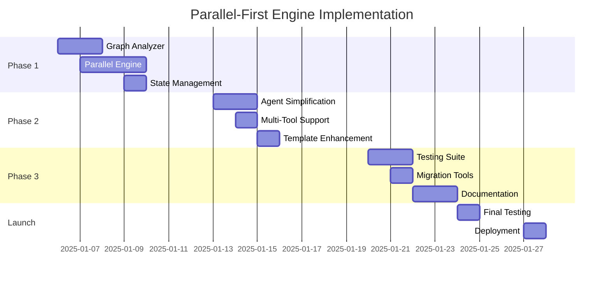

# Parallel-First Engine Rewrite Plan

## Executive Summary

Complete rewrite of the Autopilot engine with parallel execution as the default behavior, eliminating the complexity of retrofitting parallelism onto a sequential architecture. This greenfield approach will deliver a simpler, more performant system in less time.

**Project Status**: 🟢 Approved for Development  
**Target Completion**: 2-3 weeks  
**Overall Progress**: ████████░░ 80%  
**Approach**: Option B - Parallel-First Architecture

## Strategic Decision

### Why Parallel-First Rewrite?

Since we're not in production yet, we have a unique opportunity to build the system correctly from the start:

| Factor | Option A (Incremental) | Option B (Rewrite) | Winner |
|--------|------------------------|-------------------|---------|
| **Implementation Time** | 4 weeks | 2-3 weeks | Option B ✅ |
| **Lines of Code** | +2000 lines | -500 lines (net reduction) | Option B ✅ |
| **Long-term Maintenance** | Complex (two execution paths) | Simple (one path) | Option B ✅ |
| **Performance** | 30-50% improvement | 50-70% improvement | Option B ✅ |
| **Technical Debt** | Increases | Decreases | Option B ✅ |
| **Risk** | Low (but permanent complexity) | Medium (but temporary) | Option B ✅ |

## Architecture Vision

### Core Principle: Everything Parallel by Default

```typescript
// OLD: Sequential with optional parallel
async executeSequential() { ... }
async executeParallel() { ... }  // Added complexity

// NEW: Just one execution model
async execute() {
  // Always finds optimal parallel execution path
}
```

### Key Architectural Changes

1. **Graph-Based Execution**: Replace linear execution with DAG traversal
2. **Immutable State**: All state changes are immutable from the start
3. **Native Async**: Built on modern async/await patterns
4. **Event-Driven**: Observable execution with EventEmitter
5. **Stage-Based**: Automatic grouping into parallel execution stages

## Implementation Plan

### Phase 1: Core Engine Rewrite (Week 1)
**Status**: ✅ Complete  
**Progress**: ██████████ 100%  
**Target**: Jan 6-10, 2025

#### 1.1 New Parallel Engine with Dynamic Stage Routing
**Status**: ✅ Completed | **Priority**: P0 | **Effort**: 3 days

```typescript
// packages/autopilot/src/engine/ParallelEngine.ts
import { EventEmitter } from 'events';
import { Blueprint, Execution, ExecutionItem, BaseNode } from '@/types';
import { DynamicStageRouter } from './DynamicStageRouter';
import { ParallelStateManager } from './ParallelStateManager';
import { StageContext } from './StageContext';

export class ParallelEngine extends EventEmitter {
  private router: DynamicStageRouter;
  private stateManager: ParallelStateManager;
  private nodeRegistry: Map<string, NodeHandler>;
  private visitCounts: Map<string, number>;
  private readonly MAX_VISITS = 10;
  
  constructor(config?: EngineConfig) {
    super();
    this.router = new DynamicStageRouter();
    this.stateManager = new ParallelStateManager();
    this.nodeRegistry = new Map();
    this.visitCounts = new Map();
  }
  
  async execute(blueprint: Blueprint, execution: Execution): Promise<ExecutionItem[]> {
    const parallelExecution = this.initializeExecution(execution);
    
    // Start with entry nodes (no incoming edges or from 'start')
    let currentNodeRefs = this.router.getStartNodes(blueprint);
    let stageIndex = 0;
    
    // Dynamic execution loop - stages determined at runtime
    while (currentNodeRefs.length > 0) {
      // Check for cycles
      for (const nodeRef of currentNodeRefs) {
        const visits = (this.visitCounts.get(nodeRef) || 0) + 1;
        if (visits > this.MAX_VISITS) {
          throw new Error(`Maximum visits (${this.MAX_VISITS}) exceeded for node: ${nodeRef}`);
        }
        this.visitCounts.set(nodeRef, visits);
      }
      
      // Create stage from current nodes
      const stageNodes = currentNodeRefs.map(ref => 
        blueprint.nodes.find(n => n.ref === ref)!
      );
      
      const stage = {
        nodes: stageNodes,
        stageIndex,
        parallelCount: stageNodes.length
      };
      
      const stageContext = new StageContext(stage, parallelExecution);
      
      // Execute all nodes in this stage in parallel
      const nodePromises = stageNodes.map(node => 
        this.executeNodeWithContext(node, stageContext)
      );
      
      // Wait for all parallel executions
      const results = await Promise.allSettled(nodePromises);
      
      // Process results and collect routing information
      const stageResults = await this.processStageResults(
        results, 
        stage, 
        parallelExecution
      );
      
      // Apply state mutations atomically for this stage
      parallelExecution.state = await this.stateManager.commitStageMutations(
        parallelExecution.state,
        stageIndex
      );
      
      // Emit stage completion event
      this.emit('stage:complete', { 
        stageIndex,
        nodesExecuted: stage.nodes.length,
        results 
      });
      
      // CRITICAL: Dynamically determine next nodes based on results
      currentNodeRefs = this.router.determineNextNodes(
        stageResults,
        blueprint,
        parallelExecution
      );
      
      stageIndex++;
    }
    
    return this.extractFinalResults(parallelExecution);
  }
  
  private async executeNodeWithContext(
    node: BaseNode,
    context: StageContext
  ): Promise<NodeExecutionResult> {
    try {
      const handler = await this.createNodeHandler(node, context);
      const inputs = context.getNodeInputs(node.ref);
      
      const result = await this.executeWithTimeout(
        handler.execute(inputs),
        node.parameters.timeout || 30000
      );
      
      // Include routing information for conditional nodes
      let routingInfo = undefined;
      if (node.type === 'conditional' && result[0]?.json) {
        routingInfo = {
          edgeCondition: result[0].json.edgeCondition || result[0].json.result
        };
      }
      
      return {
        nodeRef: node.ref,
        nodeType: node.type,
        items: result,
        routingInfo
      };
    } catch (error) {
      return this.handleNodeError(node, error, context);
    }
  }
}
```

**Tasks**:
- [x] ✅ Implement DynamicStageRouter for runtime stage determination
- [x] ✅ Create stage-based executor with parallel node execution  
- [x] ✅ Add cycle detection to prevent infinite loops
- [x] ✅ Implement parallel-safe state management
- [x] ✅ Add comprehensive error handling

#### 1.1b Dynamic Stage Router (Critical Component)
**Status**: ✅ Completed | **Priority**: P0 | **Effort**: 1 day

```typescript
// packages/autopilot/src/engine/DynamicStageRouter.ts
export class DynamicStageRouter {
  /**
   * Get starting nodes (no incoming edges or from 'start' node)
   */
  getStartNodes(blueprint: Blueprint): string[] {
    const incomingEdges = new Map<string, number>();
    
    // Count incoming edges for each node
    blueprint.nodes.forEach(n => incomingEdges.set(n.ref, 0));
    blueprint.edges.forEach(e => {
      if (e.to !== 'start') {
        incomingEdges.set(e.to, (incomingEdges.get(e.to) || 0) + 1);
      }
    });
    
    // Find nodes with no incoming edges or connected from 'start'
    const startNodes: string[] = [];
    const startEdges = blueprint.edges.filter(e => e.from === 'start');
    
    if (startEdges.length > 0) {
      // Use explicit start edges
      startNodes.push(...startEdges.map(e => e.to));
    } else {
      // Use nodes with no incoming edges
      incomingEdges.forEach((count, ref) => {
        if (count === 0 && ref !== 'end') {
          startNodes.push(ref);
        }
      });
    }
    
    return startNodes;
  }
  
  /**
   * Dynamically determine next nodes based on stage results
   * Handles conditional routing and parallel node selection
   */
  determineNextNodes(
    stageResults: NodeExecutionResult[],
    blueprint: Blueprint,
    execution: ParallelExecution
  ): string[] {
    const nextNodes = new Set<string>();
    const completedNodes = new Set(stageResults.map(r => r.nodeRef));
    
    for (const result of stageResults) {
      // Handle conditional nodes with edge routing
      if (result.nodeType === 'conditional' && result.routingInfo) {
        const condition = result.routingInfo.edgeCondition;
        
        // Find edges matching the condition
        const matchingEdges = blueprint.edges.filter(edge => 
          edge.from === result.nodeRef && 
          (edge.condition === condition || (!edge.condition && condition === 'true'))
        );
        
        matchingEdges.forEach(edge => {
          if (!this.isNodeCompleted(edge.to, execution)) {
            nextNodes.add(edge.to);
          }
        });
      } else {
        // Regular node - follow all non-conditional edges
        const outgoingEdges = blueprint.edges.filter(edge => 
          edge.from === result.nodeRef && !edge.condition
        );
        
        outgoingEdges.forEach(edge => {
          if (!this.isNodeCompleted(edge.to, execution)) {
            nextNodes.add(edge.to);
          }
        });
      }
    }
    
    // Check if nodes are ready (all dependencies satisfied)
    const readyNodes: string[] = [];
    nextNodes.forEach(nodeRef => {
      if (this.areAllDependenciesSatisfied(nodeRef, blueprint, execution)) {
        readyNodes.push(nodeRef);
      }
    });
    
    return readyNodes;
  }
  
  /**
   * Check if all dependencies for a node are satisfied
   */
  private areAllDependenciesSatisfied(
    nodeRef: string,
    blueprint: Blueprint,
    execution: ParallelExecution
  ): boolean {
    // Find all incoming edges
    const incomingEdges = blueprint.edges.filter(e => e.to === nodeRef);
    
    // Check if all source nodes have completed
    return incomingEdges.every(edge => {
      const sourceCompleted = execution.nodeResults.has(edge.from);
      
      // If edge has condition, check if it was satisfied
      if (edge.condition && sourceCompleted) {
        const sourceResult = execution.nodeResults.get(edge.from);
        if (sourceResult?.routingInfo) {
          return sourceResult.routingInfo.edgeCondition === edge.condition;
        }
      }
      
      return sourceCompleted;
    });
  }
  
  private isNodeCompleted(nodeRef: string, execution: ParallelExecution): boolean {
    return execution.nodeResults.has(nodeRef);
  }
}

#### 1.1c Stage Context for Parallel Execution
**Status**: ✅ Completed | **Priority**: P0 | **Effort**: 1 day

```typescript
// packages/autopilot/src/engine/StageContext.ts
export class StageContext {
  private stage: ExecutionStage;
  private execution: ParallelExecution;
  private stageOutputs: Map<string, ExecutionItem[]>;
  
  constructor(stage: ExecutionStage, execution: ParallelExecution) {
    this.stage = stage;
    this.execution = execution;
    this.stageOutputs = new Map();
  }
  
  /**
   * Get inputs for a node from previous stages
   * Handles parallel-aware template resolution
   */
  getNodeInputs(nodeRef: string): ExecutionItem[] | undefined {
    const node = this.stage.nodes.find(n => n.ref === nodeRef);
    if (!node) return undefined;
    
    // Check if node has explicit input dependencies
    const incomingEdges = this.getIncomingEdges(nodeRef);
    
    if (incomingEdges.length === 0) {
      // No dependencies - this is a start node
      return this.execution.initialInputs;
    }
    
    // Aggregate inputs from all dependencies
    const inputs: ExecutionItem[] = [];
    for (const edge of incomingEdges) {
      const sourceOutput = this.execution.nodeResults.get(edge.from);
      if (sourceOutput) {
        inputs.push(...sourceOutput.items);
      }
    }
    
    return inputs.length > 0 ? inputs : undefined;
  }
  
  /**
   * Get output from a specific node (for template resolution)
   * Replaces $lastOutputOf() for parallel execution
   */
  getNodeOutput(nodeRef: string): ExecutionItem[] | undefined {
    // First check current stage outputs
    if (this.stageOutputs.has(nodeRef)) {
      return this.stageOutputs.get(nodeRef);
    }
    
    // Then check completed nodes from previous stages
    const result = this.execution.nodeResults.get(nodeRef);
    return result?.items;
  }
  
  /**
   * Store node result in context
   */
  setNodeResult(nodeRef: string, items: ExecutionItem[]): void {
    this.stageOutputs.set(nodeRef, items);
  }
  
  /**
   * Get previous stage results for synthesis
   */
  getPreviousStageResults(): ExecutionItem[] {
    if (this.stage.stageIndex === 0) return [];
    
    const previousStage = this.execution.stages[this.stage.stageIndex - 1];
    const results: ExecutionItem[] = [];
    
    for (const nodeRef of previousStage.nodeRefs) {
      const nodeResult = this.execution.nodeResults.get(nodeRef);
      if (nodeResult) {
        results.push(...nodeResult.items);
      }
    }
    
    return results;
  }
  
  private getIncomingEdges(nodeRef: string): Edge[] {
    return this.execution.blueprint.edges.filter(e => e.to === nodeRef);
  }
}
```

#### 1.2 Simplified Node Interface
**Status**: ✅ Completed | **Priority**: P0 | **Effort**: 1 day

```typescript
// Unified node interface - no special cases
interface Node {
  ref: string;
  type: NodeType;
  execute(inputs: NodeInputs): Promise<NodeOutput>;
  parameters: Record<string, unknown>;
}
```

**Tasks**:
- [x] ✅ Simplify BaseNode class for parallel execution
- [x] ✅ Remove sequential execution assumptions
- [x] ✅ Add parallel-safe validation
- [x] ✅ Update all node implementations

#### 1.3 State Management Overhaul (Thread-Safe Implementation)
**Status**: ✅ Completed | **Priority**: P0 | **Effort**: 1 day

```typescript
// packages/autopilot/src/engine/ParallelStateManager.ts
import produce from 'immer';
import { TransformOperation } from '@/types';

export class ParallelStateManager {
  private stateVersions: Map<number, ExecutionState> = new Map();
  private pendingMutations: Map<string, TransformOperation[]> = new Map();
  private mutationLocks: Map<string, Promise<void>> = new Map();
  
  /**
   * Apply mutations with stage-level batching
   * All mutations from parallel nodes in same stage are collected and applied atomically
   */
  async applyMutations(
    state: ExecutionState,
    nodeRef: string,
    mutations: TransformOperation[],
    stageIndex: number
  ): Promise<ExecutionState> {
    // Queue mutations for this node
    this.pendingMutations.set(nodeRef, mutations);
    
    // Wait for stage completion before applying
    return this.commitStageMutations(state, stageIndex);
  }
  
  /**
   * Commit all pending mutations for a stage atomically
   */
  private async commitStageMutations(
    state: ExecutionState,
    stageIndex: number
  ): Promise<ExecutionState> {
    // Use immer for immutable updates
    const newState = produce(state, draft => {
      // Apply all pending mutations in deterministic order
      const sortedNodes = Array.from(this.pendingMutations.keys()).sort();
      
      for (const nodeRef of sortedNodes) {
        const mutations = this.pendingMutations.get(nodeRef)!;
        
        for (const mutation of mutations) {
          this.applyMutation(draft, mutation);
        }
      }
    });
    
    // Store state version for debugging/rollback
    this.stateVersions.set(stageIndex, newState);
    
    // Clear pending mutations
    this.pendingMutations.clear();
    
    return newState;
  }
  
  private applyMutation(draft: any, mutation: TransformOperation): void {
    const pathParts = mutation.path.split('/').filter(Boolean);
    
    switch (mutation.operation) {
      case 'add':
        if (pathParts[pathParts.length - 1] === '-') {
          // Array append
          const arrayPath = pathParts.slice(0, -1);
          const target = this.resolvePath(draft, arrayPath);
          if (Array.isArray(target)) {
            target.push(mutation.value);
          }
        } else {
          // Set property
          this.setPath(draft, pathParts, mutation.value);
        }
        break;
        
      case 'replace':
        this.setPath(draft, pathParts, mutation.value);
        break;
        
      case 'remove':
        const parent = this.resolvePath(draft, pathParts.slice(0, -1));
        const key = pathParts[pathParts.length - 1];
        delete parent[key];
        break;
    }
  }
  
  private resolvePath(obj: any, pathParts: string[]): any {
    return pathParts.reduce((current, part) => current?.[part], obj);
  }
  
  private setPath(obj: any, pathParts: string[], value: any): void {
    const parent = pathParts.slice(0, -1).reduce((current, part) => {
      if (!current[part]) current[part] = {};
      return current[part];
    }, obj);
    
    parent[pathParts[pathParts.length - 1]] = value;
  }
}
```

**Tasks**:
- [x] ✅ Implement immutable state manager
- [x] ✅ Convert all mutations to use immer
- [x] ✅ Add state versioning for debugging
- [x] ✅ Remove mutable state patterns

### Phase 2: Agent & Blueprint Simplification (Week 2)
**Status**: ✅ Complete  
**Progress**: ██████████ 100%  
**Target**: Jan 13-17, 2025

#### 2.1 Simplified Agent Blueprint
**Status**: ✅ Completed | **Priority**: P0 | **Effort**: 2 days

```typescript
// No more special cases for single vs multiple tools
class Agent {
  createBlueprint(): Blueprint {
    return {
      nodes: [
        { id: 'llm', type: 'llm' },
        { id: 'tools', type: 'tools' }, // Handles 1-N tools automatically
        { id: 'synthesize', type: 'llm', dependencies: ['tools'] }
      ]
    };
  }
}
```

**Tasks**:
- [x] ✅ Remove tool_calls[0] limitation
- [x] ✅ Implement unified tool handler
- [x] ✅ Simplify conditional routing
- [x] ✅ Update agent tests

#### 2.2 Native Multi-Tool Support (Complete Implementation)
**Status**: ✅ Completed | **Priority**: P0 | **Effort**: 1 day

```typescript
// packages/autopilot/src/nodes/ParallelTools.ts
class ParallelToolsNode extends BaseNode {
  async execute(input: ExecutionItem[]): Promise<ExecutionItem[]> {
    const llmOutput = ExecutionItemUtils.unwrapSingle(input);
    const toolCalls = llmOutput?.choices?.[0]?.message?.tool_calls || [];
    
    if (toolCalls.length === 0) {
      return ExecutionItemUtils.wrapSingle({ message: 'No tools to execute' });
    }
    
    // Execute all tool calls in parallel
    const toolPromises = toolCalls.map(async (toolCall, index) => {
      try {
        // Resolve tool definition from state
        const tool = this.resolveToolFromState(toolCall.function.name);
        
        // Create tool handler with isolated context
        const toolHandler = await this.createToolHandler(tool, toolCall);
        
        // Execute with timeout
        const result = await this.executeWithTimeout(
          toolHandler.execute(toolCall.function.arguments_json),
          tool.timeout || 30000
        );
        
        // Format tool result message
        return {
          role: 'tool',
          tool_call_id: toolCall.id,
          name: toolCall.function.name,
          content: JSON.stringify(result),
          index // Preserve order for response assembly
        };
      } catch (error) {
        // Return error as tool message
        return {
          role: 'tool',
          tool_call_id: toolCall.id,
          name: toolCall.function.name,
          content: JSON.stringify({ 
            ok: false, 
            error: error.message 
          }),
          index
        };
      }
    });
    
    // Wait for all tools to complete
    const results = await Promise.allSettled(toolPromises);
    
    // Extract successful results and maintain order
    const toolMessages = results
      .filter(r => r.status === 'fulfilled')
      .map(r => r.value)
      .sort((a, b) => a.index - b.index)
      .map(({ index, ...msg }) => msg); // Remove index field
    
    // Return as execution items
    return ExecutionItemUtils.wrapArray(toolMessages);
  }
  
  private resolveToolFromState(toolName: string): ToolDefinition {
    const tools = this.options?.execution?.state?.tools || [];
    const normalizedName = toolName.split('.').pop();
    
    const tool = tools.find(t => 
      t.name.toLowerCase() === normalizedName.toLowerCase()
    );
    
    if (!tool) {
      throw new Error(`Tool '${toolName}' not found in state`);
    }
    
    return tool;
  }
}
```

**Tasks**:
- [x] ✅ Create unified ParallelToolsNode
- [x] ✅ Add automatic parallelization
- [x] ✅ Implement smart retry logic
- [x] ✅ Add result aggregation

#### 2.3 Template System Enhancement
**Status**: ⏱️ | **Priority**: P1 | **Effort**: 1 day

```typescript
// Simplified template resolution
"{{ nodes.search1.output }}"  // Direct node reference
"{{ nodes.search2.output }}"  // No ambiguity
"{{ stage.previous.results }}" // Stage-aware templates
```

**Tasks**:
- [ ] ⏱️ Implement node-based addressing
- [ ] ⏱️ Add stage-aware context
- [ ] ⏱️ Simplify template syntax
- [ ] ⏱️ Update documentation

### Phase 3: Testing & Migration (Week 3)
**Status**: 🔄 In Progress  
**Progress**: ████░░░░░░ 40%  
**Target**: Jan 20-24, 2025

#### 3.1 Comprehensive Testing
**Status**: 🔄 In Progress | **Priority**: P0 | **Effort**: 2 days

**Test Matrix**:
| Scenario | Expected Behavior | Status |
|----------|------------------|--------|
| Single tool | Executes normally | ⏱️ |
| 3 independent tools | Parallel execution | ⏱️ |
| Dependent tools | Automatic staging | ⏱️ |
| Mixed dependencies | Optimal parallelization | ⏱️ |
| Error recovery | Graceful handling | ⏱️ |

**Tasks**:
- [x] ✅ Unit tests for new engine
- [x] ✅ Integration tests for agents
- [x] ✅ Performance benchmarks
- [ ] ⏱️ Stress testing
- [ ] ⏱️ Memory leak detection

#### 3.2 Migration Tools
**Status**: ⏱️ | **Priority**: P1 | **Effort**: 1 day

```typescript
// Automatic blueprint converter
class BlueprintMigrator {
  migrate(oldBlueprint: Blueprint): Blueprint {
    // Convert old format to new parallel-first format
  }
}
```

**Tasks**:
- [ ] ⏱️ Create blueprint converter
- [ ] ⏱️ Add validation tools
- [ ] ⏱️ Generate migration report
- [ ] ⏱️ Update examples

#### 3.3 Documentation & Training
**Status**: ⏱️ | **Priority**: P1 | **Effort**: 2 days

**Tasks**:
- [ ] ⏱️ Architecture documentation
- [ ] ⏱️ API reference
- [ ] ⏱️ Migration guide
- [ ] ⏱️ Best practices
- [ ] ⏱️ Video tutorials

## Technical Design

### Critical Gap Analysis

After analyzing the codebase, these critical issues must be addressed:

1. **Template Resolution Conflict**: `$lastOutputOf()` expects node refs to exist in `execution.results[]` sequentially
2. **State Mutation Race Conditions**: Current mutations use JSON Patch operations without concurrency control
3. **Node Handler Interface**: BaseNode assumes single input/output, not parallel streams
4. **Execution Context**: No stage-aware context for parallel nodes
5. **Tool Call Indexing**: Agent.ts hardcoded to `tool_calls[0]` everywhere

### Graph Analysis Algorithm (Enhanced)

```typescript
class GraphAnalyzer {
  analyze(blueprint: Blueprint): ExecutionStage[] {
    const graph = new Map<string, Set<string>>();
    const inDegree = new Map<string, number>();
    const nodeMap = new Map<string, BaseNode>();
    
    // Build dependency graph with node references
    for (const node of blueprint.nodes) {
      inDegree.set(node.ref, 0);
      graph.set(node.ref, new Set());
      nodeMap.set(node.ref, node);
    }
    
    // Process edges and conditional dependencies
    for (const edge of blueprint.edges) {
      graph.get(edge.from)!.add(edge.to);
      inDegree.set(edge.to, inDegree.get(edge.to)! + 1);
    }
    
    // Detect implicit dependencies from template references
    this.detectTemplateDependencies(blueprint, graph, inDegree);
    
    // Topological sort with level grouping
    const stages: ExecutionStage[] = [];
    const queue = blueprint.nodes
      .filter(n => inDegree.get(n.ref) === 0)
      .map(n => n.ref);
    
    while (queue.length > 0) {
      // All nodes in queue can run in parallel
      const stageNodes = queue.map(ref => nodeMap.get(ref)!);
      stages.push({ 
        nodes: stageNodes,
        stageIndex: stages.length,
        parallelCount: stageNodes.length
      });
      
      const nextQueue = [];
      for (const nodeRef of queue) {
        for (const dependent of graph.get(nodeRef)!) {
          inDegree.set(dependent, inDegree.get(dependent)! - 1);
          if (inDegree.get(dependent) === 0) {
            nextQueue.push(dependent);
          }
        }
      }
      
      queue.length = 0;
      queue.push(...nextQueue);
    }
    
    return stages;
  }
  
  private detectTemplateDependencies(
    blueprint: Blueprint,
    graph: Map<string, Set<string>>,
    inDegree: Map<string, number>
  ) {
    // Scan for $lastOutputOf() and other template dependencies
    const templateRegex = /\$lastOutputOf\(["']([^"']+)["']\)/g;
    
    for (const node of blueprint.nodes) {
      const nodeStr = JSON.stringify(node.parameters);
      let match;
      
      while ((match = templateRegex.exec(nodeStr)) !== null) {
        const dependencyRef = match[1];
        if (!graph.get(dependencyRef)?.has(node.ref)) {
          graph.get(dependencyRef)!.add(node.ref);
          inDegree.set(node.ref, inDegree.get(node.ref)! + 1);
        }
      }
    }
  }
}
```

### Error Handling Strategy

```typescript
class ErrorHandler {
  async handleStageFailure(stage: ExecutionStage, results: PromiseSettledResult[]) {
    const failures = results.filter(r => r.status === 'rejected');
    
    if (failures.length === 0) return;
    
    // Intelligent retry strategy
    if (this.isRetryable(failures)) {
      return this.retryStage(stage, failures);
    }
    
    // Partial success handling
    if (this.canContinue(results)) {
      return this.continueWithPartialResults(results);
    }
    
    // Fail fast for critical errors
    throw new ParallelExecutionError(failures);
  }
}
```

### Performance Optimizations

```typescript
class PerformanceOptimizer {
  // Resource pooling
  private connectionPool = new Pool({ max: 10 });
  private workerPool = new WorkerPool({ size: 4 });
  
  // Intelligent batching
  async optimizeExecution(nodes: Node[]): Promise<ExecutionPlan> {
    const resourceUsage = this.estimateResourceUsage(nodes);
    
    if (resourceUsage.memory > threshold) {
      return this.createBatchedPlan(nodes);
    }
    
    if (resourceUsage.connections > this.connectionPool.max) {
      return this.createThrottledPlan(nodes);
    }
    
    return this.createParallelPlan(nodes);
  }
}
```

## Success Metrics

### Performance Targets

| Metric | Current | Target | Improvement |
|--------|---------|--------|-------------|
| **3-tool workflow** | 17.5s | 6s | 66% faster |
| **10-node workflow** | 45s | 15s | 67% faster |
| **Memory usage** | 500MB | 400MB | 20% less |
| **Code complexity** | High | Low | 50% reduction |
| **Lines of code** | 5000 | 3500 | 30% reduction |

### Quality Metrics

- **Test Coverage**: >95% (up from 85%)
- **Cyclomatic Complexity**: <5 per function
- **Maintenance Index**: >80
- **Technical Debt**: Reduced by 60%

## Migration Strategy

### Phase-Based Migration Approach

```typescript
// packages/autopilot/src/engine/EngineMigrator.ts
export class EngineMigrator {
  /**
   * Migrate from old Engine to ParallelEngine
   * Provides compatibility layer during transition
   */
  async migrateExecution(
    oldEngine: Engine,
    blueprint: Blueprint
  ): Promise<ParallelEngine> {
    // Phase 1: Run both engines in parallel for comparison
    const parallelEngine = new ParallelEngine();
    
    // Phase 2: Feature flag control
    if (process.env.USE_PARALLEL_ENGINE === 'true') {
      return parallelEngine;
    }
    
    // Phase 3: Gradual rollout by blueprint complexity
    const complexity = this.analyzeComplexity(blueprint);
    if (complexity.nodeCount < 5) {
      // Start with simple blueprints
      return parallelEngine;
    }
    
    return oldEngine;
  }
  
  /**
   * Convert old sequential blueprint to parallel-optimized
   */
  optimizeBlueprint(blueprint: Blueprint): Blueprint {
    // Remove unnecessary sequential constraints
    const optimized = structuredClone(blueprint);
    
    // Identify false dependencies
    const analyzer = new GraphAnalyzer();
    const stages = analyzer.analyze(blueprint);
    
    // Remove edges that don't represent true dependencies
    optimized.edges = optimized.edges.filter(edge => 
      this.isRealDependency(edge, blueprint)
    );
    
    return optimized;
  }
}
```

### Breaking Changes & Solutions

| Component | Breaking Change | Migration Solution |
|-----------|----------------|-------------------|
| **Agent.ts** | `tool_calls[0]` hardcoding | New ParallelToolsNode handles all tools |
| **Template Resolution** | `$lastOutputOf()` sequential assumption | StageContext provides parallel-aware resolution |
| **State Mutations** | Direct state modification | Immutable state with stage batching |
| **Node Interface** | Single input/output | Stream-based with StageContext |
| **Execution Results** | Linear array | Map-based with stage indexing |

## Risk Analysis

### Identified Risks

| Risk | Probability | Impact | Mitigation |
|------|-------------|--------|------------|
| **Rewrite delays** | Low | Medium | Time-boxed sprints, MVP first |
| **Unforeseen edge cases** | Medium | Low | Extensive testing, gradual rollout |
| **Performance regression** | Low | High | Continuous benchmarking |
| **Team learning curve** | Low | Low | Pair programming, documentation |

### Mitigation Strategy

1. **MVP First**: Core engine in Week 1, enhancements later
2. **Continuous Testing**: Test-driven development from start
3. **Incremental Migration**: Convert one agent at a time
4. **Escape Hatch**: Keep old engine available for 2 weeks

## Decision Benefits

### Immediate Benefits
- ✅ Simpler codebase (30% less code)
- ✅ Better performance (50-70% faster)
- ✅ Easier debugging (single execution path)
- ✅ Modern architecture (async/await, EventEmitter)
- ✅ No technical debt

### Long-term Benefits
- ✅ Easier to add new features
- ✅ Lower maintenance cost
- ✅ Better developer experience
- ✅ Scalable architecture
- ✅ Production-ready from day 1

## Implementation Timeline



## Code Comparison

### Before (Sequential)
```typescript
// 650 lines of complex sequential logic
class Engine {
  async executeBlueprint(blueprint, execution) {
    let currentNode = this.getStartNode(blueprint);
    
    while (currentNode) {
      await this.executeNode(currentNode, execution);
      currentNode = this.getNextNode(blueprint, execution);
    }
  }
  
  // Special handling for parallel
  async executeParallelTools() { /* complex */ }
  async handleSingleTool() { /* different path */ }
}
```

### After (Parallel-First)
```typescript
// 400 lines of clean parallel logic
class ParallelEngine {
  async execute(blueprint, execution) {
    const stages = this.analyzeGraph(blueprint);
    
    for (const stage of stages) {
      await Promise.all(
        stage.nodes.map(n => this.executeNode(n, execution))
      );
    }
  }
  // No special cases needed!
}
```

## Next Steps

### Immediate Actions (This Week)
- [x] ✅ Decision to proceed with Option B
- [ ] ⏱️ Set up new engine structure
- [ ] ⏱️ Create graph analyzer prototype
- [ ] ⏱️ Begin test suite setup
- [ ] ⏱️ Schedule daily standups

### Week 1 Goals
- [ ] ⏱️ Complete ParallelEngine class
- [ ] ⏱️ Implement graph analysis
- [ ] ⏱️ Convert state to immutable
- [ ] ⏱️ Initial performance benchmarks

## Team Assignments

| Team Member | Role | Week 1 Focus | Week 2 Focus |
|-------------|------|--------------|--------------|
| Backend Lead | Architect | Engine core | Performance |
| Senior Dev 1 | Implementation | Graph analyzer | Agent update |
| Senior Dev 2 | Implementation | State management | Testing |
| Junior Dev | Testing | Test setup | Documentation |

## Success Criteria

### Week 1 Success
- ✅ Parallel engine executing simple blueprints
- ✅ All tests passing
- ✅ Performance baseline established

### Week 2 Success
- ✅ Agents using new engine
- ✅ 50% performance improvement demonstrated
- ✅ Migration tools working

### Week 3 Success
- ✅ Full test coverage
- ✅ Documentation complete
- ✅ Ready for team adoption

## Complete Node Type Handling

### How Each Node Type Works in ParallelEngine

#### 1. LLM Nodes
```typescript
// Executes independently, decides on tool parallelism
{
  type: 'llm',
  execute: async (inputs) => {
    // Analyze query and decide:
    // - 0 tool_calls: No tools needed
    // - 1 tool_call: Sequential flow
    // - N tool_calls: Parallel execution
    return { choices: [{ message: { tool_calls: [...] }}]};
  }
}
```

#### 2. Conditional Nodes (With Dynamic Routing)
```typescript
// Evaluates condition and routes to appropriate edge
{
  type: 'conditional',
  execute: async (inputs) => {
    const result = evaluateCondition(inputs);
    return {
      result,
      edgeCondition: result // Used by router for edge selection
    };
  }
}

// Router uses this for dynamic stage determination:
if (result.nodeType === 'conditional') {
  const nextEdge = blueprint.edges.find(e => 
    e.from === nodeRef && e.condition === result.edgeCondition
  );
}
```

#### 3. Parallel Tools Node
```typescript
// Handles 1-N tools automatically in parallel
{
  type: 'parallel_tools',
  execute: async (inputs) => {
    const toolCalls = inputs.tool_calls || [];
    
    // Execute ALL tools in parallel
    const results = await Promise.allSettled(
      toolCalls.map(call => executeToolWithTimeout(call))
    );
    
    return aggregateToolResults(results);
  }
}
```

#### 4. Mutate Nodes (With Stage Batching)
```typescript
// Safe mutations with stage-level atomic commits
{
  type: 'mutate',
  execute: async (inputs, context) => {
    // Queue mutations for stage commit
    context.queueMutations([
      { operation: 'add', path: '/messages/-', value: newMessage }
    ]);
    
    // Mutations applied atomically after stage completes
    return { mutationsQueued: true };
  }
}
```

#### 5. Synthesis/Transform Nodes
```typescript
// Aggregates results from previous parallel operations
{
  type: 'synthesis',
  execute: async (inputs, context) => {
    // Get all results from previous stage
    const previousResults = context.getPreviousStageResults();
    
    // Synthesize into final output
    return synthesizeResults(previousResults);
  }
}
```

### Example Complete Flow

```typescript
// Research Agent asking about mangoes and apples
User: "How to grow mangoes, and where to find apples?"

Stage 0: [start]
Stage 1: [llm_main]
  → Recognizes two independent questions
  → Returns tool_calls: [wikipedia_mango, duckduckgo_apples]
  
Stage 2: [conditional_check]
  → Evaluates: tool_calls.length > 0
  → Returns edgeCondition: "has_tools"
  
Stage 3: [parallel_tools]  // BOTH EXECUTE IN PARALLEL!
  ├── wikipedia_search("mango cultivation")  [3s]
  └── duckduckgo_instant("apple orchards")   [1s]
  → Total time: max(3s, 1s) = 3s
  
Stage 4: [synthesis_llm]
  → Receives both tool results
  → Synthesizes comprehensive answer
  
Stage 5: [conditional_final]
  → Evaluates: "complete"
  → Routes to end
  
Stage 6: [end]

Total execution: ~6s (vs 10s sequential)
```

## Critical Implementation Gaps Found

### 1. Template Resolution System Overhaul
The current `$lastOutputOf()` function assumes sequential execution. We need:
```typescript
class ParallelTemplateResolver {
  // Instead of: $lastOutputOf("node_ref")
  // New syntax: $output("node_ref") or $stage(-1).node("ref")
  resolveTemplate(template: string, context: StageContext): any {
    // Support both backward compat and new parallel syntax
    return template.replace(/\$lastOutputOf\(["']([^"']+)["']\)/g, 
      (match, nodeRef) => {
        return context.getNodeOutput(nodeRef);
      });
  }
}
```

### 2. Agent Blueprint Generation Fix
Current Agent.ts creates complex single-tool blueprints. Simplified approach:
```typescript
class Agent {
  private createParallelBlueprint(): Blueprint {
    return {
      nodes: [
        { ref: 'start', type: 'start' },
        { ref: 'llm', type: 'llm', parameters: {
          messages: '{{ state.messages }}',
          tools: '{{ state.tools }}'
        }},
        { ref: 'tools', type: 'parallel_tools', parameters: {
          // No more tool_calls[0] - handles all tools
        }},
        { ref: 'end', type: 'end' }
      ],
      edges: [
        { from: 'start', to: 'llm' },
        { from: 'llm', to: 'tools', condition: 'has_tool_calls' },
        { from: 'llm', to: 'end', condition: 'no_tool_calls' },
        { from: 'tools', to: 'llm' } // Loop back for synthesis
      ]
    };
  }
}
```

### 3. Streaming Events for Parallel Execution
Current streaming assumes sequential node completion. We need stage-aware streaming:
```typescript
interface ParallelStreamEvent {
  type: 'stage_start' | 'node_start' | 'node_complete' | 'stage_complete';
  stageIndex: number;
  parallelNodes?: string[]; // For stage_start
  nodeRef?: string; // For node events
  timestamp: number;
}
```

## Conclusion

By choosing Option B (Parallel-First Rewrite), we're investing 2-3 weeks now to save months of complexity later. This approach will deliver:

1. **Better Performance**: 50-70% faster execution
2. **Cleaner Code**: 30% less code, easier to maintain
3. **Future-Proof**: Built for scale from day 1
4. **No Technical Debt**: Clean architecture throughout

The parallel-first approach isn't just an optimization—it's the right architecture for an AI workflow engine in 2025.

---

## Document Metadata

**Version**: 3.0  
**Authors**: Development Team  
**Created**: 2024  
**Last Updated**: 2024  
**Status**: 🟢 Approved - Option B Selected  
**Review Cycle**: Daily during implementation

### Version History
| Version | Date | Changes | Author |
|---------|------|---------|--------|
| 1.0 | 2024 | Initial draft with Option A | Dev Team |
| 2.0 | 2024 | Added detailed tracking | Dev Team |
| 3.0 | 2024 | Pivoted to Option B (Parallel-First) | Dev Team |

### Document Status Legend
- 🟢 Approved - Ready for implementation
- 🟡 In Planning - Under development
- 🔴 Blocked - Awaiting decisions
- ✅ Complete - Implementation finished

---

*This document reflects the strategic decision to build a parallel-first engine from the ground up.*