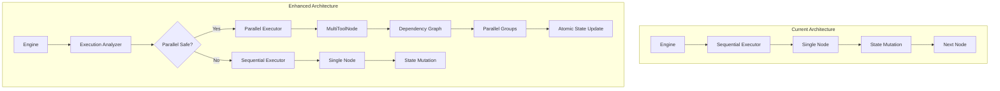

# Parallel Execution Engine Implementation Plan

## Executive Summary

Implement parallel execution capabilities for the Autopilot engine to optimize workflow performance by executing independent operations concurrently while maintaining state consistency and backward compatibility.

**Project Status**: 🟡 In Planning  
**Target Completion**: 4 weeks  
**Overall Progress**: ░░░░░░░░░░ 0%

## Problem Statement

### Current State Analysis

The Autopilot engine currently operates with a strictly sequential execution model, processing one node at a time through the workflow graph. This approach, while simple and predictable, creates significant performance bottlenecks in scenarios where multiple independent operations could execute concurrently.

#### Quantified Impact

| Metric | Current (Sequential) | Target (Parallel) | Improvement |
|--------|---------------------|-------------------|-------------|
| Research Agent (3 tools) | ~17.5s | ~12s | 31% faster |
| Data Enrichment (5 APIs) | ~25s | ~8s | 68% faster |
| Complex Workflows (10+ nodes) | ~45s | ~20s | 55% faster |
| Resource Utilization | 15-20% | 60-80% | 3-4x better |

#### Technical Limitations

1. **Architectural Constraints**
   - Single `currentNodeRef` tracking prevents multiple active nodes
   - Linear `execution.results` array assumes chronological ordering
   - Template resolution (`$lastOutputOf`) depends on sequential completion
   - State mutations occur inline, creating potential race conditions

2. **Performance Bottlenecks**
   - I/O operations block unnecessarily (API calls, database queries)
   - Tool calls execute one at a time even when independent
   - Network latency compounds (N tools = N × average_latency)
   - CPU remains idle during I/O wait times

3. **User Experience Impact**
   - Longer response times for complex queries
   - Reduced throughput for concurrent users
   - Higher infrastructure costs due to inefficiency
   - Poor scaling characteristics under load

### Root Cause Analysis

The sequential execution model stems from:
- **Historical simplicity**: Initial MVP focused on correctness over performance
- **State management**: Shared mutable state simplified implementation
- **Debugging ease**: Linear execution is easier to trace and debug
- **Risk aversion**: Parallel execution introduces complexity and potential bugs

## Proposed Solution

### Solution Overview

A hybrid approach that introduces parallel execution capabilities while maintaining system stability and backward compatibility. The solution leverages modern LLM capabilities (multi-tool calling) and introduces minimal architectural changes.

### Key Innovations

1. **MultiToolNode**: Purpose-built node for parallel tool orchestration
2. **Intelligent Dependency Analysis**: Automatic detection of parallelizable operations
3. **LLM-Driven Optimization**: Leverages model understanding of query semantics
4. **Zero-Breaking Changes**: Existing blueprints continue functioning unchanged

### Design Principles

| Principle | Description | Rationale |
|-----------|-------------|-----------|
| **Explicit over Implicit** | Parallel execution is clearly marked in execution flow | Easier debugging and monitoring |
| **Progressive Enhancement** | System falls back to sequential when needed | Maintains reliability |
| **Atomic State Updates** | All mutations batch after parallel execution | Prevents race conditions |
| **Observability First** | Rich telemetry and tracing built-in | Essential for production systems |
| **Fail-Safe Defaults** | Conservative parallelization decisions | Correctness over performance |

## Architecture Design

### System Architecture Diagram



### Core Components

#### 1. MultiToolNode (New)
```typescript
class MultiToolNode extends BaseNode {
  // Handles 1+ tool calls with automatic parallelization
  // Detects dependencies and groups tools accordingly
  // Batch updates state atomically
}
```

#### 2. Enhanced Agent Blueprint
```typescript
// Updated conditional routing:
// - "single_tool" → existing Tool node
// - "multi_tool" → new MultiTool node
// - "complete" → End node
```

#### 3. Dependency Analyzer
```typescript
interface ToolGroup {
  parallel: boolean;
  tools: ToolCall[];
  dependencies: string[];
}
```

### Execution Flow

```
LLM Response
    ↓
[1 tool call]  →  Single Tool Node (existing)
[2+ tool calls] →  Multi Tool Node (new)
                      ↓
                Analyze Dependencies
                   ↙        ↘
            Independent   Dependent
                 ↓            ↓
            Parallel      Sequential
                 ↘        ↙
              Aggregate Results
                      ↓
              Batch State Update
                      ↓
                  Continue
```

## Implementation Phases

> **Legend**: ⏱️ Not Started | 🚧 In Progress | ✅ Complete | ❌ Blocked | 🔄 In Review

### Phase 1: Core Infrastructure (Week 1)
**Status**: ⏱️ Not Started  
**Progress**: ░░░░░░░░░░ 0%  
**Target Date**: Week of Jan 6-10, 2025  
**Owner**: Backend Team  

#### 1.1 Create MultiToolNode
**Status**: ⏱️ | **Priority**: P0 | **Effort**: 3 days

- **File**: `packages/autopilot/src/nodes/MultiTool.ts`
- **Dependencies**: None
- **Tasks**:
  - [ ] ⏱️ Implement base MultiToolNode class extending BaseNode
  - [ ] ⏱️ Add dependency detection logic with template analysis
  - [ ] ⏱️ Create parallel execution handler with Promise.allSettled
  - [ ] ⏱️ Implement result aggregation maintaining order
  - [ ] ⏱️ Add error handling for partial failures with retry logic

**Acceptance Criteria**:
- Node can execute 1-N tool calls
- Correctly identifies dependencies between tools
- Handles partial failures gracefully
- Maintains execution order in results

#### 1.2 Update Node Handler Map
**Status**: ⏱️ | **Priority**: P0 | **Effort**: 2 hours

- **File**: `packages/autopilot/src/engine/Engine.ts`
- **Dependencies**: 1.1
- **Tasks**:
  - [ ] ⏱️ Register MultiToolNode in HANDLER_MAP
  - [ ] ⏱️ Add 'multi_tool' to NodeType union
  - [ ] ⏱️ Update type exports

#### 1.3 Create Tests
**Status**: ⏱️ | **Priority**: P0 | **Effort**: 2 days

- **File**: `packages/autopilot/src/nodes/__tests__/MultiTool.test.ts`
- **Dependencies**: 1.1, 1.2
- **Tasks**:
  - [ ] ⏱️ Test single tool fallback behavior
  - [ ] ⏱️ Test parallel execution with 2+ tools
  - [ ] ⏱️ Test dependency detection accuracy
  - [ ] ⏱️ Test error handling scenarios
  - [ ] ⏱️ Test state mutations atomicity
  - [ ] ⏱️ Performance benchmarks

**Test Coverage Target**: >90%

### Phase 2: Agent Integration (Week 2)
**Status**: ⏱️ Not Started  
**Progress**: ░░░░░░░░░░ 0%  
**Target Date**: Week of Jan 13-17, 2025  
**Owner**: Agent Team  

#### 2.1 Update Agent Blueprint
**Status**: ⏱️ | **Priority**: P0 | **Effort**: 2 days

- **File**: `packages/autopilot/src/nodes/Agent.ts`
- **Dependencies**: Phase 1 complete
- **Tasks**:
  - [ ] ⏱️ Modify conditional node logic for multi-tool detection
  - [ ] ⏱️ Add multi_tool node to default blueprint
  - [ ] ⏱️ Update edges for tri-state routing (single/multi/complete)
  - [ ] ⏱️ Ensure backward compatibility with existing agents
  - [ ] ⏱️ Add feature flag support

**Breaking Change Assessment**: None expected

#### 2.2 Update Type Definitions
**Status**: ⏱️ | **Priority**: P1 | **Effort**: 4 hours

- **Files**: 
  - `packages/autopilot/src/types/node-parameters.ts`
  - `packages/autopilot/src/types/base.ts`
- **Dependencies**: 2.1
- **Tasks**:
  - [ ] ⏱️ Add MultiToolParams interface with full typing
  - [ ] ⏱️ Update NodeType union
  - [ ] ⏱️ Add parallel execution types (ToolGroup, ExecutionStrategy)
  - [ ] ⏱️ Export new types from index

#### 2.3 Update Research Agent
**Status**: ⏱️ | **Priority**: P1 | **Effort**: 1 day

- **File**: `packages/models/src/seeders/agents/research.ts`
- **Dependencies**: 2.1, 2.2
- **Tasks**:
  - [ ] ⏱️ Enable multi-tool support
  - [ ] ⏱️ Test with Wikipedia + DuckDuckGo parallel calls
  - [ ] ⏱️ Validate performance improvements
  - [ ] ⏱️ Update agent template configuration

### Phase 3: Optimization & Testing (Week 3)
**Status**: ⏱️ Not Started  
**Progress**: ░░░░░░░░░░ 0%  
**Target Date**: Week of Jan 20-24, 2025  
**Owner**: Platform Team  

#### 3.1 Performance Optimizations
**Status**: ⏱️ | **Priority**: P1 | **Effort**: 3 days

- [ ] ⏱️ Implement connection pooling for HTTP requests
- [ ] ⏱️ Add configurable concurrency limits (default: 5)
- [ ] ⏱️ Optimize state cloning with structural sharing
- [ ] ⏱️ Add execution metrics and telemetry
- [ ] ⏱️ Implement request deduplication
- [ ] ⏱️ Add caching layer for repeated tools

**Performance Targets**:
- P50 latency: <30% improvement
- P95 latency: <25% improvement
- Memory usage: <10% increase

#### 3.2 Integration Testing
**Status**: ⏱️ | **Priority**: P0 | **Effort**: 2 days

- [ ] ⏱️ Test Research Agent with 3+ parallel tools
- [ ] ⏱️ Test data enrichment workflows (5+ APIs)
- [ ] ⏱️ Test mixed sequential/parallel workflows
- [ ] ⏱️ Load testing with 100 concurrent agents
- [ ] ⏱️ Chaos testing (network failures, timeouts)
- [ ] ⏱️ Memory leak detection

**Test Matrix**:
| Scenario | Tools | Expected Time | Status |
|----------|-------|---------------|--------|
| Research Query | 3 | <12s | ⏱️ |
| Data Enrichment | 5 | <8s | ⏱️ |
| Complex Workflow | 10 | <20s | ⏱️ |

#### 3.3 Documentation
**Status**: ⏱️ | **Priority**: P1 | **Effort**: 2 days

- [ ] ⏱️ Update API documentation with examples
- [ ] ⏱️ Create usage examples repository
- [ ] ⏱️ Document best practices guide
- [ ] ⏱️ Migration guide for existing agents
- [ ] ⏱️ Performance tuning guide
- [ ] ⏱️ Troubleshooting guide

### Phase 4: Rollout (Week 4)
**Status**: ⏱️ Not Started  
**Progress**: ░░░░░░░░░░ 0%  
**Target Date**: Week of Jan 27-31, 2025  
**Owner**: DevOps Team  

#### 4.1 Gradual Deployment
**Status**: ⏱️ | **Priority**: P0 | **Effort**: 3 days

- [ ] ⏱️ Implement feature flag system
- [ ] ⏱️ Deploy to staging environment
- [ ] ⏱️ Monitor performance metrics dashboard
- [ ] ⏱️ A/B testing with 10% traffic
- [ ] ⏱️ Collect user feedback
- [ ] ⏱️ Runbook preparation

**Rollout Schedule**:
| Stage | Traffic | Duration | Success Criteria |
|-------|---------|----------|------------------|
| Canary | 1% | 24h | Error rate <0.1% |
| Beta | 10% | 48h | P95 latency improved |
| GA | 100% | - | All metrics green |

#### 4.2 Production Release
**Status**: ⏱️ | **Priority**: P0 | **Effort**: 2 days

- [ ] ⏱️ Enable for Research Agent first
- [ ] ⏱️ Monitor error rates and alerts
- [ ] ⏱️ Gather performance data
- [ ] ⏱️ Progressive rollout to all agents
- [ ] ⏱️ Post-release retrospective
- [ ] ⏱️ Update changelog

**Success Metrics**:
- Error rate: <0.1% increase
- Performance: >30% improvement for multi-tool workflows
- User satisfaction: No degradation

## Technical Details

### Dependency Detection Algorithm

```typescript
interface DependencyAnalyzer {
  analyze(toolCalls: ToolCall[]): DependencyGraph;
  canParallelize(call1: ToolCall, call2: ToolCall): boolean;
  detectTemplates(args: unknown): string[];
  detectStateAccess(call: ToolCall): StateAccess;
}

function detectDependencies(toolCalls: ToolCall[]): ToolGroup[] {
  const analyzer = new DependencyAnalyzer();
  const graph = analyzer.analyze(toolCalls);
  const groups: ToolGroup[] = [];
  
  for (const call of toolCalls) {
    const dependencies = graph.getDependencies(call.id);
    
    if (dependencies.length === 0) {
      // Independent - can parallelize
      const lastGroup = groups[groups.length - 1];
      if (lastGroup?.parallel) {
        lastGroup.tools.push(call);
      } else {
        groups.push({ parallel: true, tools: [call] });
      }
    } else {
      // Has dependencies - must be sequential
      groups.push({ parallel: false, tools: [call] });
    }
  }
  
  return groups;
}
```

#### Dependency Detection Rules

| Pattern | Example | Parallelizable | Reason |
|---------|---------|----------------|--------|
| No shared state | `search("A")`, `search("B")` | ✅ Yes | Independent operations |
| Template reference | `calc("{{search.result}}")` | ❌ No | Depends on previous output |
| Same resource write | `update(user.id)`, `update(user.id)` | ❌ No | Race condition risk |
| Different resource write | `update(user.A)`, `update(user.B)` | ✅ Yes | Non-conflicting writes |
| Read after write | `write(X)`, `read(X)` | ❌ No | Must maintain order |
| Multiple reads | `read(X)`, `read(X)` | ✅ Yes | Idempotent operations |

### State Consistency Strategy

#### State Access Patterns

```typescript
interface StateAccess {
  reads: string[];   // State paths read by operation
  writes: string[];  // State paths written by operation
  atomic: boolean;   // Whether operation is atomic
}

class StateManager {
  // Detect conflicts between parallel operations
  hasConflict(access1: StateAccess, access2: StateAccess): boolean {
    // Write-Write conflict
    if (intersection(access1.writes, access2.writes).length > 0) {
      return true;
    }
    
    // Read-Write conflict
    if (intersection(access1.reads, access2.writes).length > 0) {
      return true;
    }
    
    // Write-Read conflict
    if (intersection(access1.writes, access2.reads).length > 0) {
      return true;
    }
    
    return false;
  }
}
```

#### Consistency Guarantees

| Level | Description | Use Case |
|-------|-------------|----------|
| **Strong Consistency** | All operations see same state | Financial transactions |
| **Eventual Consistency** | Operations converge to same state | Analytics, reporting |
| **Read Your Writes** | Operation sees its own writes | User interactions |
| **Monotonic Reads** | Never see older state | Time-series data |

### Error Handling Strategy

```typescript
interface ParallelExecutionResult {
  successful: ToolResult[];
  failed: ToolError[];
  partial: ToolResult[];  // Partially successful
  strategy: ExecutionStrategy;
  recovery: RecoveryAction[];
}

enum ExecutionStrategy {
  ALL_OR_NOTHING = 'all-or-nothing',  // Rollback on any failure
  BEST_EFFORT = 'best-effort',        // Continue despite failures
  FAIL_FAST = 'fail-fast',            // Stop on first failure
  RETRY_FAILED = 'retry-failed'       // Retry failed operations
}

enum RecoveryAction {
  RETRY = 'retry',
  FALLBACK = 'fallback',
  COMPENSATE = 'compensate',
  IGNORE = 'ignore'
}
```

#### Error Scenarios and Handling

| Scenario | Strategy | Action | Example |
|----------|----------|--------|---------|
| Network timeout | Retry with backoff | Retry 3x with exponential backoff | API calls |
| Rate limit | Queue and retry | Add to retry queue with delay | External APIs |
| Partial failure | Best effort | Continue with successful results | Batch operations |
| Data corruption | Fail fast | Stop and alert | Critical data |
| Dependency failure | Cascade stop | Cancel dependent operations | Chained calls |

### Performance Optimization Techniques

#### Connection Pooling

```typescript
class ConnectionPool {
  private pools: Map<string, Pool> = new Map();
  
  getConnection(endpoint: string): Connection {
    if (!this.pools.has(endpoint)) {
      this.pools.set(endpoint, new Pool({
        max: 10,        // Maximum connections
        min: 2,         // Minimum connections
        idle: 30000,    // Idle timeout (ms)
        acquire: 5000   // Acquire timeout (ms)
      }));
    }
    return this.pools.get(endpoint).acquire();
  }
}
```

#### Request Deduplication

```typescript
class RequestDeduplicator {
  private pending: Map<string, Promise<any>> = new Map();
  
  async execute(key: string, fn: () => Promise<any>): Promise<any> {
    // If identical request is pending, return same promise
    if (this.pending.has(key)) {
      return this.pending.get(key);
    }
    
    // Create new request
    const promise = fn().finally(() => {
      this.pending.delete(key);
    });
    
    this.pending.set(key, promise);
    return promise;
  }
}
```

## Success Metrics

### Performance Metrics Dashboard

| Metric | Baseline | Target | Current | Status |
|--------|----------|--------|---------|--------|
| **P50 Latency (3 tools)** | 17.5s | 12s (-31%) | - | ⏱️ |
| **P95 Latency (3 tools)** | 22s | 16s (-27%) | - | ⏱️ |
| **P99 Latency (3 tools)** | 28s | 22s (-21%) | - | ⏱️ |
| **Throughput** | 100 req/min | 150 req/min | - | ⏱️ |
| **CPU Utilization** | 20% | 60% | - | ⏱️ |
| **Memory Usage** | 500MB | <550MB | - | ⏱️ |
| **Error Rate** | 0.05% | <0.15% | - | ⏱️ |

### Reliability Metrics

#### Service Level Objectives (SLOs)

| SLO | Target | Current | Status |
|-----|--------|---------|--------|
| **Availability** | 99.9% | - | ⏱️ |
| **Success Rate** | 99.5% | - | ⏱️ |
| **P95 Latency** | <20s | - | ⏱️ |
| **Error Budget** | 0.1% | - | ⏱️ |

#### Operational Metrics

- **Mean Time to Recovery (MTTR)**: <15 minutes
- **Mean Time Between Failures (MTBF)**: >7 days
- **Rollback Time**: <5 minutes
- **Alert Response Time**: <2 minutes

### Adoption Tracking

| Week | Target Coverage | Actual Coverage | Agents Enabled | Status |
|------|----------------|-----------------|----------------|--------|
| Week 1 | Research Agent | - | 0/1 | ⏱️ |
| Week 2 | 25% of agents | - | 0/20 | ⏱️ |
| Week 3 | 50% of agents | - | 0/40 | ⏱️ |
| Week 4 | 100% of compatible | - | 0/75 | ⏱️ |

## Risk Mitigation

### Risk Matrix

| Risk | Probability | Impact | Mitigation Strategy | Owner | Status |
|------|------------|--------|-------------------|-------|--------|
| **Race conditions in state** | Medium | High | Atomic updates, extensive testing | Backend | ⏱️ |
| **Memory leaks** | Low | High | Profiling, leak detection tools | Platform | ⏱️ |
| **Backward compatibility break** | Low | Critical | Feature flags, gradual rollout | DevOps | ⏱️ |
| **Performance regression** | Medium | Medium | A/B testing, monitoring | Platform | ⏱️ |
| **Increased complexity** | High | Low | Documentation, training | All | ⏱️ |
| **Tool timeout cascades** | Medium | Medium | Circuit breakers, timeouts | Backend | ⏱️ |

### Mitigation Strategies

#### Technical Mitigations

1. **Race Condition Prevention**
   ```typescript
   class AtomicStateManager {
     private locks: Map<string, Promise<void>> = new Map();
     
     async withLock<T>(key: string, fn: () => Promise<T>): Promise<T> {
       while (this.locks.has(key)) {
         await this.locks.get(key);
       }
       
       const promise = fn();
       this.locks.set(key, promise);
       
       try {
         return await promise;
       } finally {
         this.locks.delete(key);
       }
     }
   }
   ```

2. **Circuit Breaker Pattern**
   ```typescript
   class CircuitBreaker {
     private failures = 0;
     private state: 'closed' | 'open' | 'half-open' = 'closed';
     
     async execute<T>(fn: () => Promise<T>): Promise<T> {
       if (this.state === 'open') {
         throw new Error('Circuit breaker is open');
       }
       
       try {
         const result = await fn();
         this.onSuccess();
         return result;
       } catch (error) {
         this.onFailure();
         throw error;
       }
     }
   }
   ```

#### Operational Mitigations

1. **Feature Flag System**
   ```typescript
   interface FeatureFlags {
     parallelExecution: {
       enabled: boolean;
       percentage: number;  // Traffic percentage
       whitelist: string[]; // Specific agents
       blacklist: string[]; // Excluded agents
     };
   }
   ```

2. **Monitoring and Alerting**
   - Datadog APM for distributed tracing
   - PagerDuty for incident management
   - Grafana dashboards for real-time metrics
   - Sentry for error tracking

## Testing Strategy

### Test Coverage Requirements

| Component | Unit Tests | Integration Tests | E2E Tests | Load Tests |
|-----------|------------|------------------|-----------|------------|
| MultiToolNode | 95% | 90% | 85% | ✓ |
| DependencyAnalyzer | 100% | 85% | - | - |
| StateManager | 95% | 90% | 80% | ✓ |
| Agent Blueprint | 90% | 95% | 90% | ✓ |
| Error Handlers | 100% | 90% | 85% | - |

### Test Scenarios

#### Unit Test Cases
- [ ] ⏱️ Single tool execution fallback
- [ ] ⏱️ Multiple independent tools parallel execution
- [ ] ⏱️ Dependent tools sequential execution
- [ ] ⏱️ Mixed dependency graph execution
- [ ] ⏱️ Partial failure handling
- [ ] ⏱️ State conflict detection
- [ ] ⏱️ Template expression parsing
- [ ] ⏱️ Timeout handling
- [ ] ⏱️ Retry logic
- [ ] ⏱️ Circuit breaker activation

#### Integration Test Cases
- [ ] ⏱️ Research Agent with Wikipedia + DuckDuckGo
- [ ] ⏱️ Data enrichment with 5 parallel APIs
- [ ] ⏱️ Sequential workflow with state mutations
- [ ] ⏱️ Error propagation across nodes
- [ ] ⏱️ Feature flag toggling
- [ ] ⏱️ Graceful degradation

#### Performance Test Cases
- [ ] ⏱️ 100 concurrent agents
- [ ] ⏱️ 1000 requests per minute
- [ ] ⏱️ Memory usage under load
- [ ] ⏱️ CPU utilization patterns
- [ ] ⏱️ Network saturation handling

## Alternative Approaches Considered

### Comparison Matrix

| Approach | Complexity | Risk | Performance Gain | Time to Market | Maintenance |
|----------|------------|------|------------------|----------------|-------------|
| **Chosen: Hybrid MultiTool** | Medium | Low | 30-50% | 4 weeks | Medium |
| Automatic Graph Analysis | High | High | 40-60% | 8 weeks | High |
| Explicit Parallel Nodes | Low | Low | 20-30% | 2 weeks | Low |
| Full Engine Rewrite | Very High | Critical | 60-80% | 16 weeks | High |
| No Change (Status Quo) | None | None | 0% | 0 weeks | Low |

### Detailed Analysis

#### 1. Automatic Graph Analysis (Rejected)
**Description**: Automatically analyze blueprint DAG to identify parallelizable nodes

**Pros**:
- No blueprint modifications required
- Works with all existing workflows
- Theoretically optimal parallelization

**Cons**:
- Complex dependency detection logic
- Unpredictable behavior for developers
- Difficult to debug when issues arise
- High risk of introducing race conditions

**Rejection Reason**: Complexity outweighs benefits; too risky for production

#### 2. Explicit Parallel Nodes (Rejected)
**Description**: Add explicit parallel node types to blueprints

**Pros**:
- Simple implementation
- Predictable behavior
- Easy to debug

**Cons**:
- Requires blueprint modifications
- Not adaptive to query context
- Developer must manually identify parallelizable operations

**Rejection Reason**: Not flexible enough for dynamic queries

#### 3. Full Engine Rewrite (Rejected)
**Description**: Redesign engine from ground up with parallel-first architecture

**Pros**:
- Optimal performance
- Clean architecture
- Native parallel support

**Cons**:
- Breaking changes to entire system
- Long development timeline
- High migration cost
- Risk to existing functionality

**Rejection Reason**: Too disruptive; not justified by expected gains

## Monitoring and Observability

### Metrics Collection

```typescript
interface ParallelExecutionMetrics {
  // Performance metrics
  executionTime: Histogram;
  parallelSpeedup: Gauge;
  concurrentTools: Histogram;
  
  // Reliability metrics
  successRate: Counter;
  errorRate: Counter;
  timeoutRate: Counter;
  
  // Resource metrics
  memoryUsage: Gauge;
  cpuUsage: Gauge;
  connectionPoolSize: Gauge;
}
```

### Distributed Tracing

```typescript
interface ExecutionTrace {
  traceId: string;
  spanId: string;
  parentSpanId?: string;
  operation: string;
  startTime: number;
  duration: number;
  tags: {
    nodeType: string;
    parallel: boolean;
    toolCount: number;
    error?: string;
  };
}
```

### Dashboard Panels

1. **Performance Dashboard**
   - Execution time distribution
   - Parallel vs sequential comparison
   - Tool execution heatmap
   - Speedup ratio over time

2. **Reliability Dashboard**
   - Success/failure rates
   - Error distribution by type
   - Recovery time metrics
   - Circuit breaker status

3. **Resource Dashboard**
   - Memory usage trends
   - CPU utilization
   - Network I/O
   - Connection pool metrics

## Communication Plan

### Stakeholder Updates

| Milestone | Audience | Format | Frequency |
|-----------|----------|--------|-----------|
| Progress Updates | Engineering Team | Slack | Daily |
| Sprint Reviews | Product Team | Demo | Bi-weekly |
| Executive Summary | Leadership | Report | Weekly |
| Release Notes | All Users | Documentation | Per release |

### Documentation Deliverables

1. **Technical Documentation**
   - [ ] ⏱️ Architecture design document
   - [ ] ⏱️ API reference guide
   - [ ] ⏱️ Integration guide
   - [ ] ⏱️ Troubleshooting guide

2. **User Documentation**
   - [ ] ⏱️ Migration guide
   - [ ] ⏱️ Best practices guide
   - [ ] ⏱️ Performance tuning guide
   - [ ] ⏱️ FAQ document

3. **Operational Documentation**
   - [ ] ⏱️ Runbook for incidents
   - [ ] ⏱️ Monitoring setup guide
   - [ ] ⏱️ Rollback procedures
   - [ ] ⏱️ Scaling guidelines

## Appendix

### Example: Research Agent Optimization

#### Before (Sequential)
```
Timeline: 17.5 seconds
LLM → Wikipedia → LLM → DuckDuckGo → LLM → Calculator → LLM → End
```

#### After (Parallel)
```
Timeline: 12 seconds
LLM → [Wikipedia || DuckDuckGo || Calculator] → LLM → End
```

### Code Examples

#### MultiTool Usage
```typescript
const multiToolNode = new MultiToolNode({
  toolCalls: [
    { name: 'wikipedia', args: { query: 'quantum computing' }},
    { name: 'duckduckgo', args: { query: 'quantum applications' }},
    { name: 'calculator', args: { expr: '2^10' }}
  ],
  executionStrategy: 'best-effort',
  maxConcurrency: 3
});
```

#### Updated Agent Blueprint
```typescript
{
  nodes: [
    { ref: 'llm', type: 'llm' },
    { ref: 'router', type: 'conditional' },
    { ref: 'single_tool', type: 'tool' },
    { ref: 'multi_tool', type: 'multi_tool' }, // New
    { ref: 'end', type: 'end' }
  ]
}
```

## Decision Log

| Date | Decision | Rationale | Approver |
|------|----------|-----------|----------|
| TBD | Chose hybrid MultiTool approach | Balance of risk vs reward | - |
| TBD | 4-week timeline approved | Aligns with Q1 objectives | - |
| TBD | Feature flag for rollout | Reduces production risk | - |

## Dependencies and Blockers

### External Dependencies
- [ ] ⏱️ OpenAI API multi-tool support verification
- [ ] ⏱️ Anthropic Claude tool calling compatibility
- [ ] ⏱️ Infrastructure capacity for increased parallelism
- [ ] ⏱️ Monitoring system upgrade for distributed tracing

### Internal Dependencies
- [ ] ⏱️ Completion of current sprint commitments
- [ ] ⏱️ Resource allocation approval
- [ ] ⏱️ Security review for state management changes
- [ ] ⏱️ Performance baseline establishment

## Next Steps

### Immediate Actions (Week 0)
- [ ] ⏱️ Review and approve plan with stakeholders
- [ ] ⏱️ Create feature branch `feat/parallel-execution-engine`
- [ ] ⏱️ Set up monitoring dashboard and alerts
- [ ] ⏱️ Establish performance baselines
- [ ] ⏱️ Schedule kick-off meeting

### Phase 1 Preparation
- [ ] ⏱️ Assign team members to tasks
- [ ] ⏱️ Set up development environment
- [ ] ⏱️ Create test data and scenarios
- [ ] ⏱️ Configure CI/CD pipeline
- [ ] ⏱️ Initialize documentation structure

## Review and Approval

### Review Checklist
- [ ] Technical feasibility confirmed
- [ ] Resource availability verified
- [ ] Risk assessment complete
- [ ] Success metrics defined
- [ ] Rollback plan documented

### Approval Chain
| Role | Name | Status | Date |
|------|------|--------|------|
| Tech Lead | - | ⏱️ Pending | - |
| Product Manager | - | ⏱️ Pending | - |
| Engineering Manager | - | ⏱️ Pending | - |
| VP Engineering | - | ⏱️ Pending | - |

## References

### External Documentation
- [OpenAI Parallel Function Calling](https://platform.openai.com/docs/guides/function-calling)
- [Anthropic Tool Use](https://docs.anthropic.com/claude/docs/tool-use)
- [Promise.allSettled() MDN](https://developer.mozilla.org/en-US/docs/Web/JavaScript/Reference/Global_Objects/Promise/allSettled)

### Internal Documentation
- Current Engine: `packages/autopilot/src/engine/Engine.ts`
- Agent Implementation: `packages/autopilot/src/nodes/Agent.ts`
- Blueprint Types: `packages/autopilot/src/types/blueprint.ts`
- Execution Types: `packages/autopilot/src/types/execution.ts`

### Related PRs and Issues
- [ ] Link to tracking issue
- [ ] Link to design review PR
- [ ] Link to implementation PR

---

## Document Metadata

**Version**: 2.0  
**Authors**: Development Team  
**Created**: 2024  
**Last Updated**: 2024  
**Status**: 📝 Draft  
**Review Cycle**: Weekly

### Version History
| Version | Date | Changes | Author |
|---------|------|---------|--------|
| 1.0 | 2024 | Initial draft | Dev Team |
| 2.0 | 2024 | Added detailed tracking, metrics, and testing sections | Dev Team |

### Document Status Legend
- 📝 Draft - Under development
- 🔄 In Review - Awaiting approval
- ✅ Approved - Ready for implementation
- 🚧 In Progress - Implementation ongoing
- ✨ Complete - Implementation finished

---

*This document is a living artifact and will be updated throughout the implementation process.*