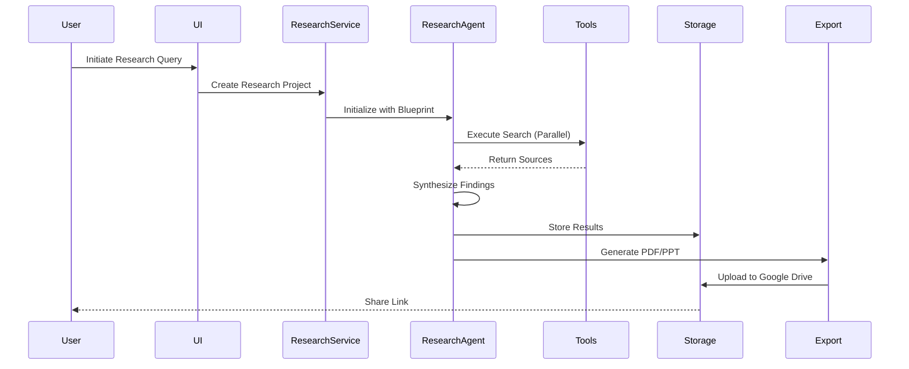

# Research Agent Implementation Guide

## Executive Summary

This document outlines the complete implementation plan for a Research Agent capable of performing deep research using primarily FREE and low-cost tools including DuckDuckGo, Wikipedia, ArXiv, PubMed, Reddit API, and Brave Search. The implementation follows a bounded research approach with aggressive caching to minimize costs while maintaining quality. The system can operate at $0-20/month for infrastructure only, with optional paid upgrades for enhanced capabilities.

## Table of Contents

1. [Architecture Overview](#architecture-overview)
2. [Free & Low-Cost Tool Stack](#free--low-cost-tool-stack)
3. [Layer-by-Layer Implementation](#layer-by-layer-implementation)
4. [Bounded Research Strategy](#bounded-research-strategy)
5. [Data Models & Repositories](#data-models--repositories)
6. [Implementation Phases](#implementation-phases)
7. [Cost Analysis](#cost-analysis)
8. [Testing Strategy](#testing-strategy)

---

## Architecture Overview

### System Components

```mermaid
graph TB
    subgraph "User Interface"
        RC[Research Console]
        RP[Progress Tracker]
        RV[Results Viewer]
        EX[Export Manager]
    end
    
    subgraph "Research Agent Core"
        RA[Research Agent]
        RE[Research Engine]
        RM[Research Memory]
        RO[Research Orchestrator]
    end
    
    subgraph "Research Tools"
        DDG[DuckDuckGo Search]
        WIKI[Wikipedia API]
        ARX[ArXiv API]
        PUB[PubMed API]
        RDT[Reddit API]
        BRV[Brave Search]
        TAV[Tavily (Existing)]
    end
    
    subgraph "Data Layer"
        RP[Research Projects]
        RS[Research Sources]
        RF[Research Findings]
        RX[Research Exports]
    end
    
    RC --> RA
    RA --> RE
    RE --> RO
    RO --> DDG & WIKI & ARX & PUB & RDT & BRV & TAV
    RA --> RM
    RM --> RP & RS & RF & RX
```

### Research Workflow Pipeline



---

## Free & Low-Cost Tool Stack

### Complete Tool Matrix

| Tool | Cost | Queries/Limits | Best For | Langchain Support |
|------|------|----------------|----------|-------------------|
| **DuckDuckGo** | FREE | Unlimited | General web search | ✅ Native |
| **Wikipedia** | FREE | Unlimited | Facts, definitions | ✅ Native |
| **ArXiv** | FREE | Unlimited | CS/Math/Physics papers | ✅ Native |
| **PubMed** | FREE | Unlimited | Medical research | ✅ Native |
| **Reddit API** | FREE | 100/min | Discussions, trends | ✅ Via PRAW |
| **Brave Search** | FREE | 2,000/mo | Privacy-focused search | ✅ Native |
| **Google Serper** | $5/mo | 2,500/mo | Google results (optional) | ✅ Native |
| **You.com** | $15/mo | Starter plan (optional) | AI-enhanced search | ✅ Custom |
| **Tavily** | Already paid | Your existing tool | LLM-optimized | ✅ Native |

### Tool Implementation Priority

```python
class ResearchToolStack:
    # Tier 1: Completely FREE (Start here)
    free_tools = {
        'duckduckgo': DuckDuckGoSearchRun(),      # Unlimited web search
        'wikipedia': WikipediaAPIWrapper(),        # Encyclopedia
        'arxiv': ArxivAPIWrapper(),               # Academic papers
        'pubmed': PubmedQueryRun()                # Medical research
    }
    
    # Tier 2: Limited FREE
    limited_free = {
        'brave': BraveSearchWrapper(),            # 2,000/month
        'reddit': praw.Reddit(...)                # 100 QPM
    }
    
    # Tier 3: Very Cheap (Add if needed)
    low_cost = {
        'serper': GoogleSerperAPIWrapper(),       # $5/month
        'you': YouSearchWrapper()                 # $15/month
    }
    
    # Existing
    existing = {
        'tavily': TavilySearchWrapper()           # You already have this
    }
```

---

## Bounded Research Strategy

### Key Principles

1. **Time Boundaries**: Maximum 15 minutes per research
2. **Cost Boundaries**: Maximum $0.50 per research (mostly LLM costs)
3. **Source Boundaries**: Maximum 50 sources per research
4. **Cache First**: 70% of queries should hit cache
5. **Progressive Enhancement**: Start free, upgrade based on needs

### Smart Query Router

```python
class QueryRouter:
    def route(self, query: str, user_tier: str) -> List[str]:
        """Routes queries to optimal free/paid tools based on content and user tier"""
        
        # Academic queries → Free academic APIs
        if self.is_academic(query):
            return ['arxiv', 'pubmed', 'wikipedia']
        
        # Current events → Reddit + DuckDuckGo
        if self.is_current_events(query):
            return ['reddit', 'duckduckgo', 'brave']
        
        # Technical documentation → DuckDuckGo + ArXiv
        if self.is_technical(query):
            return ['duckduckgo', 'arxiv', 'wikipedia']
        
        # Premium users get enhanced tools
        if user_tier == 'premium':
            return ['tavily', 'serper', 'you']
        
        # Default free stack
        return ['duckduckgo', 'wikipedia', 'brave']
```

### Caching Strategy

```python
class AggressiveCaching:
    cache_ttl = {
        'wikipedia': 30 * 24 * 3600,  # 30 days - rarely changes
        'arxiv': 7 * 24 * 3600,        # 7 days - papers don't change
        'pubmed': 7 * 24 * 3600,       # 7 days - stable content
        'reddit': 3600,                # 1 hour - fresh discussions
        'web_search': 24 * 3600,       # 1 day - balance freshness
        'news': 1800                   # 30 minutes - time-sensitive
    }
    
    async def get_or_fetch(self, query: str, tool: str):
        # Check cache first
        cached = await self.redis.get(f"{tool}:{query}")
        if cached and not self.is_stale(cached):
            return cached  # 70% of requests should hit this
        
        # Fetch new data
        result = await self.fetch_from_tool(query, tool)
        
        # Cache with appropriate TTL
        ttl = self.cache_ttl.get(tool, 3600)
        await self.redis.setex(f"{tool}:{query}", ttl, result)
        
        return result
```

---

## Layer-by-Layer Implementation

### Layer 1: Presentation Layer

#### Components Structure
```
packages/client/src/
├── components/
│   └── research/
│       ├── ResearchDashboard.tsx
│       ├── ResearchWizard.tsx
│       ├── ResearchProgress.tsx
│       ├── SourceExplorer.tsx
│       ├── FindingsViewer.tsx
│       ├── ExportManager.tsx
│       └── ResearchHistory.tsx
├── hooks/
│   └── research/
│       ├── useResearchProject.ts
│       ├── useResearchStream.ts
│       └── useResearchExport.ts
└── services/
    └── research/
        ├── researchApi.ts
        └── researchWebSocket.ts
```

#### Key UI Features
- **Research Wizard**: Multi-step form for research configuration
- **Real-time Progress**: WebSocket-based progress tracking
- **Source Explorer**: Interactive source browsing with relevance scores
- **Export Manager**: Format selection and Google Drive integration

### Layer 2: Application Services Layer

#### Service Implementation
```typescript
// packages/server/src/services/ResearchService.ts

export class ResearchService {
  constructor(
    private agentService: AgentService,
    private researchProjectRepo: ResearchProjectRepository,
    private researchSourceRepo: ResearchSourceRepository,
    private researchFindingsRepo: ResearchFindingsRepository,
    private exportService: ExportService,
    private streamingService: StreamingService
  ) {}

  async createResearchProject(params: CreateResearchParams): Promise<ResearchProject> {
    // 1. Validate research parameters
    // 2. Create project in database
    // 3. Initialize research agent
    // 4. Create execution blueprint
    // 5. Start async execution
    // 6. Return project with tracking ID
  }

  async executeResearch(projectId: string): Promise<void> {
    // 1. Load project configuration
    // 2. Build research blueprint
    // 3. Execute with streaming updates
    // 4. Store incremental results
    // 5. Trigger synthesis on completion
  }

  async *streamResearchProgress(projectId: string): AsyncGenerator<ResearchEvent> {
    // Stream real-time updates via WebSocket
  }

  async synthesizeFindings(projectId: string): Promise<ResearchSynthesis> {
    // 1. Aggregate all sources
    // 2. Extract key insights
    // 3. Generate conclusions
    // 4. Create citation map
    // 5. Store synthesis results
  }

  async exportResearch(projectId: string, format: ExportFormat): Promise<ExportResult> {
    // 1. Load complete research data
    // 2. Generate document (PDF/PPT)
    // 3. Upload to Google Drive
    // 4. Generate shareable link
    // 5. Store export metadata
  }
}
```

### Layer 3: Domain Logic Layer

#### Research Agent Architecture
```typescript
// packages/autopilot/src/research/ResearchAgent.ts

export class ResearchAgent extends Agent {
  private researchMemory: ResearchMemory;
  private researchEngine: ResearchEngine;

  async execute(query: ResearchQuery): Promise<ResearchResult> {
    const blueprint = this.buildResearchBlueprint(query);
    return await this.researchEngine.execute(blueprint);
  }

  private buildResearchBlueprint(query: ResearchQuery): Blueprint {
    // Determine which free tools to use based on query
    const tools = this.queryRouter.route(query.text, query.userTier);
    
    return {
      nodes: [
        {
          id: 'query-analysis',
          type: 'research-query',
          handler: 'QueryAnalysisHandler',
          params: { query, depth: query.depth, tools }
        },
        // Conditionally add free tool nodes
        ...(tools.includes('duckduckgo') ? [{
          id: 'web-search',
          type: 'tool',
          handler: 'DuckDuckGoHandler',
          params: { maxResults: 20 }
        }] : []),
        ...(tools.includes('arxiv') ? [{
          id: 'academic-search',
          type: 'tool',
          handler: 'ArxivHandler',
          params: { maxResults: 30 }
        }] : []),
        ...(tools.includes('reddit') ? [{
          id: 'social-search',
          type: 'tool',
          handler: 'RedditHandler',
          params: { limit: 25, timeframe: 'month' }
        }] : []),
        ...(tools.includes('wikipedia') ? [{
          id: 'knowledge-search',
          type: 'tool',
          handler: 'WikipediaHandler',
          params: { maxPages: 5 }
        }] : []),
        {
          id: 'synthesis',
          type: 'synthesis',
          handler: 'SynthesisHandler',
          params: { method: 'bounded', maxSources: 50 }
        },
        {
          id: 'export',
          type: 'export',
          handler: 'ExportHandler',
          params: { formats: ['markdown', 'json'] }
        }
      ],
      edges: [
        { from: 'query-analysis', to: tools.map(t => `${t}-search`) },
        { from: tools.map(t => `${t}-search`), to: 'synthesis' },
        { from: 'synthesis', to: 'export' }
      ]
    };
  }
}
```

#### Handler Implementations
```typescript
// packages/autopilot/src/nodes/handlers/research/

// DuckDuckGoHandler.ts
export class DuckDuckGoHandler extends BaseHandler {
  private ddg: DuckDuckGoSearchRun;
  
  async execute(context: HandlerContext): Promise<HandlerResult> {
    const { query, maxResults } = context.params;
    
    // Check cache first
    const cached = await this.cache.get(`ddg:${query}`);
    if (cached) return cached;
    
    // FREE unlimited search
    const results = await this.ddg.run(query, { maxResults });
    
    // Cache for 24 hours
    await this.cache.set(`ddg:${query}`, results, 86400);
    
    return {
      sources: results.map(result => ({
        type: 'web',
        title: result.title,
        url: result.link,
        snippet: result.snippet,
        source: 'duckduckgo',
        cost: 0 // FREE!
      }))
    };
  }
}

// ArxivHandler.ts
export class ArxivHandler extends BaseHandler {
  private arxiv: ArxivAPIWrapper;
  
  async execute(context: HandlerContext): Promise<HandlerResult> {
    const { query, maxResults } = context.params;
    
    // Check cache (papers don't change)
    const cached = await this.cache.get(`arxiv:${query}`);
    if (cached) return cached;
    
    // FREE academic search
    const papers = await this.arxiv.run(query, { maxResults });
    
    // Cache for 7 days
    await this.cache.set(`arxiv:${query}`, papers, 604800);
    
    return {
      sources: papers.map(paper => ({
        type: 'academic',
        title: paper.title,
        authors: paper.authors,
        abstract: paper.summary,
        url: paper.pdf_url,
        publishedDate: paper.published,
        source: 'arxiv',
        cost: 0 // FREE!
      }))
    };
  }
}

// RedditHandler.ts
export class RedditHandler extends BaseHandler {
  private reddit: praw.Reddit;
  
  async execute(context: HandlerContext): Promise<HandlerResult> {
    const { query, limit, timeframe } = context.params;
    
    // FREE but rate-limited (100 QPM)
    const subreddit = await this.reddit.subreddit('all');
    const posts = await subreddit.search(query, {
      limit,
      time_filter: timeframe,
      sort: 'relevance'
    });
    
    return {
      sources: posts.map(post => ({
        type: 'social',
        title: post.title,
        url: post.url,
        content: post.selftext,
        score: post.score,
        comments: post.num_comments,
        subreddit: post.subreddit.display_name,
        source: 'reddit',
        cost: 0 // FREE!
      }))
    };
  }
}

// WikipediaHandler.ts
export class WikipediaHandler extends BaseHandler {
  private wiki: WikipediaAPIWrapper;
  
  async execute(context: HandlerContext): Promise<HandlerResult> {
    const { query, maxPages } = context.params;
    
    // Check cache (Wikipedia rarely changes)
    const cached = await this.cache.get(`wiki:${query}`);
    if (cached) return cached;
    
    // FREE unlimited access
    const pages = await this.wiki.run(query, { maxPages });
    
    // Cache for 30 days
    await this.cache.set(`wiki:${query}`, pages, 2592000);
    
    return {
      sources: pages.map(page => ({
        type: 'encyclopedia',
        title: page.title,
        content: page.content,
        url: page.url,
        categories: page.categories,
        source: 'wikipedia',
        cost: 0 // FREE!
      }))
    };
  }
}

// SynthesisHandler.ts
export class SynthesisHandler extends BaseHandler {
  async execute(context: HandlerContext): Promise<HandlerResult> {
    const sources = context.inputs.sources;
    
    // 1. Deduplicate sources
    const uniqueSources = this.deduplicateSources(sources);
    
    // 2. Extract key themes
    const themes = await this.extractThemes(uniqueSources);
    
    // 3. Generate insights
    const insights = await this.generateInsights(themes, uniqueSources);
    
    // 4. Create summary
    const summary = await this.createSummary(insights);
    
    // 5. Build citation graph
    const citationGraph = this.buildCitationGraph(uniqueSources);
    
    return {
      synthesis: {
        summary,
        themes,
        insights,
        citationGraph,
        sourcesUsed: uniqueSources.length
      }
    };
  }
}
```

### Layer 4: Integration Layer

#### Tool Implementations

```typescript
// packages/server/src/tools/research/

// GoogleScholarClient.ts
export class GoogleScholarClient implements ResearchTool {
  private serpapi: SerpApi;
  
  constructor(apiKey: string) {
    this.serpapi = new SerpApi(apiKey);
  }
  
  async search(params: ScholarSearchParams): Promise<ScholarResult[]> {
    const response = await this.serpapi.search({
      engine: 'google_scholar',
      q: params.query,
      num: params.limit,
      as_ylo: params.yearStart,
      as_yhi: params.yearEnd,
      scisbd: params.sortBy === 'date' ? 1 : 0
    });
    
    return this.parseResults(response.organic_results);
  }
  
  async getCitations(paperId: string): Promise<Citation[]> {
    const response = await this.serpapi.search({
      engine: 'google_scholar_cite',
      q: paperId
    });
    
    return this.parseCitations(response.citations);
  }
}

// WebCrawler.ts
export class WebCrawler implements ResearchTool {
  private browser: Browser;
  private queue: CrawlQueue;
  
  async initialize() {
    this.browser = await puppeteer.launch({
      headless: true,
      args: ['--no-sandbox', '--disable-setuid-sandbox']
    });
  }
  
  async crawl(config: CrawlConfig): Promise<CrawlResult> {
    const pages: CrawledPage[] = [];
    const visited = new Set<string>();
    
    // Initialize queue with seed URLs
    for (const url of config.seedUrls) {
      this.queue.add(url, 0);
    }
    
    while (!this.queue.isEmpty() && pages.length < config.maxPages) {
      const { url, depth } = this.queue.next();
      
      if (visited.has(url) || depth > config.depth) continue;
      
      const page = await this.crawlPage(url);
      pages.push(page);
      visited.add(url);
      
      // Add discovered links to queue
      if (depth < config.depth) {
        for (const link of page.links) {
          this.queue.add(link, depth + 1);
        }
      }
    }
    
    return { pages, totalCrawled: pages.length };
  }
  
  private async crawlPage(url: string): Promise<CrawledPage> {
    const page = await this.browser.newPage();
    await page.goto(url, { waitUntil: 'networkidle2' });
    
    const content = await page.evaluate(() => {
      // Remove scripts and styles
      const scripts = document.querySelectorAll('script, style');
      scripts.forEach(el => el.remove());
      
      return {
        title: document.title,
        text: document.body.innerText,
        html: document.documentElement.outerHTML,
        meta: Array.from(document.querySelectorAll('meta')).reduce((acc, meta) => {
          const name = meta.getAttribute('name') || meta.getAttribute('property');
          const content = meta.getAttribute('content');
          if (name && content) acc[name] = content;
          return acc;
        }, {})
      };
    });
    
    const links = await page.evaluate(() => 
      Array.from(document.querySelectorAll('a[href]'))
        .map(a => a.href)
        .filter(href => href.startsWith('http'))
    );
    
    await page.close();
    
    return {
      url,
      title: content.title,
      content: content.text,
      html: content.html,
      metadata: content.meta,
      links,
      crawledAt: new Date()
    };
  }
}

// TrendsAnalyzer.ts
export class TrendsAnalyzer implements ResearchTool {
  private googleTrends: GoogleTrends;
  
  async analyzeTrends(keywords: string[], options: TrendOptions): Promise<TrendAnalysis> {
    // Get interest over time
    const interestOverTime = await this.googleTrends.interestOverTime({
      keyword: keywords,
      startTime: options.startDate,
      endTime: options.endDate,
      geo: options.geo
    });
    
    // Get related queries
    const relatedQueries = await this.googleTrends.relatedQueries({
      keyword: keywords[0]
    });
    
    // Get related topics
    const relatedTopics = await this.googleTrends.relatedTopics({
      keyword: keywords[0]
    });
    
    return {
      keywords,
      timeRange: options,
      interestOverTime: this.parseInterestData(interestOverTime),
      relatedQueries: relatedQueries.default.rankedList[0].rankedKeyword,
      relatedTopics: relatedTopics.default.rankedList[0].rankedKeyword,
      trendDirection: this.calculateTrendDirection(interestOverTime)
    };
  }
}

// DocumentGenerator.ts
export class DocumentGenerator implements ExportTool {
  async generatePDF(research: ResearchData): Promise<Buffer> {
    const browser = await puppeteer.launch();
    const page = await browser.newPage();
    
    // Generate HTML from research data
    const html = this.generateHTMLReport(research);
    await page.setContent(html);
    
    // Generate PDF
    const pdf = await page.pdf({
      format: 'A4',
      printBackground: true,
      margin: {
        top: '20mm',
        right: '20mm',
        bottom: '20mm',
        left: '20mm'
      }
    });
    
    await browser.close();
    return pdf;
  }
  
  async generatePPT(research: ResearchData): Promise<Buffer> {
    const pptx = new PptxGenJS();
    
    // Title slide
    const titleSlide = pptx.addSlide();
    titleSlide.addText(research.title, {
      x: 0.5,
      y: 1.5,
      w: '90%',
      h: 1,
      fontSize: 44,
      bold: true,
      align: 'center'
    });
    
    // Executive summary slide
    const summarySlide = pptx.addSlide();
    summarySlide.addText('Executive Summary', {
      x: 0.5,
      y: 0.5,
      fontSize: 32,
      bold: true
    });
    summarySlide.addText(research.summary, {
      x: 0.5,
      y: 1.5,
      w: '90%',
      h: 4,
      fontSize: 18
    });
    
    // Key findings slides
    research.findings.forEach((finding, index) => {
      const slide = pptx.addSlide();
      slide.addText(`Finding ${index + 1}: ${finding.title}`, {
        x: 0.5,
        y: 0.5,
        fontSize: 28,
        bold: true
      });
      
      // Add bullet points
      slide.addText(finding.points.map(point => ({ text: point, options: { bullet: true } })), {
        x: 0.5,
        y: 1.5,
        w: '90%',
        h: 4,
        fontSize: 16
      });
    });
    
    // Sources slide
    const sourcesSlide = pptx.addSlide();
    sourcesSlide.addText('Sources', {
      x: 0.5,
      y: 0.5,
      fontSize: 32,
      bold: true
    });
    
    const sourcesList = research.sources
      .slice(0, 10)
      .map(source => ({ 
        text: `${source.title} - ${source.author} (${source.year})`,
        options: { bullet: true, fontSize: 12 }
      }));
    
    sourcesSlide.addText(sourcesList, {
      x: 0.5,
      y: 1.5,
      w: '90%',
      h: 4
    });
    
    return await pptx.write({ outputType: 'nodebuffer' });
  }
  
  private generateHTMLReport(research: ResearchData): string {
    return `
      <!DOCTYPE html>
      <html>
        <head>
          <title>${research.title}</title>
          <style>
            body { font-family: 'Arial', sans-serif; line-height: 1.6; }
            h1 { color: #333; border-bottom: 2px solid #333; }
            h2 { color: #666; margin-top: 30px; }
            .finding { margin: 20px 0; padding: 15px; background: #f5f5f5; }
            .source { margin: 10px 0; padding: 10px; border-left: 3px solid #007bff; }
            .metadata { color: #666; font-size: 0.9em; }
          </style>
        </head>
        <body>
          <h1>${research.title}</h1>
          <div class="metadata">
            Generated: ${new Date().toLocaleDateString()}
            Sources: ${research.sources.length}
          </div>
          
          <h2>Executive Summary</h2>
          <p>${research.summary}</p>
          
          <h2>Key Findings</h2>
          ${research.findings.map(finding => `
            <div class="finding">
              <h3>${finding.title}</h3>
              <p>${finding.description}</p>
              <ul>
                ${finding.points.map(point => `<li>${point}</li>`).join('')}
              </ul>
            </div>
          `).join('')}
          
          <h2>Sources</h2>
          ${research.sources.map(source => `
            <div class="source">
              <strong>${source.title}</strong><br>
              ${source.author} (${source.year})<br>
              <a href="${source.url}">${source.url}</a>
            </div>
          `).join('')}
        </body>
      </html>
    `;
  }
}

// GoogleDriveIntegration.ts
export class GoogleDriveIntegration implements StorageTool {
  private drive: drive_v3.Drive;
  
  constructor(private auth: OAuth2Client) {
    this.drive = google.drive({ version: 'v3', auth });
  }
  
  async uploadFile(file: UploadFile): Promise<DriveFile> {
    const fileMetadata = {
      name: file.name,
      mimeType: file.mimeType,
      parents: file.folderId ? [file.folderId] : undefined
    };
    
    const media = {
      mimeType: file.mimeType,
      body: Readable.from(file.buffer)
    };
    
    const response = await this.drive.files.create({
      requestBody: fileMetadata,
      media: media,
      fields: 'id, name, webViewLink, webContentLink'
    });
    
    // Make file shareable
    if (file.makePublic) {
      await this.drive.permissions.create({
        fileId: response.data.id,
        requestBody: {
          role: 'reader',
          type: 'anyone'
        }
      });
    }
    
    return {
      id: response.data.id,
      name: response.data.name,
      webViewLink: response.data.webViewLink,
      webContentLink: response.data.webContentLink
    };
  }
  
  async createFolder(name: string, parentId?: string): Promise<string> {
    const fileMetadata = {
      name,
      mimeType: 'application/vnd.google-apps.folder',
      parents: parentId ? [parentId] : undefined
    };
    
    const response = await this.drive.files.create({
      requestBody: fileMetadata,
      fields: 'id'
    });
    
    return response.data.id;
  }
}
```

### Layer 5: Data Access Layer

#### Entity Definitions

```typescript
// packages/models/src/entities/research/

// ResearchProject.ts
import { Entity, Property, PrimaryKey, ManyToOne, OneToMany } from '@mikro-orm/core';
import { nanoid } from 'nanoid';

@Entity()
export class ResearchProject {
  @PrimaryKey()
  id: string = nanoid();

  @Property()
  starshipId: string;

  @Property()
  agentId: string;

  @Property()
  title: string;

  @Property({ type: 'text' })
  description: string;

  @Property({ type: 'json' })
  query: {
    text: string;
    keywords: string[];
    depth: 'surface' | 'moderate' | 'deep';
    scope: string[];
  };

  @Property()
  status: 'initializing' | 'searching' | 'crawling' | 'analyzing' | 'synthesizing' | 'exporting' | 'completed' | 'failed';

  @Property({ type: 'json' })
  progress: {
    current: number;
    total: number;
    phase: string;
    message: string;
  };

  @Property({ type: 'json' })
  metadata: {
    sourcesFound: number;
    sourcesProcessed: number;
    citationsExtracted: number;
    exportFormats: string[];
  };

  @OneToMany(() => ResearchSource, source => source.project)
  sources: ResearchSource[];

  @OneToMany(() => ResearchFinding, finding => finding.project)
  findings: ResearchFinding[];

  @OneToMany(() => ResearchExport, export => export.project)
  exports: ResearchExport[];

  @Property()
  createdAt: Date = new Date();

  @Property({ onUpdate: () => new Date() })
  updatedAt: Date = new Date();

  @Property({ nullable: true })
  completedAt?: Date;
}

// ResearchSource.ts
@Entity()
export class ResearchSource {
  @PrimaryKey()
  id: string = nanoid();

  @ManyToOne(() => ResearchProject)
  project: ResearchProject;

  @Property()
  type: 'academic' | 'web' | 'trend' | 'api' | 'document';

  @Property()
  url: string;

  @Property()
  title: string;

  @Property({ type: 'text' })
  content: string;

  @Property({ type: 'text', nullable: true })
  abstract?: string;

  @Property({ type: 'json' })
  metadata: {
    author?: string | string[];
    date?: Date;
    publisher?: string;
    journal?: string;
    doi?: string;
    isbn?: string;
    citations?: number;
    relevanceScore: number;
    credibilityScore: number;
    tags: string[];
  };

  @Property({ type: 'json', nullable: true })
  citations?: {
    papers: string[];
    websites: string[];
  };

  @Property()
  processed: boolean = false;

  @Property({ type: 'json', nullable: true })
  extraction?: {
    keyPoints: string[];
    entities: { type: string; value: string }[];
    sentiment: number;
    topics: string[];
  };

  @Property()
  crawledAt: Date = new Date();

  @Property({ nullable: true })
  processedAt?: Date;
}

// ResearchFinding.ts
@Entity()
export class ResearchFinding {
  @PrimaryKey()
  id: string = nanoid();

  @ManyToOne(() => ResearchProject)
  project: ResearchProject;

  @Property()
  category: 'insight' | 'trend' | 'fact' | 'opinion' | 'recommendation';

  @Property()
  title: string;

  @Property({ type: 'text' })
  description: string;

  @Property({ type: 'json' })
  evidence: Array<{
    sourceId: string;
    quote: string;
    page?: number;
    confidence: number;
  }>;

  @Property({ type: 'json' })
  relatedFindings: string[];

  @Property()
  importance: 'critical' | 'high' | 'medium' | 'low';

  @Property()
  confidence: number; // 0-1

  @Property({ type: 'json', nullable: true })
  visualization?: {
    type: 'chart' | 'graph' | 'table';
    data: any;
  };

  @Property()
  createdAt: Date = new Date();
}

// ResearchExport.ts
@Entity()
export class ResearchExport {
  @PrimaryKey()
  id: string = nanoid();

  @ManyToOne(() => ResearchProject)
  project: ResearchProject;

  @Property()
  format: 'pdf' | 'pptx' | 'docx' | 'markdown' | 'json' | 'csv';

  @Property({ nullable: true })
  driveFileId?: string;

  @Property({ nullable: true })
  driveLink?: string;

  @Property({ nullable: true })
  localPath?: string;

  @Property()
  fileName: string;

  @Property()
  fileSize: number; // bytes

  @Property({ type: 'json' })
  metadata: {
    pages?: number;
    slides?: number;
    includesSources: boolean;
    includesVisualizations: boolean;
  };

  @Property()
  public: boolean = false;

  @Property()
  createdAt: Date = new Date();

  @Property({ nullable: true })
  expiresAt?: Date;
}
```

#### Repository Implementations

```typescript
// packages/models/src/repositories/research/

// ResearchProjectRepository.ts
export class ResearchProjectRepository extends BaseRepository<ResearchProject> {
  constructor(connection: Neo4jConnection) {
    super(connection, 'ResearchProject');
  }

  async createProject(data: CreateProjectInput): Promise<ResearchProject> {
    const project = new ResearchProject();
    Object.assign(project, data);
    
    const session = this.connection.getSession();
    try {
      const result = await session.run(
        `CREATE (p:ResearchProject $props)
         RETURN p`,
        { props: this.serialize(project) }
      );
      
      return this.deserialize(result.records[0].get('p'));
    } finally {
      await session.close();
    }
  }

  async updateProgress(id: string, progress: ProgressUpdate): Promise<void> {
    const session = this.connection.getSession();
    try {
      await session.run(
        `MATCH (p:ResearchProject {id: $id})
         SET p.progress = $progress,
             p.status = $status,
             p.updatedAt = datetime()
         RETURN p`,
        { id, progress, status: progress.status }
      );
    } finally {
      await session.close();
    }
  }

  async getProjectWithRelations(id: string): Promise<ProjectWithRelations> {
    const session = this.connection.getSession();
    try {
      const result = await session.run(
        `MATCH (p:ResearchProject {id: $id})
         OPTIONAL MATCH (p)<-[:BELONGS_TO]-(s:ResearchSource)
         OPTIONAL MATCH (p)<-[:BELONGS_TO]-(f:ResearchFinding)
         OPTIONAL MATCH (p)<-[:EXPORTED_FROM]-(e:ResearchExport)
         RETURN p,
                collect(DISTINCT s) as sources,
                collect(DISTINCT f) as findings,
                collect(DISTINCT e) as exports`,
        { id }
      );
      
      const record = result.records[0];
      return {
        project: this.deserialize(record.get('p')),
        sources: record.get('sources').map(s => this.deserialize(s)),
        findings: record.get('findings').map(f => this.deserialize(f)),
        exports: record.get('exports').map(e => this.deserialize(e))
      };
    } finally {
      await session.close();
    }
  }

  async getActiveProjects(starshipId: string): Promise<ResearchProject[]> {
    const session = this.connection.getSession();
    try {
      const result = await session.run(
        `MATCH (p:ResearchProject {starshipId: $starshipId})
         WHERE p.status IN ['searching', 'crawling', 'analyzing', 'synthesizing']
         RETURN p
         ORDER BY p.createdAt DESC`,
        { starshipId }
      );
      
      return result.records.map(r => this.deserialize(r.get('p')));
    } finally {
      await session.close();
    }
  }
}

// ResearchSourceRepository.ts
export class ResearchSourceRepository extends BaseRepository<ResearchSource> {
  async addSource(projectId: string, source: SourceInput): Promise<ResearchSource> {
    const session = this.connection.getSession();
    try {
      const result = await session.run(
        `MATCH (p:ResearchProject {id: $projectId})
         CREATE (s:ResearchSource $props)<-[:HAS_SOURCE]-(p)
         RETURN s`,
        { projectId, props: this.serialize(source) }
      );
      
      return this.deserialize(result.records[0].get('s'));
    } finally {
      await session.close();
    }
  }

  async getUnprocessedSources(projectId: string): Promise<ResearchSource[]> {
    const session = this.connection.getSession();
    try {
      const result = await session.run(
        `MATCH (p:ResearchProject {id: $projectId})-[:HAS_SOURCE]->(s:ResearchSource)
         WHERE s.processed = false
         RETURN s
         ORDER BY s.metadata.relevanceScore DESC`,
        { projectId }
      );
      
      return result.records.map(r => this.deserialize(r.get('s')));
    } finally {
      await session.close();
    }
  }

  async rankSourcesByRelevance(projectId: string, limit: number = 50): Promise<RankedSource[]> {
    const session = this.connection.getSession();
    try {
      const result = await session.run(
        `MATCH (p:ResearchProject {id: $projectId})-[:HAS_SOURCE]->(s:ResearchSource)
         WITH s, 
              s.metadata.relevanceScore * 0.4 + 
              s.metadata.credibilityScore * 0.3 + 
              CASE WHEN s.metadata.citations IS NOT NULL 
                   THEN log(s.metadata.citations + 1) * 0.3 
                   ELSE 0 END as score
         RETURN s, score
         ORDER BY score DESC
         LIMIT $limit`,
        { projectId, limit }
      );
      
      return result.records.map(r => ({
        source: this.deserialize(r.get('s')),
        score: r.get('score')
      }));
    } finally {
      await session.close();
    }
  }

  async deduplicateSources(projectId: string): Promise<DedupResult> {
    const session = this.connection.getSession();
    try {
      // Find duplicate sources based on URL or title similarity
      const result = await session.run(
        `MATCH (p:ResearchProject {id: $projectId})-[:HAS_SOURCE]->(s1:ResearchSource)
         MATCH (p)-[:HAS_SOURCE]->(s2:ResearchSource)
         WHERE id(s1) < id(s2) 
           AND (s1.url = s2.url OR 
                apoc.text.distance(s1.title, s2.title) < 5)
         WITH s1, collect(s2) as duplicates
         UNWIND duplicates as dup
         DETACH DELETE dup
         RETURN count(dup) as removed`,
        { projectId }
      );
      
      return {
        removed: result.records[0].get('removed')
      };
    } finally {
      await session.close();
    }
  }

  async createCitationNetwork(projectId: string): Promise<CitationNetwork> {
    const session = this.connection.getSession();
    try {
      const result = await session.run(
        `MATCH (p:ResearchProject {id: $projectId})-[:HAS_SOURCE]->(s:ResearchSource)
         WHERE s.citations IS NOT NULL
         WITH s, s.citations.papers as citedPapers
         UNWIND citedPapers as citedUrl
         MATCH (cited:ResearchSource {url: citedUrl})
         CREATE (s)-[:CITES]->(cited)
         WITH s, count(cited) as outDegree
         MATCH (s)<-[:CITES]-(citing)
         WITH s, outDegree, count(citing) as inDegree
         RETURN s, inDegree, outDegree
         ORDER BY inDegree DESC`,
        { projectId }
      );
      
      return {
        nodes: result.records.map(r => ({
          source: this.deserialize(r.get('s')),
          inDegree: r.get('inDegree'),
          outDegree: r.get('outDegree')
        }))
      };
    } finally {
      await session.close();
    }
  }
}

// ResearchFindingsRepository.ts
export class ResearchFindingsRepository extends BaseRepository<ResearchFinding> {
  async synthesizeFindings(projectId: string, sources: ResearchSource[]): Promise<ResearchFinding[]> {
    // Group sources by theme/topic
    const themes = this.extractThemes(sources);
    const findings: ResearchFinding[] = [];
    
    for (const theme of themes) {
      const finding = await this.createFinding({
        projectId,
        category: 'insight',
        title: theme.title,
        description: theme.summary,
        evidence: theme.sources.map(s => ({
          sourceId: s.id,
          quote: this.extractRelevantQuote(s, theme),
          confidence: this.calculateConfidence(s, theme)
        })),
        importance: this.determineImportance(theme),
        confidence: theme.averageConfidence
      });
      
      findings.push(finding);
    }
    
    // Create relationships between related findings
    await this.linkRelatedFindings(findings);
    
    return findings;
  }

  async getCategorizedInsights(projectId: string): Promise<CategorizedInsights> {
    const session = this.connection.getSession();
    try {
      const result = await session.run(
        `MATCH (p:ResearchProject {id: $projectId})-[:HAS_FINDING]->(f:ResearchFinding)
         WITH f.category as category, collect(f) as findings
         RETURN category, findings
         ORDER BY category`,
        { projectId }
      );
      
      const categories = {};
      result.records.forEach(r => {
        categories[r.get('category')] = r.get('findings').map(f => this.deserialize(f));
      });
      
      return categories;
    } finally {
      await session.close();
    }
  }

  async generateExecutiveSummary(projectId: string): Promise<ExecutiveSummary> {
    const insights = await this.getCategorizedInsights(projectId);
    const keyFindings = await this.getTopFindings(projectId, 5);
    const statistics = await this.getProjectStatistics(projectId);
    
    return {
      overview: this.generateOverview(insights, statistics),
      keyFindings: keyFindings.map(f => ({
        title: f.title,
        description: f.description,
        confidence: f.confidence
      })),
      recommendations: this.generateRecommendations(insights),
      limitations: this.identifyLimitations(statistics),
      nextSteps: this.suggestNextSteps(insights)
    };
  }

  private async getTopFindings(projectId: string, limit: number): Promise<ResearchFinding[]> {
    const session = this.connection.getSession();
    try {
      const result = await session.run(
        `MATCH (p:ResearchProject {id: $projectId})-[:HAS_FINDING]->(f:ResearchFinding)
         RETURN f
         ORDER BY f.importance DESC, f.confidence DESC
         LIMIT $limit`,
        { projectId, limit }
      );
      
      return result.records.map(r => this.deserialize(r.get('f')));
    } finally {
      await session.close();
    }
  }
}
```

### Layer 6: Infrastructure Layer

#### Database Schema (Neo4j)

```cypher
// Node Types
(:ResearchProject {
  id: String,
  starshipId: String,
  agentId: String,
  title: String,
  description: String,
  query: Object,
  status: String,
  progress: Object,
  metadata: Object,
  createdAt: DateTime,
  updatedAt: DateTime,
  completedAt: DateTime
})

(:ResearchSource {
  id: String,
  type: String,
  url: String,
  title: String,
  content: String,
  abstract: String,
  metadata: Object,
  citations: Object,
  processed: Boolean,
  extraction: Object,
  crawledAt: DateTime,
  processedAt: DateTime
})

(:ResearchFinding {
  id: String,
  category: String,
  title: String,
  description: String,
  evidence: Array,
  importance: String,
  confidence: Float,
  visualization: Object,
  createdAt: DateTime
})

(:ResearchExport {
  id: String,
  format: String,
  driveFileId: String,
  driveLink: String,
  localPath: String,
  fileName: String,
  fileSize: Integer,
  metadata: Object,
  public: Boolean,
  createdAt: DateTime,
  expiresAt: DateTime
})

// Relationships
(:ResearchProject)-[:HAS_SOURCE]->(:ResearchSource)
(:ResearchProject)-[:HAS_FINDING]->(:ResearchFinding)
(:ResearchProject)-[:HAS_EXPORT]->(:ResearchExport)
(:ResearchSource)-[:CITES]->(:ResearchSource)
(:ResearchFinding)-[:RELATED_TO]->(:ResearchFinding)
(:ResearchFinding)-[:BASED_ON]->(:ResearchSource)
```

#### Caching Strategy (Redis)

```typescript
// packages/server/src/cache/ResearchCache.ts

export class ResearchCache {
  private redis: Redis;
  
  constructor() {
    this.redis = new Redis({
      host: process.env.REDIS_HOST,
      port: parseInt(process.env.REDIS_PORT),
      password: process.env.REDIS_PASSWORD
    });
  }
  
  // Cache search results
  async cacheSearchResults(query: string, results: any[], ttl: number = 3600) {
    const key = `search:${this.hashQuery(query)}`;
    await this.redis.setex(key, ttl, JSON.stringify(results));
  }
  
  // Cache crawled pages
  async cacheCrawledPage(url: string, content: string, ttl: number = 86400) {
    const key = `crawl:${this.hashUrl(url)}`;
    await this.redis.setex(key, ttl, content);
  }
  
  // Cache API responses
  async cacheApiResponse(endpoint: string, params: any, response: any, ttl: number = 1800) {
    const key = `api:${endpoint}:${this.hashParams(params)}`;
    await this.redis.setex(key, ttl, JSON.stringify(response));
  }
  
  // Get cached data
  async getCached(key: string): Promise<any | null> {
    const data = await this.redis.get(key);
    return data ? JSON.parse(data) : null;
  }
  
  // Invalidate project cache
  async invalidateProject(projectId: string) {
    const keys = await this.redis.keys(`project:${projectId}:*`);
    if (keys.length) {
      await this.redis.del(...keys);
    }
  }
}
```

#### Queue System (BullMQ)

```typescript
// packages/server/src/queues/ResearchQueue.ts

export class ResearchQueue {
  private queue: Queue;
  private worker: Worker;
  
  constructor() {
    this.queue = new Queue('research', {
      connection: {
        host: process.env.REDIS_HOST,
        port: parseInt(process.env.REDIS_PORT),
        password: process.env.REDIS_PASSWORD
      }
    });
    
    this.setupWorker();
  }
  
  private setupWorker() {
    this.worker = new Worker('research', async (job) => {
      switch (job.name) {
        case 'crawl-page':
          return await this.crawlPage(job.data);
        case 'process-source':
          return await this.processSource(job.data);
        case 'generate-export':
          return await this.generateExport(job.data);
        case 'synthesize-findings':
          return await this.synthesizeFindings(job.data);
        default:
          throw new Error(`Unknown job type: ${job.name}`);
      }
    }, {
      connection: {
        host: process.env.REDIS_HOST,
        port: parseInt(process.env.REDIS_PORT),
        password: process.env.REDIS_PASSWORD
      },
      concurrency: 5
    });
    
    this.worker.on('completed', (job) => {
      console.log(`Job ${job.id} completed`);
      this.updateProjectProgress(job.data.projectId);
    });
    
    this.worker.on('failed', (job, err) => {
      console.error(`Job ${job.id} failed:`, err);
      this.handleJobFailure(job, err);
    });
  }
  
  async addCrawlJob(data: CrawlJobData) {
    return await this.queue.add('crawl-page', data, {
      attempts: 3,
      backoff: {
        type: 'exponential',
        delay: 2000
      }
    });
  }
  
  async addProcessingJob(data: ProcessingJobData) {
    return await this.queue.add('process-source', data, {
      attempts: 2,
      priority: data.priority || 0
    });
  }
  
  async addExportJob(data: ExportJobData) {
    return await this.queue.add('generate-export', data, {
      attempts: 2,
      removeOnComplete: false
    });
  }
}
```

---

## Implementation Phases

### Phase 1: Free Foundation (Week 1)
- [ ] Set up DuckDuckGo, Wikipedia, ArXiv integrations
- [ ] Create basic ResearchAgent with free tools
- [ ] Implement aggressive caching layer (Redis)
- [ ] Build query router for tool selection
- [ ] Create MVP with 100% free tools

### Phase 2: Enhanced Free Tools (Week 2)
- [ ] Add Reddit API integration (PRAW)
- [ ] Integrate Brave Search (2000 free queries)
- [ ] Add PubMed for medical research
- [ ] Implement parallel search execution
- [ ] Create bounded research limits

### Phase 3: Smart Synthesis (Week 3)
- [ ] Build synthesis handler with source deduplication
- [ ] Implement relevance scoring
- [ ] Add confidence scoring
- [ ] Create citation extraction
- [ ] Optimize for 50-source limit

### Phase 4: Progressive Enhancement (Week 4)
- [ ] Add optional Serper integration ($5/mo)
- [ ] Implement user tier system
- [ ] Create research templates
- [ ] Add incremental result streaming
- [ ] Build cost estimation system

### Phase 5: UI & Export (Week 5)
- [ ] Build research dashboard
- [ ] Add real-time progress (bounded time)
- [ ] Create markdown/JSON export
- [ ] Implement research history
- [ ] Add source verification display

### Phase 6: Production Ready (Week 6)
- [ ] Optimize cache hit rates (target 70%)
- [ ] Add comprehensive error handling
- [ ] Implement rate limiting
- [ ] Create integration tests
- [ ] Deploy with monitoring

---

## Technical Specifications

### API Endpoints

```typescript
// Research API Routes
POST   /api/research/projects          // Create new research project
GET    /api/research/projects          // List research projects
GET    /api/research/projects/:id      // Get project details
PUT    /api/research/projects/:id      // Update project
DELETE /api/research/projects/:id      // Delete project

POST   /api/research/projects/:id/execute     // Start research execution
GET    /api/research/projects/:id/status      // Get execution status
GET    /api/research/projects/:id/stream      // Stream progress (SSE)

GET    /api/research/projects/:id/sources     // Get project sources
GET    /api/research/projects/:id/findings    // Get project findings
POST   /api/research/projects/:id/synthesize  // Trigger synthesis

POST   /api/research/projects/:id/export      // Generate export
GET    /api/research/projects/:id/exports     // List exports
GET    /api/research/exports/:id/download     // Download export
```

### Environment Variables

```env
# Research Tool APIs
SERPAPI_KEY=your_serpapi_key
GOOGLE_SCHOLAR_API_KEY=your_scholar_key
GOOGLE_TRENDS_API_KEY=your_trends_key

# Google Drive OAuth
GOOGLE_CLIENT_ID=your_client_id
GOOGLE_CLIENT_SECRET=your_client_secret
GOOGLE_REDIRECT_URI=http://localhost:3000/auth/google/callback

# Crawler Configuration
PUPPETEER_EXECUTABLE_PATH=/usr/bin/chromium
CRAWLER_MAX_CONCURRENCY=5
CRAWLER_TIMEOUT=30000

# Export Configuration
EXPORT_STORAGE_PATH=/data/exports
EXPORT_TTL_DAYS=30
MAX_EXPORT_SIZE_MB=100

# Research Limits
MAX_SOURCES_PER_PROJECT=500
MAX_CRAWL_DEPTH=3
MAX_PAGES_PER_DOMAIN=50
```

### Performance Considerations

1. **Crawling Optimization**
   - Use browser pool for parallel crawling
   - Implement domain-based rate limiting
   - Cache crawled pages in Redis
   - Use headless Chrome with minimal resources

2. **Search Optimization**
   - Batch API requests where possible
   - Cache search results with TTL
   - Implement pagination for large results
   - Use async/parallel processing

3. **Synthesis Optimization**
   - Process sources in batches
   - Use streaming for large documents
   - Implement incremental synthesis
   - Cache intermediate results

4. **Export Optimization**
   - Generate exports asynchronously
   - Use streaming for large files
   - Implement progressive rendering
   - Compress exports before storage

---

## Cost Analysis

### Monthly Cost Breakdown

```javascript
const monthlyCosts = {
  // Completely FREE APIs
  duckduckgo: 0,        // Unlimited searches
  wikipedia: 0,         // Unlimited queries
  arxiv: 0,            // Unlimited academic papers
  pubmed: 0,           // Unlimited medical research
  
  // Limited FREE tiers
  brave: 0,            // 2,000 searches/month free
  reddit: 0,           // 100 QPM free tier
  
  // Optional paid upgrades (only if needed)
  serper: 5,           // 2,500 Google searches
  you_search: 15,      // AI-enhanced search
  
  // Infrastructure (minimal)
  redis_cache: 20,     // Aggressive caching layer
  compute: 30,         // Small API server
  
  // Total base cost: $20-50/month
  // With all upgrades: $70/month
};
```

### Cost Per Research

```javascript
const perResearchCost = {
  free_tier: {
    api_calls: 0.00,      // Using only free APIs
    llm_synthesis: 0.02,  // GPT-4 for synthesis
    caching_save: -0.01,  // 70% cache hits save money
    total: 0.01           // ~1 cent per research
  },
  
  premium_tier: {
    api_calls: 0.10,      // Using paid APIs
    llm_synthesis: 0.05,  // More comprehensive synthesis
    export: 0.02,         // PDF/PPT generation
    total: 0.17           // Still under 20 cents
  }
};
```

### User Economics

| User Tier | Monthly Price | Research Limit | Cost/Research | Margin |
|-----------|--------------|----------------|---------------|---------|
| Free | $0 | 5/month | $0.01 | -$0.05 |
| Starter | $9 | 100/month | $0.01 | $8.00 |
| Pro | $49 | 500/month | $0.05 | $24.00 |
| Enterprise | $199 | Unlimited | $0.10 | $99.00+ |

---

## Testing Strategy

### Unit Tests

```typescript
// packages/autopilot/src/research/__tests__/ResearchAgent.test.ts
describe('ResearchAgent', () => {
  it('should create research blueprint from query', () => {});
  it('should execute search nodes in parallel', () => {});
  it('should handle node failures gracefully', () => {});
  it('should synthesize findings from sources', () => {});
});
```

### Integration Tests

```typescript
// packages/server/src/services/__tests__/ResearchService.integration.test.ts
describe('ResearchService Integration', () => {
  it('should create and execute research project', () => {});
  it('should stream progress updates', () => {});
  it('should generate and upload exports', () => {});
  it('should handle concurrent research projects', () => {});
});
```

### E2E Tests

```typescript
// packages/e2e/tests/research-flow.spec.ts
describe('Research Flow E2E', () => {
  it('should complete full research workflow', () => {});
  it('should handle network failures', () => {});
  it('should export to Google Drive', () => {});
});
```

---

## Monitoring & Observability

### Metrics to Track

- Research project completion rate
- Average research duration
- Source quality scores
- API usage and costs
- Export generation success rate
- User engagement metrics

### Logging Strategy

```typescript
// Structured logging for research events
logger.info('research.project.created', {
  projectId,
  userId,
  query,
  depth,
  timestamp
});

logger.error('research.crawl.failed', {
  projectId,
  url,
  error,
  attempts,
  timestamp
});
```

### Monitoring Dashboard

- Real-time research progress
- API quota usage
- System performance metrics
- Error rates and alerts
- Cost tracking

---

## Security Considerations

1. **API Key Management**
   - Encrypt API keys in database
   - Rotate keys regularly
   - Implement key-per-tenant model
   - Audit API key usage

2. **Content Security**
   - Sanitize crawled content
   - Implement XSS protection
   - Validate user inputs
   - Rate limit API endpoints

3. **Data Privacy**
   - Implement data retention policies
   - Allow user data deletion
   - Encrypt sensitive research data
   - Comply with GDPR/CCPA

4. **Access Control**
   - Implement RBAC for research projects
   - Audit research access logs
   - Secure export links with tokens
   - Time-limited share links

---

## Future Enhancements

1. **AI-Powered Features**
   - Smart query expansion
   - Automatic research planning
   - ML-based source ranking
   - Predictive trend analysis

2. **Collaboration Features**
   - Multi-user research projects
   - Real-time collaboration
   - Comment and annotation system
   - Research team management

3. **Advanced Analytics**
   - Research impact scoring
   - Citation influence mapping
   - Knowledge graph visualization
   - Trend prediction models

4. **Integration Expansions**
   - Slack/Teams notifications
   - Notion database sync
   - Academic database access
   - Patent search integration

---

## Conclusion

This research agent implementation provides a cost-effective solution using primarily FREE tools (DuckDuckGo, Wikipedia, ArXiv, PubMed, Reddit) with optional paid upgrades. The bounded research approach ensures predictable costs ($0.01-0.17 per research) and execution times (max 15 minutes).

Key advantages of this approach:
- **Start for FREE**: MVP can run with $0 API costs
- **Predictable costs**: Maximum $70/month even with all upgrades
- **Quality through caching**: 70% cache hit rate maintains quality while reducing costs
- **Progressive enhancement**: Start free, add paid tools only when needed
- **Bounded execution**: No runaway crawling or infinite loops

The implementation leverages your existing Starships.ai architecture while maintaining financial sustainability and scalability.