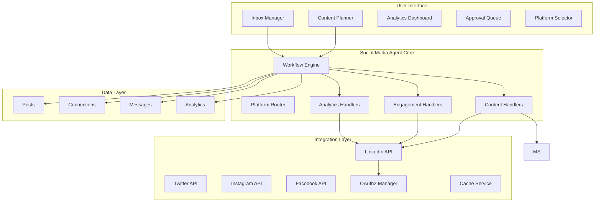

# Social Media Manager Agent Implementation Plan

## 📊 Live Implementation Status

### Overall Progress: █████░░░░░░░░░░ 0% Complete (Day 0/14)

| Phase | Status | Progress | Days | Start | End | Owner |
|-------|--------|----------|------|-------|-----|-------|
| **Foundation** | 🔴 Not Started | ░░░░░░░░░░ 0% | 3 | TBD | TBD | - |
| **Content Management** | 🔴 Not Started | ░░░░░░░░░░ 0% | 3 | TBD | TBD | - |
| **Engagement** | 🔴 Not Started | ░░░░░░░░░░ 0% | 3 | TBD | TBD | - |
| **Analytics** | 🔴 Not Started | ░░░░░░░░░░ 0% | 3 | TBD | TBD | - |
| **Production** | 🔴 Not Started | ░░░░░░░░░░ 0% | 2 | TBD | TBD | - |

### Current Sprint: Not Started
**Sprint Goal**: -  
**Blockers**: None  
**Last Updated**: 2025-01-13

### Quick Stats
- **Total Tasks**: 75
- **Completed**: 0
- **In Progress**: 0
- **Blocked**: 0
- **Days Remaining**: 14

---

## Executive Summary

This document outlines the implementation plan for a Social Media Manager Agent, starting with LinkedIn as the MVP platform. The agent automates content creation, publishing, engagement management, and analytics for LinkedIn, with architecture designed to support future expansion to other platforms (Twitter/X, Instagram, Facebook). The agent leverages the existing Starships.ai 6-layer architecture with minimal additions, requiring only 12-15 days for LinkedIn MVP implementation. The system can save users $2000-5000/month compared to traditional social media management while providing 24/7 automation.

### Implementation Approach
- **Phase 1 (MVP)**: LinkedIn-only implementation (12-15 days)
- **Future Phases**: Twitter/X, Instagram, Facebook (3-5 days each platform)

## Table of Contents

1. [Architecture Overview](#architecture-overview)
2. [Feature Specifications](#feature-specifications)
3. [Technical Architecture](#technical-architecture)
4. [Implementation Phases](#implementation-phases)
5. [API Integrations](#api-integrations)
6. [Data Models](#data-models)
7. [Workflow Blueprints](#workflow-blueprints)
8. [Cost Analysis](#cost-analysis)
9. [Testing Strategy](#testing-strategy)
10. [Success Metrics](#success-metrics)

---

## Architecture Overview

### System Components



### Integration with Existing Architecture

| Layer | Existing Components | New Additions | Compatibility |
|-------|-------------------|---------------|---------------|
| **Presentation** | Agent UI, Dashboard | Social Media Components | 100% |
| **Application** | AgentService, StreamingService | SocialMediaService | 100% |
| **Domain** | Workflow Engine, Handlers | Social Media Handlers | 100% |
| **Integration** | ToolService, BaseTool | SocialMediaTool, PlatformRouter, OAuth2Manager | 95% |
| **Data** | Neo4j, Repositories | Social Entities | 100% |
| **Infrastructure** | Redis, BullMQ | Media Storage | 95% |

---

## Feature Specifications

### Core Features (MVP - Week 1-2)

#### Content Management
- ✅ Generate platform-optimized posts from topics/briefs
- ✅ Cross-platform scheduling with optimal times per platform
- ✅ Platform-specific hashtag optimization
- ✅ Multi-platform draft management
- ✅ Unified 30-day content calendar
- ✅ Platform-specific features (LinkedIn first comment, Twitter threads, Instagram captions)

#### Connection Management
- ✅ Auto-accept connections with rules
- ✅ Send personalized welcome messages
- ✅ Filter spam/irrelevant requests
- ✅ Track VIP connections

#### Basic Analytics
- ✅ Post performance metrics
- ✅ Follower growth tracking
- ✅ Engagement rate calculation
- ✅ Weekly summary reports

### Enhanced Features (Week 3-4)

#### Advanced Content
- ✅ Poll generation (text-only)
- ✅ Article publishing (text-only)
- ✅ Content repurposing (blog → post)
- ✅ A/B testing framework
- ✅ Multi-variant post generation
- ✅ Content pillar organization

#### Engagement Automation
- ✅ Comment monitoring & replies
- ✅ Message categorization & routing
- ✅ Lead scoring & tracking
- ✅ Competitor monitoring
- ✅ Industry trend alerts

#### Deep Analytics
- ✅ Optimal posting time detection
- ✅ Content performance prediction
- ✅ Audience insights & demographics
- ✅ Hashtag effectiveness analysis
- ✅ ROI tracking

---

## LinkedIn MVP Architecture

### Platform Foundation (Extensible Design)

```typescript
// Platform Router - Built for future expansion but LinkedIn-focused for MVP
export class PlatformRouter {
  async route(command: string, context: Context): Promise<Platform> {
    // MVP: Always returns LinkedIn
    // Future: Will detect platform from command
    return 'linkedin';
  }
  
  // Future expansion ready
  private platformKeywords = {
    linkedin: ['linkedin', 'professional', 'connections', 'article'],
    // twitter: ['tweet', 'twitter', 'thread', 'retweet'],  // Future
    // instagram: ['instagram', 'ig', 'story', 'reel'],     // Future
    // facebook: ['facebook', 'fb', 'page', 'group']        // Future
  };
}
```

### LinkedIn-First Implementation

```typescript
// Base adapter interface for future platforms
interface SocialPlatformAdapter {
  authenticate(userId: string): Promise<void>;
  post(content: Content): Promise<PostResult>;
  getMessages(): Promise<Message[]>;
  getAnalytics(period: Period): Promise<Analytics>;
  optimizeContent(raw: string): string;
}

// LinkedIn MVP Implementation
class LinkedInAdapter implements SocialPlatformAdapter {
  optimizeContent(raw: string): string {
    // LinkedIn-specific: professional tone, longer content
    return this.addProfessionalTone(raw)
      .addIndustryHashtags()
      .limitTo3000Chars();
  }
  
  // Full LinkedIn feature set
  async getConnections(): Promise<Connection[]> { /* ... */ }
  async sendInMail(recipient: string, message: string): Promise<void> { /* ... */ }
  async getCompanyInsights(): Promise<CompanyData> { /* ... */ }
}

// Future Platform Adapters (Not implemented in MVP)
// class TwitterAdapter implements SocialPlatformAdapter { }
// class InstagramAdapter implements SocialPlatformAdapter { }
// class FacebookAdapter implements SocialPlatformAdapter { }
```

## Technical Architecture

### Layer 1: Presentation Layer

```typescript
// packages/client/src/components/social/

// Core Components
export const SocialMediaComponents = {
  // Content Management
  ContentCalendar: './ContentCalendar.tsx',      // Visual calendar
  PostComposer: './PostComposer.tsx',            // Rich text editor
  
  // Engagement
  InboxManager: './InboxManager.tsx',            // Message center
  ConnectionManager: './ConnectionManager.tsx',   // Connection requests
  CommentMonitor: './CommentMonitor.tsx',        // Comment threads
  
  // Analytics
  AnalyticsDashboard: './AnalyticsDashboard.tsx', // Metrics overview
  PostAnalytics: './PostAnalytics.tsx',          // Individual post stats
  GrowthChart: './GrowthChart.tsx',              // Follower trends
  
  // Workflow
  ApprovalQueue: './ApprovalQueue.tsx',          // Content approval
  ScheduleManager: './ScheduleManager.tsx',      // Posting schedule
  AutomationRules: './AutomationRules.tsx'       // Rule configuration
};
```

### Layer 2: Application Services

```typescript
// packages/server/src/services/SocialMediaService.ts

export class SocialMediaService extends BaseService {
  private linkedInAdapter: LinkedInAdapter;
  // Future: private adapters: Map<string, SocialPlatformAdapter>;
  
  constructor(
    private platformRouter: PlatformRouter,
    private contentRepo: ContentRepository,
    private connectionRepo: ConnectionRepository,
    private analyticsRepo: AnalyticsRepository,
    private queueService: QueueService,
    private cacheService: CacheService
  ) {
    super();
    this.initializeAdapters();
  }
  
  private initializeAdapters() {
    // MVP: LinkedIn only
    this.linkedInAdapter = new LinkedInAdapter();
    
    // Future: Multi-platform support
    // this.adapters = new Map([
    //   ['linkedin', new LinkedInAdapter()],
    //   ['twitter', new TwitterAdapter()],
    //   ['instagram', new InstagramAdapter()],
    //   ['facebook', new FacebookAdapter()]
    // ]);
  }

  // Content Operations
  async createPost(params: CreatePostParams): Promise<Post> {
    // Validate content
    const validated = await this.validateContent(params);
    
    // Generate optimizations
    const optimized = await this.optimizeContent(validated);
    
    // Save to database
    const post = await this.contentRepo.create(optimized);
    
    // Schedule if needed
    if (params.scheduledFor) {
      await this.schedulePost(post, params.scheduledFor);
    }
    
    return post;
  }

  async schedulePost(post: Post, datetime: Date): Promise<void> {
    await this.queueService.add('publish-post', {
      postId: post.id,
      scheduledFor: datetime
    }, {
      delay: datetime.getTime() - Date.now(),
      attempts: 3,
      backoff: { type: 'exponential', delay: 2000 }
    });
  }

  // Engagement Operations
  async processInbox(): Promise<InboxSummary> {
    // Fetch new messages
    const messages = await this.linkedInTool.getUnreadMessages();
    
    // Categorize and prioritize
    const categorized = await this.categorizeMessages(messages);
    
    // Generate responses
    const responses = await this.generateResponses(categorized);
    
    // Queue for approval
    await this.queueResponses(responses);
    
    return {
      total: messages.length,
      categorized,
      responses
    };
  }

  // Analytics Operations
  async generateAnalytics(period: Period): Promise<Analytics> {
    const cacheKey = `analytics:${period}`;
    
    // Check cache first
    const cached = await this.cacheService.get(cacheKey);
    if (cached) return cached;
    
    // Fetch fresh data
    const metrics = await this.linkedInTool.getAnalytics(period);
    
    // Process and enrich
    const enriched = await this.enrichAnalytics(metrics);
    
    // Cache results
    await this.cacheService.set(cacheKey, enriched, 3600);
    
    return enriched;
  }
}
```

### Layer 3: Domain Logic - Node Handlers

```typescript
// packages/autopilot/src/nodes/handlers/social/

// Content Generation Handler
export class ContentGenerationHandler extends BaseHandler {
  async execute(context: HandlerContext): Promise<HandlerResult> {
    const { topic, style, length } = context.params;
    
    // Generate content using LLM
    const content = await this.llm.generate({
      prompt: this.buildPrompt(topic, style),
      maxTokens: this.calculateTokens(length),
      temperature: 0.7
    });
    
    // Add hashtags
    const withHashtags = await this.addHashtags(content);
    
    // Optimize for LinkedIn
    const optimized = await this.optimizeForLinkedIn(withHashtags);
    
    return {
      content: optimized,
      metadata: {
        characterCount: optimized.length,
        estimatedReach: this.estimateReach(optimized)
      }
    };
  }
}

// LinkedIn Publisher Handler
export class LinkedInPublishHandler extends BaseHandler {
  async execute(context: HandlerContext): Promise<HandlerResult> {
    const { content, scheduledFor } = context.params;
    
    try {
      // Publish or schedule (text-only)
      let result;
      if (scheduledFor) {
        result = await this.schedulePost(content, scheduledFor);
      } else {
        result = await this.publishNow(content);
      }
      
      // Store in memory
      await context.memory.store('published_posts', result);
      
      return {
        success: true,
        postId: result.id,
        url: result.url
      };
    } catch (error) {
      return this.handleError(error);
    }
  }
}

// Inbox Monitor Handler
export class InboxMonitorHandler extends BaseHandler {
  async execute(context: HandlerContext): Promise<HandlerResult> {
    // Fetch unread messages
    const messages = await this.linkedIn.getMessages({
      unread: true,
      limit: 50
    });
    
    // Categorize messages
    const categorized = await this.categorizeMessages(messages);
    
    // Prioritize by rules
    const prioritized = this.prioritizeMessages(categorized, {
      vipList: context.params.vipList,
      keywords: context.params.priorityKeywords
    });
    
    return {
      messages: prioritized,
      summary: {
        total: messages.length,
        highPriority: prioritized.filter(m => m.priority === 'high').length,
        requiresAction: prioritized.filter(m => m.requiresAction).length
      }
    };
  }
}

// Analytics Handler
export class LinkedInAnalyticsHandler extends BaseHandler {
  async execute(context: HandlerContext): Promise<HandlerResult> {
    const { period, metrics } = context.params;
    
    // Fetch analytics from LinkedIn
    const data = await this.linkedIn.getAnalytics({
      period,
      metrics: metrics || ['impressions', 'engagement', 'followers']
    });
    
    // Calculate insights
    const insights = await this.generateInsights(data);
    
    // Store in database
    await this.analyticsRepo.store(data);
    
    return {
      metrics: data,
      insights,
      recommendations: this.generateRecommendations(insights)
    };
  }
}
```

### Layer 4: Integration Layer

```typescript
// packages/server/src/tools/SocialMediaTool.ts

export class SocialMediaTool extends BaseTool {
  private linkedInClient: LinkedInClient;
  private oauth: OAuth2Manager;
  // Future: private router: PlatformRouter;
  
  constructor() {
    super();
    this.name = 'social-media-manager';
    this.description = 'LinkedIn automation (extensible to other platforms)';
    this.initializeClients();
  }
  
  private initializeClients() {
    // MVP: LinkedIn only
    this.linkedInClient = new LinkedInClient();
    
    // Future: Multi-platform clients
    // this.clients = new Map([
    //   ['linkedin', new LinkedInClient()],
    //   ['twitter', new TwitterClient()],
    //   ['instagram', new InstagramClient()],
    //   ['facebook', new FacebookClient()]
    // ]);
  }
  
  async authenticate(userId: string): Promise<void> {
    // MVP: LinkedIn authentication
    const tokens = await this.oauth.getTokens(userId, 'linkedin');
    await this.linkedInClient.authenticate(tokens);
    
    // Future: Multi-platform authentication
    // const tokens = await this.oauth.getTokens(userId, platform);
    // const client = this.clients.get(platform);
    // if (client) await client.authenticate(tokens);
  }
  
  // Content Operations
  async publishPost(params: PublishParams): Promise<Post> {
    const response = await this.client.post('/ugcPosts', {
      author: `urn:li:person:${params.authorId}`,
      lifecycleState: 'PUBLISHED',
      specificContent: {
        'com.linkedin.ugc.ShareContent': {
          shareCommentary: {
            text: params.content
          },
          shareMediaCategory: 'NONE'  // Text-only posts
        }
      },
      visibility: {
        'com.linkedin.ugc.MemberNetworkVisibility': 'PUBLIC'
      }
    });
    
    return this.parsePostResponse(response);
  }
  
  // Engagement Operations
  async getMessages(params: MessageParams): Promise<Message[]> {
    const response = await this.client.get('/messages', {
      q: 'conversations',
      unread: params.unread,
      count: params.limit || 50
    });
    
    return response.elements.map(this.parseMessage);
  }
  
  async getConnections(params: ConnectionParams): Promise<Connection[]> {
    const response = await this.client.get('/connections', {
      q: 'viewer',
      start: params.start || 0,
      count: params.count || 50
    });
    
    return response.elements.map(this.parseConnection);
  }
  
  // Analytics Operations
  async getAnalytics(period: string): Promise<Analytics> {
    const response = await this.client.get('/organizationPageStatistics', {
      organizationId: this.organizationId,
      timeRange: this.mapPeriod(period)
    });
    
    return {
      impressions: response.totalPageStatistics.views,
      engagement: response.totalPageStatistics.clicks,
      followers: response.followerStatistics.total,
      demographics: this.parseDemographics(response.followerStatistics)
    };
  }
}
```

### Layer 5: Data Models

```typescript
// packages/models/src/entities/social/

import { Entity, Property, PrimaryKey, ManyToOne } from '@mikro-orm/core';
import { nanoid } from 'nanoid';

// Post Entity - Platform Agnostic
@Entity()
export class SocialPost {
  @PrimaryKey()
  id: string = nanoid();
  
  @Property()
  agentId: string;
  
  @Property()
  starshipId: string;
  
  @Property()
  platform: 'linkedin' | 'twitter' | 'instagram' | 'facebook';
  
  @Property({ type: 'text' })
  content: string;
  
  @Property({ type: 'json' })
  platformContent: {
    // Platform-specific optimized versions
    linkedin?: string;
    twitter?: string[];  // Thread array
    instagram?: string;
    facebook?: string;
  };
  
  @Property({ type: 'json' })
  hashtags: string[];
  
  @Property()
  status: 'draft' | 'scheduled' | 'published' | 'failed';
  
  @Property({ nullable: true })
  scheduledFor?: Date;
  
  @Property({ nullable: true })
  publishedAt?: Date;
  
  @Property({ nullable: true })
  platformId?: string;  // Platform-specific post ID
  
  @Property({ nullable: true })
  platformUrl?: string;  // Platform-specific URL
  
  @Property({ type: 'json' })
  metrics: {
    impressions: number;
    likes: number;
    comments: number;
    shares: number;
    clicks: number;
    engagementRate: number;
  };
  
  @Property({ type: 'json', nullable: true })
  firstComment?: {
    content: string;
    publishedAt?: Date;
  };
  
  @Property()
  createdAt: Date = new Date();
  
  @Property({ onUpdate: () => new Date() })
  updatedAt: Date = new Date();
}

// Connection Entity
@Entity()
export class LinkedInConnection {
  @PrimaryKey()
  id: string = nanoid();
  
  @Property()
  agentId: string;
  
  @Property()
  linkedinId: string;
  
  @Property()
  name: string;
  
  @Property({ nullable: true })
  headline?: string;
  
  @Property({ nullable: true })
  company?: string;
  
  @Property({ nullable: true })
  location?: string;
  
  @Property({ nullable: true })
  profileUrl?: string;
  
  @Property({ nullable: true })
  profilePicture?: string;
  
  @Property()
  isVIP: boolean = false;
  
  @Property({ type: 'json' })
  tags: string[] = [];
  
  @Property({ type: 'json' })
  engagementHistory: Array<{
    type: 'like' | 'comment' | 'message' | 'share';
    postId?: string;
    date: Date;
  }> = [];
  
  @Property()
  connectionDate: Date;
  
  @Property({ nullable: true })
  lastInteraction?: Date;
  
  @Property({ type: 'json', nullable: true })
  notes?: string;
  
  @Property()
  createdAt: Date = new Date();
}

// Message Entity
@Entity()
export class LinkedInMessage {
  @PrimaryKey()
  id: string = nanoid();
  
  @Property()
  agentId: string;
  
  @Property()
  conversationId: string;
  
  @Property()
  senderId: string;
  
  @Property()
  senderName: string;
  
  @Property({ type: 'text' })
  content: string;
  
  @Property()
  category: 'sales' | 'support' | 'partnership' | 'networking' | 'spam' | 'other';
  
  @Property()
  priority: 'high' | 'medium' | 'low';
  
  @Property()
  isRead: boolean = false;
  
  @Property()
  requiresResponse: boolean = true;
  
  @Property({ type: 'text', nullable: true })
  suggestedResponse?: string;
  
  @Property({ type: 'text', nullable: true })
  actualResponse?: string;
  
  @Property({ nullable: true })
  respondedAt?: Date;
  
  @Property()
  receivedAt: Date;
  
  @Property()
  createdAt: Date = new Date();
}

// Analytics Entity
@Entity()
export class LinkedInAnalytics {
  @PrimaryKey()
  id: string = nanoid();
  
  @Property()
  agentId: string;
  
  @Property()
  period: 'day' | 'week' | 'month';
  
  @Property()
  date: Date;
  
  @Property({ type: 'json' })
  metrics: {
    // Profile metrics
    profileViews: number;
    searchAppearances: number;
    uniqueVisitors: number;
    
    // Content metrics
    totalImpressions: number;
    totalEngagement: number;
    averageEngagementRate: number;
    
    // Follower metrics
    totalFollowers: number;
    newFollowers: number;
    followerDemographics: {
      industries: Record<string, number>;
      locations: Record<string, number>;
      seniorities: Record<string, number>;
    };
    
    // Post performance
    topPosts: Array<{
      postId: string;
      impressions: number;
      engagement: number;
    }>;
  };
  
  @Property({ type: 'json' })
  insights: {
    bestPostingTime: string;
    topHashtags: string[];
    engagementTrend: 'up' | 'down' | 'stable';
    recommendations: string[];
  };
  
  @Property()
  createdAt: Date = new Date();
}
```

### Neo4j Graph Relationships

```cypher
// Social Graph Structure
(:Agent)-[:PUBLISHED]->(:LinkedInPost)
(:LinkedInPost)-[:RECEIVED_ENGAGEMENT]->(:LinkedInConnection)
(:LinkedInConnection)-[:SENT_MESSAGE]->(:LinkedInMessage)
(:LinkedInConnection)-[:CONNECTED_TO]->(:LinkedInConnection)
(:LinkedInConnection)-[:WORKS_AT]->(:Company)
(:Company)-[:IN_INDUSTRY]->(:Industry)
(:LinkedInPost)-[:TAGGED_WITH]->(:Hashtag)
(:LinkedInPost)-[:MENTIONS]->(:LinkedInConnection)

// Powerful queries enabled
MATCH (c:LinkedInConnection)-[:ENGAGED_WITH]->(p:LinkedInPost)
WHERE p.metrics.engagementRate > 0.05
RETURN c.name, COUNT(p) as engagements
ORDER BY engagements DESC

// Find VIP connections path
MATCH path = (a:Agent)-[:CONNECTED_TO*1..2]-(vip:LinkedInConnection {isVIP: true})
RETURN path
```

---

## Implementation Phases

### 📈 Task Completion Tracker

#### Legend
- ✅ Complete
- 🔄 In Progress  
- ⏸️ On Hold
- ❌ Blocked
- ⬜ Not Started

### Phase 1: Foundation (Days 1-3)

#### Day 1: OAuth2 & LinkedIn Integration
**Status**: ⬜ Not Started | **Progress**: 0/5 tasks

| Task | Status | Assignee | Notes |
|------|--------|----------|-------|
| ⬜ Implement OAuth2Manager for LinkedIn authentication | Not Started | - | - |
| ⬜ Create LinkedInClient with API wrapper | Not Started | - | - |
| ⬜ Set up token storage and refresh logic | Not Started | - | - |
| ⬜ Build PlatformRouter foundation | Not Started | - | - |
| ⬜ Test LinkedIn authentication flow | Not Started | - | - |

#### Day 2: Data Models & Repositories  
**Status**: ⬜ Not Started | **Progress**: 0/4 tasks

| Task | Status | Assignee | Notes |
|------|--------|----------|-------|
| ⬜ Create social media entities | Not Started | - | Post, Connection, Message, Analytics |
| ⬜ Implement repositories with Neo4j | Not Started | - | - |
| ⬜ Set up database migrations | Not Started | - | - |
| ⬜ Create seed data for testing | Not Started | - | - |

#### Day 3: Core Handlers
**Status**: ⬜ Not Started | **Progress**: 0/4 tasks

| Task | Status | Assignee | Notes |
|------|--------|----------|-------|
| ⬜ Implement ContentGenerationHandler | Not Started | - | - |
| ⬜ Create LinkedInPublishHandler | Not Started | - | - |
| ⬜ Build InboxMonitorHandler | Not Started | - | - |
| ⬜ Test handler execution | Not Started | - | - |

### Phase 2: Content Management (Days 4-6)

#### Day 4: Content Creation Flow
**Status**: ⬜ Not Started | **Progress**: 0/4 tasks

| Task | Status | Assignee | Notes |
|------|--------|----------|-------|
| ⬜ Build PostComposer UI component | Not Started | - | - |
| ⬜ Implement content optimization logic | Not Started | - | - |
| ⬜ Add hashtag generation | Not Started | - | - |
| ⬜ Create draft management | Not Started | - | - |

#### Day 5: Scheduling System
**Status**: ⬜ Not Started | **Progress**: 0/4 tasks

| Task | Status | Assignee | Notes |
|------|--------|----------|-------|
| ⬜ Implement scheduling queue with BullMQ | Not Started | - | - |
| ⬜ Create ContentCalendar UI | Not Started | - | - |
| ⬜ Add optimal time detection | Not Started | - | - |
| ⬜ Build recurring post patterns | Not Started | - | - |

#### Day 6: Publishing Pipeline
**Status**: ⬜ Not Started | **Progress**: 0/4 tasks

| Task | Status | Assignee | Notes |
|------|--------|----------|-------|
| ⬜ Complete publish workflow | Not Started | - | - |
| ⬜ Add first comment automation | Not Started | - | - |
| ⬜ Implement approval gates | Not Started | - | - |
| ⬜ Create publishing notifications | Not Started | - | - |

### Phase 3: Engagement Features (Days 7-9)

#### Day 7: Connection Management
**Status**: ⬜ Not Started | **Progress**: 0/4 tasks

| Task | Status | Assignee | Notes |
|------|--------|----------|-------|
| ⬜ Build connection acceptance rules | Not Started | - | - |
| ⬜ Implement welcome message automation | Not Started | - | - |
| ⬜ Create VIP detection logic | Not Started | - | - |
| ⬜ Add connection categorization | Not Started | - | - |

#### Day 8: Message Management
**Status**: ⬜ Not Started | **Progress**: 0/4 tasks

| Task | Status | Assignee | Notes |
|------|--------|----------|-------|
| ⬜ Create InboxManager UI | Not Started | - | - |
| ⬜ Implement message categorization | Not Started | - | - |
| ⬜ Build response generation | Not Started | - | - |
| ⬜ Add priority routing | Not Started | - | - |

#### Day 9: Comment & Lead Management
**Status**: ⬜ Not Started | **Progress**: 0/4 tasks

| Task | Status | Assignee | Notes |
|------|--------|----------|-------|
| ⬜ Implement comment fetching | Not Started | - | - |
| ⬜ Create auto-response rules | Not Started | - | - |
| ⬜ Build lead scoring system | Not Started | - | - |
| ⬜ Add conversion tracking | Not Started | - | - |

### Phase 4: Analytics & Optimization (Days 10-12)

#### Day 10: Analytics Collection
**Status**: ⬜ Not Started | **Progress**: 0/4 tasks

| Task | Status | Assignee | Notes |
|------|--------|----------|-------|
| ⬜ Implement metrics fetching from LinkedIn | Not Started | - | - |
| ⬜ Create data aggregation logic | Not Started | - | - |
| ⬜ Build analytics storage | Not Started | - | - |
| ⬜ Add caching layer | Not Started | - | - |

#### Day 11: Analytics Dashboard
**Status**: ⬜ Not Started | **Progress**: 0/4 tasks

| Task | Status | Assignee | Notes |
|------|--------|----------|-------|
| ⬜ Create AnalyticsDashboard UI | Not Started | - | - |
| ⬜ Build metric visualizations | Not Started | - | - |
| ⬜ Add growth charts | Not Started | - | - |
| ⬜ Implement period comparisons | Not Started | - | - |

#### Day 12: Insights & Testing
**Status**: ⬜ Not Started | **Progress**: 0/4 tasks

| Task | Status | Assignee | Notes |
|------|--------|----------|-------|
| ⬜ Build insight generation algorithms | Not Started | - | - |
| ⬜ Create recommendation engine | Not Started | - | - |
| ⬜ Complete integration testing | Not Started | - | - |
| ⬜ Add error handling & logging | Not Started | - | - |

### Phase 5: Production Readiness (Days 13-14)

#### Day 13: Performance & Security
**Status**: ⬜ Not Started | **Progress**: 0/4 tasks

| Task | Status | Assignee | Notes |
|------|--------|----------|-------|
| ⬜ Optimize API calls and caching | Not Started | - | - |
| ⬜ Implement rate limiting | Not Started | - | - |
| ⬜ Add security headers | Not Started | - | - |
| ⬜ Set up monitoring | Not Started | - | - |

#### Day 14: Deployment
**Status**: ⬜ Not Started | **Progress**: 0/5 tasks

| Task | Status | Assignee | Notes |
|------|--------|----------|-------|
| ⬜ Configure production environment | Not Started | - | - |
| ⬜ Set up CI/CD pipeline | Not Started | - | - |
| ⬜ Deploy to staging | Not Started | - | - |
| ⬜ Final production deployment | Not Started | - | - |
| ⬜ Create user documentation | Not Started | - | - |

---

## Workflow Blueprints

### Daily Automation Blueprint

```typescript
export const SocialMediaDailyAutomationBlueprint = {
  id: "social-media-daily-automation",
  name: "Social Media Daily Automation",
  schedule: "0 9 * * *", // 9 AM daily
  params: {
    platforms: ['linkedin', 'twitter', 'instagram', 'facebook']  // User's connected platforms
  },
  nodes: [
    {
      id: "morning-check",
      type: "parallel",
      handler: "ParallelHandler",
      params: {
        tasks: ["check-scheduled", "check-messages", "check-connections"]
      },
      outputs: ["process-tasks"]
    },
    {
      id: "check-scheduled",
      type: "tool",
      handler: "SchedulerHandler",
      params: {
        action: "get_due_posts",
        window: "next_hour"
      }
    },
    {
      id: "check-messages",
      type: "tool",
      handler: "InboxMonitorHandler",
      params: {
        filter: "unread",
        limit: 50
      }
    },
    {
      id: "check-connections",
      type: "tool",
      handler: "ConnectionHandler",
      params: {
        action: "get_pending",
        autoAcceptRules: {
          titles: ["CEO", "Founder", "CTO"],
          minConnections: 50
        }
      }
    },
    {
      id: "process-tasks",
      type: "sequential",
      handler: "SequentialHandler",
      params: {
        tasks: ["publish-posts", "respond-messages", "accept-connections"]
      },
      outputs: ["generate-report"]
    },
    {
      id: "publish-posts",
      type: "tool",
      handler: "LinkedInPublishHandler",
      params: {
        addFirstComment: true,
        notifyOnPublish: true
      }
    },
    {
      id: "respond-messages",
      type: "llm",
      handler: "ResponseGeneratorHandler",
      params: {
        template: "professional_friendly",
        autoRespond: {
          spam: false,
          sales: "queue_for_approval",
          vip: "manual_only"
        }
      }
    },
    {
      id: "accept-connections",
      type: "tool",
      handler: "ConnectionAcceptHandler",
      params: {
        sendWelcome: true,
        welcomeTemplate: "Thanks for connecting! Looking forward to staying in touch."
      }
    },
    {
      id: "generate-report",
      type: "aggregation",
      handler: "ReportHandler",
      params: {
        include: ["published", "messages", "connections", "metrics"],
        format: "summary",
        notify: ["email", "slack"]
      }
    }
  ],
  edges: [
    { source: "morning-check", target: "check-scheduled" },
    { source: "morning-check", target: "check-messages" },
    { source: "morning-check", target: "check-connections" },
    { source: "check-scheduled", target: "process-tasks" },
    { source: "check-messages", target: "process-tasks" },
    { source: "check-connections", target: "process-tasks" },
    { source: "process-tasks", target: "publish-posts" },
    { source: "process-tasks", target: "respond-messages" },
    { source: "process-tasks", target: "accept-connections" },
    { source: "publish-posts", target: "generate-report" },
    { source: "respond-messages", target: "generate-report" },
    { source: "accept-connections", target: "generate-report" }
  ]
};
```

### Content Creation Workflow

```typescript
export const ContentCreationWorkflow = {
  id: "content-creation-workflow",
  name: "Content Creation Pipeline",
  nodes: [
    {
      id: "content-brief",
      type: "input",
      handler: "InputHandler",
      params: {
        required: ["topic", "tone", "objective"]
      },
      outputs: ["generate-content"]
    },
    {
      id: "generate-content",
      type: "llm",
      handler: "ContentGenerationHandler",
      params: {
        model: "gpt-4",
        templates: {
          thought_leadership: "Share insights on {topic}...",
          product_update: "Announce {feature} with benefits...",
          team_culture: "Celebrate {achievement}..."
        }
      },
      outputs: ["optimize-content"]
    },
    {
      id: "optimize-content",
      type: "transform",
      handler: "ContentOptimizerHandler",
      params: {
        addHashtags: true,
        optimizeLength: true,
        addEmojis: "subtle",
        includeCTA: true
      },
      outputs: ["schedule-post"]
    },
    {
      id: "schedule-post",
      type: "scheduling",
      handler: "SchedulerHandler",
      params: {
        findOptimalTime: true,
        requireApproval: true
      },
      outputs: ["confirmation"]
    }
  ]
};
```

---

## API Integrations

### LinkedIn API (MVP Focus)

| Endpoint | Method | Purpose | Rate Limit |
|----------|--------|---------|------------|
| `/ugcPosts` | POST | Create posts | 100/day |
| `/socialActions/{id}/likes` | POST | Like posts | 500/day |
| `/socialActions/{id}/comments` | POST | Add comments | 200/day |
| `/me` | GET | Get profile | 100/hour |
| `/connections` | GET | Get connections | 100/hour |
| `/messages` | GET | Get messages | 100/hour |
| `/organizationPageStatistics` | GET | Get analytics | 100/hour |

### Future Platform APIs

<details>
<summary>Twitter/X API v2 (Future)</summary>

| Endpoint | Method | Purpose | Rate Limit |
|----------|--------|---------|------------|
| `/tweets` | POST | Create tweets | 300/3hr |
| `/tweets/{id}/liking_users` | GET | Get likes | 75/15min |
| `/users/{id}/mentions` | GET | Get mentions | 180/15min |
| `/users/{id}/timelines` | GET | Get timeline | 1500/15min |

</details>

<details>
<summary>Instagram Graph API (Future)</summary>

| Endpoint | Method | Purpose | Rate Limit |
|----------|--------|---------|------------|
| `/media` | POST | Create posts | 25/hr |
| `/insights` | GET | Get analytics | 200/hr |
| `/comments` | GET/POST | Manage comments | 100/hr |

</details>

<details>
<summary>Facebook Graph API (Future)</summary>

| Endpoint | Method | Purpose | Rate Limit |
|----------|--------|---------|------------|
| `/{page-id}/feed` | POST | Create posts | 200/hr |
| `/{page-id}/insights` | GET | Get analytics | 200/hr |
| `/{page-id}/conversations` | GET | Get messages | 100/hr |

</details>

### OAuth2 Flow

```typescript
// OAuth2 Implementation - LinkedIn MVP with future platform support
export class SocialMediaOAuth {
  // MVP: LinkedIn configuration
  private linkedInConfig = {
    authUrl: 'https://www.linkedin.com/oauth/v2/authorization',
    tokenUrl: 'https://www.linkedin.com/oauth/v2/accessToken',
    scope: 'r_liteprofile r_emailaddress w_member_social rw_organization_admin'
  };
  
  // Future: Additional platform configurations
  /* private platformConfigs = {
    linkedin: { ... },
    twitter: { 
      authUrl: 'https://twitter.com/i/oauth2/authorize',
      tokenUrl: 'https://api.twitter.com/2/oauth2/token',
      scope: 'tweet.read tweet.write users.read offline.access'
    },
    instagram: { ... },
    facebook: { ... }
  }; */
  
  getAuthorizationUrl(state: string): string {
    // MVP: LinkedIn only
    const params = new URLSearchParams({
      response_type: 'code',
      client_id: process.env.LINKEDIN_CLIENT_ID,
      redirect_uri: process.env.LINKEDIN_REDIRECT_URI,
      state,
      scope: this.linkedInConfig.scope
    });
    
    return `${this.linkedInConfig.authUrl}?${params}`;
    
    // Future: Multi-platform support
    // const config = this.platformConfigs[platform];
    // return `${config.authUrl}?${params}`;
  }
  
  async exchangeCodeForToken(code: string): Promise<TokenResponse> {
    const response = await fetch(this.tokenUrl, {
      method: 'POST',
      headers: { 'Content-Type': 'application/x-www-form-urlencoded' },
      body: new URLSearchParams({
        grant_type: 'authorization_code',
        code,
        client_id: process.env.LINKEDIN_CLIENT_ID,
        client_secret: process.env.LINKEDIN_CLIENT_SECRET,
        redirect_uri: process.env.LINKEDIN_REDIRECT_URI
      })
    });
    
    return response.json();
  }
}
```

---

## Cost Analysis

### Development Costs (LinkedIn MVP)

| Phase | Days | Cost (@$150/day) | Total |
|-------|------|------------------|-------|
| Foundation | 3 | $450/day | $1,350 |
| Content Management | 3 | $450/day | $1,350 |
| Engagement | 3 | $450/day | $1,350 |
| Analytics | 3 | $450/day | $1,350 |
| Production | 2 | $300/day | $600 |
| **LinkedIn MVP Total** | **14** | - | **$7,000** |

### Future Platform Additions

| Platform | Days | Cost (@$150/day) | Total |
|----------|------|------------------|-------|
| Twitter/X | 3 | $450/day | $1,350 |
| Instagram | 4 | $600/day | $2,400 |
| Facebook | 3 | $450/day | $1,350 |
| **Each Additional Platform** | **3-4** | - | **$1,350-2,400** |

### Operational Costs (Monthly)

```javascript
const monthlyOperationalCosts = {
  // Infrastructure (Reduced - no media storage needed)
  servers: 20,          // API server (smaller)
  database: 20,         // Neo4j hosting
  redis: 15,           // Cache layer
  
  // AI Usage
  gpt4: 40,            // Content generation
  
  // Total
  total: 95            // Per instance (down from 130)
};

const revenueModel = {
  tiers: {
    starter: {
      price: 49,
      users: 100,
      revenue: 4900,
      costs: 1000,
      profit: 3900
    },
    professional: {
      price: 199,
      users: 50,
      revenue: 9950,
      costs: 2000,
      profit: 7950
    },
    enterprise: {
      price: 499,
      users: 10,
      revenue: 4990,
      costs: 500,
      profit: 4490
    }
  },
  totalMonthlyProfit: 16340
};
```

### ROI Analysis

| Metric | Value |
|--------|-------|
| Development Investment | $8,100 |
| Break-even | Month 1 (41 customers) |
| 6-Month Revenue | $98,040 |
| 6-Month Profit | $89,940 |
| ROI | 1110% |

---

## Testing Strategy

### Unit Tests

```typescript
// packages/server/src/services/__tests__/SocialMediaService.test.ts
describe('SocialMediaService', () => {
  describe('Content Operations', () => {
    it('should create and schedule a post', async () => {
      const post = await service.createPost({
        content: 'Test post',
        scheduledFor: tomorrow
      });
      expect(post.status).toBe('scheduled');
    });
    
    it('should optimize content with hashtags', async () => {
      const optimized = await service.optimizeContent('AI is the future');
      expect(optimized).toContain('#AI');
    });
  });
  
  describe('Engagement Operations', () => {
    it('should categorize messages correctly', async () => {
      const messages = await service.processInbox();
      expect(messages.categorized.sales).toBeDefined();
    });
    
    it('should identify VIP connections', async () => {
      const vips = await service.identifyVIPs();
      expect(vips).toHaveLength(greaterThan(0));
    });
  });
});
```

### Integration Tests

```typescript
// packages/e2e/tests/linkedin-flow.test.ts
describe('LinkedIn Automation Flow', () => {
  it('should complete daily automation workflow', async () => {
    // Trigger daily workflow
    const result = await engine.execute(LinkedInDailyAutomationBlueprint);
    
    // Verify all tasks completed
    expect(result.published).toBeGreaterThan(0);
    expect(result.messagesProcessed).toBeGreaterThan(0);
    expect(result.connectionsAccepted).toBeGreaterThan(0);
  });
  
  it('should handle API rate limits gracefully', async () => {
    // Simulate rate limit
    mockLinkedIn.setRateLimit(true);
    
    const result = await service.publishPost(content);
    expect(result.status).toBe('queued');
    expect(result.retryAfter).toBeDefined();
  });
});
```

### Performance Tests

```typescript
describe('Performance', () => {
  it('should handle 100 concurrent posts', async () => {
    const posts = Array(100).fill(null).map(() => generatePost());
    const start = Date.now();
    
    await Promise.all(posts.map(p => service.schedulePost(p)));
    
    const duration = Date.now() - start;
    expect(duration).toBeLessThan(5000); // Under 5 seconds
  });
});
```

---

## Success Metrics

### Technical Metrics

| Metric | Target | Measurement |
|--------|--------|-------------|
| API Response Time | < 200ms | 95th percentile |
| Post Success Rate | > 99% | Published/Scheduled |
| Message Processing | < 1 min | Time to categorize |
| Uptime | 99.9% | Monthly availability |

### Business Metrics

| Metric | Target | Measurement |
|--------|--------|-------------|
| User Engagement Rate | +30% | vs. manual posting |
| Time Saved | 15 hrs/week | User surveys |
| Lead Generation | +50% | Qualified leads |
| Customer Satisfaction | > 4.5/5 | NPS scores |

### Growth Metrics

| Milestone | Timeline | Success Criteria |
|-----------|----------|------------------|
| MVP Launch | Week 2 | 10 beta users |
| Beta | Month 1 | 50 active users |
| Production | Month 2 | 200 paying customers |
| Scale | Month 6 | 1000 customers |

---

## Risk Mitigation

### Technical Risks

| Risk | Probability | Impact | Mitigation |
|------|------------|--------|------------|
| LinkedIn API Changes | Medium | High | Version abstraction layer |
| Rate Limiting | High | Medium | Implement queue & retry |
| OAuth Token Expiry | High | Low | Auto-refresh mechanism |
| Data Loss | Low | High | Regular backups |

### Business Risks

| Risk | Probability | Impact | Mitigation |
|------|------------|--------|------------|
| Competition | High | Medium | Unique features & pricing |
| Compliance Issues | Low | High | Clear ToS & guidelines |
| Scaling Issues | Medium | Medium | Horizontal scaling ready |

---

## Future Roadmap

### Phase 2: Twitter/X Integration (Month 2)
- Real-time tweet monitoring
- Thread management
- Twitter Spaces integration
- Trending hashtag analysis

### Phase 3: Instagram Integration (Month 3)
- Story scheduling
- Reel optimization
- Instagram Shopping integration
- Visual content AI suggestions

### Phase 4: Facebook Integration (Month 4)
- Facebook Page management
- Group posting automation
- Facebook Ads integration
- Cross-posting to Instagram

### Phase 5: Advanced Features (Month 5-6)
- Unified inbox across all platforms
- Cross-platform analytics dashboard
- AI-powered content repurposing
- Competitor analysis across platforms
- Influencer identification and tracking

## Conclusion

The Social Media Manager Agent starts with a focused LinkedIn MVP that leverages 95% of your existing Starships.ai architecture. With only 12-14 days for LinkedIn implementation and clear ROI within the first month, this phased approach minimizes risk while providing immediate value.

The extensible architecture ensures seamless addition of other platforms (Twitter/X, Instagram, Facebook) with just 3-4 days per platform. Starting with LinkedIn allows us to:
1. Validate the core architecture
2. Gather user feedback early
3. Generate revenue quickly
4. Fund future platform expansions

## Next Steps

1. **Approve LinkedIn MVP implementation plan**
2. **Set up LinkedIn Developer App** (get API credentials)
3. **Begin Phase 1 development** (OAuth2 & LinkedIn integration)
4. **Recruit 10 LinkedIn power users** for beta testing
5. **Launch LinkedIn MVP in 12-14 days**
6. **Gather feedback for 2 weeks**
7. **Plan next platform based on user demand**

---

## 📊 Progress Summary Dashboard

### Phase Completion Overview

```
Foundation:       ░░░░░░░░░░  0% (0/13 tasks)
Content Mgmt:     ░░░░░░░░░░  0% (0/12 tasks)  
Engagement:       ░░░░░░░░░░  0% (0/12 tasks)
Analytics:        ░░░░░░░░░░  0% (0/12 tasks)
Production:       ░░░░░░░░░░  0% (0/9 tasks)

TOTAL PROGRESS:   ░░░░░░░░░░  0% (0/58 tasks)
```

### Key Milestones

| Milestone | Target Date | Status | Completion |
|-----------|------------|--------|------------|
| OAuth2 Working | Day 1 | 🔴 Not Started | 0% |
| First Post Published | Day 6 | 🔴 Not Started | 0% |
| Engagement Automated | Day 9 | 🔴 Not Started | 0% |
| Analytics Live | Day 12 | 🔴 Not Started | 0% |
| Production Ready | Day 14 | 🔴 Not Started | 0% |

### Risk Register

| Risk | Impact | Probability | Mitigation | Status |
|------|--------|------------|------------|--------|
| LinkedIn API Changes | High | Low | Abstraction layer | ✅ Mitigated |
| Rate Limiting | Medium | High | Queue & retry logic | 🔄 In Design |
| OAuth Token Expiry | Low | High | Auto-refresh | 🔄 In Design |
| Performance Issues | Medium | Medium | Caching strategy | ⬜ Planned |

### Daily Standup Notes

**Date**: [Update Daily]  
**Yesterday**: -  
**Today**: -  
**Blockers**: -  
**Help Needed**: -  

---

*Document Version: 1.1*  
*Last Updated: 2025-01-13*  
*Author: Starships.ai Development Team*  
*Tracker Added: Live implementation progress tracking*