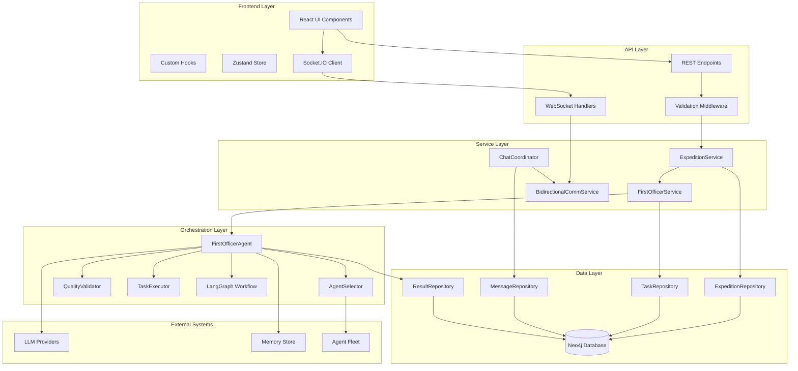
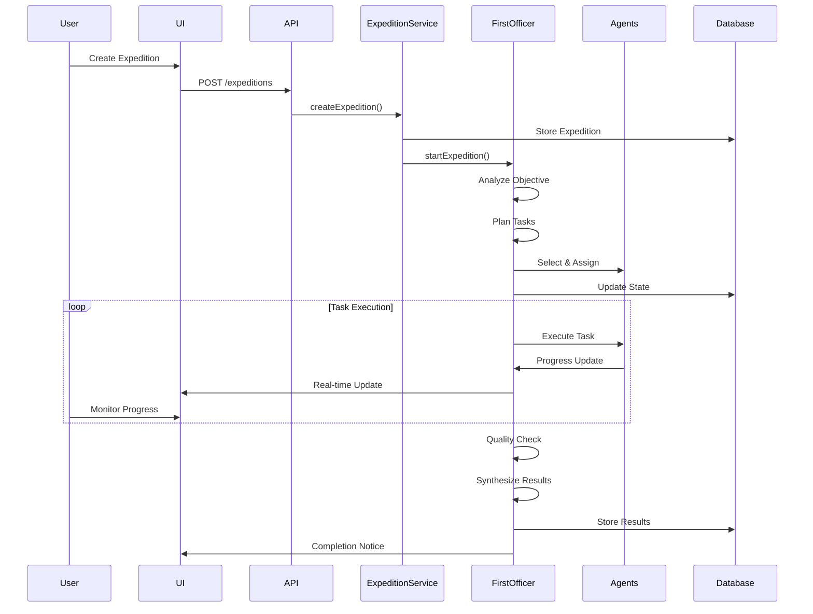

# Expedition Feature with First Officer Agents - Technical Documentation

## Executive Summary

The Expedition Feature is a sophisticated multi-agent orchestration system designed for starships.ai that enables coordinated team missions led by an autonomous First Officer agent. This feature transforms individual AI agents into collaborative teams capable of executing complex, multi-faceted objectives through intelligent task decomposition, parallel execution, and quality-assured delivery.

### Key Capabilities
- **Autonomous Orchestration**: First Officer agent manages entire expedition lifecycle
- **Dynamic Team Assembly**: Intelligent agent selection based on skills and availability
- **Parallel Task Execution**: Efficient concurrent task processing with dependency management
- **Quality Assurance**: Built-in validation and retry mechanisms
- **Real-time Communication**: WebSocket-based live updates and bidirectional chat
- **Vision Alignment**: Automatic verification of expedition-vision alignment

### Business Value
- Enables complex multi-agent projects without manual coordination
- Reduces time-to-completion through parallel execution
- Ensures consistent quality through automated validation
- Provides transparency via real-time progress tracking
- Maintains strategic alignment with company vision

## Architecture Overview

### System Components



### Data Flow Architecture



### Component Responsibilities

#### First Officer Agent
- **Primary Role**: Autonomous expedition orchestrator
- **Responsibilities**:
  - Objective analysis and complexity assessment
  - Task decomposition and dependency mapping
  - Agent selection and assignment
  - Progress monitoring and coordination
  - Quality validation and result synthesis
  - Error handling and recovery

#### Agent Selector
- **Primary Role**: Intelligent crew member selection
- **Mechanisms**:
  - Rule-based skill matching
  - LLM-enhanced selection refinement
  - Workload balancing
  - Availability verification

#### Quality Validator
- **Primary Role**: Ensure output meets standards
- **Functions**:
  - Task result validation
  - Quality scoring (0-100)
  - Issue identification
  - Retry recommendations

#### Task Executor
- **Primary Role**: Manage individual task execution
- **Features**:
  - Parallel execution management
  - Progress tracking
  - Error handling
  - Result collection

## Implementation Plan

### Phase 0: Foundation (Week 1)
**Status**: ✅ Complete

#### Database Schema
```cypher
// Expedition Node
CREATE (e:Expedition {
  id: STRING,
  starshipId: STRING,
  name: STRING,
  mission: STRING,
  status: STRING,
  createdBy: STRING,
  createdAt: DATETIME,
  updatedAt: DATETIME
})

// Task Node
CREATE (t:ExpeditionTask {
  id: STRING,
  expeditionId: STRING,
  title: STRING,
  description: STRING,
  status: STRING,
  priority: STRING,
  assignedAgentId: STRING,
  estimatedEffort: INTEGER,
  actualEffort: INTEGER
})

// Relationships
CREATE (e:Expedition)-[:HAS_TASK]->(t:ExpeditionTask)
CREATE (t:ExpeditionTask)-[:DEPENDS_ON]->(t2:ExpeditionTask)
CREATE (a:Agent)-[:ASSIGNED_TO]->(t:ExpeditionTask)
```

#### Core Types
- ✅ Protocol types defined in `packages/protocol/src/types/expedition.ts`
- ✅ First Officer types in `packages/agent-engine/src/first-officer/types.ts`
- ✅ Error handling types with specific expedition error codes

### Phase 1: Core Implementation (Week 2-3)
**Status**: ~70% Complete

#### First Officer Agent
```typescript
// Core workflow implementation
class FirstOfficerAgent {
  // Workflow phases
  async analyzeObjective(objective: string): Promise<ObjectiveAnalysis>
  async planTasks(analysis: ObjectiveAnalysis): Promise<TaskPlan>
  async selectAgents(tasks: TaskBreakdown[]): Promise<AgentAssignment[]>
  async executeTasks(assignments: AgentAssignment[]): Promise<TaskExecution[]>
  async validateQuality(results: CompletedTask[]): Promise<QualityCheck[]>
  async synthesizeResults(tasks: CompletedTask[]): Promise<string>
}
```

#### LangGraph Workflow
```typescript
// Simplified workflow state machine
const workflow = new StateGraph({
  nodes: {
    analyze_objective: analyzeObjectiveNode,
    plan_tasks: planTasksNode,
    select_agents: selectAgentsNode,
    assign_tasks: assignTasksNode,
    execute_tasks: executeTasksNode,
    monitor_progress: monitorProgressNode,
    quality_check: qualityCheckNode,
    synthesize_results: synthesizeResultsNode,
    handle_error: handleErrorNode
  },
  edges: {
    // State transitions based on conditions
  }
})
```

### Phase 2: Integration (Week 3-4)
**Status**: 🔴 Critical Gap - API Routes Missing

#### Required API Endpoints
```typescript
// Expedition management
POST   /api/starships/:starshipId/expeditions
GET    /api/starships/:starshipId/expeditions
GET    /api/expeditions/:expeditionId
PUT    /api/expeditions/:expeditionId
DELETE /api/expeditions/:expeditionId

// Expedition operations
POST   /api/expeditions/:expeditionId/start
POST   /api/expeditions/:expeditionId/pause
POST   /api/expeditions/:expeditionId/resume
POST   /api/expeditions/:expeditionId/cancel

// Task management
GET    /api/expeditions/:expeditionId/tasks
POST   /api/expeditions/:expeditionId/tasks
PUT    /api/expeditions/:expeditionId/tasks/:taskId

// Real-time chat
POST   /api/expeditions/:expeditionId/messages
GET    /api/expeditions/:expeditionId/messages

// Results
GET    /api/expeditions/:expeditionId/results
POST   /api/expeditions/:expeditionId/results
```

#### WebSocket Events
```typescript
// Client -> Server
socket.emit('expedition:join', { expeditionId })
socket.emit('expedition:leave', { expeditionId })
socket.emit('expedition:send-message', { expeditionId, message })

// Server -> Client
socket.emit('expedition:phase-update', { phase, progress })
socket.emit('expedition:task-update', { taskId, status })
socket.emit('expedition:message', { message })
socket.emit('expedition:completed', { result })
```

### Phase 3: UI Components (Week 4-5)
**Status**: 🟡 Basic components exist, need integration

#### Required Pages
```tsx
// Expedition List Page
/ship/[slug]/expeditions
- Display all expeditions for the starship
- Create new expedition button
- Filter by status
- Search functionality

// Expedition Detail Page
/ship/[slug]/expeditions/[expeditionId]
- Unified chat interface
- Progress visualization
- Task timeline
- Agent activity feed
- Result display
```

#### Key Components
```tsx
// CreateExpeditionModal
- Mission input
- Agent selection (mandatory)
- Validation feedback

// ExpeditionChat
- Message thread display
- Phase indicators
- Progress bars
- Agent avatars

// TaskTimeline
- Visual task progression
- Dependency visualization
- Status indicators
```

## Technical Specifications

### API Contracts

#### Create Expedition
```typescript
// Request
POST /api/starships/:starshipId/expeditions
{
  "name": "Market Analysis Project",
  "mission": "Analyze competitor pricing strategies",
  "selectedAgents": ["agent-id-1", "agent-id-2"] // REQUIRED
}

// Response
{
  "expedition": {
    "id": "exp-123",
    "starshipId": "ship-456",
    "name": "Market Analysis Project",
    "mission": "Analyze competitor pricing strategies",
    "assignedAgents": ["agent-id-1", "agent-id-2"],
    "status": "draft",
    "createdAt": "2025-01-26T10:00:00Z",
    "updatedAt": "2025-01-26T10:00:00Z"
  }
}
```

#### Start Expedition
```typescript
// Request
POST /api/expeditions/:expeditionId/start

// Response
{
  "success": true,
  "message": "Expedition started successfully",
  "workflowId": "wf-789"
}
```

### Data Models

#### Expedition State
```typescript
interface FirstOfficerState {
  expeditionId: string;
  currentPhase: WorkflowPhase;
  requirements: string;
  taskBreakdown: TaskBreakdown[];
  selectedAgents?: AgentAssignment[];
  agentAssignments: Record<string, string[]>;
  agentResults: Record<string, any>;
  completedTasks?: CompletedTask[];
  qualityChecks?: QualityCheck[];
  finalResult?: string;
  errors: string[];
  retryCount: number;
  lastUpdated: string;
}
```

#### Task Structure
```typescript
interface TaskBreakdown {
  id: string;
  description: string;
  requiredSkills: string[];
  assignedAgentId?: string;
  status: TaskStatus;
  deliverable: string;
  dependencies: string[];
  estimatedEffort?: number;
  result?: string;
}
```

#### Quality Metrics
```typescript
interface QualityScore {
  overall: number;         // 0-100
  completeness: number;    // 0-100
  accuracy: number;        // 0-100
  relevance: number;       // 0-100
  clarity: number;         // 0-100
  assessedBy: string;
  assessedAt: string;
  notes?: string;
}
```

### LLM Prompt Templates

#### Objective Analysis
```typescript
const OBJECTIVE_ANALYSIS_PROMPT = `
You are the First Officer's analysis system. Analyze the given objective and provide a structured assessment.

RESPONSE FORMAT (JSON):
{
  "complexity": "simple|moderate|complex|expert",
  "estimatedDuration": 60,
  "requiredSkills": ["skill1", "skill2"],
  "riskFactors": ["risk1", "risk2"],
  "successCriteria": ["criteria1", "criteria2"],
  "approach": "sequential|parallel|hybrid"
}

Objective: {objective}
`;
```

#### Task Planning
```typescript
const TASK_PLANNING_PROMPT = `
You are the First Officer's task planning system. Break down the objective into executable tasks.

RESPONSE FORMAT (JSON):
{
  "tasks": [
    {
      "id": "task-1",
      "description": "Task description",
      "requiredSkills": ["skill1"],
      "deliverable": "Expected output",
      "dependencies": [],
      "estimatedEffort": 30
    }
  ],
  "dependencies": {"task-1": []},
  "criticalPath": ["task-1"],
  "parallelGroups": [["task-1"]],
  "estimatedTotalTime": 60
}

Objective: {objective}
Analysis: {analysis}
`;
```

## Integration Guide

### Frontend Integration

#### 1. Setup Expedition Hooks
```typescript
// useExpeditionData.ts
const useExpeditions = (starshipId: string) => {
  return useQuery({
    queryKey: ['expeditions', starshipId],
    queryFn: () => expeditionApi.getExpeditions(starshipId),
    staleTime: 30000,
    cacheTime: 300000
  });
};

const useExpeditionChat = (expeditionId: string) => {
  const [messages, setMessages] = useState<ExpeditionMessage[]>([]);
  
  useEffect(() => {
    socket.emit('expedition:join', { expeditionId });
    
    socket.on('expedition:message', (message) => {
      setMessages(prev => [...prev, message]);
    });
    
    return () => {
      socket.emit('expedition:leave', { expeditionId });
    };
  }, [expeditionId]);
  
  return { messages, sendMessage };
};
```

#### 2. Implement UI Components
```tsx
// ExpeditionChat.tsx
export function ExpeditionChat({ expeditionId }: Props) {
  const { messages, sendMessage } = useExpeditionChat(expeditionId);
  const { expedition } = useExpedition(expeditionId);
  
  return (
    <div className="expedition-chat">
      <ExpeditionHeader expedition={expedition} />
      <MessageList messages={messages} />
      <MessageInput onSend={sendMessage} />
      <ProgressSidebar expedition={expedition} />
    </div>
  );
}
```

### Backend Integration

#### 1. Service Layer Setup
```typescript
// ExpeditionService.ts
export class ExpeditionService {
  async createExpedition(userId: string, request: CreateExpeditionRequest) {
    // Validate agent selection is provided
    if (!request.selectedAgents?.length) {
      throw new ValidationError('Agent selection required');
    }
    
    // Validate starship ownership
    await this.validateStarshipOwnership(request.starshipId, userId);
    
    // Create expedition
    const expedition = await this.expeditionRepo.create({
      ...request,
      status: 'draft',
      createdBy: userId
    });
    
    return expedition;
  }
  
  async startExpedition(expeditionId: string, userId: string) {
    const expedition = await this.validateExpeditionAccess(expeditionId, userId);
    
    // Start First Officer workflow
    const result = await this.firstOfficerService.startExpedition(
      expeditionId,
      userId,
      expedition.mission
    );
    
    return { success: true, workflowId: result };
  }
}
```

#### 2. Real-time Communication
```typescript
// expeditionHandlers.ts
export function setupExpeditionHandlers(io: Server) {
  io.on('connection', (socket) => {
    socket.on('expedition:join', async ({ expeditionId }) => {
      socket.join(`expedition:${expeditionId}`);
      
      // Send current state
      const messages = await messageRepo.findByExpedition(expeditionId);
      socket.emit('expedition:messages', messages);
    });
    
    socket.on('expedition:send-message', async ({ expeditionId, content }) => {
      const message = await firstOfficerService.handleUserMessage(
        expeditionId,
        content
      );
      
      io.to(`expedition:${expeditionId}`).emit('expedition:message', message);
    });
  });
}
```

## Development Guidelines

### Code Standards

#### TypeScript Best Practices
- Use strict mode and explicit types
- Avoid `any` types except for LangGraph state
- Implement proper error boundaries
- Use discriminated unions for state types

#### Error Handling
```typescript
// Use specific error types
throw new ExpeditionError(
  'AGENT_NOT_AVAILABLE',
  'Selected agent is not available for assignment',
  { agentId, expeditionId }
);

// Handle errors appropriately
try {
  await firstOfficer.startExpedition(expeditionId);
} catch (error) {
  if (error.code === 'WORKFLOW_FAILED') {
    // Specific handling for workflow failures
  }
  throw error;
}
```

#### Logging Standards
```typescript
// Use structured logging
logger.info('[FIRST-OFFICER] Starting expedition', {
  expeditionId,
  userId,
  agentCount: selectedAgents.length,
  timestamp: new Date().toISOString()
});

// Include context in errors
logger.error('[EXPEDITION-SERVICE] Failed to create expedition', {
  error: error.message,
  stack: error.stack,
  request,
  userId
});
```

### Architecture Principles

#### 1. Separation of Concerns
- **Controllers**: Handle HTTP requests/responses only
- **Services**: Business logic and orchestration
- **Repositories**: Data access and persistence
- **Agents**: Autonomous task execution

#### 2. State Management
- Use LangGraph for workflow state
- Persist state after each phase transition
- Enable workflow resumption from any phase
- Maintain audit trail of all state changes

#### 3. Scalability Considerations
- Implement connection pooling for Neo4j
- Use Redis for workflow state caching
- Queue long-running tasks
- Implement circuit breakers for external services

## Testing Strategy

### Unit Testing

#### First Officer Agent Tests
```typescript
describe('FirstOfficerAgent', () => {
  it('should analyze objective complexity correctly', async () => {
    const agent = new FirstOfficerAgent('ship-1', memoryStore, {}, ['agent-1']);
    const analysis = await agent.analyzeObjective('Simple data entry task');
    
    expect(analysis.complexity).toBe('simple');
    expect(analysis.estimatedDuration).toBeLessThan(30);
  });
  
  it('should require agent selection on initialization', () => {
    expect(() => {
      new FirstOfficerAgent('ship-1', memoryStore, {}, []);
    }).toThrow('at least one agent to be selected');
  });
});
```

#### Service Layer Tests
```typescript
describe('ExpeditionService', () => {
  it('should validate agent selection on creation', async () => {
    const request = {
      starshipId: 'ship-1',
      name: 'Test Expedition',
      mission: 'Test mission',
      selectedAgents: [] // Empty selection
    };
    
    await expect(service.createExpedition('user-1', request))
      .rejects.toThrow('Agent selection is required');
  });
});
```

### Integration Testing

#### End-to-End Workflow Test
```typescript
describe('Expedition E2E', () => {
  it('should complete full expedition lifecycle', async () => {
    // 1. Create expedition
    const expedition = await api.post('/expeditions', {
      starshipId: 'ship-1',
      name: 'E2E Test',
      mission: 'Complete test objective',
      selectedAgents: ['agent-1', 'agent-2']
    });
    
    // 2. Start expedition
    await api.post(`/expeditions/${expedition.id}/start`);
    
    // 3. Monitor progress via WebSocket
    const updates = await waitForWorkflowCompletion(expedition.id);
    
    // 4. Verify results
    const result = await api.get(`/expeditions/${expedition.id}/results`);
    expect(result.quality.overall).toBeGreaterThan(70);
  });
});
```

### Performance Testing

#### Load Testing Scenarios
1. **Concurrent Expeditions**: Test system with 100+ active expeditions
2. **Large Teams**: Test expeditions with 20+ agents
3. **Complex Workflows**: Test deeply nested task dependencies
4. **Message Throughput**: Test 1000+ messages per minute

#### Performance Benchmarks
- Expedition creation: < 500ms
- Workflow phase transition: < 2s
- Message delivery: < 100ms
- UI update latency: < 200ms

## Deployment Plan

### Phase 1: Infrastructure Setup
1. **Database Migration**
   ```bash
   npm run migrate:expeditions
   ```

2. **Environment Variables**
   ```env
   LANGCHAIN_API_KEY=xxx
   FIRST_OFFICER_MODEL=gpt-4
   EXPEDITION_TIMEOUT_MINUTES=60
   MAX_AGENTS_PER_EXPEDITION=20
   ```

3. **Redis Configuration**
   ```typescript
   // Workflow state caching
   const redis = new Redis({
     host: process.env.REDIS_HOST,
     port: 6379,
     keyPrefix: 'expedition:'
   });
   ```

### Phase 2: Feature Rollout
1. **Alpha Release** (Week 1)
   - Enable for internal testing team
   - Monitor error rates and performance
   - Collect feedback on UX

2. **Beta Release** (Week 2-3)
   - Enable for 10% of users
   - A/B test against manual coordination
   - Measure completion rates and quality

3. **General Availability** (Week 4)
   - Enable for all users
   - Provide migration tools for existing projects
   - Launch documentation and tutorials

### Monitoring & Observability

#### Key Metrics
```typescript
// Expedition metrics
expeditions_created_total
expeditions_completed_total
expeditions_failed_total
expedition_duration_seconds
expedition_quality_score

// Task metrics
tasks_created_total
tasks_completed_total
task_execution_duration_seconds
task_retry_count

// System metrics
first_officer_response_time_ms
agent_selection_duration_ms
workflow_phase_transition_duration_ms
```

#### Alerting Rules
1. **High Failure Rate**: Alert if > 10% expeditions fail
2. **Long Running**: Alert if expedition > 2 hours
3. **Low Quality**: Alert if average quality < 60%
4. **System Errors**: Alert on any critical errors

## Future Enhancements

### MCP (Model Context Protocol) Integration
```typescript
// Future: Direct tool access for agents
interface MCPToolAccess {
  tools: ['file-system', 'web-search', 'code-execution'];
  permissions: ['read', 'write', 'execute'];
  sandboxed: boolean;
}

// Agent with MCP capabilities
class MCPEnabledAgent extends BaseAgent {
  async executeWithTools(task: Task): Promise<Result> {
    const context = await this.buildMCPContext(task);
    const tools = await this.loadMCPTools(task.requiredTools);
    
    return await this.llm.complete({
      prompt: task.description,
      context,
      tools,
      maxIterations: 10
    });
  }
}
```

### Advanced Features Roadmap

#### Q2 2025: Enhanced Collaboration
- Multi-expedition coordination
- Cross-team resource sharing
- Agent skill development tracking
- Expedition templates library

#### Q3 2025: Intelligence Layer
- Predictive task duration estimates
- Automatic skill gap identification
- Quality prediction models
- Optimal team composition AI

#### Q4 2025: Enterprise Features
- Custom workflow designers
- Compliance and audit trails
- Role-based access control
- SLA management

### Performance Optimizations

#### 1. Workflow Optimization
```typescript
// Implement workflow caching
class CachedWorkflow extends FirstOfficerAgent {
  private workflowCache = new Map<string, WorkflowState>();
  
  async getCachedOrCompute(key: string, compute: Function) {
    if (this.workflowCache.has(key)) {
      return this.workflowCache.get(key);
    }
    
    const result = await compute();
    this.workflowCache.set(key, result);
    return result;
  }
}
```

#### 2. Agent Pool Management
```typescript
// Implement agent connection pooling
class AgentPool {
  private available: Agent[] = [];
  private busy: Map<string, Agent> = new Map();
  
  async acquire(requirements: string[]): Promise<Agent> {
    const agent = this.findBestMatch(requirements);
    this.busy.set(agent.id, agent);
    return agent;
  }
  
  release(agentId: string): void {
    const agent = this.busy.get(agentId);
    if (agent) {
      this.busy.delete(agentId);
      this.available.push(agent);
    }
  }
}
```

## Appendix

### Glossary
- **Expedition**: A coordinated multi-agent mission with specific objectives
- **First Officer**: Autonomous agent that orchestrates expeditions
- **Starship**: Container for AI agents and expeditions
- **Task Breakdown**: Decomposed subtasks from main objective
- **Quality Score**: Numerical assessment of task/expedition output
- **Workflow Phase**: Current state in expedition lifecycle

### References
- LangGraph Documentation: https://python.langchain.com/docs/langgraph
- Neo4j Best Practices: https://neo4j.com/docs/
- Socket.IO Guide: https://socket.io/docs/v4/
- TypeScript Handbook: https://www.typescriptlang.org/docs/

### Support Resources
- Technical Issues: Create GitHub issue with `expedition-feature` label
- Architecture Questions: Contact platform team
- Feature Requests: Submit via product board
- Documentation Updates: PR to `docs/technical/`

---

*Last Updated: January 26, 2025*
*Version: 1.0.0*
*Status: Implementation In Progress (~70% Complete)*