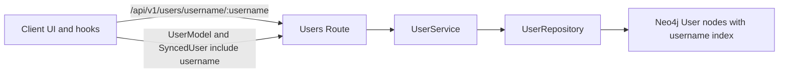
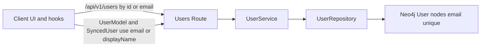

# Username Removal Implementation Plan (Direct Removal)

Context: This plan addresses GitHub issue: https://github.com/theingenuityco/starships.ai/issues/253

Objective: Remove username across the product surface and rely on email or id for identity via a direct removal (no deprecation), since there are no external dependents.

Summary verdict from codebase review

- Username is currently a first-class field across protocol, entity, repository, services, API routes, client hooks/UI, and tests. It is enforced via validation and used in responses and UX toasts.
- Treat this as a cross-cutting refactor with breaking API changes, not as a trivial bug.

Current state assessment

Protocol contracts

- User model requires username: [TypeScript.UserModel()](packages/protocol/src/domains/user.ts:14) with property at line 16.
- Create request requires username: [TypeScript.CreateUserRequest()](packages/protocol/src/domains/user.ts:34).
- Update request optionally accepts username: [TypeScript.UpdateUserRequest()](packages/protocol/src/domains/user.ts:46).
- Filters and sorting include username: [TypeScript.UserFilters()](packages/protocol/src/domains/user.ts:76), [TypeScript.UserSort()](packages/protocol/src/domains/user.ts:84).

Models and entity

- Entity enforces username with transform and validation: [packages/models/src/entities/UserEntity.ts](packages/models/src/entities/UserEntity.ts:102).
- Username is part of profile completion and display helpers at lines 190 to 226 in [packages/models/src/entities/UserEntity.ts](packages/models/src/entities/UserEntity.ts).
- Helper exists to derive username from email at line 276 in [packages/models/src/entities/UserEntity.ts](packages/models/src/entities/UserEntity.ts).

Repository and persistence

- Find by username: [TypeScript.findByUsername()](packages/models/src/repositories/UserRepository.ts:53).
- Create with password generates username from email: [TypeScript.createWithPassword()](packages/models/src/repositories/UserRepository.ts:224) uses username at lines 234 to 242.
- Neo4j schema defines an index on u.username at line 153 of [packages/models/src/helpers/database/connection.ts](packages/models/src/helpers/database/connection.ts:153).

Server services and API

- Service checks/generates username on create: [TypeScript.createUser()](packages/server/src/services/UserService.ts:55), [TypeScript.createUserWithPassword()](packages/server/src/services/UserService.ts:79), and generator [TypeScript.generateUniqueUsername()](packages/server/src/services/UserService.ts:326).
- Service exposes getUserByUsername: [TypeScript.getUserByUsername()](packages/server/src/services/UserService.ts:149).
- Users route exposes GET by username and validates username in multiple schemas: [packages/server/src/routes/users.ts](packages/server/src/routes/users.ts:28) and the route at line 179.
- Auth routes set username and use it in JWT payload and response: [packages/server/src/routes/auth.ts](packages/server/src/routes/auth.ts:67).

Client application

- Public API type SyncedUser includes username: [TypeScript.SyncedUser()](packages/client/src/lib/api.ts:399).
- Client hooks call by username and validate usernames: [TypeScript.useUserByUsername()](packages/client/src/hooks/useUsers.ts:112), [TypeScript.validateUsername()](packages/client/src/hooks/useUsers.ts:532).
- Client UX toasts reference displayName || username across registration, create, update, delete, and login: [packages/client/src/hooks/useUsers.ts](packages/client/src/hooks/useUsers.ts:223).
- useAuth crafts a local synced user object with username fallback from email: [packages/client/src/hooks/useAuth.ts](packages/client/src/hooks/useAuth.ts:262).

Out of scope

- Do not modify infrastructure username fields unrelated to the User domain such as Neo4j connection credentials: [packages/models/src/helpers/database/connection.ts](packages/models/src/helpers/database/connection.ts:4).

Architecture overview (current)

Target architecture (no username)

Implementation strategy (direct removal, no deprecation)

Execute the following steps in a single coordinated change set across the monorepo to keep types and runtime consistent:

1. Protocol: remove username from all contracts and exports.
2. Models/Entity: delete username property, transformers, and validation; update helpers.
3. Repository: remove username lookups and persistence; adjust create/update flows.
4. Server: remove username from services and routes; remove by-username endpoint.
5. Client: remove username from hooks, types, API helpers, and UX copy.
6. Database schema: stop creating username index; optionally provide a maintenance script to drop it.
7. Tests: update or delete tests referencing username.
8. Final sweep: repo-wide search to ensure no functional references remain except allowed infra variables (e.g., NEO4J_USERNAME).

Detailed change list by layer and file

Protocol package

- Update [TypeScript.UserModel()](packages/protocol/src/domains/user.ts:14):
  - Remove the username property (currently at line 16).
- Update [TypeScript.CreateUserRequest()](packages/protocol/src/domains/user.ts:34):
  - Remove the username field.
- Update [TypeScript.UpdateUserRequest()](packages/protocol/src/domains/user.ts:46):
  - Remove the username field.
- Update [TypeScript.UserFilters()](packages/protocol/src/domains/user.ts:76) and [TypeScript.UserSort()](packages/protocol/src/domains/user.ts:84):
  - Remove username keys and enum members.

Models package

- Edit [packages/models/src/entities/UserEntity.ts](packages/models/src/entities/UserEntity.ts:96):
  - Delete the entire username property block (transform, IsString, Length, Matches).
  - Update [TypeScript.validate()](packages/models/src/entities/UserEntity.ts:150) to not set or require username on create.
  - Update helpers:
    - hasCompleteProfile(): remove username from the check (line 190).
    - getInitials(): remove username branch (lines 212-214); rely on displayName, else email.
    - getDisplayName(): remove username fallback (line 225); use displayName or email local part.
    - Remove [TypeScript.generateUsernameFromEmail()](packages/models/src/entities/UserEntity.ts:276).
- Edit [TypeScript.UserRepository](packages/models/src/repositories/UserRepository.ts:6):
  - Delete [TypeScript.findByUsername()](packages/models/src/repositories/UserRepository.ts:53) and its usages.
  - In [TypeScript.createWithPassword()](packages/models/src/repositories/UserRepository.ts:224), stop constructing username and validating it; persist email, displayName, password, createdAt only.

Database schema

- Edit initialization in [TypeScript.initializeSchema()](packages/models/src/helpers/database/connection.ts:130):
  - Remove the user_username_index creation (line 153).
- Optional maintenance (Neo4j): provide script/command to drop the index in existing environments after deployment.

Server package

- Edit [TypeScript.UserService](packages/server/src/services/UserService.ts:41):
  - In [TypeScript.createUser()](packages/server/src/services/UserService.ts:55): remove username uniqueness checks.
  - In [TypeScript.createUserWithPassword()](packages/server/src/services/UserService.ts:79): remove username generation and uniqueness checks; do not write username.
  - Remove [TypeScript.getUserByUsername()](packages/server/src/services/UserService.ts:149).
  - Remove [TypeScript.generateUniqueUsername()](packages/server/src/services/UserService.ts:326).
  - In [TypeScript.updateUserProfile()](packages/server/src/services/UserService.ts:168): remove username change validation branch.
- Edit Users routes [packages/server/src/routes/users.ts](packages/server/src/routes/users.ts:28):
  - Remove username from Create/Update/Profile Zod schemas.
  - Delete GET /users/username/:username endpoint (line 179).
- Edit Auth routes [packages/server/src/routes/auth.ts](packages/server/src/routes/auth.ts:67):
  - Do not set username at registration.
  - For JWT payloads and response DTOs, replace name fallback `displayName || username` with `displayName || email.split('@')[0]`.

Client package

- Edit hooks [packages/client/src/hooks/useUsers.ts](packages/client/src/hooks/useUsers.ts:62):
  - Remove query keys and hook [TypeScript.useUserByUsername()](packages/client/src/hooks/useUsers.ts:112).
  - Remove [TypeScript.validateUsername()](packages/client/src/hooks/useUsers.ts:532).
  - Replace all `${displayName || username}` with `${displayName || emailLocalPart}` in toasts and messages.
- Edit auth hook [packages/client/src/hooks/useAuth.ts](packages/client/src/hooks/useAuth.ts:259):
  - In syncedUser construction, remove username and compute displayName only.
- Edit API types [TypeScript.SyncedUser()](packages/client/src/lib/api.ts:399):
  - Remove the username property from the interface and from any consumer code.

Database and data considerations

- No user data migration is required: repository writes already use email as merge key.
- Index removal is operational; the property may still exist on nodes, but it is unused. Optionally add a one-off cleaning script later.

Acceptance criteria

- Protocol: username removed from public contracts; repo compiles and type checks across all packages.
- Server: All user CRUD operations work without username; by-username route removed; validation no longer accepts or requires username.
- Repository: No queries use username; username index not created.
- Entity: Validation passes without username; helpers correctly fallback to displayName or email local part.
- Client: No references to username remain; UI and toasts use displayName or email local part; all hooks compile and function.
- Tests: Updated to remove username assumptions; all tests pass.

Risks and mitigations

- Hidden references to username in client or server:
  - Mitigate with repo-wide search and CI guard (lint rule) forbidding username usage in domain code after migration.
- Cached data shapes including username:
  - Mitigate by invalidating affected caches and updating query keys (remove username key space).
- Third-party or docs expecting username:
  - Mitigate by updating docs and examples to use displayName or email local part.

Execution plan

- Single PR spanning protocol, models, server, and client in this monorepo.
- Sequence:
  1. Update protocol types and run typecheck to surface all compile errors.
  2. Update models/entities/repositories to satisfy types.
  3. Update server services and routes; remove by-username endpoint.
  4. Update client hooks/types and UI copy.
  5. Remove username index creation from DB schema init.
  6. Update tests; ensure green CI.
  7. Final repo-wide grep for `\busername\b` to confirm only infra occurrences remain (e.g., NEO4J_USERNAME).

Rollback plan

- Revert the PR; no partial deprecation path is maintained per requirements.

Work breakdown and estimates

- Protocol changes: 0.5 to 1 day.
- Server services and routes: 1 day.
- Repository and DB schema: 0.5 day.
- Client hooks/UI: 1 day.
- Tests and cleanup: 0.5 to 1 day.
- Total estimate: 3 to 4 days including reviews and CI.
