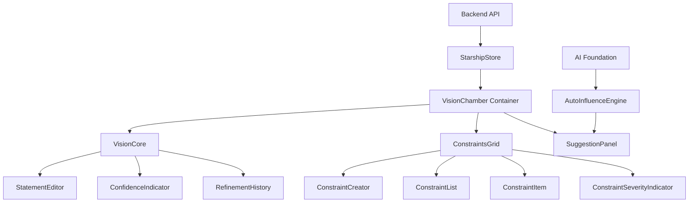
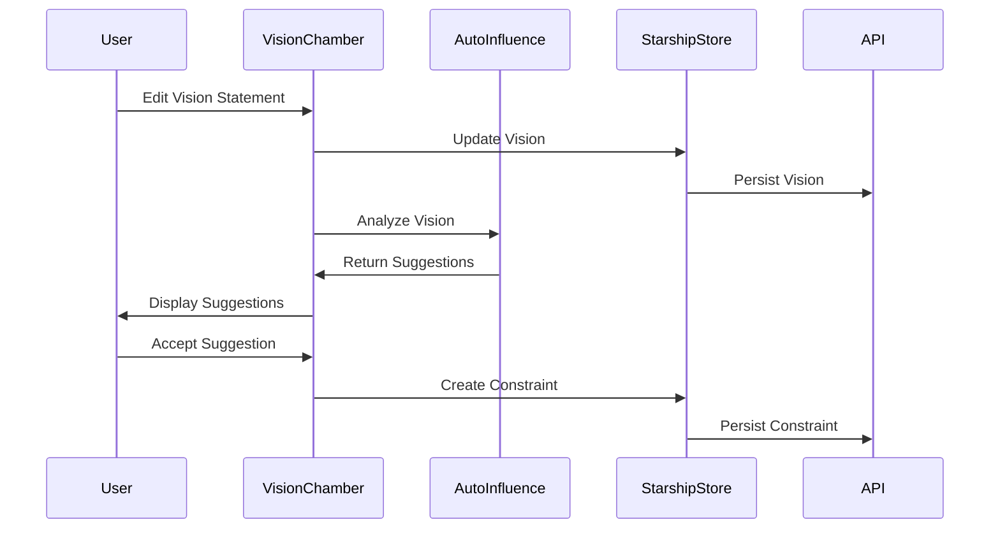

# Vision Chamber Architecture Documentation

## Table of Contents
1. [System Overview](#system-overview)
2. [Core Components Documentation](#core-components-documentation)
3. [Shared Systems Documentation](#shared-systems-documentation)
4. [Technical Architecture](#technical-architecture)
5. [User Workflows](#user-workflows)
6. [Development Guidelines](#development-guidelines)
7. [API Integration](#api-integration)

---

## 1. System Overview

### Purpose and Role
The Vision Chamber is a sophisticated consciousness management system within the Starships.ai platform that enables users to:
- Define and refine their starship's core mission vision
- Establish operational constraints across multiple categories
- Receive AI-powered suggestions for vision refinement and constraint creation
- Manage the evolution of their starship's consciousness over time

### High-Level Architecture
The Vision Chamber follows a modular, component-based architecture with the following key characteristics:



### Integration with Platform Systems
- **Starship Store**: Centralized state management for vision and constraints
- **Backend API**: Persistence layer for all Vision Chamber data
- **AI Foundation**: Future integration point for intelligent agents
- **Navigation System**: Accessible through the main navigation as "Vision Chamber"
- **Command Deck**: Quick access modules for vision and constraint management

---

## 2. Core Components Documentation

### VisionCore Component
**Location**: [`packages/client/src/components/vision-chamber/VisionChamber/VisionCore/`](packages/client/src/components/vision-chamber/VisionChamber/VisionCore/)

The VisionCore is the primary interface for managing the starship's vision statement. It provides a cohesive editing experience with real-time feedback and confidence scoring.

#### Key Features:
- **Vision Statement Management**: Create, edit, and save vision statements
- **Confidence Scoring**: Real-time confidence assessment based on statement length and quality
- **Version Tracking**: Historical tracking of vision refinements
- **Responsive Design**: Adaptive layout for different screen sizes

#### Sub-Components:

##### StatementEditor.tsx
- **Purpose**: Provides a rich text editing interface for vision statements
- **Features**:
  - Auto-focus on edit mode
  - Character count display
  - Save/cancel controls with validation
  - Loading states during API calls
  - Placeholder text guidance

##### ConfidenceIndicator.tsx
- **Purpose**: Visual representation of vision statement confidence
- **Features**:
  - Animated progress bar with color-coded confidence levels
  - Badge display with confidence percentage
  - Pulse animation for high confidence scores
  - Responsive sizing options

##### RefinementHistory.tsx
- **Purpose**: Tracks and displays vision statement evolution
- **Features**:
  - Last updated timestamp
  - Version tracking (placeholder for future expansion)
  - Future timeline functionality for change history

### ConstraintsGrid Component
**Location**: [`packages/client/src/components/vision-chamber/VisionChamber/ConstraintsGrid/`](packages/client/src/components/vision-chamber/VisionChamber/ConstraintsGrid/)

The ConstraintsGrid manages all operational constraints that guide starship behavior. It provides comprehensive CRUD operations with advanced filtering and organization capabilities.

#### Key Features:
- **Constraint Management**: Create, edit, activate/deactivate, and delete constraints
- **Categorization**: Four constraint types (Resource, Ethical, Technical, Business)
- **Severity Assessment**: Four severity levels (Low, Medium, High, Critical)
- **Advanced Filtering**: Multi-dimensional filtering and sorting
- **Bulk Operations**: Mass actions and batch processing

#### Sub-Components:

##### ConstraintCreator.tsx
- **Purpose**: Modal interface for creating new constraints
- **Features**:
  - Category selection with icons and descriptions
  - Severity level selection with explanations
  - Form validation and error handling
  - Example suggestions for each category
  - Active/inactive toggle

##### ConstraintItem.tsx
- **Purpose**: Individual constraint display and inline editing
- **Features**:
  - Inline editing with save/cancel functionality
  - Active/inactive toggle
  - Severity indicator display
  - Dropdown menu for actions (edit, delete)
  - Visual state indicators (new, modified)

##### ConstraintList.tsx
- **Purpose**: List management with filtering and sorting
- **Features**:
  - Multi-dimensional filtering (type, severity, status)
  - Sortable columns with ascending/descending order
  - Filter state persistence
  - Loading states and empty state handling

##### ConstraintSeverityIndicator.tsx
- **Purpose**: Visual severity representation
- **Features**:
  - Color-coded severity levels
  - Icon-based severity indicators
  - Multiple size variants
  - Label display options
  - Accessibility support

---

## 3. Shared Systems Documentation

### AI Foundation System
**Location**: [`packages/client/src/components/vision-chamber/VisionChamber/shared/ai-foundation.ts`](packages/client/src/components/vision-chamber/VisionChamber/shared/ai-foundation.ts)

The AI Foundation provides the architectural framework for future AI agent integration, defining interfaces and patterns for consciousness modification and constraint analysis.

#### Key Components:

##### MCP (Model Context Protocol) Integration
- **Purpose**: Standardized communication with AI agents
- **Features**:
  - Request/response patterns for agent communication
  - Priority-based request handling
  - Agent capability definitions
  - Memory context management

##### Agent Orchestration Framework
- **Purpose**: Management of multiple AI agents
- **Features**:
  - Agent capability mapping
  - Interaction history tracking
  - Performance monitoring
  - Feedback loop integration

##### Future Integration Points
- **Aether Cortex**: Primary AI orchestration platform
- **LangGraph**: Workflow orchestration for complex AI tasks
- **MCP Server**: Real-time agent communication
- **WebSocket Integration**: Live agent interactions

### Auto-Influence System
**Location**: [`packages/client/src/components/vision-chamber/VisionChamber/shared/auto-influence.ts`](packages/client/src/components/vision-chamber/VisionChamber/shared/auto-influence.ts)

The AutoInfluenceEngine analyzes vision statements and generates intelligent suggestions for improvements and constraint creation.

#### Key Features:

##### Vision Refinement Analysis
- **Pattern Recognition**: Identifies improvement opportunities
- **Suggestion Generation**: Creates refined vision statements
- **Confidence Scoring**: Rates suggestion quality
- **Category Classification**: Clarity, scope, purpose, action improvements

##### Constraint Suggestion Engine
- **Trigger Detection**: Identifies constraint-worthy content
- **Category Mapping**: Auto-categorizes suggested constraints
- **Severity Assessment**: Determines appropriate constraint severity
- **Duplication Prevention**: Avoids redundant constraint suggestions

##### Analysis Patterns
```typescript
const VISION_REFINEMENT_PATTERNS = {
  clarity: ['vague', 'maybe', 'might', 'possibly', 'unclear'],
  scope: ['everything', 'all', 'anything', 'universal'],
  purpose: ['to do', 'for', 'about'],
  action: ['is', 'are', 'being', 'static']
};

const CONSTRAINT_SUGGESTION_PATTERNS = {
  resource: ['energy', 'power', 'fuel', 'crew', 'time', 'limited'],
  ethical: ['civilian', 'innocent', 'peaceful', 'non-combatant'],
  technical: ['incompatible', 'interference', 'malfunction', 'limitation'],
  business: ['budget', 'cost', 'expense', 'funding']
};
```

### SuggestionPanel Component
**Location**: [`packages/client/src/components/vision-chamber/VisionChamber/shared/SuggestionPanel.tsx`](packages/client/src/components/vision-chamber/VisionChamber/shared/SuggestionPanel.tsx)

The SuggestionPanel provides a user interface for reviewing and acting on AI-generated suggestions.

#### Key Features:
- **Suggestion Display**: Cards showing constraint and vision refinement suggestions
- **Confidence Indicators**: Visual representation of suggestion quality
- **Detailed View**: Expandable details showing reasoning and triggers
- **Action Controls**: Accept, dismiss, or dismiss all suggestions
- **Source Attribution**: Clear indication of suggestion origin

---

## 4. Technical Architecture

### Data Flow Architecture



### State Management Patterns

The Vision Chamber uses Zustand for state management with the following patterns:

#### Vision State
```typescript
interface VisionState {
  vision: {
    statement: string;
    lastUpdated: Date;
    confidence: number;
  };
  constraints: Constraint[];
  pendingChanges: PendingChange[];
  loading: boolean;
  error: string | null;
}
```

#### Actions
- `updateVisionAPI(statement: string)`: Updates vision statement
- `loadConstraints()`: Loads constraints from API
- `createConstraint(data: ConstraintFormData)`: Creates new constraint
- `updateConstraint(id: string, changes: Partial<Constraint>)`: Updates constraint
- `deleteConstraint(id: string)`: Deletes constraint

### Type Definitions

The system uses comprehensive TypeScript types defined in [`types.ts`](packages/client/src/components/vision-chamber/VisionChamber/shared/types.ts):

#### Core Types
```typescript
interface Constraint {
  id: string;
  codexId: string;
  type: 'resource' | 'ethical' | 'technical' | 'business';
  description: string;
  severity: 'low' | 'medium' | 'high' | 'critical';
  isActive: boolean;
  createdAt: string;
  updatedAt: string;
}

interface InfluenceSuggestion {
  id: string;
  type: 'constraint' | 'vision_refinement';
  source: 'vision_change' | 'constraint_activation' | 'agent_observation';
  suggestion: ConstraintFormData | VisionRefinementFormData;
  confidence: number;
  reasoning: string;
  timestamp: string;
  triggers: string[];
}
```

### Integration Patterns

#### API Integration
- **Starship Store**: Centralized API communication
- **Error Handling**: Comprehensive error states and user feedback
- **Optimistic Updates**: Immediate UI updates with rollback capability
- **Debounced Analysis**: Prevents excessive API calls during rapid changes

#### Component Communication
- **Props Drilling**: Minimal, focused on essential data
- **Event Callbacks**: Clean separation of concerns
- **Shared State**: Zustand store for cross-component communication
- **Context Providers**: Future expansion for complex state sharing

---

## 5. User Workflows

### Vision Statement Creation and Refinement

1. **Initial Creation**
   - User clicks "Create Vision" button
   - StatementEditor opens with placeholder text
   - User types vision statement
   - Real-time character count and validation
   - Save triggers API call and confidence calculation

2. **Refinement Process**
   - Auto-influence engine analyzes statement after 2-second debounce
   - Suggestions appear in SuggestionPanel
   - User can accept, expand details, or dismiss suggestions
   - Accepted refinements update the vision statement
   - History tracking records changes

3. **Confidence Scoring**
   - Automatic calculation based on statement length and quality
   - Visual feedback through ConfidenceIndicator
   - Color-coded confidence levels (red < 40%, orange 40-60%, yellow 60-80%, green > 80%)
   - Animated progress bar with pulse effect for high confidence

### Constraint Management Workflows

1. **Constraint Creation**
   - User clicks "Add Constraint" button
   - ConstraintCreator modal opens
   - Category selection (Resource, Ethical, Technical, Business)
   - Description input with examples
   - Severity level selection (Low, Medium, High, Critical)
   - Active/inactive toggle
   - Form validation and submission

2. **Constraint Organization**
   - Filtering by type, severity, and status
   - Sorting by various criteria
   - Search functionality
   - Bulk operations
   - Visual severity indicators

3. **Constraint Editing**
   - Inline editing with save/cancel
   - Active/inactive toggle
   - Severity modification
   - Deletion with confirmation

### AI-Assisted Suggestion Integration

1. **Suggestion Generation**
   - Triggered by vision statement changes
   - Analysis of content for improvement opportunities
   - Automatic constraint suggestions based on vision content
   - Confidence scoring for each suggestion

2. **Suggestion Review**
   - Suggestions appear in dedicated panel
   - Expandable details showing reasoning and triggers
   - Source attribution and confidence indicators
   - Accept/dismiss actions for each suggestion

3. **Suggestion Implementation**
   - Accepted constraint suggestions create new constraints
   - Accepted vision refinements update the statement
   - Dismissed suggestions are removed from the queue
   - Feedback loop for improving suggestion quality

---

## 6. Development Guidelines

### Component Architecture Patterns

#### Fractal Component Design
Each major component follows a fractal pattern:
- **Index Component**: Main container with state and logic
- **Sub-Components**: Specialized components for specific features
- **Shared Components**: Reusable components across the system

#### State Management Principles
- **Single Source of Truth**: Zustand store for all Vision Chamber state
- **Immutable Updates**: All state changes create new objects
- **Optimistic Updates**: UI updates immediately, with rollback on API failure
- **Error Boundaries**: Comprehensive error handling and user feedback

#### Component Communication
- **Props for Data**: Pass data down through props
- **Callbacks for Events**: Pass event handlers up through callbacks
- **Store for Shared State**: Use Zustand store for cross-component communication
- **Context for Complex State**: Future expansion for complex state sharing

### Adding New Constraint Types

1. **Update Type Definition**
   ```typescript
   // In types.ts
   type ConstraintType = 'resource' | 'ethical' | 'technical' | 'business' | 'new_type';
   ```

2. **Add to Category Configuration**
   ```typescript
   // In ConstraintCreator.tsx
   const CATEGORIES = [
     // ... existing categories
     {
       type: 'new_type' as const,
       label: 'New Type',
       icon: NewIcon,
       description: 'Description of new type',
       examples: ['Example 1', 'Example 2', 'Example 3']
     }
   ];
   ```

3. **Update Auto-Influence Patterns**
   ```typescript
   // In auto-influence.ts
   const CONSTRAINT_SUGGESTION_PATTERNS = {
     // ... existing patterns
     new_type: [
       {
         triggers: ['trigger1', 'trigger2'],
         template: 'Template for new type: {resource}',
         severity: 'medium' as const
       }
     ]
   };
   ```

4. **Add Icon Support**
   ```typescript
   // In ConstraintItem.tsx
   const CATEGORY_ICONS = {
     // ... existing icons
     new_type: NewTypeIcon
   };
   ```

### Extending AI Foundation Capabilities

1. **Add New Agent Types**
   ```typescript
   // In ai-foundation.ts
   interface AgentDefinition {
     // ... existing properties
     type: 'vision_analyst' | 'constraint_monitor' | 'consciousness_coordinator' | 'new_agent_type';
   }
   ```

2. **Define Agent Capabilities**
   ```typescript
   export interface NewAgentCapability extends AgentCapability {
     category: 'new_category';
     specialFeatures: string[];
   }
   ```

3. **Create Integration Hooks**
   ```typescript
   export interface UseNewAgentHook {
     // Define hook interface
     agentState: any;
     agentActions: any;
   }
   ```

### Testing Strategies

#### Unit Testing
- **Component Testing**: Test individual components in isolation
- **Logic Testing**: Test business logic and utilities
- **State Testing**: Test Zustand store actions and state changes
- **Type Testing**: Ensure TypeScript types are correct

#### Integration Testing
- **API Integration**: Test API calls and error handling
- **Component Integration**: Test component interaction
- **Store Integration**: Test store updates and component reactions
- **Workflow Testing**: Test complete user workflows

#### End-to-End Testing
- **Vision Creation**: Test complete vision creation workflow
- **Constraint Management**: Test constraint CRUD operations
- **Suggestion Flow**: Test suggestion generation and acceptance
- **Error Scenarios**: Test error handling and recovery

---

## 7. API Integration

### Backend Service Integration

The Vision Chamber integrates with the backend through the Starship Store, which provides a clean abstraction layer for API communication.

#### Key API Endpoints

##### Vision Management
- `GET /api/v1/starships/:id/codex/telos` - Retrieve vision statement
- `PUT /api/v1/starships/:id/codex` - Update vision statement
- `GET /api/v1/starships/:id/codex/constraints` - Retrieve constraints
- `POST /api/v1/starships/:id/codex/constraints` - Create constraint
- `PUT /api/v1/starships/:id/codex/constraints/:constraintId` - Update constraint
- `DELETE /api/v1/starships/:id/codex/constraints/:constraintId` - Delete constraint

##### Future AI Integration Endpoints
- `POST /api/v1/starships/:id/agents/activate` - Activate AI agent
- `POST /api/v1/starships/:id/agents/mcp-request` - Send MCP request
- `GET /api/v1/starships/:id/consciousness/insights` - Get consciousness insights
- `WS /api/v1/starships/:id/consciousness/stream` - Real-time consciousness updates

### Data Persistence Patterns

#### Optimistic Updates
```typescript
// Update UI immediately
set({ vision: { statement: newStatement } });

// Then sync with API
try {
  await api.updateVision(newStatement);
} catch (error) {
  // Rollback on error
  set({ vision: { statement: previousStatement } });
}
```

#### Error Handling
```typescript
try {
  await api.operation();
} catch (error) {
  set({ 
    error: 'User-friendly error message',
    loading: false 
  });
}
```

#### State Synchronization
```typescript
// Load initial state
const loadVisionAndConstraints = async () => {
  set({ loading: true });
  try {
    const [vision, constraints] = await Promise.all([
      api.getVision(),
      api.getConstraints()
    ]);
    set({ vision, constraints, loading: false });
  } catch (error) {
    set({ error: 'Failed to load data', loading: false });
  }
};
```

### Real-time Updates and Synchronization

#### WebSocket Integration (Future)
```typescript
// Future WebSocket integration for real-time updates
const useVisionChamberSocket = () => {
  useEffect(() => {
    const socket = new WebSocket('/ws/vision-chamber');
    
    socket.onmessage = (event) => {
      const update = JSON.parse(event.data);
      handleRealtimeUpdate(update);
    };
    
    return () => socket.close();
  }, []);
};
```

#### Conflict Resolution
```typescript
// Handle concurrent modifications
const handleConflictResolution = (localChanges: any, remoteChanges: any) => {
  // Implement conflict resolution strategy
  // Options: last-write-wins, merge, user-choice
};
```

#### Change Queuing
```typescript
// Queue changes for batch processing
const queueChange = (change: PendingChange) => {
  set(state => ({
    pendingChanges: [...state.pendingChanges, change]
  }));
};
```

---

## Future Roadmap

### Phase 1: Current Implementation
- ✅ Core Vision Chamber functionality
- ✅ Constraint management system
- ✅ Auto-influence suggestion engine
- ✅ Basic AI foundation interfaces

### Phase 2: Enhanced Features
- 🔄 Advanced filtering and search
- 🔄 Bulk operations for constraints
- 🔄 Version history and rollback
- 🔄 Export/import functionality

### Phase 3: AI Integration
- 🔮 Aether Cortex integration
- 🔮 LangGraph workflow orchestration
- 🔮 MCP server communication
- 🔮 Real-time agent interactions

### Phase 4: Advanced Consciousness
- 🔮 Multi-agent orchestration
- 🔮 Consciousness monitoring dashboard
- 🔮 Predictive constraint suggestions
- 🔮 Autonomous consciousness evolution

---

## Conclusion

The Vision Chamber represents a sophisticated approach to consciousness management in AI systems. Its modular architecture, comprehensive feature set, and future-ready design make it a cornerstone of the Starships.ai platform. The system successfully balances immediate functionality with extensibility, providing a solid foundation for future AI integration and consciousness evolution.

The combination of human-driven vision creation and AI-assisted refinement creates a powerful tool for defining and maintaining coherent starship consciousness. The constraint system ensures that this consciousness operates within defined parameters while remaining adaptable to changing requirements.

As the system evolves, the AI foundation will enable increasingly sophisticated consciousness management capabilities, ultimately leading to truly autonomous and intelligent starship behavior guided by human-defined values and objectives.