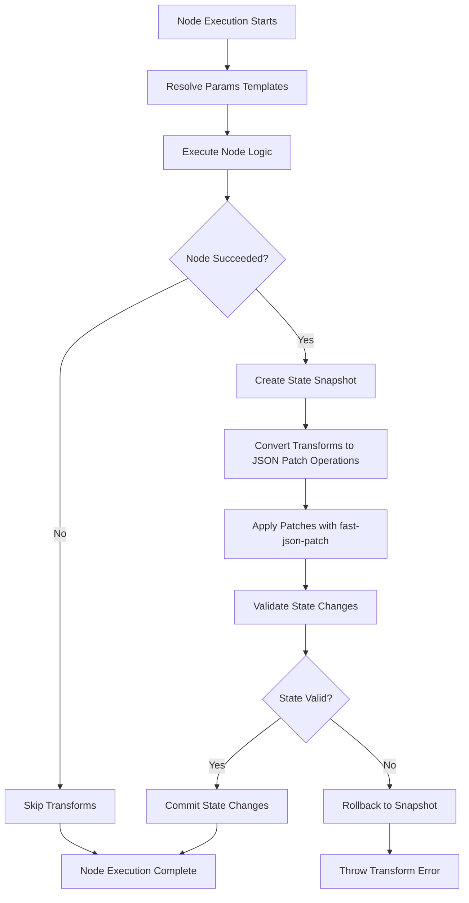

# Template-Based State Management Pattern for Autopilot

## Current Architecture Analysis ✅

Based on the codebase review, here's the current state management architecture:

### Current Flow

1. **Engine** creates handlers with `params` + `execution` context
2. **Execution** contains: `state`, `results`, `status`, `currentNodeRef`, `error`
3. **Params** are static, serialized at blueprint creation time
4. **Template expressions** use `{{ }}` syntax for dynamic value resolution
5. **Transform operations** use JSON Patch operations via `fast-json-patch`

### Existing JSONata Pattern ✅

```typescript
// In Conditional node
const executionContext = {
  state: this.options?.execution?.state || {},
  results: this.options?.execution?.results || [],
  status: this.options?.execution?.status || 'not_started',
  currentNodeRef: this.options?.execution?.currentNodeRef,
};
const result = await expression.evaluate(executionContext);
```

## Template-Based Expression Resolution Design ✅

### 1. Template Syntax Design

**Mustache-like Syntax**: `{{ jsonataExpression }}`

- Simple, familiar syntax
- Clear visual distinction from regular content
- Supports nested expressions and complex JSONata operations

### 2. Template Expression Examples

```typescript
// Simple state value access
'{{ state.userId }}';

// Complex result queries
"{{ results[$ ~> $filter(function($v) { $v.nodeRef = 'user_input' })][-1].data.email }}";

// Function calls with context
'{{ $now() }}';

// Conditional expressions
"{{ state.user.tier = 'premium' ? 'high' : 'normal' }}";

// Nested object access
'{{ state.user.profile.preferences.language }}';
```

### 3. Eval Architecture

```typescript
interface EvalContext {
  state: ExecutionState;
  results: NodeResult[];
  status: ExecutionStatus;
  currentNodeRef?: string;
  // Additional helper functions
  $nodeResult: (nodeRef: string) => NodeResult | undefined;
  $lastResult: () => NodeResult | undefined;
  $now: () => string;
  $random: () => string;
  $count: (array: unknown[]) => number;
}

class Eval {
  private static readonly TEMPLATE_REGEX = /\{\{\s*(.*?)\s*\}\}/g;

  async resolveTemplates(params: any, execution: Execution): Promise<any> {
    const context = this.buildContext(execution);
    return await this.processValue(params, context);
  }

  private async processValue(value: any, context: EvalContext): Promise<any> {
    if (typeof value === 'string') {
      return await this.resolveStringTemplates(value, context);
    } else if (Array.isArray(value)) {
      return await Promise.all(value.map((item) => this.processValue(item, context)));
    } else if (value && typeof value === 'object') {
      return await this.resolveObjectTemplates(value, context);
    }
    return value;
  }

  private async resolveStringTemplates(str: string, context: EvalContext): Promise<string> {
    const matches = Array.from(str.matchAll(Eval.TEMPLATE_REGEX));

    if (matches.length === 0) return str;

    // Handle full-string replacement vs partial replacement
    if (matches.length === 1 && matches[0][0] === str) {
      // Full string is a template - return the actual resolved type
      return await this.evaluateExpression(matches[0][1], context);
    } else {
      // Partial replacement - substitute within string
      let result = str;
      for (const match of matches) {
        const resolved = await this.evaluateExpression(match[1], context);
        result = result.replace(match[0], String(resolved));
      }
      return result;
    }
  }

  private async resolveObjectTemplates(obj: Record<string, any>, context: EvalContext): Promise<any> {
    const result: any = {};
    for (const [key, value] of Object.entries(obj)) {
      result[key] = await this.processValue(value, context);
    }
    return result;
  }

  private async evaluateExpression(expression: string, context: EvalContext): Promise<any> {
    try {
      const jsonataExpr = jsonata(expression.trim());
      return await jsonataExpr.evaluate(context);
    } catch (error) {
      throw new Error(`Expression evaluation failed for "${expression}": ${error instanceof Error ? error.message : 'Unknown error'}`);
    }
  }

  buildContext(execution: Execution): EvalContext {
    return {
      state: execution.state,
      results: execution.results,
      status: execution.status,
      currentNodeRef: execution.currentNodeRef,

      // Helper functions
      $nodeResult: (nodeRef: string) => execution.results.find((r) => r.nodeRef === nodeRef),
      $lastResult: () => execution.results[execution.results.length - 1],
      $now: () => new Date().toISOString(),
      $random: () => Math.random().toString(36).substring(2, 15),
      $count: (array: unknown[]) => (Array.isArray(array) ? array.length : 0),
    };
  }

  hasTemplateExpressions(value: any): boolean {
    if (typeof value === 'string') {
      return Eval.TEMPLATE_REGEX.test(value);
    } else if (Array.isArray(value)) {
      return value.some((item) => this.hasTemplateExpressions(item));
    } else if (value && typeof value === 'object') {
      return Object.values(value).some((val) => this.hasTemplateExpressions(val));
    }
    return false;
  }
}
```

### 4. Template Resolution Examples

```typescript
// Input params with templates
const httpParams = {
  url: 'https://api.example.com/users/{{ state.userId }}',
  method: 'POST',
  body: {
    name: '{{ state.user.name }}',
    email: "{{ $nodeResult('user_input').data.email }}",
    timestamp: '{{ $now() }}',
    isActive: "{{ state.user.lastLogin > $dateTime($now(), '-7 days') }}",
  },
  headers: {
    Authorization: 'Bearer {{ state.auth.token }}',
    'User-Agent': 'Starships-Autopilot/1.0',
  },
};

// After template resolution (example execution state)
const resolvedParams = {
  url: 'https://api.example.com/users/user-123',
  method: 'POST',
  body: {
    name: 'John Doe',
    email: 'john@example.com',
    timestamp: '2024-01-15T10:30:00.000Z',
    isActive: true,
  },
  headers: {
    Authorization: 'Bearer abc123token',
    'User-Agent': 'Starships-Autopilot/1.0',
  },
};
```

### 5. Type Safety and Validation

```typescript
interface TemplateValidationOptions {
  allowedContextKeys?: string[]; // Restrict available context
  requiredExpressions?: string[]; // Expressions that must resolve
  forbiddenFunctions?: string[]; // Block certain JSONata functions
}

class TemplateValidator {
  static validateExpression(expression: string, options?: TemplateValidationOptions): ValidationResult {
    // Parse JSONata expression for security/validation
    // Check for allowed context access
    // Validate function usage
    // Return validation errors if any
  }

  static validateParams(params: any, options?: TemplateValidationOptions): ValidationResult {
    // Recursively find and validate all template expressions
    // Check for circular references
    // Validate expression syntax
  }
}
```

## Transform Operations for State Mutations ✅

### 1. Transform Property Design

The current implementation uses an optional `transforms` property (note the plural) with JSON Patch operations:

```typescript
interface BaseParams {
  transforms?: TransformOperation[];
}

interface TransformOperation {
  /** JSON Patch operation type */
  operation: 'add' | 'replace' | 'remove' | 'copy' | 'move' | 'test';
  /** JSON Pointer path (e.g., "/state/counter", "/state/user/name") */
  path: string;
  /** Value to apply - can be static value or template expression {{ }} */
  value?: unknown;
  /** For copy/move operations - source path */
  from?: string;
}
```

### 2. Transform Syntax and Operations

**JSON Patch Operations** - using standardized RFC 6901 operations:

```typescript
// Transform examples using JSON Patch operations
const transforms = [
  // Simple value assignment
  { operation: 'add', path: '/state/lastExecuted', value: '{{ $now() }}' },

  // Increment counters
  { operation: 'replace', path: '/state/apiCallCount', value: '{{ (state.apiCallCount || 0) + 1 }}' },

  // Complex conditional updates
  {
    operation: 'replace',
    path: '/state/user/status',
    value: "{{ state.user.lastLogin > $dateTime($now(), '-30 days') ? 'active' : 'inactive' }}",
  },

  // Array operations
  { operation: 'add', path: '/state/executionHistory/-', value: { nodeRef: '{{ currentNodeRef }}', timestamp: '{{ $now() }}' } },

  // Nested object updates
  { operation: 'replace', path: '/state/metrics/success', value: '{{ state.metrics.success + 1 }}' },

  // Copy operations
  { operation: 'copy', path: '/state/backup/lastResult', from: '/state/currentResult' },

  // Move operations
  { operation: 'move', path: '/state/archive/oldData', from: '/state/tempData' },

  // Remove operations
  { operation: 'remove', path: '/state/tempData' },

  // Test operations (for validation)
  { operation: 'test', path: '/state/user/tier', value: 'premium' },
];
```

### 3. Transform Processor Architecture

```typescript
class TransformProcessor {
  private safetyManager = new TransformSafetyManager();
  private eval = new Eval();

  async applyTransforms(transforms: TransformOperation[], execution: Execution): Promise<void> {
    if (!transforms || transforms.length === 0) return;

    // Create execution snapshot for rollback
    const executionSnapshot = this.safetyManager.createExecutionSnapshot(execution);

    try {
      // Convert transforms to JSON Patch operations
      const patchOperations = await this.convertToJsonPatchOperations(transforms, execution);

      // Apply patches using fast-json-patch
      const stateWrapper = { state: execution.state };
      const patchedWrapper = applyPatch(stateWrapper, patchOperations, false, false).newDocument;

      // Update execution state
      execution.state = patchedWrapper.state;

      // Validate state changes
      const validation = this.safetyManager.validateStateChanges(executionSnapshot.state, execution.state);
      if (!validation.valid) {
        throw new Error(`State validation failed: ${validation.errors?.map((e) => e.message).join(', ')}`);
      }
    } catch (error) {
      // Rollback state on any failure
      this.safetyManager.rollbackExecution(execution, executionSnapshot);
      throw error;
    }
  }

  private async convertToJsonPatchOperations(transforms: TransformOperation[], execution: Execution): Promise<Operation[]> {
    const operations: Operation[] = [];

    for (const transform of transforms) {
      // Resolve template expressions in the value
      let resolvedValue = transform.value;
      if (transform.value !== undefined) {
        resolvedValue = await this.eval.resolveTemplates(transform.value, execution);
      }

      // Resolve template expressions in the from path (for copy/move operations)
      let resolvedFrom = transform.from;
      if (transform.from !== undefined) {
        resolvedFrom = (await this.eval.resolveTemplates(transform.from, execution)) as string;
      }

      // Create JSON Patch operation
      const operation = this.createJsonPatchOperation(transform, resolvedValue, resolvedFrom);
      operations.push(operation);
    }

    return operations;
  }
}
```

### 4. Transform Execution Examples

```typescript
// HTTP Request node with state tracking
{
  type: "http_request",
  parameters: {
    url: "{{ state.apiEndpoint }}/users",
    method: "POST",
    body: {
      data: "{{ $nodeResult('form_input').data }}"
    },
    transforms: [
      // Track API usage
      { operation: 'replace', path: '/state/apiCallCount', value: '{{ (state.apiCallCount || 0) + 1 }}' },
      { operation: 'add', path: '/state/lastApiCall', value: '{{ $now() }}' },

      // Update user session state
      { operation: 'replace', path: '/state/session/lastActivity', value: '{{ $now() }}' },

      // Add to request history array
      { operation: 'add', path: '/state/requestHistory/-', value: { url: '{{ state.apiEndpoint }}/users', timestamp: '{{ $now() }}' } }
    ]
  }
}

// Agent node with conversation tracking
{
  type: "agent",
  parameters: {
    name: "Customer Support",
    model: "anthropic/claude-3.5-sonnet",
    memoryState: {
      identity: { name: "Sarah", role: "Support Agent" }
    },
    blueprint: { /* nested workflow */ },
    transforms: [
      // Track conversation metadata
      { operation: 'add', path: '/state/conversation/agentAssigned', value: 'customer_support' },
      { operation: 'add', path: '/state/conversation/startTime', value: '{{ state.conversation.startTime || $now() }}' },

      // Update user interaction history
      { operation: 'add', path: '/state/user/interactions/-', value: { type: 'agent', timestamp: '{{ $now() }}' } },

      // Dynamic priority assignment
      { operation: 'add', path: '/state/conversation/priority', value: "{{ state.user.tier = 'premium' ? 'high' : (state.session.errorCount > 3 ? 'urgent' : 'normal') }}" }
    ]
  }
}
```

### 5. Transform Safety and Atomicity

```typescript
class TransformSafetyManager {
  /**
   * Create state snapshot before applying transforms
   */
  createExecutionSnapshot(execution: Execution): Execution {
    return deepClone(execution);
  }

  /**
   * Rollback execution if transforms fail
   */
  rollbackExecution(execution: Execution, snapshot: Execution): void {
    execution.state = snapshot.state;
    // Note: Don't rollback results as they represent the actual node execution
  }

  /**
   * Validate state changes don't break execution
   */
  validateStateChanges(beforeState: ExecutionState, afterState: ExecutionState): ValidationResult {
    const errors: ValidationError[] = [];

    // Basic validation - ensure state is still an object
    if (!afterState || typeof afterState !== 'object') {
      errors.push({
        code: 'INVALID_PARAMETERS',
        message: 'Transform operations resulted in invalid state structure',
      });
    }

    return {
      valid: errors.length === 0,
      errors,
    };
  }
}
```

### 6. Transform Execution Flow



## Benefits of JSON Patch Transform Operations

1. **Standardized**: Uses RFC 6901 JSON Patch standard for predictable operations
2. **Atomic**: All transforms in an array are applied atomically with rollback on failure
3. **Powerful**: Supports all JSON Patch operations (add, replace, remove, copy, move, test)
4. **Safe**: Path validation ensures only `/state` can be modified
5. **Template-aware**: Values can use template expressions with `{{ }}` syntax
6. **Type-safe**: Full TypeScript support with proper operation types
7. **Validated**: Operations are validated at blueprint parse time
8. **Performance**: Uses `fast-json-patch` library for efficient patch operations
9. **Rollback Support**: Deep cloning and snapshot management for safe state mutations

This JSON Patch-based transform system provides robust, standardized state mutations while maintaining the flexibility and power needed for complex workflow orchestration.
