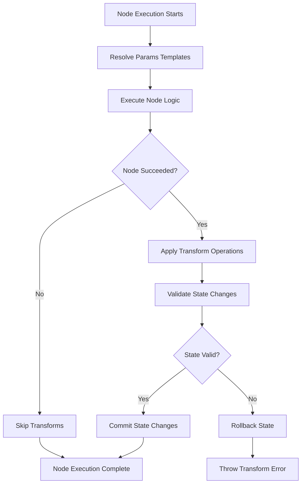

# Template-Based State Management Pattern for Autopilot

## Current Architecture Analysis ✅

Based on the codebase review, here's the current state management architecture:

### Current Flow

1. **Engine** creates handlers with `params` + `execution` context
2. **Execution** contains: `state`, `results`, `status`, `currentNodeRef`, `error`
3. **Params** are static, serialized at blueprint creation time
4. **Conditional node** already uses JSONata to query execution state read-only

### Existing JSONata Pattern ✅

```typescript
// In Conditional node
const executionContext = {
  state: this.options?.execution?.state || {},
  results: this.options?.execution?.results || [],
  status: this.options?.execution?.status || 'not_started',
  currentNodeRef: this.options?.execution?.currentNodeRef,
};
const result = await expression.evaluate(executionContext);
```

## Template-Based Expression Resolution Design ✅

### 1. Template Syntax Design

**Mustache-like Syntax**: `{{ jsonataExpression }}`

- Simple, familiar syntax
- Clear visual distinction from regular content
- Supports nested expressions and complex JSONata operations

### 2. Template Expression Examples

```typescript
// Simple state value access
'{{ state.userId }}';

// Complex result queries
"{{ results[$ ~> $filter(function($v) { $v.nodeRef = 'user_input' })][-1].data.email }}";

// Function calls with context
'{{ $now() }}';

// Conditional expressions
"{{ state.user.tier = 'premium' ? 'high' : 'normal' }}";

// Nested object access
'{{ state.user.profile.preferences.language }}';
```

### 3. Eval Architecture

```typescript
interface EvalContext {
  state: ExecutionState;
  results: NodeResult[];
  status: ExecutionStatus;
  currentNodeRef?: string;
  // Additional helper functions
  $nodeResult: (nodeRef: string) => NodeResult | undefined;
  $lastResult: () => NodeResult | undefined;
  $now: () => string;
  $random: () => string;
  $count: (array: unknown[]) => number;
}

class Eval {
  private static readonly TEMPLATE_REGEX = /\{\{\s*(.*?)\s*\}\}/g;

  async resolveTemplates(params: any, execution: Execution): Promise<any> {
    const context = this.buildContext(execution);
    return await this.processValue(params, context);
  }

  private async processValue(value: any, context: EvalContext): Promise<any> {
    if (typeof value === 'string') {
      return await this.resolveStringTemplates(value, context);
    } else if (Array.isArray(value)) {
      return await Promise.all(value.map((item) => this.processValue(item, context)));
    } else if (value && typeof value === 'object') {
      return await this.resolveObjectTemplates(value, context);
    }
    return value;
  }

  private async resolveStringTemplates(str: string, context: EvalContext): Promise<string> {
    const matches = Array.from(str.matchAll(Eval.TEMPLATE_REGEX));

    if (matches.length === 0) return str;

    // Handle full-string replacement vs partial replacement
    if (matches.length === 1 && matches[0][0] === str) {
      // Full string is a template - return the actual resolved type
      return await this.evaluateExpression(matches[0][1], context);
    } else {
      // Partial replacement - substitute within string
      let result = str;
      for (const match of matches) {
        const resolved = await this.evaluateExpression(match[1], context);
        result = result.replace(match[0], String(resolved));
      }
      return result;
    }
  }

  private async resolveObjectTemplates(obj: Record<string, any>, context: EvalContext): Promise<any> {
    const result: any = {};
    for (const [key, value] of Object.entries(obj)) {
      result[key] = await this.processValue(value, context);
    }
    return result;
  }

  private async evaluateExpression(expression: string, context: EvalContext): Promise<any> {
    try {
      const jsonataExpr = jsonata(expression.trim());
      return await jsonataExpr.evaluate(context);
    } catch (error) {
      throw new Error(`Expression evaluation failed for "${expression}": ${error instanceof Error ? error.message : 'Unknown error'}`);
    }
  }

  buildContext(execution: Execution): EvalContext {
    return {
      state: execution.state,
      results: execution.results,
      status: execution.status,
      currentNodeRef: execution.currentNodeRef,

      // Helper functions
      $nodeResult: (nodeRef: string) => execution.results.find((r) => r.nodeRef === nodeRef),
      $lastResult: () => execution.results[execution.results.length - 1],
      $now: () => new Date().toISOString(),
      $random: () => Math.random().toString(36).substring(2, 15),
      $count: (array: unknown[]) => (Array.isArray(array) ? array.length : 0),
    };
  }

  hasTemplateExpressions(value: any): boolean {
    if (typeof value === 'string') {
      return Eval.TEMPLATE_REGEX.test(value);
    } else if (Array.isArray(value)) {
      return value.some((item) => this.hasTemplateExpressions(item));
    } else if (value && typeof value === 'object') {
      return Object.values(value).some((val) => this.hasTemplateExpressions(val));
    }
    return false;
  }
}
```

### 4. Template Resolution Examples

```typescript
// Input params with templates
const httpParams = {
  url: 'https://api.example.com/users/{{ state.userId }}',
  method: 'POST',
  body: {
    name: '{{ state.user.name }}',
    email: "{{ $nodeResult('user_input').data.email }}",
    timestamp: '{{ $now() }}',
    isActive: "{{ state.user.lastLogin > $dateTime($now(), '-7 days') }}",
  },
  headers: {
    Authorization: 'Bearer {{ state.auth.token }}',
    'User-Agent': 'Starships-Autopilot/1.0',
  },
};

// After template resolution (example execution state)
const resolvedParams = {
  url: 'https://api.example.com/users/user-123',
  method: 'POST',
  body: {
    name: 'John Doe',
    email: 'john@example.com',
    timestamp: '2024-01-15T10:30:00.000Z',
    isActive: true,
  },
  headers: {
    Authorization: 'Bearer abc123token',
    'User-Agent': 'Starships-Autopilot/1.0',
  },
};
```

### 5. Type Safety and Validation

```typescript
interface TemplateValidationOptions {
  allowedContextKeys?: string[]; // Restrict available context
  requiredExpressions?: string[]; // Expressions that must resolve
  forbiddenFunctions?: string[]; // Block certain JSONata functions
}

class TemplateValidator {
  static validateExpression(expression: string, options?: TemplateValidationOptions): ValidationResult {
    // Parse JSONata expression for security/validation
    // Check for allowed context access
    // Validate function usage
    // Return validation errors if any
  }

  static validateParams(params: any, options?: TemplateValidationOptions): ValidationResult {
    // Recursively find and validate all template expressions
    // Check for circular references
    // Validate expression syntax
  }
}
```

## Transform Operations for State Mutations ✅

### 1. Transform Property Design

Add an optional `transform` property to all node parameter interfaces:

```typescript
interface BaseNodeParams {
  // ... existing params
  transform?: string | string[]; // JSONata assignment expressions
}

// Examples of parameter types with transforms
interface HttpRequestParams extends BaseNodeParams {
  url: string;
  method?: string;
  body?: any;
  headers?: Record<string, string>;
  transform?: string | string[];
}

interface AgentParams extends BaseNodeParams {
  name: string;
  model: string;
  memoryState: AgentMemoryState;
  blueprint: Blueprint;
  transform?: string | string[];
}
```

### 2. Transform Syntax and Operations

**JSONata Assignment Expressions** - using `:=` operator for state mutations:

```typescript
// Transform examples
const transforms = [
  // Simple value assignment
  'state.lastExecuted := $now()',

  // Increment counters
  'state.apiCallCount := (state.apiCallCount ? state.apiCallCount : 0) + 1',

  // Complex conditional updates
  "state.user.status := state.user.lastLogin > $dateTime($now(), '-30 days') ? 'active' : 'inactive'",

  // Array operations
  "state.executionHistory := $append(state.executionHistory ? state.executionHistory : [], {'nodeRef': currentNodeRef, 'timestamp': $now()})",

  // Nested object updates
  'state.metrics.success := state.metrics.success + 1',

  // Conditional transforms based on node results
  'state.lastError := $lastResult().error ? $lastResult().error : null',
];
```

### 3. Transform Processor Architecture

```typescript
interface TransformContext extends TemplateContext {
  // Additional helpers for mutations
  $increment: (path: string, amount?: number) => void;
  $append: (array: any[], item: any) => any[];
  $merge: (target: any, source: any) => any;
  $deleteKey: (obj: any, key: string) => any;
}

class TransformProcessor {
  async applyTransforms(transforms: string | string[], execution: Execution, nodeResult?: NodeResult): Promise<void> {
    const transformArray = Array.isArray(transforms) ? transforms : [transforms];
    const context = this.buildTransformContext(execution, nodeResult);

    // Apply transforms sequentially to maintain order
    for (const transform of transformArray) {
      await this.applySingleTransform(transform, execution, context);
    }
  }

  private async applySingleTransform(transform: string, execution: Execution, context: TransformContext): Promise<void> {
    try {
      // Parse and validate assignment expression
      this.validateTransformSyntax(transform);

      // Create JSONata expression
      const expr = jsonata(transform);

      // Apply transform to execution state
      // JSONata assignment expressions modify the context object directly
      await expr.evaluate(context);
    } catch (error) {
      throw new Error(`Transform failed for expression "${transform}": ${error}`);
    }
  }

  private validateTransformSyntax(transform: string): void {
    // Check for assignment operator
    if (!transform.includes(':=')) {
      throw new Error('Transform expressions must use assignment operator (:=)');
    }

    // Validate that left side starts with 'state.'
    const leftSide = transform.split(':=')[0].trim();
    if (!leftSide.startsWith('state.')) {
      throw new Error('Transform expressions can only modify execution state');
    }

    // Additional security checks
    this.checkForbiddenOperations(transform);
  }

  private checkForbiddenOperations(transform: string): void {
    const forbidden = ['eval', 'Function', 'require', 'import'];
    for (const op of forbidden) {
      if (transform.includes(op)) {
        throw new Error(`Forbidden operation "${op}" in transform expression`);
      }
    }
  }

  private buildTransformContext(execution: Execution, nodeResult?: NodeResult): TransformContext {
    // Create a mutable reference to state for assignments
    const context = {
      state: execution.state, // This will be mutated by JSONata assignments
      results: execution.results,
      status: execution.status,
      currentNodeRef: execution.currentNodeRef,

      // Include current node result if provided
      $currentResult: () => nodeResult,
      $nodeResult: (nodeRef: string) => execution.results.find((r) => r.nodeRef === nodeRef),
      $lastResult: () => execution.results[execution.results.length - 1],
      $now: () => new Date().toISOString(),

      // Helper functions for common operations
      $increment: (path: string, amount = 1) => {
        const expr = jsonata(`${path} := (${path} ? ${path} : 0) + ${amount}`);
        return expr.evaluate(context);
      },

      $append: (array: any[], item: any) => {
        return Array.isArray(array) ? [...array, item] : [item];
      },

      $merge: (target: any, source: any) => {
        return { ...target, ...source };
      },
    };

    return context;
  }
}
```

### 4. Transform Execution Examples

```typescript
// HTTP Request node with state tracking
{
  type: "http_request",
  parameters: {
    url: "{{ state.apiEndpoint }}/users",
    method: "POST",
    body: {
      data: "{{ $nodeResult('form_input').data }}"
    },
    transform: [
      // Track API usage
      "state.apiCallCount := (state.apiCallCount ? state.apiCallCount : 0) + 1",
      "state.lastApiCall := $now()",

      // Update user session state
      "state.session.lastActivity := $now()",

      // Conditional error tracking
      "state.session.errorCount := $currentResult().error ? state.session.errorCount + 1 : state.session.errorCount"
    ]
  }
}

// Agent node with conversation tracking
{
  type: "agent",
  parameters: {
    name: "Customer Support",
    model: "anthropic/claude-3.5-sonnet",
    memoryState: {
      identity: { name: "Sarah", role: "Support Agent" }
    },
    blueprint: { /* nested workflow */ },
    transform: [
      // Track conversation metadata
      "state.conversation.agentAssigned := 'customer_support'",
      "state.conversation.startTime := state.conversation.startTime ? state.conversation.startTime : $now()",

      // Update user interaction history
      "state.user.interactions := $append(state.user.interactions ? state.user.interactions : [], {'type': 'agent', 'timestamp': $now()})",

      // Dynamic priority assignment
      "state.conversation.priority := state.user.tier = 'premium' ? 'high' : (state.session.errorCount > 3 ? 'urgent' : 'normal')"
    ]
  }
}
```

### 5. Transform Safety and Atomicity

```typescript
class TransformSafetyManager {
  // Create state snapshot before applying transforms
  createStateSnapshot(execution: Execution): ExecutionState {
    return JSON.parse(JSON.stringify(execution.state));
  }

  // Rollback state if transforms fail
  rollbackState(execution: Execution, snapshot: ExecutionState): void {
    execution.state = snapshot;
  }

  // Validate state changes don't break execution
  validateStateChanges(beforeState: ExecutionState, afterState: ExecutionState): ValidationResult {
    // Check for breaking changes
    // Validate state structure integrity
    // Ensure no critical keys were deleted
    return { valid: true, errors: [] };
  }
}
```

### 6. Transform Execution Flow



## Benefits of Transform Operations

1. **Declarative State Management**: Clear, readable state mutations
2. **Conditional Logic**: Transforms can include complex business rules
3. **Execution Context Aware**: Full access to execution state and results
4. **Atomic Operations**: Transforms are applied atomically with rollback on failure
5. **Serializable**: All logic stored as JSON-compatible strings
6. **Order Dependent**: Transform array maintains execution order
7. **Side-effect Free**: Pure functions that only modify designated state

This transform system provides the "mutate" capability you need, complementing the template expressions for state queries.
