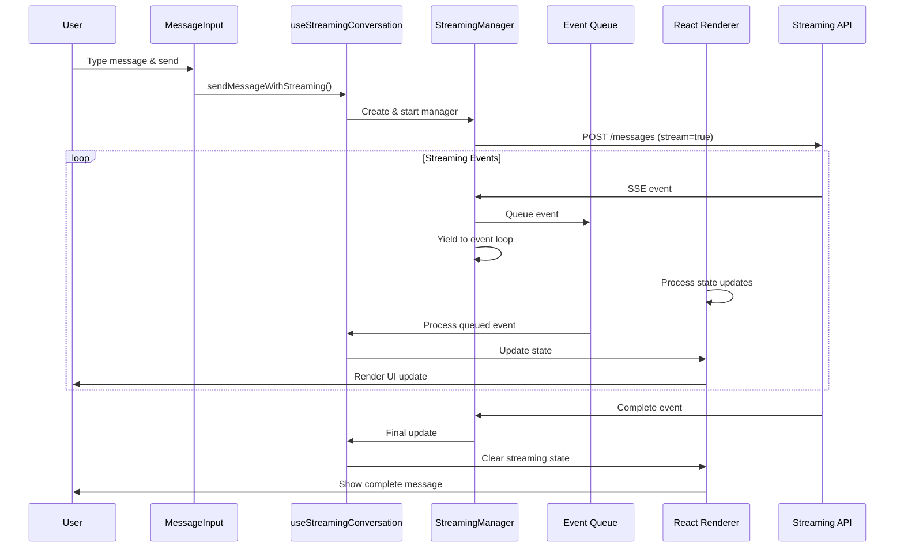

# Streaming Integration - Client Implementation

This document explains the client-side streaming implementation that integrates with the server's streaming infrastructure.

## Overview

The client implements real-time streaming for AI agent conversations using Server-Sent Events (SSE) with a **non-blocking architecture** that ensures smooth UI updates during streaming.

## Architecture

```
┌─────────────────────────────────────────────────────────┐
│                  Client Components                      │
├─────────────────────────────────────────────────────────┤
│  ConversationInterface                                  │
│  ├── ConversationMessageInput (streaming-enabled)      │
│  ├── ConversationMessageList (optimized rendering)     │
│  └── MessageContent (streaming indicators)             │
├─────────────────────────────────────────────────────────┤
│  useStreamingConversation Hook (NEW)                    │
│  ├── Non-blocking SSE Management                        │
│  ├── Event Queue Processing                             │
│  └── Optimized State Updates                            │
├─────────────────────────────────────────────────────────┤
│  StreamingManager Class (NEW)                           │
│  ├── Event Loop Yielding                                │
│  ├── Queue-based Processing                             │
│  └── RequestIdleCallback Integration                    │
├─────────────────────────────────────────────────────────┤
│  Protocol Layer (@starships/protocol)                   │
│  ├── StreamingChunk Types                               │
│  ├── StreamingState Types                               │
│  └── SSE Event Contracts                                │
└─────────────────────────────────────────────────────────┘
```

## Key Components

### StreamingManager Class (NEW)

Located at `src/lib/streaming-manager.ts`

**Responsibilities:**

- Manages SSE connections without blocking the event loop
- Queues streaming events for asynchronous processing
- Yields control to React for UI updates between events
- Uses `requestIdleCallback` for optimal scheduling

**Key Features:**

- **Non-blocking event processing**: Events are queued and processed asynchronously
- **Event loop yielding**: After each event, control is yielded back to the browser
- **Smart scheduling**: Uses `requestIdleCallback` when available for optimal performance
- **Graceful degradation**: Falls back to `setTimeout(0)` in older browsers

**Usage:**

```typescript
const manager = new StreamingManager({
  url: '/api/streaming',
  onEvent: async event => {
    // Process event without blocking
    updateState(event.data)
  },
  onError: error => console.error(error),
})

await manager.start()
```

### useStreamingConversation Hook

Located at `src/hooks/useStreamingConversation.ts`

**Responsibilities:**

- Provides a React-friendly interface to StreamingManager
- Manages streaming state with optimized updates
- Integrates with TanStack Query for data consistency
- Handles conversation-specific streaming logic

**Key Features:**

- **Non-blocking streaming**: Uses StreamingManager for event processing
- **Optimized React updates**: Batches state updates efficiently
- **Memory efficient**: Cleans up resources properly
- **Error resilient**: Handles connection failures gracefully

**Usage:**

```typescript
const { sendMessageWithStreaming, isStreaming, streamingContent, stopStreaming } = useStreamingConversation(conversationId)
```

### ConversationMessageList (Updated)

**Optimizations:**

- **Memoized message bubbles**: Prevents unnecessary re-renders
- **Smart scrolling**: Uses `requestAnimationFrame` for smooth scrolling
- **Efficient diff detection**: Custom comparison for streaming messages
- **Optimized rendering**: Only re-renders changed messages

### ConversationMessageInput (Updated)

**Integration Changes:**

- Uses `useStreamingConversation` for non-blocking streaming
- Supports stop streaming functionality
- Shows real-time streaming status
- Handles streaming states gracefully

## Non-Blocking Streaming Flow



## Key Improvements in 2025 Architecture

### 1. Non-Blocking Event Processing

**Problem**: SSE streaming was blocking the JavaScript event loop, preventing React from processing state updates until the entire stream completed.

**Solution**: Implemented queue-based event processing with explicit yielding:

```typescript
// Event processing with yielding
private async processEventQueue(): Promise<void> {
  while (this.isStreaming || this.eventQueue.length > 0) {
    if (this.eventQueue.length > 0) {
      const event = this.eventQueue.shift()!

      // Process the event
      await this.options.onEvent(event)

      // Yield control to the event loop
      await this.yieldToEventLoop()
    }
  }
}

// Smart yielding using requestIdleCallback
private yieldToEventLoop(): Promise<void> {
  return new Promise(resolve => {
    if ('requestIdleCallback' in window) {
      requestIdleCallback(() => resolve())
    } else {
      setTimeout(resolve, 0)
    }
  })
}
```

### 2. Optimized React Rendering

**Problem**: Excessive re-renders during streaming caused performance issues.

**Solution**: Implemented memoization and smart comparison:

```typescript
// Memoized message component with custom comparison
const MemoizedMessageBubble = memo(MessageBubble, (prev, next) => {
  if (prev.message.id !== next.message.id) return false
  if (prev.message.streaming !== next.message.streaming) return false
  if (prev.message.streaming) {
    // Only re-render streaming messages if content changed
    return prev.message.content === next.message.content
  }
  return true
})
```

### 3. Separated Streaming Logic

**Problem**: Streaming logic was tightly coupled with conversation management.

**Solution**: Created dedicated streaming hooks and managers:

- `StreamingManager`: Handles low-level SSE connections
- `useStreamingConversation`: Provides React integration
- `useConversation`: Manages base conversation data

This separation allows for:

- Better testability
- Easier maintenance
- Flexible streaming strategies
- Reusable components

## Performance Considerations

### Memory Management

- Event queues are cleaned up after processing
- Streaming content is cleared after completion
- SSE connections are properly closed
- React components are memoized

### CPU Optimization

- Uses `requestIdleCallback` for non-critical updates
- Batches state updates when possible
- Minimizes React re-renders
- Efficient scroll handling with `requestAnimationFrame`

### Network Efficiency

- Reuses SSE connections where possible
- Implements automatic reconnection
- Handles connection failures gracefully
- Supports streaming cancellation

## Browser Support

- **Modern Browsers**: Full support with `requestIdleCallback`
- **Legacy Browsers**: Graceful degradation with `setTimeout`
- **Mobile**: Optimized for mobile networks and devices
- **SSE Support**: Automatic fallback for unsupported browsers

## Development & Testing

### Enable Debug Logging

```typescript
// In StreamingManager
console.log('[StreamingManager] Event processed')

// In useStreamingConversation
console.log('[Streaming] State updated')
```

### Testing Streaming

```bash
# Start development server
pnpm dev

# Test streaming behavior
1. Open conversation interface
2. Send a message
3. Observe real-time streaming without UI freezing
4. Check React DevTools for render patterns
```

### Performance Monitoring

Use Chrome DevTools Performance tab to verify:

- No long tasks during streaming
- Smooth 60fps during updates
- Efficient memory usage
- Proper event loop scheduling

## Security

- **Authentication**: JWT tokens included in SSE requests
- **CORS**: Proper cross-origin handling
- **Data Validation**: All streaming data is validated
- **XSS Protection**: Content is sanitized before rendering

## Future Enhancements

1. **Web Worker Integration**: Move stream processing to a worker thread
2. **Virtual Scrolling**: For conversations with thousands of messages
3. **Streaming Compression**: Reduce bandwidth usage
4. **Progressive Enhancement**: Better offline support
5. **WebTransport**: Migration path for better performance

---

This streaming implementation provides real-time updates without blocking the UI, ensuring a smooth and responsive user experience during AI conversations.
