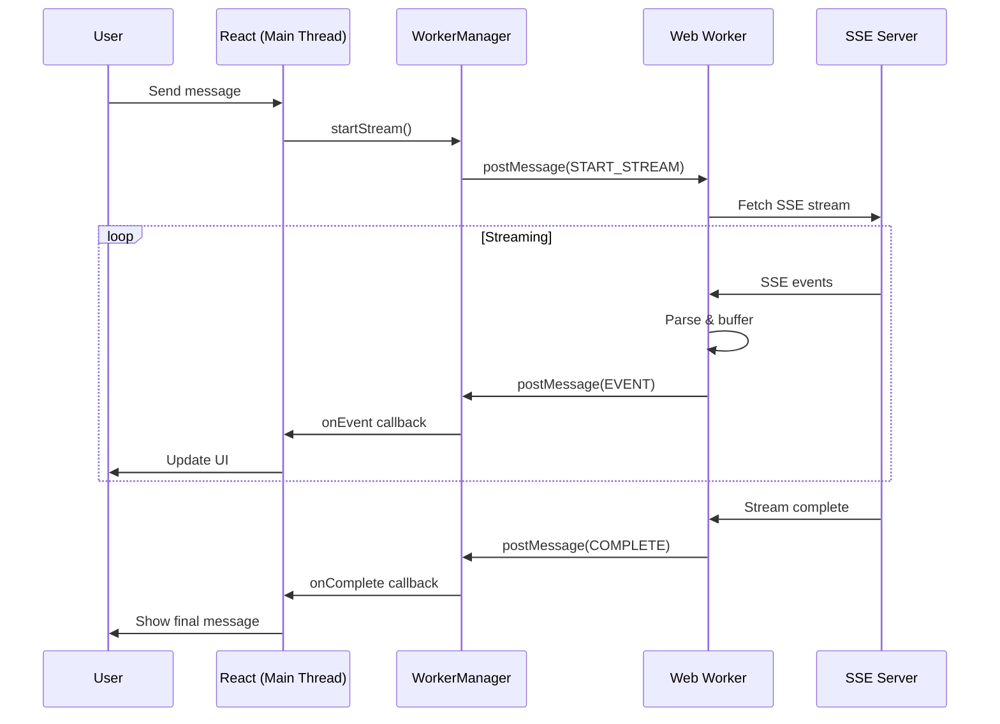

# Streaming Integration - Web Worker Implementation

This document explains the client-side streaming implementation using Web Workers to prevent event loop blocking.

## Overview

The client implements real-time streaming for AI agent conversations using Server-Sent Events (SSE) processed in a Web Worker, ensuring the main thread remains completely responsive.

## Architecture

```
┌─────────────────────────────────────────────────────────┐
│                     Main Thread (UI)                     │
├─────────────────────────────────────────────────────────┤
│  React Components                                        │
│  ├── ConversationInterface                              │
│  ├── ConversationMessageList                            │
│  └── ConversationMessageInput                           │
├─────────────────────────────────────────────────────────┤
│  useStreamingConversation Hook                          │
│  └── StreamingWorkerManager                             │
└─────────────────────────────────────────────────────────┘
                           │
                    PostMessage API
                           │
┌─────────────────────────────────────────────────────────┐
│                  Web Worker Thread                       │
├─────────────────────────────────────────────────────────┤
│  streaming.worker.js                                     │
│  ├── SSE Connection Management                           │
│  ├── Event Parsing & Buffering                          │
│  ├── Stream Processing                                   │
│  └── Error Handling                                      │
└─────────────────────────────────────────────────────────┘
```

## Key Components

### Web Worker (`public/streaming.worker.js`)

**Responsibilities:**

- Handles all SSE connections in a separate thread
- Parses SSE events and buffers incomplete messages
- Communicates with main thread via postMessage
- Manages multiple concurrent streams

### StreamingWorkerManager (`src/lib/streaming-worker-manager.ts`)

**Responsibilities:**

- Creates and manages the Web Worker instance
- Provides clean API for starting/stopping streams
- Routes messages between React and Worker
- Implements singleton pattern for efficiency

### useStreamingConversation Hook (`src/hooks/useStreamingConversation.ts`)

**Responsibilities:**

- React interface for streaming operations
- Manages streaming state
- Updates TanStack Query cache with streamed data
- Handles conversation-specific logic

## How It Works

1. **User sends a message**: The UI component calls `sendMessageWithStreaming()`
2. **Worker starts streaming**: Request is sent to Web Worker which establishes SSE connection
3. **Worker processes events**: All SSE parsing happens in the worker thread
4. **Main thread updates UI**: Lightweight messages update React state
5. **UI remains responsive**: Main thread is never blocked

## Streaming Flow



## Benefits

1. **True Non-Blocking**: SSE processing in separate thread
2. **Smooth UI**: Main thread free for React rendering
3. **Better Performance**: No event loop blocking
4. **Scalable**: Handles multiple concurrent streams
5. **Error Isolation**: Worker crashes don't affect UI

## Consistency and Ordering (Unified Streaming Semantics)

To ensure message rendering matches database order exactly and to eliminate duplicate user bubbles, the client and server follow these rules:

- No optimistic user bubble during streaming:
  - The client does not pre-render a user message when `stream: true`. The server persists the user message and emits a JSON-Patch add operation, which the client applies to render the user bubble once.
  - Implemented in [useConversation()](packages/client/src/hooks/useConversations.ts:571) by skipping optimistic insert when `variables.stream` is true and relying on server deltas.

- Strict ascending ordering by `createdAt`:
  - The client requests messages ordered ascending and appends new ones at the end, matching DB order.
  - See [useConversation() initial fetch params](packages/client/src/hooks/useConversations.ts:136) and appends in cache updates.

- Stable placeholder targeting via normalized JSON-Patch:
  - The server emits deltas with paths normalized to concrete numeric indexes derived from a per-connection baseline and running add count.
  - Placeholder operations target the most recent assistant shell using `/messages/-1/...` which is normalized on the server to the correct index.
  - See [StreamingService.normalizeDelta()](packages/server/src/services/StreamingService.ts:149).

- Assistant streaming lifecycle:
  - Shell added: `add /messages/-` with `{ streaming: true, content: '' , contentChunks: [] }`.
  - Chunks streamed: `add /messages/-1/contentChunks/-` with positional data.
  - Completion: `replace /messages/-1/content` (final text), `replace /messages/-1/streaming false`, `remove /messages/-1/contentChunks`, followed by final ID/updatedAt patch.
  - Implemented in [ConversationService.eventCallback()](packages/server/src/services/ConversationService.ts:204).

- Event types:
  - JSON-Patch deltas are sent as SSE `event: delta` with a single RFC6902 op as data (client auto-detects).
  - Full messages may be sent as SSE `event: message` with a `MessageModel` body. The client accepts raw message objects (presence of `role` is sufficient).
  - Defined in [StreamingEvent/SSEEventType](packages/protocol/src/contracts/streaming.ts:41).

This model yields: user types → server persists → JSON-Patch add renders user once → assistant shell added → chunks applied to that shell → completion finalizes → DB order preserved across API and SSE.

## Usage

```typescript
// In your React component
const { sendMessageWithStreaming, isStreaming, streamingContent, stopStreaming } = useStreamingConversation(conversationId)

// Send a message with streaming
await sendMessageWithStreaming(message, {
  agentId: agent.id,
  conversationId: conversationId,
})

// Stop streaming if needed
stopStreaming()
```

## Testing

```bash
# Start development server
pnpm dev

# Test streaming
1. Open the conversation interface
2. Send a message to an AI agent
3. Observe real-time streaming without UI blocking
4. Try interacting with other UI elements while streaming
```

## Browser Support

- Modern browsers with Web Worker support (all major browsers)
- SSE support required (polyfilled if needed)
- Falls back gracefully if Workers unavailable

## Security

- JWT tokens included in SSE requests
- Worker runs in isolated context
- No direct DOM access from worker
- Proper error boundaries

---

This implementation ensures complete non-blocking streaming by offloading all SSE processing to a Web Worker thread.
