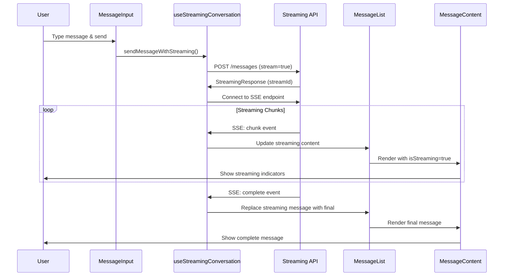

# Streaming Integration - Client Implementation

This document explains the client-side streaming implementation that integrates with the server's streaming infrastructure.

## Overview

The client implements real-time streaming for AI agent conversations using Server-Sent Events (SSE), providing users with immediate feedback as AI responses are generated.

## Architecture

```
┌─────────────────────────────────────────────────────────┐
│                  Client Components                      │
├─────────────────────────────────────────────────────────┤
│  ConversationInterface                                  │
│  ├── ConversationMessageInput (streaming-enabled)      │
│  ├── ConversationMessageList (streaming display)       │
│  └── MessageContent (streaming indicators)             │
├─────────────────────────────────────────────────────────┤
│  useStreamingConversation Hook                          │
│  ├── SSE Connection Management                          │
│  ├── Streaming State Management                         │
│  └── Optimistic UI Updates                              │
├─────────────────────────────────────────────────────────┤
│  Protocol Layer (@starships/protocol)                   │
│  ├── StreamingChunk Types                               │
│  ├── StreamingState Types                               │
│  └── SSE Event Contracts                                │
└─────────────────────────────────────────────────────────┘
```

## Key Components

### useStreamingConversation Hook

Located at `src/hooks/useStreamingConversation.ts`

**Responsibilities:**

- Manages SSE connections to the streaming endpoint
- Handles real-time chunk processing
- Provides streaming state and content to components
- Integrates with TanStack Query for data consistency

**Key Features:**

- Automatic connection management
- Error handling and recovery
- Optimistic UI updates
- Streaming content accumulation

**Usage:**

```typescript
const { sendMessageWithStreaming, streamingState, isStreaming, streamingContent } = useStreamingConversation()
```

### ConversationMessageInput

**Integration Changes:**

- Uses `sendMessageWithStreaming` instead of regular `sendMessage`
- Disables input during streaming to prevent multiple requests
- Shows loading indicators during streaming

### ConversationMessageList

**Integration Changes:**

- Displays temporary streaming messages in real-time
- Combines regular messages with streaming content
- Passes streaming state to individual message components

### MessageContent

**Integration Changes:**

- Shows streaming indicators (animated cursor, "thinking..." text)
- Handles incomplete markdown during streaming
- Displays real-time content updates

## Streaming Flow



## Streaming States

The client manages several streaming states:

```typescript
interface StreamingState {
  status: 'idle' | 'connecting' | 'streaming' | 'complete' | 'error'
  streamId: string | null
  content: string // Accumulated streaming content
  error: StreamingError | null
  isStreaming: boolean
}
```

## Error Handling

- **Connection Errors**: Automatic reconnection attempts
- **Stream Errors**: Fallback to non-streaming requests
- **Network Issues**: User-friendly error messages
- **Timeout Handling**: Configurable timeouts with recovery

## Visual Indicators

### During Streaming

- Animated thinking indicator
- Streaming cursor (blinking)
- Disabled input state
- Progress feedback

### Error States

- Connection error notifications
- Retry options
- Fallback messaging

## Development

### Testing Streaming

```bash
# Start development server
pnpm dev

# In browser, navigate to conversation
# Send a message to see streaming in action
```

### Debug Mode

Enable streaming debug logs:

```typescript
// In useStreamingConversation.ts
const DEBUG_STREAMING = true
```

## Performance Considerations

- **Memory Management**: Streaming content is cleaned up after completion
- **Connection Pooling**: SSE connections are reused where possible
- **Rate Limiting**: Client-side throttling prevents spam
- **Fallback Strategy**: Graceful degradation for unsupported browsers

## Browser Support

- **Modern Browsers**: Full SSE support
- **Legacy Browsers**: Automatic fallback to polling
- **Mobile**: Optimized for mobile networks

## Security

- **Authentication**: JWT tokens included in SSE requests
- **CORS**: Proper cross-origin handling
- **Data Validation**: All streaming data is validated client-side

---

This streaming implementation provides a seamless real-time experience while maintaining robustness and performance across different scenarios.
