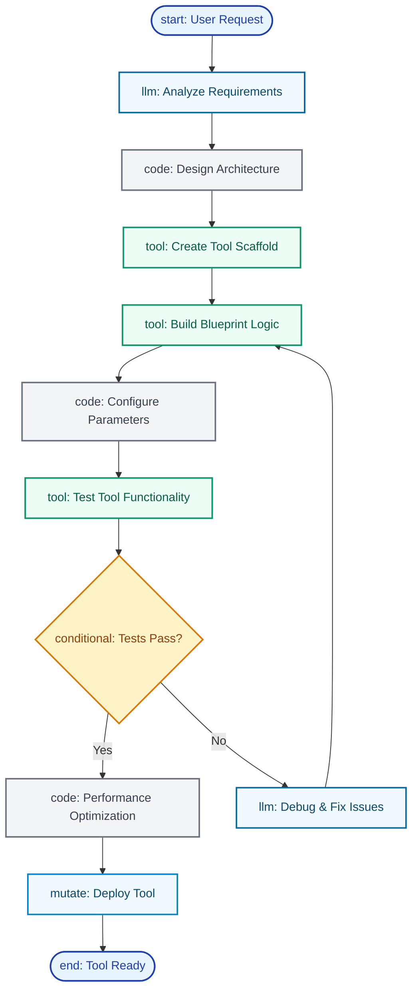

import {
  Code,
  Wrench,
  Workflow,
  Settings,
  CheckCircle,
  Bot,
  Network,
  Cpu,
  Zap,
  Brain,
  Search,
  BarChart,
  MessageSquare,
  Globe,
} from 'lucide-react';

<Callout type="success">
  **Build Any Tool**: From simple API integrations to complex multi-system workflows - Daedalus creates production-ready tools through
  conversation.
</Callout>

<div style={{ position: 'relative', marginTop: '-160px', marginBottom: '100px', display: 'flex', justifyContent: 'flex-end' }}>
  <CopyPageButton />
</div>

## Who is Daedalus?

The technical specialist that builds custom tools and workflows through conversation. Unlike using existing tools, Daedalus creates specialized capabilities that any agent can use to solve complex technical challenges.

<div className="my-8">
  
  <div className="text-sm text-muted-foreground text-center mt-2">
    Create tools with parameters and blueprints, or deploy from templates
  </div>
</div>

---

## Getting Started: Your First Tool

<Steps>
<Step icon={<MessageSquare />}>
### Describe Your Need
Tell Daedalus: "Create a tool that sends formatted Slack notifications with error handling"

**<CheckCircle className="inline w-4 h-4 text-green-600" /> Be Detailed**: Include functionality, format, and reliability requirements upfront

</Step>

<Step icon={<Code />}>
### Technical Planning
Daedalus asks about requirements and integration details while designing the workflow.

**<CheckCircle className="inline w-4 h-4 text-green-600" /> Share Context**: Mention authentication methods, rate limits, and integration needs

</Step>

<Step icon={<CheckCircle />}>
### Build and Test
Daedalus creates the tool with validation, testing, and documentation ready for agents.

**<CheckCircle className="inline w-4 h-4 text-green-600" /> Set Success Criteria**: Define "working" - delivery confirmation, success rate, response time

</Step>

<Step icon={<Wrench />}>
### Deploy and Assign
Your tool becomes available for assignment to agents with your specific requirements.

**<CheckCircle className="inline w-4 h-4 text-green-600" /> Start Simple**: Deploy basic functionality first, then add features based on usage

</Step>
</Steps>

<Callout type="info">
  **Technical Expertise Included**: Daedalus handles complex workflow design, error handling, and optimization automatically.
</Callout>

---

## What Makes Daedalus Special

Daedalus is a **meta-agent builder** - an AI that creates the technical building blocks other agents use. Daedalus understands:

- **<Workflow className="inline w-4 h-4" /> Blueprint Architecture**: How to design efficient multi-step workflows
- **<Code className="inline w-4 h-4" /> Tool Engineering**: Creating reliable, reusable capabilities with proper error handling
- **<Network className="inline w-4 h-4" /> Integration Patterns**: Connecting systems and APIs effectively
- **<Cpu className="inline w-4 h-4" /> Performance Optimization**: Building fast, scalable solutions

## How Daedalus Creates Tools

### Requirement Analysis and Design

**Technical Specification Gathering**:

```
You: "Create a tool that validates email addresses and checks domain reputation"

Daedalus: "I'll build an email validation tool. Let me confirm requirements:
- Input: Email address string
- Validation: Syntax, domain existence, reputation score
- Output: Valid/invalid status with details
- Integration: Should this connect to any specific email services?"
```

**Architecture Planning**:

```
Daedalus designs:
1. Input validation node
2. Syntax check logic
3. Domain DNS lookup
4. Reputation API call
5. Result aggregation
6. Error handling paths
```

### How Daedalus Works Behind the Scenes

Daedalus uses specialized capabilities to design and build tools:

**<Wrench className="inline w-4 h-4" /> Tool Development**: Creates tool scaffolds, modifies blueprints, validates functionality, and manages the complete tool development lifecycle.

**<Workflow className="inline w-4 h-4" /> Blueprint Construction**: Designs efficient workflow architectures with proper error handling, optimal performance, and maintainable structure.

**<CheckCircle className="inline w-4 h-4" /> Quality Assurance**: Validates workflows, implements security best practices, and ensures tools work reliably across different scenarios.

### The Daedalus Tool Creation Workflow

Every tool creation follows this proven workflow pattern:



### How Each Step Works

- **<Brain className="inline w-4 h-4" /> Analyze Requirements**: Daedalus processes your request and identifies the tool's purpose, input/output specifications, and technical constraints
- **<Code className="inline w-4 h-4" /> Design Architecture**: Plans the blueprint workflow, determines node types needed, and maps data flow patterns
- **<Wrench className="inline w-4 h-4" /> Create Scaffold**: Builds the basic tool structure with parameter definitions and initial blueprint nodes
- **<Workflow className="inline w-4 h-4" /> Build Logic**: Implements the core workflow with proper error handling, validation, and business logic
- **<Settings className="inline w-4 h-4" /> Configure Parameters**: Sets up input validation, output formatting, and environment variable requirements
- **<CheckCircle className="inline w-4 h-4" /> Test & Optimize**: Validates functionality, optimizes performance, and ensures reliability before deployment

<Callout type="info">
  **Production-Ready Tools**: Daedalus builds tools with comprehensive error handling, security, and performance optimization built-in.
</Callout>

## Daedalus Creation Examples

<Tabs items={['Slack Integration', 'Data Import', 'Monitoring System', 'Business Logic']}>
<Tab value="Slack Integration">

### Slack Notification Tool

**Your Request**:

> "Create a tool that sends formatted messages to Slack channels with error handling"

**Daedalus's Process**:

1. **Requirements Analysis**: Clarifies message formats, channels, authentication methods
2. **Workflow Design**: Creates validate → format → authenticate → send → handle-response flow
3. **Error Handling**: Implements retry logic, rate limiting, and fallback strategies
4. **Testing**: Validates with different message types and error scenarios

**Result**: Production-ready Slack tool with comprehensive error handling and formatting options

</Tab>
<Tab value="Data Import">

### CSV Database Import

**Your Request**:

> "Build a tool that processes CSV files and imports data to our database safely"

**Daedalus's Process**:

1. **Data Flow Design**: Creates upload → parse → validate → transform → insert → report workflow
2. **Validation Logic**: Implements data type checking, constraint validation, and business rules
3. **Performance Optimization**: Adds batch processing, streaming, and memory management
4. **Transaction Safety**: Ensures atomic operations with rollback capabilities

**Result**: Robust data import tool handling large files and complex validation requirements

</Tab>
<Tab value="Monitoring System">

### Uptime Monitor

**Your Request**:

> "Create a monitoring tool that checks website uptime and sends intelligent alerts"

**Daedalus's Process**:

1. **Monitoring Architecture**: Designs scheduled checks with response analysis and alerting
2. **Health Logic**: Implements status determination based on response codes, timing, and content
3. **Alert Management**: Creates escalation rules, recovery notifications, and multi-channel alerts
4. **Historical Tracking**: Adds trend analysis and performance degradation detection

**Result**: Comprehensive monitoring system with intelligent alerting and historical insights

</Tab>
<Tab value="Business Logic">

### Order Processing Workflow

**Your Request**:

> "Build a tool that handles complex order processing with multiple system integrations"

**Daedalus's Process**:

1. **System Integration**: Maps connections to inventory, payment, CRM, and shipping systems
2. **Business Rules**: Implements validation, pricing logic, and approval workflows
3. **Compensation Logic**: Creates rollback strategies for partial failures
4. **Orchestration**: Designs parallel processing and status tracking

**Result**: Enterprise-grade order processing tool with comprehensive error recovery

</Tab>
</Tabs>
