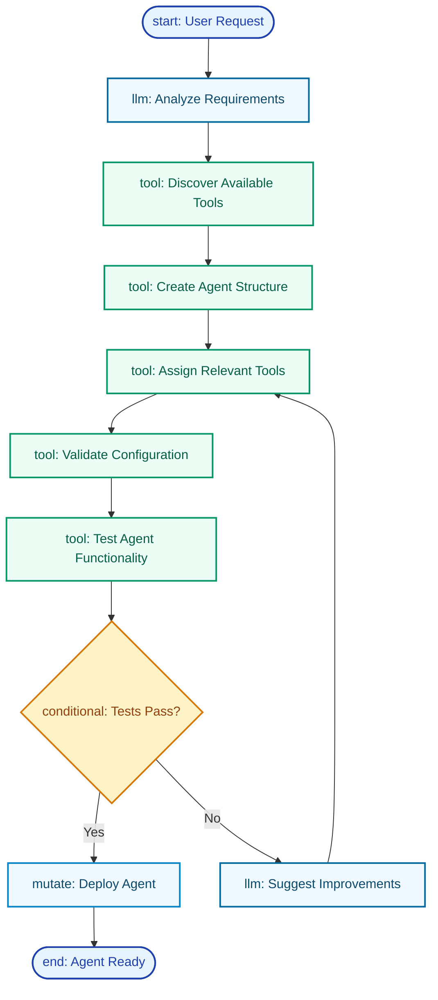

<div className="flex justify-end mb-4">
  <CopyPageButton />
</div>

import { Globe, MessageSquare, Settings, CheckCircle, Wrench, Bot, Workflow, Zap, Brain, Search, BarChart } from 'lucide-react';

# Gaia - Agent Creator

The conversational specialist that creates and configures other agents through natural language interaction. Unlike code-first development, Gaia transforms business requirements into working agents through conversation.

<div className="my-8">
  
  <div className="text-sm text-muted-foreground text-center mt-2">Create agents through natural conversation with Gaia</div>
</div>

<Callout type="success">
  **Gaia's Specialty**: Creating agents that understand your business domain, have the right tools, and work exactly how you need them to.
</Callout>

---

## Getting Started: Your First Agent

<Steps>
<Step icon={<MessageSquare />}>
### Start a Conversation
Simply tell Gaia what you need: "Create a customer support agent for our SaaS product" and Gaia begins the creation process.
</Step>

<Step icon={<Settings />}>
### Iterative Refinement
Gaia asks clarifying questions and makes suggestions. Refine capabilities, tone, and tools through natural conversation.
</Step>

<Step icon={<CheckCircle />}>
### Test and Deploy
Gaia validates the agent configuration and helps you test it before making it available to your team.
</Step>

<Step icon={<Bot />}>
### Ongoing Improvement
Continue conversing with Gaia to add features, adjust behavior, or optimize performance based on usage.
</Step>
</Steps>

<Callout type="info">
**No Technical Skills Required**: Gaia handles all the technical complexity while you focus on describing what you need in plain language.
</Callout>

---

## What Makes Gaia Special

Gaia is a **meta-agent** - an AI that specializes in building other AIs through conversation. Gaia understands:

- **<Brain className="inline w-4 h-4" /> Agent Architecture**: How to structure agents for optimal performance
- **<Wrench className="inline w-4 h-4" /> Tool Selection**: Which capabilities each agent needs for specific tasks  
- **<MessageSquare className="inline w-4 h-4" /> Business Context**: How to translate requirements into agent configurations
- **<CheckCircle className="inline w-4 h-4" /> Best Practices**: Proven patterns for successful agent deployment

## When to Use Gaia

**Perfect for**:
- Business users who need agents but prefer conversation over code
- Rapid prototyping and testing of agent concepts  
- Domain-specific agents requiring business context
- Team collaboration where multiple stakeholders provide input
- Iterative refinement of agent capabilities

**Alternative approaches**:
- **Code-First Development**: Use [CLI tools](/getting-started/quickstart) when you need version control, complex integrations, or CI/CD pipelines
- **Templates**: Use [marketplace templates](/core-concepts/marketplace) for standard, well-defined use cases
- **[Daedalus](/agents/daedalus)**: Building custom tools and workflows that agents can use

## How Gaia Creates Agents

### Conversation-Driven Creation

**Natural Language Requirements**:
```
You: "I need an agent that helps with customer onboarding"

Gaia: "I'll create a customer onboarding agent. Let me ask a few questions:
- What type of customers are you onboarding?
- What systems should the agent access?
- What's the typical onboarding workflow?"
```

**Progressive Refinement**:
```
You: "Actually, it should also handle billing questions"

Gaia: "Adding billing capabilities. I'll assign these tools:
- Customer lookup
- Billing system integration  
- Escalation workflows for complex billing issues
Would you like me to configure specific billing scenarios?"
```

### The Gaia Agent Creation Workflow

Every agent creation follows this proven workflow pattern:



### How Each Step Works

- **<Brain className="inline w-4 h-4" /> Analyze Requirements**: Gaia processes your natural language request and identifies the agent's purpose, capabilities needed, and success criteria
- **<Search className="inline w-4 h-4" /> Discover Tools**: Searches available tools and capabilities that match the agent's requirements
- **<Settings className="inline w-4 h-4" /> Create Structure**: Builds the agent's core configuration, system prompt, and behavioral guidelines
- **<Wrench className="inline w-4 h-4" /> Assign Tools**: Selects and configures the optimal tool set for the agent's specific use case
- **<CheckCircle className="inline w-4 h-4" /> Validate & Test**: Ensures the agent configuration works correctly and meets requirements
- **<Bot className="inline w-4 h-4" /> Deploy**: Makes the agent available for use with full functionality

<Callout type="info">
**Iterative Refinement**: If tests don't pass, Gaia automatically suggests improvements and refines the configuration until the agent works perfectly.
</Callout>

---

## Gaia Creation Examples

<Tabs items={['Customer Support', 'Content Research', 'Finance Automation', 'Learning Assistant']}>
<Tab value="Customer Support">

### Customer Support Agent

**Your Request**:
> "Create a customer support agent for our SaaS platform that handles login issues, feature questions, and routes complex bugs to human support"

**Gaia's Process**:
1. **Requirement Analysis**: Asks about your product, common issues, escalation rules
2. **Tool Selection**: Assigns knowledge base search, ticket creation, user lookup tools
3. **Workflow Design**: Creates support → analyze → resolve → escalate workflow
4. **Testing**: Validates responses with sample scenarios

**Result**: Production-ready support agent that reduces ticket volume by 60%

</Tab>
<Tab value="Content Research">

### Research Assistant

**Your Request**:
> "Build a research assistant that helps me write technical blog posts by gathering information from academic papers and creating structured outlines"

**Gaia's Process**:
1. **Source Configuration**: Sets up arXiv, PubMed, and academic database access
2. **Analysis Tools**: Adds fact-checking, citation management, and summarization
3. **Output Integration**: Configures Notion or Google Docs for structured output
4. **Quality Controls**: Implements source verification and bias detection

**Result**: Research agent that produces well-sourced, structured content drafts

</Tab>
<Tab value="Finance Automation">

### Finance Tracker

**Your Request**:
> "Create a spending tracker that monitors my bank transactions and sends alerts when I overspend in any category"

**Gaia's Process**:
1. **Bank Integration**: Sets up secure Plaid connection for transaction data
2. **Categorization**: Configures expense categorization and budget tracking
3. **Alert System**: Creates notification rules for spending thresholds
4. **Reporting**: Adds monthly summary and trend analysis

**Result**: Automated finance agent that keeps budgets on track with real-time insights

</Tab>
<Tab value="Learning Assistant">

### Study Assistant

**Your Request**:
> "Build a study assistant that creates flashcards from my notes and reminds me when to review them"

**Gaia's Process**:
1. **Content Processing**: Sets up text analysis for note extraction
2. **Flashcard Generation**: Configures question-answer pair creation
3. **Spaced Repetition**: Implements optimal review scheduling
4. **Progress Tracking**: Adds performance analytics and insights

**Result**: Learning agent that improves retention through scientific review scheduling

</Tab>
</Tabs>

## Best Practices for Working with Gaia

**Be Specific About Requirements**:
- Instead of "Create a support agent", say "Create a support agent for our SaaS product that handles login issues, feature questions, and routes complex bugs to human support"

**Provide Business Context**:
- Instead of "Make it friendly", say "Use a professional but approachable tone, similar to our current support team's communication style"

**Define Success Metrics**:
- Instead of "Make it work well", say "Target 80% resolution rate with less than 2 minute response time, escalate when confidence is low"

**Iterative Development**:
- Start with basic functionality and core tools
- Add capabilities based on usage patterns
- Continuously refine based on performance data and user feedback
- Optimize workflows as business needs evolve

### Common Agent Patterns

**Multi-Purpose Agents**: Handle related tasks efficiently (e.g., customer success agent managing onboarding, support, upgrades, and renewals)

**Specialized Experts**: Focus on specific domains (e.g., technical documentation agent for API docs, code analysis, and developer guides)

**Workflow Coordinators**: Orchestrate complex processes (e.g., project launch agent coordinating teams, tracking milestones, and managing escalations)

## Common Issues and Solutions

**Agent Not Understanding Context**: Ask Gaia to "add more domain-specific context to the system prompt"

**Missing Capabilities**: Request "Add [specific tool] capability to handle [specific task]"

**Inconsistent Behavior**: Say "Make the agent's responses more consistent by [specific guidance]"

**Performance Optimization**: Ask Gaia to "Optimize the agent for faster response times, lower costs, or higher accuracy"

## Advanced Features

**Export to Code**: Convert conversational agents to TypeScript for version control and CI/CD integration

**Team Sharing**: Export configurations, share across organization, and maintain consistent standards

**Template Creation**: Turn successful agents into reusable templates for your organization

---

## Next Steps

<Cards>
  <Card
    icon={<MessageSquare />}
    title="Start Building Now"
    href="/getting-started"
  >
    Create your first agent through conversation
  </Card>
  
  <Card
    icon={<Wrench />}
    title="Add Custom Tools"
    href="/agents/daedalus"
  >
    Work with Daedalus to create specialized tools
  </Card>
  
  <Card
    icon={<Search />}
    title="Browse Templates"
    href="/core-concepts/marketplace"
  >
    Explore ready-to-deploy agent templates
  </Card>
  
  <Card
    icon={<Bot />}
    title="Understand Agents"
    href="/core-concepts/agents"
  >
    Learn how agents work and interact with tools
  </Card>
</Cards>

<Callout type="info">
  **Ready to Start?** Find Gaia in your starship's agent marketplace and begin creating your first specialized agent through natural conversation.
</Callout>