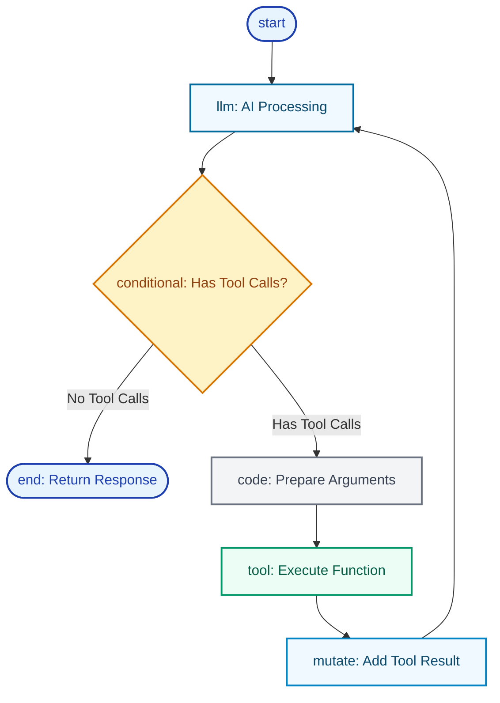

<div className="flex justify-end mb-4">
  <CopyPageButton />
</div>

import {
  Bot,
  Code,
  Globe,
  Zap,
  Settings,
  Play,
  CheckCircle,
  Users,
  Workflow,
  Brain,
  Network,
  Cpu,
  Database,
  Wrench,
  RotateCcw,
  ExternalLink,
  Construction,
} from 'lucide-react';

## What Are Agents?

**Agents** are AI assistants that combine language understanding, tool usage, and memory. Unlike simple chatbots, agents can:

- **Take Actions**: Use tools to interact with systems, process data, and integrate with any platform
- **Remember Context**: Maintain conversation history and adapt to user preferences
- **Execute Workflows**: Follow multi-step processes with decision making and collaboration
- **Adapt & Evolve**: Discover new capabilities and work with humans and other agents

Think of agents as **AI teammates** that work independently within defined boundaries, capable of collaborating on complex tasks through handoffs, parallel processing, and shared context.

<div className="my-8">
  <video className="w-full rounded-lg border border-border/20 shadow-lg" src="/docs/images/demo.webm" autoPlay loop muted playsInline />
  <p className="text-sm text-muted-foreground text-center mt-2">See the full Starships.ai platform in action</p>
</div>

---

## Universal Agent Architecture

Every agent in the Starships.ai framework shares the same core architecture:

### Core Components

- **<Brain className="inline w-4 h-4" /> Personality**: System prompt defining expertise, communication style, and behavioral guidelines
- **<Wrench className="inline w-4 h-4" /> Tools**: Set of capabilities like API calls, data processing, file operations, integrations
- **<Database className="inline w-4 h-4" /> Memory**: Persistent context including conversation history, user preferences, and learned patterns
- **<Workflow className="inline w-4 h-4" /> Blueprints**: Workflow definitions that specify how the agent executes multi-step tasks
- **<Settings className="inline w-4 h-4" /> Configuration**: Model selection, permissions, timeout settings, and operational parameters

---

## The Universal Agent Blueprint

Every agent follows the same core execution pattern:



### How Each Node Works

- <span style={{ color: '#0066cc' }}>
    **[start](/core-concepts/blueprints#start-node)** <ExternalLink className="inline w-3 h-3" />
  </span>
  : Receives input and triggers agent execution
- <span style={{ color: '#0066cc' }}>
    **[llm](/core-concepts/blueprints#llm-node)** <ExternalLink className="inline w-3 h-3" />
  </span>
  : Processes requests using AI models, decides on tool usage
- <span style={{ color: '#0066cc' }}>
    **[conditional](/core-concepts/blueprints#conditional-node)** <ExternalLink className="inline w-3 h-3" />
  </span>
  : Routes execution based on LLM decisions (tools vs. response)
- <span style={{ color: '#0066cc' }}>
    **[code](/core-concepts/blueprints#code-node)** <ExternalLink className="inline w-3 h-3" />
  </span>
  : Prepares data and formats tool arguments for execution
- <span style={{ color: '#0066cc' }}>
    **[tool](/core-concepts/blueprints#tool-node)** <ExternalLink className="inline w-3 h-3" />
  </span>
  : Executes capabilities like API calls, data processing
- <span style={{ color: '#0066cc' }}>
    **[mutate](/core-concepts/blueprints#mutate-node)** <ExternalLink className="inline w-3 h-3" />
  </span>
  : Updates memory with tool results for next LLM cycle
- <span style={{ color: '#0066cc' }}>
    **[end](/core-concepts/blueprints#end-node)** <ExternalLink className="inline w-3 h-3" />
  </span>
  : Returns response when agent has complete answer

<Callout type="info">
  **Blueprint vs. Creation**: This diagram shows how agents execute tasks internally using blueprints. For how meta-agents like Gaia create
  other agents, see the individual [meta-agent documentation](/agents/gaia).
</Callout>

---

## How Agents Process Requests

### The Tool-Calling Loop

What makes agents intelligent rather than just chatbots:

<Steps>
<Step icon={<Brain />}>
### LLM Analyzes Request
The AI model examines your input and compares it against available tools and conversation history
</Step>

<Step icon={<Zap />}>
  ### Decides on Action Either provides a direct response or identifies which tools are needed to gather more information
</Step>

<Step icon={<Wrench />}>
  ### Executes Tools Calls external APIs, searches databases, processes files, or performs calculations as needed
</Step>

<Step icon={<RotateCcw />}>
### Incorporates Results
Adds tool results to its understanding and repeats until it can provide a complete answer
</Step>
</Steps>

**Example Flow**:

```
User: "What's our team's progress this week?"

Agent thinks: "I need project data" → Calls project-status tool
Tool returns: Current task completion rates
Agent thinks: "I need recent updates" → Calls team-activity tool
Tool returns: This week's commits and updates
Agent responds: "Your team completed 12 tasks this week, 3 ahead of schedule..."
```

### Why This Works

- **Self-contained**: Each agent has AI model + tools + memory
- **Purpose-built**: Same architecture, different tools = different capabilities
- **Composable**: Agents can work together on complex workflows
- **Learning**: Every interaction improves decision-making

<Callout type="info">
  **Want to build custom workflows?** Learn about all blueprint nodes and advanced patterns in our [Blueprint Reference
  Guide](/core-concepts/blueprints).
</Callout>

---

## Agent Memory

Agents maintain context across conversations:

- **Remember what you've discussed** and your preferences
- **Adapt to new capabilities** when tools are added
- **Share context** with other agents when working together

This persistent memory is what makes agents intelligent teammates rather than simple chatbots.

---

## Ready to Build Your First Agent?

Now that you understand how agents work, you're ready to create your own:

<Cards>
  <Card icon={<Globe />} title="Getting Started Guide" href="/getting-started">
    Step-by-step guide to creating your first agent with Gaia
  </Card>

<Card icon={<Bot />} title="Chat with Gaia" href="/agents/gaia">
  The meta-agent that creates other agents through conversation
</Card>

  <Card icon={<Wrench />} title="Chat with Daedalus" href="/agents/daedalus">
    The meta-agent that builds custom tools and workflows
  </Card>
</Cards>

---

## Agent Publishing & Sharing

<Callout type="warning" title="Coming Soon">
  Agent marketplace and publishing system is currently in development.
</Callout>

**Planned features**:

- Share agents privately within your organization
- Publish to the community marketplace
- Version control and quality assurance
- Convert successful agents into reusable templates

---

## Next Steps

<Cards>
  <Card title="Create with Gaia" href="/agents/gaia">
    Use Gaia to create agents through conversation
  </Card>
  <Card title="Build with Daedalus" href="/agents/daedalus">
    Create custom tools and workflows with Daedalus
  </Card>
  <Card title="Code-First Development" href="/getting-started/quickstart">
    Use CLI and SDK for programmatic development
  </Card>
  <Card title="Tools & Capabilities" href="/core-concepts/tools">
    Understand the tool ecosystem that powers agents
  </Card>
</Cards>
