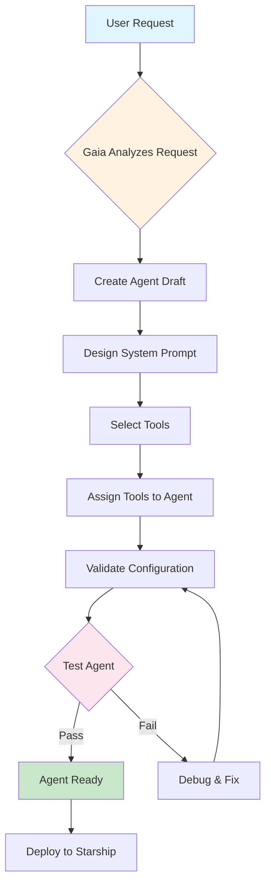

import { Bot, Code, Globe, Zap, Settings, Play, CheckCircle, Users, Workflow, Brain } from 'lucide-react';

# Agents

<Callout type="success">
  **Core Concept**: Agents are AI assistants that can use tools, remember context, and execute multi-step workflows autonomously.
</Callout>

## Agent Architecture

Every agent consists of:

- **Personality**: System prompt defining expertise and communication style
- **Tools**: Capabilities like API calls, data processing, integrations
- **Memory**: Context retention across conversations and tasks
- **Workflows**: Multi-step processes and decision trees

## Gaia: Your Agent Creation Assistant

**Gaia** is the meta-agent that creates all other agents on your starship. Think of Gaia as your AI assistant that specializes in building other AI assistants.

**How Gaia Works**: Simply describe what you need, and Gaia handles the technical details:

**Behind the Scenes**: Gaia uses these tools to build agents:

<Accordions>
  <Accordion title="🔧 Agent Management Tools">
    - **`agent-open`**: Creates new agents or opens existing ones for editing
    - **`agent-edit`**: Modifies agent configuration, system prompts, and settings
    - **`agent-test`**: Validates agent functionality with test scenarios
    - **`agent-list`**: Discovers existing agents to avoid duplicates
    - **`agent-get`**: Retrieves complete agent details and configuration
  </Accordion>

  <Accordion title="🛠️ Tool Assignment Tools">
    - **`agent-assign-tool`**: Adds tools to an agent's capability set
    - **`agent-unassign-tool`**: Removes tools from agents
    - **`tool-list`**: Discovers available tools for assignment
    - Strategic assignment based on agent role and requirements
  </Accordion>

  <Accordion title="🏗️ Blueprint & Validation Tools">
    - **`blueprint-lint`**: Validates workflow structure and node connectivity
    - **`blueprint-examples`**: Provides proven workflow patterns
    - **`node-schema`**: Gets exact parameter requirements for workflow nodes
    - Ensures agents have reliable, production-ready workflows
  </Accordion>
</Accordions>


## How Agent Workflows Work

Agents execute tasks through **blueprints** - visual workflows made of connected nodes. Here's how it works:

### Agent Creation Workflow




### Agent Communication & Context

**Memory Across Conversations**: Agents remember previous interactions and can reference past decisions, making them truly conversational rather than stateless.

**Natural Language Interface**: Communicate with agents in plain English - no need to learn specific commands or syntax.

**Context Awareness**: Agents understand your business domain, team structure, and project requirements through their system prompts and training.

**Multi-Modal Capabilities**: Agents can process text, analyze data, work with files, and integrate with various systems seamlessly.

### Agent Lifecycle Management

**Development to Production**: 
- Start with a prototype agent for testing
- Iterate based on real usage patterns  
- Deploy to production when ready
- Monitor and improve over time

**Version Control**: Track changes to agent configurations and roll back if needed

**Performance Analytics**: Monitor response times, success rates, and user satisfaction to optimize agent performance

**Scaling**: Start with one agent, then create specialized variants for different use cases or departments

## Building Your First Agent

**Quick Start**: Chat with Gaia to create an agent in under 5 minutes

<Steps>
<Step>

### Describe Your Need
Tell Gaia what you want your agent to do:
```
"Create a customer support agent for our SaaS product"
"Build an agent that processes invoices and sends follow-ups"
"I need a research assistant that finds market data"
```

</Step>

<Step>

### Gaia Designs Your Agent
Gaia asks clarifying questions and builds:
- Appropriate personality and expertise
- Relevant tool access and permissions
- Workflow patterns and escalation rules

</Step>

<Step>

### Start Using Immediately
Your agent is ready to work:
- Chat naturally about tasks
- Watch it take actions with tools
- Iterate and improve based on usage

</Step>
</Steps>

### Common Agent Patterns

<Tabs items={['Support Agents', 'Processing Agents', 'Research Agents']}>
<Tab value="Support Agents">

**Use case**: Handle customer inquiries and support tickets

**Typical tools**: Knowledge base search, ticket creation, user lookup
**Personality**: Friendly, helpful, professional
**Escalation**: Route complex issues to human support

**Example**: 24/7 support that handles 80% of common questions automatically

</Tab>
<Tab value="Processing Agents">

**Use case**: Automate data processing and workflow tasks

**Typical tools**: File processing, database updates, API integrations
**Personality**: Efficient, detail-oriented, systematic
**Escalation**: Flag exceptions for human review

**Example**: Invoice processing agent that handles end-to-end workflow

</Tab>
<Tab value="Research Agents">

**Use case**: Gather information and generate insights

**Typical tools**: Web search, data analysis, report generation
**Personality**: Analytical, thorough, objective
**Escalation**: Request guidance on research scope

**Example**: Market research agent that delivers weekly trend reports

</Tab>
</Tabs>

## See It In Action

<Tabs items={['Customer Support', 'Research Assistant', 'Operations Manager']}>
<Tab value="Customer Support">

**User**: "Create a support agent for our project management tool"

**Gaia builds**:
- Agent with knowledge of your product features
- Access to user lookup and ticket creation tools
- Friendly, helpful communication style
- Escalation patterns for complex issues

**Result**: 24/7 support that handles 80% of inquiries automatically

</Tab>
<Tab value="Research Assistant">

**User**: "I need an agent that researches market trends"

**Gaia builds**:
- Agent specialized in market analysis
- Access to web search and data analysis tools
- Structured reporting capabilities
- Industry-specific knowledge patterns

**Result**: Weekly market reports generated automatically

</Tab>
<Tab value="Operations Manager">

**User**: "Create an agent that manages our deployment pipeline"

**Gaia builds**:
- Agent with DevOps expertise and monitoring access
- Integration with CI/CD tools and alert systems
- Decision-making protocols for routine operations
- Escalation rules for critical issues

**Result**: Automated deployment management with intelligent oversight

</Tab>
</Tabs>

## Advanced Features

### Dynamic Capability Expansion

**The Power of Meta-Agents**: Start with a basic agent and expand its capabilities over time:

1. **Gaia creates** your initial agent with core functionality
2. **Identify gaps** during real-world usage
3. **Add new tools** as needed (via Daedalus or existing tools)
4. **Agent evolves** without rebuilding from scratch

**Real Example**:
```
Week 1: Support agent handles basic questions
Week 2: Add ticket creation capability
Week 3: Add customer history lookup
Week 4: Add escalation routing logic
```

### Governance and Control

- **Agent Permissions**: Control what each agent can access
- **Approval Workflows**: Require human confirmation for sensitive actions
- **Audit Trails**: Complete logging of agent decisions and actions
- **Performance Monitoring**: Track effectiveness and ROI


### Code Integration

**Export to Code**: Export any conversational agent as TypeScript:
```bash
starships export my-agent
# Generates complete agent.ts file
```

**Import from Code**: Import CLI-created agents for conversational editing:
```bash
starships import my-agent
# Now available in conversational interface
```

### Enterprise Features

- **Access Controls**: Role-based permissions and team management
- **Custom Integrations**: Connect to any API or internal system
- **Team Collaboration**: Share agents across departments

## Next Steps

<Cards>
  <Card title="Start Building" href="#building-your-first-agent">
    Create your first agent now
  </Card>
  <Card title="Tools & Capabilities" href="/core-concepts/tools">
    Understand what agents can do
  </Card>
  <Card title="Advanced Workflows" href="/core-concepts/workflows">
    Multi-step processes and automation
  </Card>
  <Card title="Developer Guide" href="/getting-started/quickstart">
    CLI and SDK for code-first development
  </Card>
</Cards>
