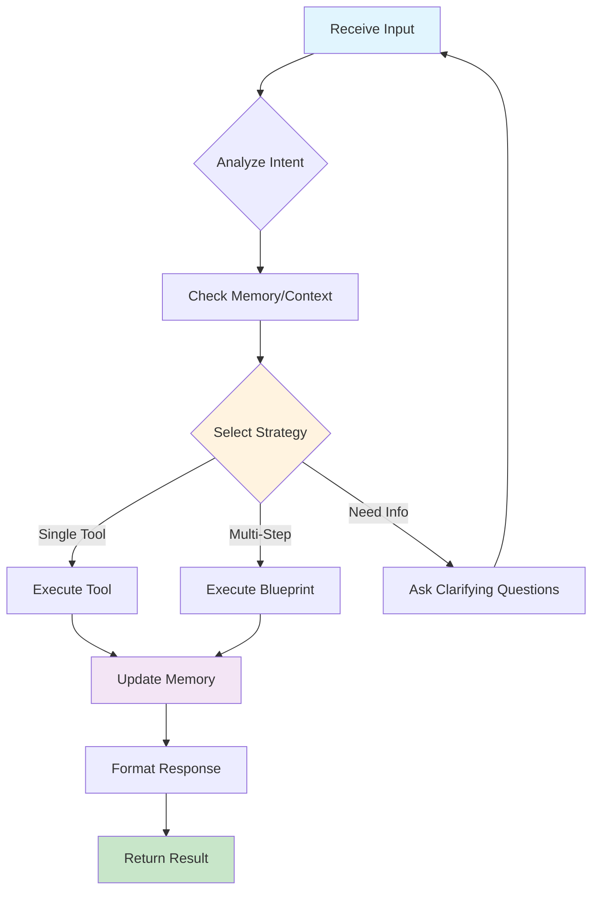
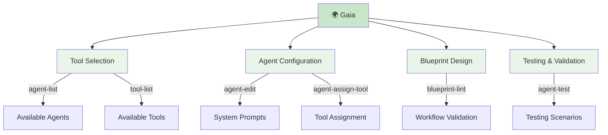

import { Bot, Code, Globe, Zap, Settings, Play, CheckCircle, Users, Workflow, Brain, Network, Cpu, Database } from 'lucide-react';

# Agents

The foundational framework for creating AI assistants that understand context, use tools, and execute complex workflows autonomously.

<Callout type="success">
  **Framework Core**: Agents are the building blocks of your AI workforce - each one a specialized assistant built on the same universal architecture.
</Callout>

## What Are Agents?

**Agents** are AI entities that combine language understanding with tool usage and memory retention. Unlike simple chatbots, agents can:

- **Take Actions**: Use tools to interact with systems, APIs, and data
- **Remember Context**: Maintain conversation history and learned preferences
- **Execute Workflows**: Follow multi-step processes with decision making
- **Collaborate**: Work with humans and other agents on complex tasks

Think of agents as **AI teammates** that understand your domain and can work independently within defined boundaries.

## Universal Agent Architecture

Every agent in the Starships.ai framework shares the same core architecture:

<Tabs items={['Components', 'Execution Model', 'Memory System']}>
<Tab value="Components">

### Core Components

- **🧠 Personality**: System prompt defining expertise, communication style, and behavioral guidelines
- **🛠️ Tools**: Set of capabilities like API calls, data processing, file operations, integrations  
- **💾 Memory**: Persistent context including conversation history, user preferences, and learned patterns
- **📋 Blueprints**: Workflow definitions that specify how the agent executes multi-step tasks
- **⚙️ Configuration**: Model selection, permissions, timeout settings, and operational parameters

</Tab>
<Tab value="Execution Model">

### How Any Agent Executes Tasks



**Universal Process**:
1. **Input Analysis**: Understand user intent and context
2. **Memory Consultation**: Access relevant conversation history and learned patterns
3. **Strategy Selection**: Choose appropriate tools or workflows
4. **Execution**: Perform actions while monitoring for errors
5. **Memory Update**: Store results and learned patterns
6. **Response Formation**: Provide clear, contextual feedback

</Tab>
<Tab value="Memory System">

### Memory Architecture

**Short-term Memory**:
- Current conversation context
- Recent actions and results  
- Active workflow state

**Long-term Memory**:
- User preferences and patterns
- Successful workflow strategies
- Domain-specific knowledge

**Shared Memory** (between agents):
- Team context and coordination
- Cross-agent workflow results
- Organizational knowledge base

</Tab>
</Tabs>

## Agent Creation Framework

The platform provides multiple approaches to create agents:

### Conversational Creation
**Best for**: Rapid prototyping, business users, iterative development

```
User: "I need an agent that processes customer feedback and generates reports"
Meta-Agent: Creates agent with appropriate tools, workflows, and reporting capabilities
Result: Working agent ready immediately with option to refine
```

### Code-First Development
**Best for**: Developers, complex integrations, version control

```typescript
import { Agent, Blueprint } from '@starships/core';

const feedbackAgent = new Agent({
  name: 'Customer Feedback Processor',
  model: 'anthropic/claude-sonnet-4.5',
  tools: ['sentiment-analysis', 'report-generator', 'crm-integration'],
  blueprint: feedbackProcessingWorkflow,
  systemPrompt: 'You are a customer success analyst...'
});
```

### Template-Based Creation
**Best for**: Consistent deployment, enterprise standards, rapid scaling

- Start with proven agent templates
- Customize for specific use cases
- Deploy across teams with standard configurations

## Meta-Agents: The Creator Framework

**Meta-agents** are specialized agents that create and manage other agents. They understand the agent framework deeply and can:

<Cards>
  <Card
    icon={<Globe />}
    title="Gaia - Agent Creator"
    href="/agents/gaia"
  >
    Specializes in creating business and operational agents through conversation
  </Card>
  
  <Card
    icon={<Code />}
    title="Daedalus - Tool Creator"
    href="/agents/daedalus"  
  >
    Builds custom tools and complex workflows that any agent can use
  </Card>
  
  <Card
    icon={<Network />}
    title="Sybil - Navigator"
    href="/agents/sybil"
  >
    Provides guidance and coordinates multi-agent workflows
  </Card>
</Cards>

### Meta-Agent Capabilities

**Gaia's Framework Knowledge**:


## Agent Publishing & Sharing

<Callout type="info" title="Feature In Development">
The agent marketplace and publishing system is currently being developed.
</Callout>

**Planned Publishing Framework**:

- **Private Sharing**: Share agents within your organization
- **Public Marketplace**: Contribute agents to the community marketplace
- **Version Control**: Track agent iterations and improvements
- **Quality Assurance**: Community ratings, reviews, and validation
- **Template System**: Convert successful agents into reusable templates

**Publishing Workflow** (Coming Soon):
```bash
starships agent publish my-support-agent --visibility=public
starships agent version my-support-agent --major  
starships marketplace search "customer support"
```

## Building Your First Agent

<Steps>
<Step>

### Choose Your Approach

**Conversational** (Recommended for beginners):
- Chat with Gaia to describe your needs
- Iterate through natural conversation
- Deploy immediately

**Code-First** (For developers):
- Use CLI and SDK for full control
- Version control and CI/CD integration
- Export conversational agents to code

</Step>

<Step>

### Define Agent Purpose

**Clear Scope**: What specific problem does this agent solve?
**Success Metrics**: How will you measure agent effectiveness?
**Boundaries**: What should the agent NOT do?

**Example Scoping**:
```
Purpose: Process customer support tickets
Success: 80% resolution rate, < 2min response time
Boundaries: Cannot offer refunds > $100, escalates billing issues
```

</Step>

<Step>

### Deploy and Iterate

**Start Simple**: Begin with core functionality
**Monitor Performance**: Track usage patterns and success rates
**Expand Gradually**: Add tools and capabilities based on real usage
**Version Control**: Track changes and improvements over time

</Step>
</Steps>

## Common Agent Patterns

<Tabs items={['Processing Agents', 'Interactive Agents', 'Analytical Agents']}>
<Tab value="Processing Agents">

**Purpose**: Automate repetitive tasks and data processing workflows

**Characteristics**:
- High automation level
- Minimal human interaction required  
- Focus on efficiency and accuracy
- Exception handling and escalation

**Examples**:
- Invoice processing and approval routing
- Document analysis and categorization
- Data synchronization between systems
- Automated quality assurance checks

**Key Tools**: File processing, API integrations, data validation, notification systems

</Tab>
<Tab value="Interactive Agents">

**Purpose**: Engage with humans for support, guidance, and collaboration

**Characteristics**:
- Natural conversation flow
- Context awareness and memory
- Personality and communication style
- Escalation to human experts

**Examples**:
- Customer support and help desk
- Sales qualification and lead nurturing
- Internal IT support and guidance
- Training and onboarding assistants

**Key Tools**: Knowledge base search, ticket creation, CRM integration, communication platforms

</Tab>
<Tab value="Analytical Agents">

**Purpose**: Process data, generate insights, and support decision-making

**Characteristics**:
- Data analysis and pattern recognition
- Report generation and visualization  
- Predictive modeling and forecasting
- Research and information synthesis

**Examples**:
- Market research and competitive analysis
- Financial reporting and trend analysis
- Performance monitoring and optimization
- Risk assessment and compliance checking

**Key Tools**: Database queries, statistical analysis, visualization, research APIs

</Tab>
</Tabs>

## Advanced Framework Concepts

### Agent Collaboration
**Multi-Agent Workflows**: Agents can coordinate on complex tasks
- **Handoffs**: Pass work between specialized agents
- **Parallel Processing**: Multiple agents work simultaneously  
- **Shared Context**: Collaborate using shared memory and context

### Dynamic Capability Expansion
**Runtime Tool Addition**: Agents can gain new capabilities without rebuilding
- **Hot Tool Loading**: Add tools to running agents
- **Capability Discovery**: Agents learn about new available tools
- **Permission Management**: Control what tools agents can access

### Enterprise Integration
**Framework Extensibility**: Connect agents to any system
- **Custom Tool Development**: Build domain-specific capabilities
- **API Integration**: Connect to existing business systems
- **Security Framework**: Role-based access and audit trails

## Performance and Monitoring

### Agent Analytics
**Built-in Monitoring**: Track agent performance and usage
- **Response Times**: Monitor speed and efficiency
- **Success Rates**: Track task completion and accuracy
- **User Satisfaction**: Collect feedback and ratings
- **Cost Tracking**: Monitor API usage and resource consumption

### Optimization Strategies
**Continuous Improvement**: Enhance agent performance over time
- **Workflow Optimization**: Improve blueprint efficiency
- **Tool Selection**: Choose optimal tools for each task
- **Model Tuning**: Select appropriate AI models for different needs
- **Memory Management**: Optimize context and memory usage

## Next Steps

<Cards>
  <Card title="Create with Gaia" href="/agents/gaia">
    Use Gaia to create agents through conversation
  </Card>
  <Card title="Build with Daedalus" href="/agents/daedalus">
    Create custom tools and workflows with Daedalus  
  </Card>
  <Card title="Code-First Development" href="/getting-started/quickstart">
    Use CLI and SDK for programmatic development
  </Card>
  <Card title="Tools & Capabilities" href="/core-concepts/tools">
    Understand the tool ecosystem that powers agents
  </Card>
</Cards>