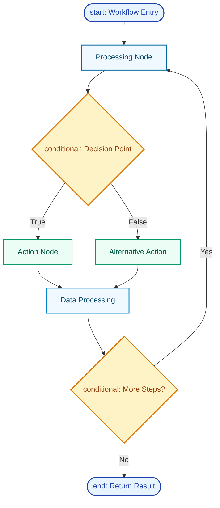
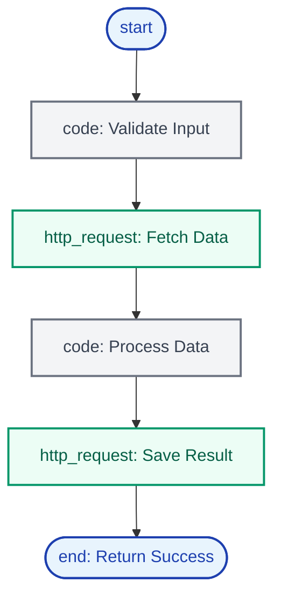
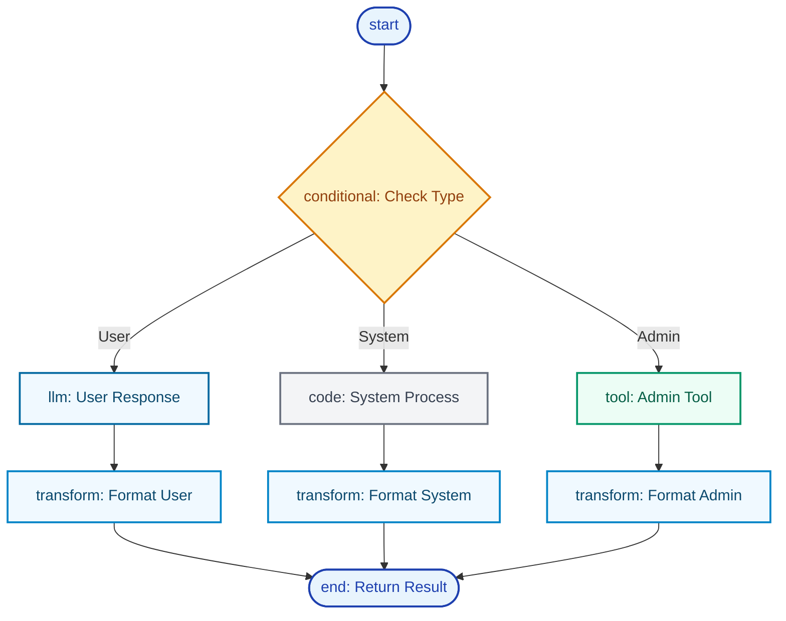
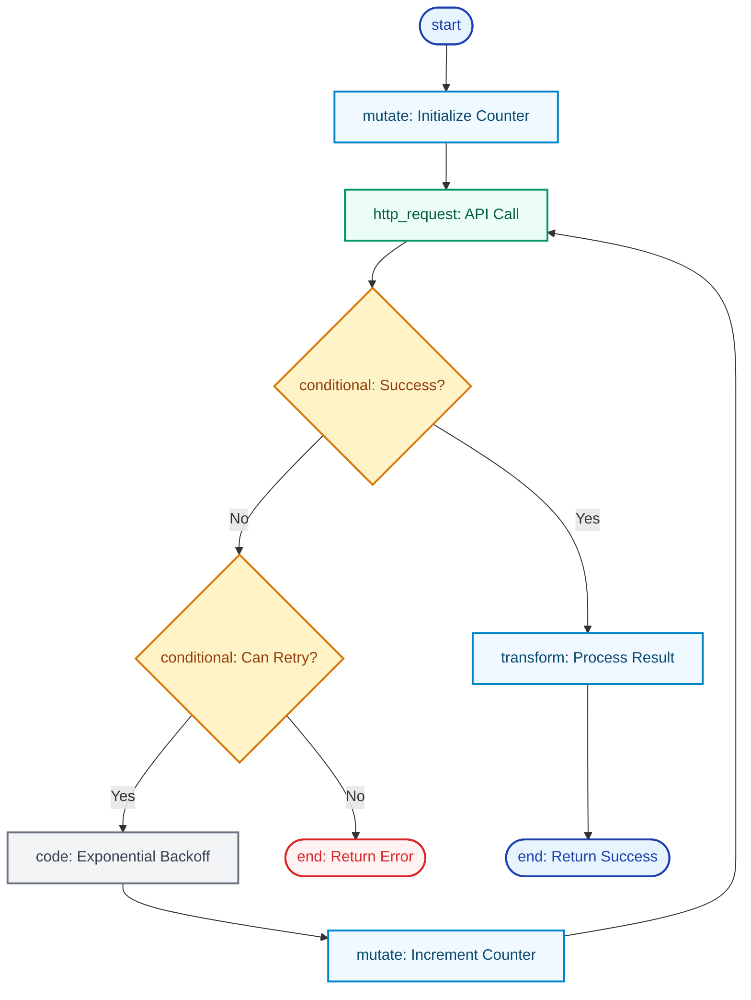

import {
  GitBranch,
  Play,
  Zap,
  Settings,
  Bot,
  Code,
  Network,
  Database,
  ArrowRight,
  CheckCircle,
  Workflow,
  Brain,
  Wrench,
  MessageSquare,
  Globe,
  ExternalLink,
} from 'lucide-react';

<Callout type="success">
  **Visual Workflow Engine**: Blueprints power every agent interaction - from simple conversations to complex multi-step automations through an intuitive node-based system.
</Callout>

  <h2>What Are Blueprints?</h2>
  <CopyPageButton />

**Blueprints** are the visual workflow system that powers how [agents](/core-concepts/agents) and [tools](/core-concepts/tools) execute tasks. Every conversation, tool call, and automation in Starships.ai runs through blueprints - making them the foundational execution engine of the platform.

- **<Workflow className="inline w-4 h-4" /> Visual Workflows**: Node-based system for building complex logic without code
- **<Brain className="inline w-4 h-4" /> Intelligent Execution**: AI-driven decision making with conditional branching  
- **<Wrench className="inline w-4 h-4" /> Tool Integration**: Seamless connection to external APIs and services
- **<Database className="inline w-4 h-4" /> State Management**: Persistent data flow across multi-step processes

---

## Getting Started: Your First Blueprint

Understanding blueprints is key to building powerful agents and tools. Here's how they work in practice:

<Steps>
<Step icon={<Play />}>
### See Blueprints in Action
Every agent conversation follows a blueprint. When you chat with an agent, here's what happens:
- **Start** → **LLM Processing** → **Tool Calls** (if needed) → **Response**
- The agent decides whether to use tools based on your request
- Results flow back through the blueprint to create intelligent responses
</Step>

<Step icon={<Wrench />}>
### Tools Use Blueprints Too
When an agent calls a tool, that tool executes its own blueprint:
- **Validate Input** → **API Call** → **Process Data** → **Return Result**
- Tools can have conditional logic, retry mechanisms, and error handling
- Multiple tools can be called in sequence or parallel
</Step>

<Step icon={<Settings />}>
### Build Custom Workflows
Advanced users can create custom blueprints for complex automations:
- **Multi-step processes** with branching logic
- **External API integrations** with authentication
- **Data transformations** and state management
- **Error recovery** and retry strategies
</Step>
</Steps>

## Universal Blueprint Architecture

Every blueprint follows the same core execution pattern, regardless of complexity:

### Core Components

Every blueprint is built from these fundamental elements:

- **<Play className="inline w-4 h-4" /> Nodes**: Individual processing steps that perform specific actions
- **<ArrowRight className="inline w-4 h-4" /> Edges**: Connections that define execution flow and data passing
- **<Settings className="inline w-4 h-4" /> State**: Shared data that persists across node executions
- **<Code className="inline w-4 h-4" /> Templates**: Dynamic expressions that access state and node outputs

---

## How Blueprints Execute

When a blueprint runs, the execution engine follows this process:

<Steps>
<Step icon={<Play />}>
### Initialize State
The workflow begins with the `start` node, which receives input data and initializes the workflow state.
</Step>

<Step icon={<Network />}>
### Process Nodes
Each node executes in sequence, with data flowing along edges. Nodes can be:
- **Processing** (transform data, make API calls)
- **Decision** (branch based on conditions)  
- **Integration** (call tools, external services)
</Step>

<Step icon={<Database />}>
### Manage State
State persists across nodes, allowing complex data transformations and multi-step processes to maintain context.
</Step>

<Step icon={<CheckCircle />}>
### Return Results
The workflow completes at an `end` node, returning structured results back to the calling agent or system.
</Step>
</Steps>

<Callout type="info">
  **Deep Integration**: Blueprints are tightly integrated with [agents](/core-concepts/agents) for tool calling and [tools](/core-concepts/tools) for custom functionality. Every interaction in Starships.ai is powered by this workflow system.
</Callout>

---

## Node Reference Guide

Blueprints are built from 12 specialized node types, each designed for specific workflow functions:

  <table className="w-full border-collapse bg-fd-card rounded-xl shadow-sm">
    <thead>
      <tr className="bg-gradient-to-r from-fd-muted/40 to-fd-muted/20 border-b border-fd-border">
        <th className="px-6 py-4 text-left font-semibold text-fd-foreground border-r border-fd-border/50 first:rounded-tl-xl">Node Type</th>
        <th className="px-6 py-4 text-left font-semibold text-fd-foreground border-r border-fd-border/50">Purpose</th>
        <th className="px-6 py-4 text-left font-semibold text-fd-foreground border-r border-fd-border/50">Key Parameters</th>
        <th className="px-6 py-4 text-left font-semibold text-fd-foreground last:rounded-tr-xl">Common Use Cases</th>
      </tr>
    </thead>
    <tbody className="divide-y divide-fd-border/50">
      <tr className="hover:bg-fd-muted/10 transition-colors duration-150">
        <td className="px-6 py-4 border-r border-fd-border/50">
          

            <Play className="w-4 h-4 mr-2 text-green-600" />
            start
          

        </td>
        <td className="px-6 py-4 text-fd-muted-foreground border-r border-fd-border/50">Workflow entry point</td>
        <td className="px-6 py-4 text-fd-muted-foreground border-r border-fd-border/50">input schema</td>
        <td className="px-6 py-4 text-fd-muted-foreground">All workflows, input validation</td>
      </tr>
      <tr className="hover:bg-fd-muted/10 transition-colors duration-150">
        <td className="px-6 py-4 border-r border-fd-border/50">
          

            <CheckCircle className="w-4 h-4 mr-2 text-blue-600" />
            end
          

        </td>
        <td className="px-6 py-4 text-fd-muted-foreground border-r border-fd-border/50">Workflow exit point</td>
        <td className="px-6 py-4 text-fd-muted-foreground border-r border-fd-border/50">output data</td>
        <td className="px-6 py-4 text-fd-muted-foreground">Return results, workflow completion</td>
      </tr>
      <tr className="hover:bg-fd-muted/10 transition-colors duration-150">
        <td className="px-6 py-4 border-r border-fd-border/50">
          

            <Brain className="w-4 h-4 mr-2 text-purple-600" />
            llm
          

        </td>
        <td className="px-6 py-4 text-fd-muted-foreground border-r border-fd-border/50">AI model processing</td>
        <td className="px-6 py-4 text-fd-muted-foreground border-r border-fd-border/50">model, prompt, temperature</td>
        <td className="px-6 py-4 text-fd-muted-foreground">Text analysis, reasoning, generation</td>
      </tr>
      <tr className="hover:bg-fd-muted/10 transition-colors duration-150">
        <td className="px-6 py-4 border-r border-fd-border/50">
          

            <GitBranch className="w-4 h-4 mr-2 text-orange-600" />
            conditional
          

        </td>
        <td className="px-6 py-4 text-fd-muted-foreground border-r border-fd-border/50">Branch execution flow</td>
        <td className="px-6 py-4 text-fd-muted-foreground border-r border-fd-border/50">expression, conditions</td>
        <td className="px-6 py-4 text-fd-muted-foreground">Decision points, logic routing</td>
      </tr>
      <tr className="hover:bg-fd-muted/10 transition-colors duration-150">
        <td className="px-6 py-4 border-r border-fd-border/50">
          

            <Globe className="w-4 h-4 mr-2 text-red-600" />
            http_request
          

        </td>
        <td className="px-6 py-4 text-fd-muted-foreground border-r border-fd-border/50">External API calls</td>
        <td className="px-6 py-4 text-fd-muted-foreground border-r border-fd-border/50">url, method, headers, auth</td>
        <td className="px-6 py-4 text-fd-muted-foreground">API integrations, data fetching</td>
      </tr>
      <tr className="hover:bg-fd-muted/10 transition-colors duration-150">
        <td className="px-6 py-4 border-r border-fd-border/50">
          

            <Code className="w-4 h-4 mr-2 text-yellow-600" />
            code
          

        </td>
        <td className="px-6 py-4 text-fd-muted-foreground border-r border-fd-border/50">JavaScript execution</td>
        <td className="px-6 py-4 text-fd-muted-foreground border-r border-fd-border/50">script, timeout</td>
        <td className="px-6 py-4 text-fd-muted-foreground">Data processing, calculations</td>
      </tr>
      <tr className="hover:bg-fd-muted/10 transition-colors duration-150">
        <td className="px-6 py-4 border-r border-fd-border/50">
          

            <Wrench className="w-4 h-4 mr-2 text-green-600" />
            tool
          

        </td>
        <td className="px-6 py-4 text-fd-muted-foreground border-r border-fd-border/50">Function execution</td>
        <td className="px-6 py-4 text-fd-muted-foreground border-r border-fd-border/50">tool reference, parameters</td>
        <td className="px-6 py-4 text-fd-muted-foreground">Custom functions, tool calling</td>
      </tr>
      <tr className="hover:bg-fd-muted/10 transition-colors duration-150">
        <td className="px-6 py-4 border-r border-fd-border/50">
          

            <Settings className="w-4 h-4 mr-2 text-gray-600" />
            transform
          

        </td>
        <td className="px-6 py-4 text-fd-muted-foreground border-r border-fd-border/50">Data transformation</td>
        <td className="px-6 py-4 text-fd-muted-foreground border-r border-fd-border/50">JSON patches, mappings</td>
        <td className="px-6 py-4 text-fd-muted-foreground">Format conversion, data shaping</td>
      </tr>
      <tr className="hover:bg-fd-muted/10 transition-colors duration-150">
        <td className="px-6 py-4 border-r border-fd-border/50">
          

            <Database className="w-4 h-4 mr-2 text-indigo-600" />
            mutate
          

        </td>
        <td className="px-6 py-4 text-fd-muted-foreground border-r border-fd-border/50">State modification</td>
        <td className="px-6 py-4 text-fd-muted-foreground border-r border-fd-border/50">reducer function</td>
        <td className="px-6 py-4 text-fd-muted-foreground">Update workflow state, counters</td>
      </tr>
      <tr className="hover:bg-fd-muted/10 transition-colors duration-150">
        <td className="px-6 py-4 border-r border-fd-border/50">
          

            <Network className="w-4 h-4 mr-2 text-teal-600" />
            workflow
          

        </td>
        <td className="px-6 py-4 text-fd-muted-foreground border-r border-fd-border/50">Nested blueprint execution</td>
        <td className="px-6 py-4 text-fd-muted-foreground border-r border-fd-border/50">blueprint reference</td>
        <td className="px-6 py-4 text-fd-muted-foreground">Reusable workflows, composition</td>
      </tr>
      <tr className="hover:bg-fd-muted/10 transition-colors duration-150">
        <td className="px-6 py-4 border-r border-fd-border/50">
          

            <Bot className="w-4 h-4 mr-2 text-blue-600" />
            agent
          

        </td>
        <td className="px-6 py-4 text-fd-muted-foreground border-r border-fd-border/50">Complete agent execution</td>
        <td className="px-6 py-4 text-fd-muted-foreground border-r border-fd-border/50">agent reference, context</td>
        <td className="px-6 py-4 text-fd-muted-foreground">Delegate to agents, conversations</td>
      </tr>
      <tr className="hover:bg-fd-muted/10 transition-colors duration-150">
        <td className="px-6 py-4 border-r border-fd-border/50 last:rounded-bl-xl">
          

            <MessageSquare className="w-4 h-4 mr-2 text-pink-600" />
            user_prompt
          

        </td>
        <td className="px-6 py-4 text-fd-muted-foreground border-r border-fd-border/50">Human interaction</td>
        <td className="px-6 py-4 text-fd-muted-foreground border-r border-fd-border/50">prompt text, input type</td>
        <td className="px-6 py-4 text-fd-muted-foreground last:rounded-br-xl">User input, approval workflows</td>
      </tr>
    </tbody>
  </table>

---

## Advanced Workflow Patterns

Blueprints support sophisticated workflow patterns for complex automation needs:

### Sequential Processing Pattern

For straightforward workflows with ordered steps:

**Use Cases**: Data processing pipelines, API integrations, file operations

### Conditional Branching Pattern

For workflows requiring different paths based on data or conditions:

**Use Cases**: User role routing, content type handling, error recovery strategies

### Loop and Retry Pattern

For workflows requiring iteration or error recovery:

**Use Cases**: API retry logic, batch processing, polling operations, error recovery

---

## Real-World Examples

Blueprints power real automation workflows in the [marketplace](/core-concepts/marketplace):

- **RAG Search & Chat**: Multi-step vector search with AI-powered response generation
- **Support Ticket Triage**: Automated classification and routing based on content analysis
- **Lead Enrichment**: Sequential API calls to gather and consolidate customer data  
- **Content Moderation**: Parallel processing with rule-based and AI-powered validation
- **API Orchestrator**: Complex multi-service coordination with error handling

<Callout type="info">
  **Building Workflows**: Use [Daedalus](/agents/daedalus) to create custom tools powered by blueprints, or work with [Gaia](/agents/gaia) to build agents that leverage these workflow patterns automatically.
</Callout>

