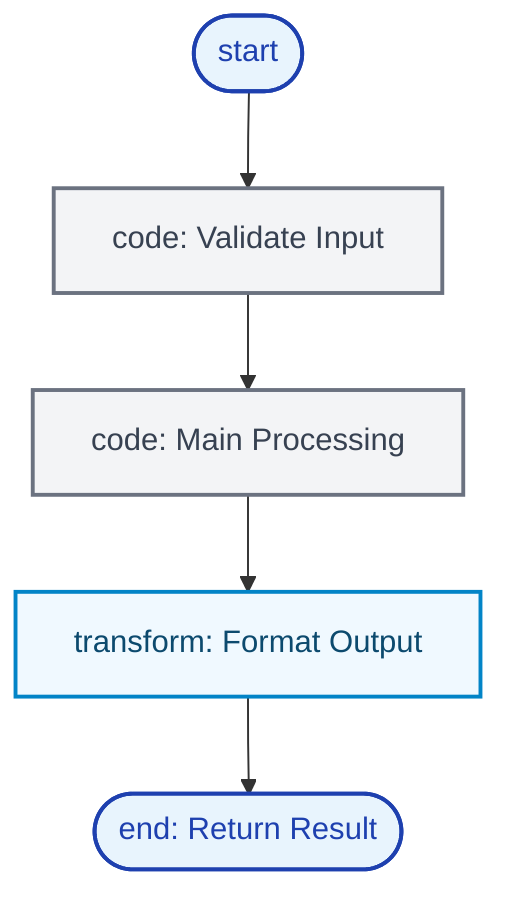
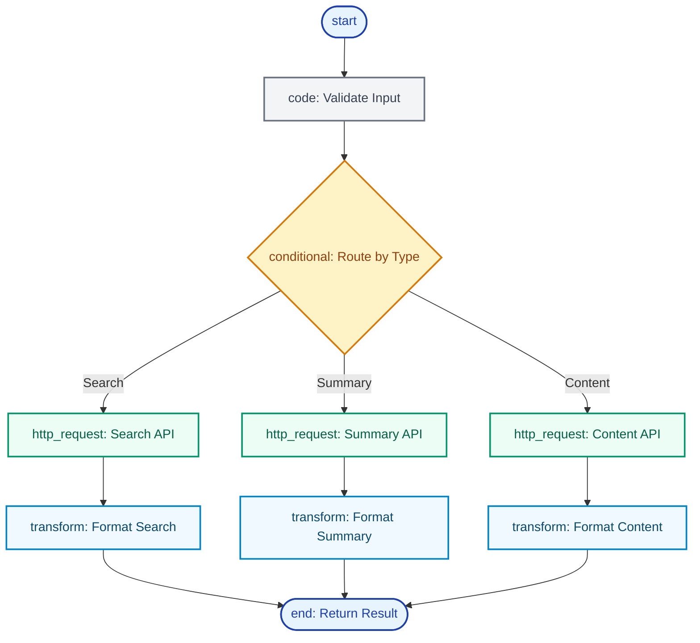
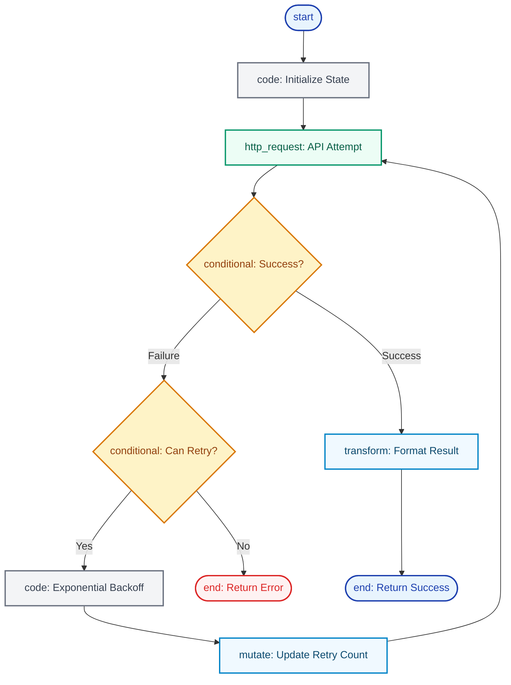

import {
  Wrench,
  Code,
  Globe,
  Zap,
  Settings,
  Play,
  CheckCircle,
  Users,
  Workflow,
  Brain,
  Network,
  Cpu,
  Database,
  RotateCcw,
  ExternalLink,
  Construction,
  Shield,
  Package,
  Cog,
  Search,
  Calculator,
  Clock,
  MessageSquare,
  Bot,
  Lightbulb,
  BarChart,
  HeartPulse,
} from 'lucide-react';

<div className="flex items-center justify-between">
  <h2>What are Tools?</h2>
  <CopyPageButton />
</div>

**Tools** are executable capabilities that extend what [agents](/core-concepts/agents) can do beyond conversation. Unlike simple functions, tools are **blueprint-powered**, **reusable**, and **intelligent** - capable of complex workflows and decision-making.

Think of tools as **specialized AI workers** that agents can delegate specific tasks to, like having experts on your team for different functions.

<div className="my-8">
  
  <div className="text-sm text-muted-foreground text-center mt-2">
    Tool marketplace: Browse automation tools with code examples and one-click installation
  </div>
</div>

---

## Getting Started: Your First Tool

<Steps>
<Step icon={<Search />}>
### Browse Tool Templates
Navigate to the [Marketplace](/core-concepts/marketplace) and explore available tool templates. Filter by category to find tools for your use case.
</Step>

<Step icon={<Zap />}>
### Deploy a Tool
Click on a tool template and select "Deploy". Configure any required API keys or settings, then confirm deployment to your starship.
</Step>

<Step icon={<Bot />}>
### Assign to Agent
Go to your agent settings and assign the new tool. Agents can now use this tool during conversations automatically.
</Step>

<Step icon={<CheckCircle />}>
### Test in Conversation
Chat with your agent and ask them to use the tool. Watch as they intelligently call the tool when needed.
</Step>
</Steps>

<Callout type="info">
  **New to Starships.ai?** Check out our [Getting Started](/getting-started) guide to set up your account and understand how tools work
  within your starship.
</Callout>

---

## Universal Tool Architecture

Every tool in the Starships.ai framework shares the same core architecture:

### Core Components

- **<Brain className="inline w-4 h-4" /> Function Interface**: JSON schema defining what parameters the tool accepts and returns
- **<Workflow className="inline w-4 h-4" /> Blueprint Logic**: Visual workflow defining exactly how the tool operates
- **<Settings className="inline w-4 h-4" /> Configuration**: User-specific settings like API keys and custom parameters
- **<Shield className="inline w-4 h-4" /> Execution Engine**: Secure, isolated runtime environment with timeouts and resource limits
- **<Package className="inline w-4 h-4" /> Marketplace Integration**: Template system for sharing and reusing tools across the community

---

## Blueprint-Powered Architecture

### Three Types of Tool Blueprints

Tools in Starships.ai use **visual workflows (blueprints)** that fall into three main patterns based on complexity and use case:

### 1. Linear Blueprint (Simple Sequential Flow)

For straightforward operations like calculations, data formatting, or simple API calls:



**Use Cases**: Calculator tool, time utilities, text processing, unit conversions

### 2. Branched Blueprint (Conditional Logic)

For tools that need different processing paths based on input or context:



**Use Cases**: Wikipedia search tool, multi-format processors, API routing tools, content type handlers

### 3. Loop Blueprint (Retry and State Management)

For tools that need retry logic, error recovery, or iterative processing:



**Use Cases**: Rate-limited APIs, unreliable external services, batch processing tools, file upload handlers


### Blueprint Node Types

All blueprint types can use any combination of these powerful node types:

- <span style={{color: '#0066cc'}}>**[start](/core-concepts/blueprints#start-node)**</span> <ExternalLink className="inline w-3 h-3" />: Receives tool parameters and initiates execution
- <span style={{color: '#0066cc'}}>**[code](/core-concepts/blueprints#code-node)**</span> <ExternalLink className="inline w-3 h-3" />: Executes JavaScript for data processing and validation logic
- <span style={{color: '#0066cc'}}>**[conditional](/core-concepts/blueprints#conditional-node)**</span> <ExternalLink className="inline w-3 h-3" />: Routes execution based on conditions and business logic
- <span style={{color: '#0066cc'}}>**[http_request](/core-concepts/blueprints#http-node)**</span> <ExternalLink className="inline w-3 h-3" />: Makes API calls to external services with authentication
- <span style={{color: '#0066cc'}}>**[mutate](/core-concepts/blueprints#mutate-node)**</span> <ExternalLink className="inline w-3 h-3" />: Updates tool state and context for complex workflows
- <span style={{color: '#0066cc'}}>**[transform](/core-concepts/blueprints#transform-node)**</span> <ExternalLink className="inline w-3 h-3" />: Modifies data structure and format using JSON operations
- <span style={{color: '#0066cc'}}>**[end](/core-concepts/blueprints#end-node)**</span> <ExternalLink className="inline w-3 h-3" />: Returns structured results to the calling agent

<Callout type="info">
  **Blueprint Architecture**: Learn more about the [visual workflow system](/core-concepts/blueprints) that powers intelligent tool
  execution.
</Callout>

---

## How Tools Work with Agents

Tools seamlessly integrate with agent conversations through LLM function calling:

<Steps>
<Step icon={<Brain />}>
### Agent Analyzes Request
The agent examines your request and identifies which tools might be helpful to provide a complete answer.
</Step>

<Step icon={<Zap />}>
  ### Function Calling Decision The agent decides to call specific tools with appropriate parameters, like "I need to search for current
  weather data."
</Step>

<Step icon={<Wrench />}>
  ### Tool Execution The tool's blueprint executes with the provided parameters, potentially involving multiple steps like API calls, data
  processing, and formatting.
</Step>

<Step icon={<RotateCcw />}>
### Result Integration
The tool result is returned to the agent, who incorporates it into their understanding and continues the conversation.
</Step>
</Steps>

**Example Flow**:

```
User: "What's the current exchange rate for EUR to USD?"

Agent thinks: "I need currency data" → Calls currency-converter tool
Tool executes: API call → data processing → formatted response
Tool returns: "1 EUR = 1.0856 USD (as of 2024-01-15 14:30 UTC)"
Agent responds: "The current EUR to USD exchange rate is 1.0856..."
```

---

## Tool Discovery & Categories

Tools are organized into categories based on their primary function:

- **Data & Search**: Web search, Wikipedia lookup, document search, data processing, API integration
- **Development**: Code analysis, documentation generation, testing, deployment automation
- **Communication**: Email integration, chat platforms, SMS, calendar scheduling
- **Utilities**: Mathematical operations, time/date tools, text processing, system operations


## Create Custom Tools with Daedalus

<div className="my-6">
  
  <div className="text-sm text-muted-foreground text-center mt-2">Create tools with parameters and blueprints, or deploy from templates</div>
</div>

[**Daedalus**](/agents/daedalus) is the meta-agent that specializes in creating custom tools through conversation. Build API integrations, data processors, monitoring systems, and automation workflows tailored to your specific needs.

<Callout type="info">
  **Ready to Create Custom Tools?** Work with [Daedalus](/agents/daedalus) to build tools tailored to your specific needs through natural
  conversation.
</Callout>

---

## Enterprise Features

- **Isolated Execution**: Tools run in separate processes with resource controls
- **Input Validation**: JSON Schema validation and sanitization
- **Access Control**: Permission-based tool access per agent
- **Tool Composition**: Tools can call other tools for complex workflows
- **Dynamic Discovery**: Agents automatically understand new tool capabilities

