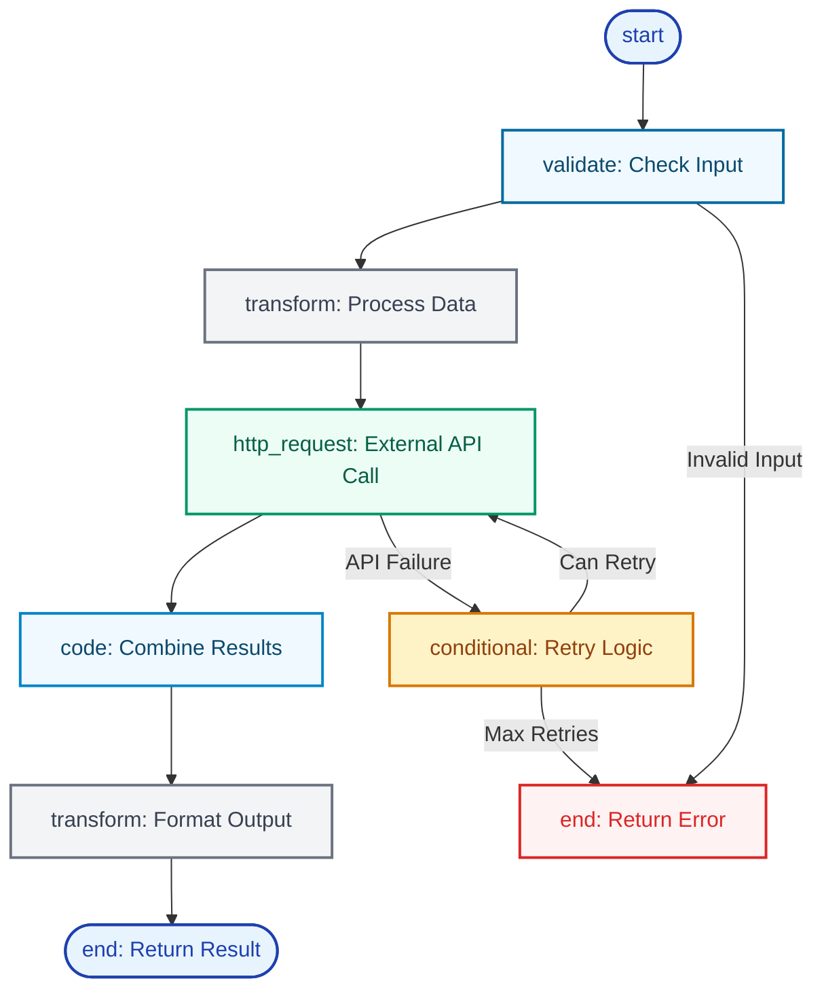

import { Wrench, Code, Globe, Zap, Settings, Play, CheckCircle, Users, Workflow, Brain, Network, Cpu, Database, RotateCcw, ExternalLink, Construction, Shield, Package, Cog, Search, Calculator, Clock, MessageSquare } from 'lucide-react';

# Tools

<div className="flex justify-end mb-4">
  <CopyPageButton />
</div>

<Callout type="info">
**On this page**: What tools are • How they work • Tool categories • Blueprint architecture • Tool lifecycle • Creating with Daedalus
</Callout>

## What Are Tools?

**Tools** are executable capabilities that extend what agents can do beyond conversation. Unlike simple functions, tools in Starships.ai are:

- **Blueprint-Powered**: Built from visual workflows, not code
- **Reusable**: Shared across multiple agents and starships
- **Intelligent**: Can make decisions and handle complex logic
- **Secure**: Execute in isolated environments with resource controls

Think of tools as **specialized AI workers** that agents can delegate specific tasks to, like having experts on your team for different functions.

<div className="my-8">
  
  <p className="text-sm text-muted-foreground text-center mt-2">Create tools with parameters and blueprints, or deploy from templates</p>
</div>

---

## Universal Tool Architecture

Every tool in the Starships.ai framework follows the same proven architecture:

### Core Components

<Cards>
  <Card 
    icon={<Brain />}
    title="Function Interface"
  >
    JSON schema defining what parameters the tool accepts and what it returns. Like a contract specifying how to call a specialist.
  </Card>
  
  <Card
    icon={<Workflow />}
    title="Blueprint Logic"
  >
    Visual workflow defining exactly how the tool operates. Like step-by-step instructions a specialist follows to complete tasks.
  </Card>
  
  <Card
    icon={<Settings />}
    title="Configuration"
  >
    User-specific settings like API keys and custom parameters. Like providing your specialist with access to your systems and preferences.
  </Card>
  
  <Card
    icon={<Shield />}
    title="Execution Engine"
  >
    Secure, isolated runtime environment with timeouts and resource limits. Like a controlled workspace where specialists can work safely.
  </Card>
  
  <Card
    icon={<Package />}
    title="Marketplace Integration"
  >
    Template system for sharing and reusing tools across the community. Like a library of proven specialist workflows you can instantly deploy.
  </Card>
</Cards>

---

## How Tools Work with Agents

### The Tool-Calling Integration

Tools seamlessly integrate with agent conversations through LLM function calling:

<Steps>
<Step icon={<Brain />}>
### Agent Analyzes Request
The agent examines your request and identifies which tools might be helpful to provide a complete answer.
</Step>

<Step icon={<Zap />}>
### Function Calling Decision
The agent decides to call specific tools with appropriate parameters, like "I need to search for current weather data."
</Step>

<Step icon={<Wrench />}>
### Tool Execution
The tool's blueprint executes with the provided parameters, potentially involving multiple steps like API calls, data processing, and formatting.
</Step>

<Step icon={<RotateCcw />}>
### Result Integration
The tool result is returned to the agent, who incorporates it into their understanding and continues the conversation.
</Step>
</Steps>

**Example Flow**:
```
User: "What's the current exchange rate for EUR to USD?"

Agent thinks: "I need currency data" → Calls currency-converter tool
Tool executes: API call → data processing → formatted response
Tool returns: "1 EUR = 1.0856 USD (as of 2024-01-15 14:30 UTC)"
Agent responds: "The current EUR to USD exchange rate is 1.0856..."
```

### Why This Works
- **Automatic Discovery**: Agents know what tools are available and how to use them
- **Parameter Mapping**: LLM intelligently extracts tool parameters from conversation context
- **Error Handling**: Tools provide structured error messages agents can understand and act on
- **Result Processing**: Tool outputs are designed for agent comprehension and user presentation

<Callout type="info">
**Want to build custom tools?** Learn how Daedalus creates sophisticated tools through conversation in our [Tool Creator Guide](/agents/daedalus).
</Callout>

---

## Tool Categories

Tools are organized into categories based on their primary function:

### Available Categories

<Tabs items={['Data & Search', 'Development', 'Communication', 'Utilities']}>
<Tab value="Data & Search">

**Information Retrieval and Analysis**
- **Search Tools**: Web search, Wikipedia lookup, document search
- **Data Processing**: CSV analysis, JSON transformation, format conversion
- **Research Tools**: Academic paper search, fact checking, summarization
- **API Integration**: External service connections for data retrieval

**Example Tools**:
- `wikipedia-search` - Wikipedia content search and extraction
- `duckduckgo` - Web search capabilities with result formatting
- `data-analyzer` - Process and analyze structured data files

</Tab>
<Tab value="Development">

**Coding and Technical Tasks**
- **Code Analysis**: Code review, bug detection, performance analysis
- **Documentation**: API documentation generation, code commenting
- **Testing**: Automated test generation, validation, debugging assistance
- **Deployment**: CI/CD integration, build automation, environment management

**Example Tools**:
- `code-reviewer` - Analyze code quality and suggest improvements
- `api-tester` - Validate API endpoints and generate test cases
- `documentation-generator` - Create comprehensive technical documentation

</Tab>
<Tab value="Communication">

**Messaging and Notifications**
- **Email Integration**: Send emails, parse messages, manage mailing lists
- **Chat Platforms**: Slack, Discord, Teams integration
- **Notifications**: SMS, push notifications, webhook calls
- **Scheduling**: Calendar integration, meeting coordination

**Example Tools**:
- `email-sender` - Send formatted emails with attachments
- `slack-notifier` - Post messages to Slack channels with rich formatting
- `calendar-scheduler` - Schedule meetings and manage calendar events

</Tab>
<Tab value="Utilities">

**General Purpose Tools**
- **Calculations**: Mathematical operations, unit conversions, financial calculations
- **Time & Date**: Timezone conversions, scheduling, date arithmetic
- **Text Processing**: Language translation, text analysis, format conversion
- **System Tools**: File operations, monitoring, health checks

**Example Tools**:
- `calculator` - Evaluate mathematical expressions safely
- `time` - Current time retrieval with timezone support
- `echo` - Testing and debugging tool for workflow validation

</Tab>
</Tabs>

---

## Blueprint-Powered Architecture

### What Makes Tools Intelligent

Unlike traditional functions, tools in Starships.ai are powered by **visual workflows (blueprints)**:



### Blueprint Node Types

Tools can use any combination of these powerful node types:

- <span style={{color: '#0066cc'}}>**[start](/core-concepts/blueprints#start-node)** <ExternalLink className="inline w-3 h-3" /></span>: Receives tool parameters and initiates execution
- <span style={{color: '#0066cc'}}>**[http_request](/core-concepts/blueprints#http-node)** <ExternalLink className="inline w-3 h-3" /></span>: Makes API calls to external services with authentication
- <span style={{color: '#0066cc'}}>**[code](/core-concepts/blueprints#code-node)** <ExternalLink className="inline w-3 h-3" /></span>: Executes JavaScript for data processing and logic
- <span style={{color: '#0066cc'}}>**[transform](/core-concepts/blueprints#transform-node)** <ExternalLink className="inline w-3 h-3" /></span>: Modifies data structure and format using JSON operations
- <span style={{color: '#0066cc'}}>**[conditional](/core-concepts/blueprints#conditional-node)** <ExternalLink className="inline w-3 h-3" /></span>: Routes execution based on conditions and business logic
- <span style={{color: '#0066cc'}}>**[mutate](/core-concepts/blueprints#mutate-node)** <ExternalLink className="inline w-3 h-3" /></span>: Updates tool state and context for complex workflows
- <span style={{color: '#0066cc'}}>**[end](/core-concepts/blueprints#end-node)** <ExternalLink className="inline w-3 h-3" /></span>: Returns structured results to the calling agent

### Template Expression System

Tools use dynamic expressions to access data and context:

```javascript
// Access tool parameters
{{ $json.searchQuery }}
{{ $json.apiKey }}

// Reference previous node outputs
{{ $lastOutputOf("api_call")[0].json.results }}

// Environment variables and configuration
{{ env('EXTERNAL_API_KEY') }}
{{ config.customEndpoint }}

// Complex data path access
{{ $lastOutputOf("process_data")[0].json.summary.totalResults }}
```

---

## Tool Lifecycle

### From Template to Execution

<Steps>
<Step>

### Template Creation
Tools start as reusable templates in the marketplace, defined with JSON schema parameters and blueprint workflows.

**Template Definition**:
```typescript
{
  name: "Weather Lookup",
  slug: "weather-lookup", 
  description: "Get current weather for any location",
  parameters: {
    type: "object",
    properties: {
      location: { type: "string", description: "City name or coordinates" }
    },
    required: ["location"]
  },
  blueprint: { /* workflow definition */ }
}
```

</Step>

<Step>

### Instance Deployment
Users deploy tool templates to their starship, creating customizable instances with their own configurations.

**Instance Configuration**:
- API keys and authentication tokens
- Custom endpoints and service configurations  
- User-specific parameters and preferences
- Permission and access control settings

</Step>

<Step>

### Agent Assignment
Tools are assigned to specific agents, making them available for function calling during conversations.

<div className="my-6">
  
  <p className="text-sm text-muted-foreground text-center mt-2">Wire tools to agents with one click and keep configurations organized</p>
</div>

**Assignment Process**:
- Select tools relevant to agent's purpose
- Configure tool access and permissions
- Optimize tool selection for performance
- Enable/disable tools based on context

</Step>

<Step>

### Runtime Execution
When agents call tools, they execute in secure, isolated environments with comprehensive monitoring.

**Execution Features**:
- Child process isolation for security
- Resource limits and timeout controls
- Comprehensive error handling and recovery
- Event streaming for monitoring and debugging

</Step>
</Steps>

---

## Tool Security and Performance

### Execution Environment

<Tabs items={['Security', 'Performance', 'Monitoring']}>
<Tab value="Security">

**Isolated Execution**: Tools run in separate Node.js processes to prevent interference and security breaches

**Resource Controls**:
- Memory limits to prevent resource exhaustion
- Wall-clock timeouts for responsive user experience
- CPU usage monitoring and throttling
- Network access controls and request filtering

**Input Validation**:
- JSON Schema validation for all tool parameters
- Type checking and sanitization of user inputs
- Protection against injection attacks and malformed data
- Secure handling of sensitive information like API keys

**Access Control**:
- Permission-based tool access per agent
- Environment variable isolation per starship
- Audit logging for all tool executions
- Rate limiting and usage monitoring

</Tab>
<Tab value="Performance">

**Optimized Execution**: Smart runner selection based on execution context and nesting depth

**Execution Strategies**:
- Child process isolation for top-level tool calls
- Local execution for nested workflows (better performance)
- Connection pooling for database and API operations
- Intelligent caching of frequently accessed data

**Resource Management**:
- Efficient memory usage with automatic cleanup
- Concurrent execution for independent operations
- Batch processing capabilities for large datasets
- Graceful degradation under high load

**Response Optimization**:
- Streaming responses for long-running operations
- Compression for large result sets
- Connection reuse for multiple API calls
- Smart timeout configurations per tool type

</Tab>
<Tab value="Monitoring">

**Comprehensive Event System**: Real-time visibility into tool execution and performance

**Event Types**:
- `tool_started` - Tool execution begins with context
- `tool_complete` - Execution finished with results or errors
- `node_completed` - Individual blueprint node completion
- `workflow_started` - Blueprint workflow initiation

**Metrics Collection**:
- Execution duration and performance statistics
- Resource usage (memory, CPU, network)
- Error rates and failure patterns
- Usage patterns and optimization opportunities

**Debugging Support**:
- Detailed execution traces with node-level granularity
- Error context with stack traces and input data
- Blueprint validation and lint checking
- Test execution with sample data

</Tab>
</Tabs>

---

## Daedalus: The Tool Creator

**Daedalus** is the meta-agent that specializes in creating, managing, and optimizing tools. Daedalus understands:

<Cards>
  <Card
    icon={<Code />}
    title="Blueprint Architecture"
    href="/agents/daedalus"
  >
    How to design efficient, reliable workflows using the full range of node types and patterns.
  </Card>
  
  <Card
    icon={<Wrench />}
    title="Tool Engineering"
    href="/agents/daedalus"
  >
    Creating robust, reusable tools with proper error handling, validation, and performance optimization.
  </Card>
  
  <Card
    icon={<Network />}
    title="Integration Patterns"
    href="/agents/daedalus"
  >
    Connecting tools to external APIs, databases, and services with authentication and security best practices.
  </Card>
  
  <Card
    icon={<Settings />}
    title="System Management"
    href="/agents/daedalus"
  >
    Tool lifecycle management, version control, testing, and deployment across the platform.
  </Card>
</Cards>

### What Daedalus Can Build

<Accordions>
  <Accordion title="🔗 API Integration Tools">
    **External Service Connections**: Daedalus creates tools that integrate with any REST API, handling authentication, rate limiting, and error recovery automatically.
    
    **Examples**:
    - Payment processing tools (Stripe, PayPal)
    - Communication tools (email, SMS, chat platforms)
    - Data services (weather, finance, social media)
    - Enterprise systems (CRM, ERP, databases)
  </Accordion>

  <Accordion title="📊 Data Processing Tools">
    **Complex Data Workflows**: Multi-step data processing pipelines with validation, transformation, and output formatting.
    
    **Examples**:
    - CSV import/export with validation and cleansing
    - Report generation from multiple data sources
    - Format conversion between different data standards
    - Real-time data analysis and alerting
  </Accordion>

  <Accordion title="🔍 Monitoring and Analysis Tools">
    **System Intelligence**: Tools that monitor, analyze, and respond to system conditions and business metrics.
    
    **Examples**:
    - Website uptime and performance monitoring
    - Business metrics tracking and alerting
    - Log analysis and anomaly detection
    - Security monitoring and threat response
  </Accordion>

  <Accordion title="🔧 Workflow Automation Tools">
    **Process Orchestration**: Complex multi-step business processes that coordinate between different systems and stakeholders.
    
    **Examples**:
    - Order processing pipelines with multiple validation steps
    - Customer onboarding workflows with conditional branching
    - Document approval processes with escalation logic
    - Event-driven automation with webhooks and notifications
  </Accordion>
</Accordions>

<Callout type="info">
**Ready to Create Custom Tools?** Work with Daedalus to build tools tailored to your specific needs. Learn more in our [Daedalus Tool Creator Guide](/agents/daedalus).
</Callout>

---

## Built-in Tool Examples

### Essential Tools Available Now

<Cards>
  <Card icon={<Calculator />} title="Calculator">
    Evaluate mathematical expressions safely with support for complex calculations and unit conversions.
  </Card>
  
  <Card icon={<Clock />} title="Time">
    Current time retrieval with timezone support, date arithmetic, and scheduling helpers.
  </Card>
  
  <Card icon={<Search />} title="Wikipedia Search">
    Search and extract content from Wikipedia with automatic summarization and fact checking.
  </Card>
  
  <Card icon={<Globe />} title="DuckDuckGo Search">
    Web search capabilities with result filtering, ranking, and content extraction.
  </Card>
  
  <Card icon={<MessageSquare />} title="Echo">
    Testing and debugging tool for validating workflows and checking data flow.
  </Card>
  
  <Card icon={<Cog />} title="System Tools">
    File operations, environment checks, and system monitoring capabilities.
  </Card>
</Cards>

### Tool Usage Patterns

**Simple Tool Call**:
```javascript
// Agent uses calculator tool
agent.callTool('calculator', { expression: '2 + 2 * 3' })
// Returns: { result: 8, expression: '2 + 2 * 3' }
```

**Complex Workflow Tool**:
```javascript
// Agent uses research tool with multi-step process
agent.callTool('research-assistant', { 
  topic: 'renewable energy trends', 
  sources: ['academic', 'news', 'reports'],
  depth: 'comprehensive'
})
// Executes: search → filter → analyze → summarize → cite
```

---

## Advanced Tool Concepts

### Tool Composition and Nesting

Tools can call other tools, creating powerful composition patterns:

**Example**: A "Market Analysis" tool that:
1. Uses `web-search` tool to find recent news
2. Uses `data-processor` tool to analyze financial data  
3. Uses `report-generator` tool to create formatted output
4. Uses `email-sender` tool to distribute results

### Dynamic Tool Discovery

Agents automatically discover and adapt to new tools:

- **Capability Detection**: Agents understand what new tools can do
- **Parameter Learning**: Automatic parameter mapping from JSON schemas
- **Usage Optimization**: Learn optimal tool combinations through experience
- **Error Recovery**: Adapt tool usage based on success/failure patterns

### Enterprise Tool Integration

Connect tools to your existing infrastructure:

- **Authentication**: OAuth, API keys, certificate-based auth
- **VPN Support**: Secure connections to internal systems
- **Compliance**: SOC 2, GDPR, HIPAA-compliant tool execution
- **Audit Trails**: Comprehensive logging for regulatory requirements

---

## Next Steps

<Cards>
  <Card title="Create with Daedalus" href="/agents/daedalus">
    Build custom tools and workflows with the expert tool creator
  </Card>
  <Card title="Agent Integration" href="/core-concepts/agents#agent-memory">
    Learn how agents discover and use tools effectively
  </Card>
  <Card title="Blueprint Reference" href="/core-concepts/blueprints">
    Understand the visual workflow system that powers tools
  </Card>
  <Card title="Marketplace" href="/core-concepts/marketplace">
    Explore available tool templates and share your creations
  </Card>
</Cards>