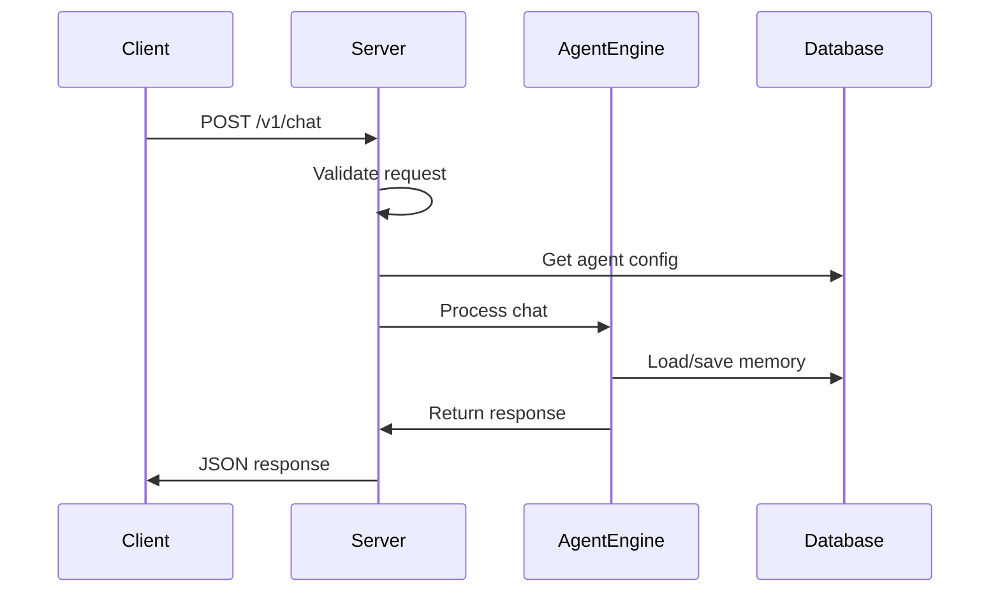
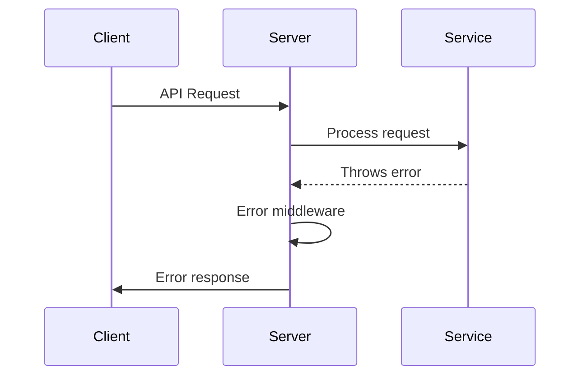

# @starships/server

Production-ready Express.js API server powering the starships.ai platform. Features starship management, workflow orchestration, agent deployment, conversation handling, and Stripe billing with comprehensive security and monitoring.

## 🚀 Features

- **Starship Management**: Complete CRUD operations with subscription billing and agent deployment
- **Workflow Orchestration**: Advanced workflow planning and execution with AI-powered orchestrators
- **Agent Marketplace**: Agent creation, templates, and deployment management
- **Conversation System**: Chat interfaces with message history and structured logging
- **Workflow Integration**: Integration with autopilot workflow execution system
- **Stripe Integration**: Complete subscription billing with webhook idempotency and portal management
- **JWT Authentication**: Secure authentication with middleware protection
- **Waitlist Management**: Early access user onboarding system
- **Health Monitoring**: Comprehensive health checks and system metrics
- **Production Ready**: Error handling, request validation, and CORS configuration

## 📦 Installation

```bash
# Install dependencies
pnpm install

# Build the package
pnpm build

# Start development server
pnpm dev

# Start production server
pnpm start
```

## 🏗️ Architecture

### Server Structure

```
src/
├── index.ts                     # Main server
├── config/
│   └── environment.ts          # Environment configuration
├── routes/
│   ├── agents.ts              # Agent CRUD and marketplace operations
│   ├── agent-templates.ts     # Agent template management
│   ├── auth.ts                # Authentication endpoints
│   ├── conversations.ts       # Chat and communication endpoints
│   ├── health.ts              # Health monitoring and metrics
│   ├── memory.ts              # Memory management endpoints
│   ├── native-api-keys.ts     # Encrypted API key management
│   ├── starships.ts           # Starship CRUD and billing operations
│   ├── users.ts               # User management endpoints
│   ├── waitlist.ts            # Waitlist management endpoints
│   └── webhooks.ts            # Stripe webhook handling
├── services/
│   ├── StarshipService.ts            # Starship lifecycle management
│   ├── SubscriptionService.ts        # Stripe subscription management
│   └── (other services as needed)
├── middleware/
│   ├── auth.ts                       # Authentication middleware
│   ├── jwt-auth.ts                   # JWT token validation
│   ├── errorHandler.ts               # Centralized error handling
│   └── validation.ts                 # Request validation
└── utils/
    └── responseHelpers.ts            # Standardized API responses
```

## 🔧 API Endpoints

### Conversation System

#### Create Conversation

```http
POST /api/v1/conversations
Authorization: Bearer <token>
Content-Type: application/json

{
  "starshipId": "starship-123",
  "title": "Research Discussion",
  "description": "Planning research strategy"
}
```

**Response:**

```json
{
  "id": "conv-456",
  "starshipId": "starship-123",
  "title": "Research Discussion",
  "description": "Planning research strategy",
  "createdAt": "2024-01-15T10:30:00Z"
}
```

#### Send Message

```http
POST /api/v1/conversations/:id/messages
Authorization: Bearer <token>
Content-Type: application/json

{
  "content": "Let's analyze the competitive landscape",
  "role": "user"
}
```

### Starship Management

#### Create Starship

```http
POST /starships
Authorization: Bearer <token>
Content-Type: application/json

{
  "name": "Enterprise",
  "class": "cruiser"
}
```

**Response:**

```json
{
  "starship": {
    "id": "starship-123",
    "slug": "enterprise",
    "ownerId": "user-456",
    "class": "cruiser",
    "name": "Enterprise",
    "maxActiveExpeditions": 5,
    "maxAgents": 6,
    "status": "active",
    "createdAt": "2024-01-15T10:30:00Z",
    "updatedAt": "2024-01-15T10:30:00Z"
  }
}
```

#### Update Starship

```http
PUT /starships/:id
Authorization: Bearer <token>
Content-Type: application/json

{
  "name": "Enterprise NX-01",
  "status": "inactive",
  "maxActiveExpeditions": 3
}
```

**Response:**

```json
{
  "starship": {
    "id": "starship-123",
    "name": "Enterprise NX-01",
    "status": "inactive",
    "maxActiveExpeditions": 3,
    "updatedAt": "2024-01-15T11:00:00Z"
  }
}
```

### Agent Marketplace

#### List Agents with Filtering

```http
GET /agents?category=research&tags=analysis&public=true&page=1&limit=10
Authorization: Bearer <token>
```

**Response:**

```json
{
  "agents": [
    {
      "id": "agent-123",
      "name": "Research Analyst",
      "model": "gpt-4",
      "category": "research",
      "tags": ["analysis", "research", "data"],
      "isPublic": true,
      "authorId": "user-456",
      "rating": 4.8,
      "usageCount": 1250,
      "starshipId": "starship-123"
    }
  ],
  "pagination": {
    "page": 1,
    "limit": 10,
    "total": 45,
    "totalPages": 5
  }
}
```

#### Agent Analytics

```http
GET /agents/:id/analytics
Authorization: Bearer <token>
```

**Response:**

```json
{
  "usage": {
    "totalInvocations": 1250,
    "last30Days": 89,
    "averageRating": 4.8,
    "totalRatings": 156
  },
  "performance": {
    "averageResponseTime": 2.3,
    "successRate": 0.97,
    "errorRate": 0.03
  }
}
```

#### Create Agent

```http
POST /agents
Authorization: Bearer <token>
Content-Type: application/json

{
  "name": "Code Assistant",
  "model": "gpt-4",
  "starshipId": "starship-123",
  "category": "coding",
  "tags": ["coding", "development"],
  "isPublic": false
}
```

**Response:**

```json
{
  "id": "agent-456",
  "name": "Code Assistant",
  "model": "gpt-4",
  "starshipId": "starship-123",
  "category": "coding",
  "tags": ["coding", "development"],
  "isPublic": false,
  "authorId": "user-456",
  "createdAt": "2024-01-15T10:30:00Z",
  "updatedAt": "2024-01-15T10:30:00Z"
}
```

#### Update Agent Starship Assignment

```http
PUT /agents/:id/starship
Authorization: Bearer <token>
Content-Type: application/json

{
  "starshipId": "starship-789"
}
```

**Response:**

```json
{
  "message": "Agent starship assignment updated successfully",
  "agent": {
    "id": "agent-456",
    "starshipId": "starship-789",
    "updatedAt": "2024-01-15T11:00:00Z"
  }
}
```

#### Get Agents by Starship

```http
GET /agents/by-starship/:starshipId
Authorization: Bearer <token>
```

**Response:**

```json
[
  {
    "id": "agent-123",
    "name": "Assistant",
    "starshipId": "starship-123",
    "category": "general"
  }
]
```

### Memory Endpoints

#### Clear Memory

```http
DELETE /v1/memory/:sessionKey
```

**Response:**

```json
{
  "success": true,
  "message": "Memory cleared successfully"
}
```

#### Reset All Memory

```http
POST /v1/memory/reset
```

**Response:**

```json
{
  "success": true,
  "message": "All memory cleared successfully"
}
```

### MCP Tool Integration

#### List MCP Server Templates

```http
GET /mcp-servers
Authorization: Bearer <token>
```

**Response:**

```json
[
  {
    "id": "mcp-github",
    "name": "GitHub",
    "slug": "github",
    "description": "GitHub repository management and code analysis",
    "category": "development",
    "dockerImage": "starships/mcp-github:latest",
    "requiredApiKeys": ["GITHUB_TOKEN"],
    "tools": ["list_repos", "read_file", "create_issue"]
  }
]
```

#### Manage Native Tool API Keys

```http
PUT /starships/:starshipId/native-api-keys
Authorization: Bearer <token>
Content-Type: application/json

{
  "apiKeys": {
    "firecrawl": "fc-api-key-12345",
    "notion": "secret_notion-key-67890"
  }
}
```

**Response:**

```json
{
  "message": "API keys updated successfully",
  "encryptedKeys": {
    "firecrawl": "encrypted:AES256:...",
    "notion": "encrypted:AES256:..."
  }
}
```

### HTTP Communication

All communication is handled through REST API endpoints with JSON request/response format.

### Stripe Billing Integration

#### Stripe Webhook

```http
POST /webhooks/stripe
Stripe-Signature: <webhook-signature>
Content-Type: application/json

{
  "type": "checkout.session.completed",
  "data": {
    "object": {
      "subscription": "sub_1234567890",
      "customer": "cus_1234567890"
    }
  }
}
```

**Features:**

- Idempotency protection for webhook events
- Automatic subscription status updates
- Payment failure handling and retries
- Billing portal integration

### Comprehensive Health Monitoring

#### Detailed Health Check

```http
GET /health/detailed
```

**Response:**

```json
{
  "status": "healthy",
  "services": {
    "database": {
      "status": "healthy",
      "latency": 12
    },
    "stripe": {
      "status": "healthy",
      "lastWebhook": "2024-01-15T10:25:00Z"
    }
  },
  "metrics": {
    "memory": {
      "used": 234567890,
      "total": 1073741824
    },
    "cpu": {
      "usage": 0.23
    }
  }
}
```

## 🔧 Configuration

### Environment Variables

```env
# Server Configuration
SERVER_PORT=4000
NODE_ENV=production
CORS_ORIGIN=http://localhost:3000

# Database Configuration
NEO4J_URI=[NEO4J-LOCAL-URL]
NEO4J_USERNAME=neo4j
NEO4J_PASSWORD=password

# LLM Provider Configuration
OPENAI_API_KEY=your_openai_key
ANTHROPIC_API_KEY=your_anthropic_key

# Authentication (JWT)
JWT_SECRET=your_jwt_secret_key_32_chars_min

# Stripe Payment Integration
STRIPE_SECRET_KEY=sk_test_...
STRIPE_PUBLISHABLE_KEY=pk_test_...
STRIPE_WEBHOOK_SECRET=whsec_...
STRIPE_PRODUCT_SCOUT_ID=prod_scout_...
STRIPE_PRODUCT_CRUISER_ID=prod_cruiser_...
STRIPE_PRODUCT_DRAUGHT_ID=prod_draught_...

# Native Tool APIs (for encrypted storage)
FIRECRAWL_API_KEY=your_firecrawl_key
NOTION_API_KEY=your_notion_key

# Security & Encryption
ENCRYPTION_KEY=your_32_byte_encryption_key


# Logging & Monitoring
LOG_LEVEL=info
LOG_FORMAT=json
PROMETHEUS_METRICS_PORT=9090
```

### Server Configuration

```typescript
interface ServerConfig {
  port: number;
  cors: {
    origin: string | string[];
    credentials: boolean;
  };
  rateLimit: {
    windowMs: number;
    max: number;
  };
  security: {
    apiKey?: string;
  };
}
```

## 🛡️ Middleware

### Core Middleware

```typescript
import express from 'express';
import cors from 'cors';

const app = express();

// Body parsing
app.use(express.json({ limit: '10mb' }));
app.use(express.urlencoded({ extended: true }));

// CORS configuration
app.use(
  cors({
    origin: process.env.CORS_ORIGIN,
    credentials: true,
    methods: ['GET', 'POST', 'PUT', 'DELETE', 'OPTIONS'],
    allowedHeaders: ['Content-Type', 'Authorization'],
  })
);

// Security headers
app.use((req, res, next) => {
  res.header('X-Content-Type-Options', 'nosniff');
  res.header('X-Frame-Options', 'DENY');
  res.header('X-XSS-Protection', '1; mode=block');
  next();
});
```

### Request Validation

```typescript
import { body, validationResult } from 'express-validator';

// Chat request validation
export const validateChatRequest = [
  body('agent_id').isString().notEmpty(),
  body('user_id').isString().notEmpty(),
  body('message').isString().notEmpty(),
  body('channel_id').optional().isString(),
  body('stream').optional().isBoolean(),

  (req: Request, res: Response, next: NextFunction) => {
    const errors = validationResult(req);
    if (!errors.isEmpty()) {
      return res.status(400).json({
        error: 'Validation failed',
        details: errors.array(),
      });
    }
    next();
  },
];
```

### Error Handling

```typescript
// Global error handler
app.use((err: Error, req: Request, res: Response, next: NextFunction) => {
  console.error('Server error:', err);

  if (err.name === 'ValidationError') {
    return res.status(400).json({
      error: 'Validation failed',
      message: err.message,
    });
  }

  if (err.name === 'UnauthorizedError') {
    return res.status(401).json({
      error: 'Unauthorized',
      message: 'Invalid or missing authentication',
    });
  }

  res.status(500).json({
    error: 'Internal server error',
    message: process.env.NODE_ENV === 'development' ? err.message : 'Something went wrong',
  });
});
```

## 🔄 Request/Response Flow

### Chat Processing Flow



### Error Handling Flow



## 🧪 Testing

### Test Structure

```
tests/
├── setup.ts                 # Test configuration
├── testUtils.ts             # Test utilities
├── mocks/                   # Mock implementations
│   └── @starships/
│       └── autopilot.ts     # Autopilot engine mocks
└── unit/                    # Unit tests
    ├── agents.spec.ts       # Agent endpoints
    ├── chat.spec.ts         # Chat endpoints
    ├── health.spec.ts       # Health checks
    └── memory.spec.ts       # Memory endpoints
```

### Running Tests

```bash
# Run all tests
pnpm test

# Run with coverage
pnpm test --coverage

# Run specific test file
pnpm test chat.spec.ts

# Run in watch mode
pnpm test --watch
```

### Test Examples

```typescript
import request from 'supertest';
import { app } from '../src/index';

describe('Chat Endpoints', () => {
  it('should process chat request', async () => {
    const response = await request(app)
      .post('/v1/chat')
      .send({
        agent_id: 'test-agent',
        user_id: 'test-user',
        message: 'Hello',
      })
      .expect(200);

    expect(response.body).toHaveProperty('reply');
    expect(response.body.reply).toBeDefined();
  });

  it('should validate required fields', async () => {
    const response = await request(app)
      .post('/v1/chat')
      .send({
        agent_id: 'test-agent',
        // Missing user_id and message
      })
      .expect(400);

    expect(response.body).toHaveProperty('error', 'Validation failed');
  });
});
```

## 🐳 Docker Deployment

### Dockerfile

```dockerfile
FROM node:20-alpine

WORKDIR /app

# Copy package files
COPY package*.json ./
COPY pnpm-lock.yaml ./

# Install dependencies
RUN npm install -g pnpm
RUN pnpm install --frozen-lockfile

# Copy source code
COPY . .

# Build application
RUN pnpm build

# Expose port
EXPOSE 4000

# Health check
HEALTHCHECK --interval=30s --timeout=3s --start-period=5s --retries=3 \
  CMD curl -f http://localhost:4000/health || exit 1

# Start server
CMD ["pnpm", "start"]
```

### Docker Compose

```yaml
version: '3.8'

services:
  server:
    build: .
    ports:
      - '4000:4000'
    environment:
      - NODE_ENV=production
      - NEO4J_URI=bolt://neo4j:7687
      - NEO4J_USERNAME=neo4j
      - NEO4J_PASSWORD=password
    depends_on:
      - neo4j
    restart: unless-stopped

  neo4j:
    image: neo4j:5.15
    ports:
      - '7474:7474'
      - '7687:7687'
    environment:
      - NEO4J_AUTH=neo4j/password
      - NEO4J_PLUGINS=["apoc"]
    volumes:
      - neo4j_data:/data
      - neo4j_logs:/logs
    restart: unless-stopped

volumes:
  neo4j_data:
  neo4j_logs:
```

## 🚀 Performance

### Optimization Features

- **Connection Pooling**: Database connection management
- **Request Compression**: Gzip compression for responses
- **Caching**: In-memory caching for frequently accessed data
- **Rate Limiting**: Protection against abuse
- **Health Monitoring**: Performance metrics and monitoring

### Performance Metrics

```typescript
interface PerformanceMetrics {
  requestsPerSecond: number;
  averageResponseTime: number;
  errorRate: number;
  memoryUsage: number;
  cpuUsage: number;
}
```

### Monitoring Endpoints

```http
GET /metrics         # Prometheus metrics
GET /health          # Health status
GET /health/detailed # Detailed health information
```

## 🔍 Troubleshooting

### Common Issues

1. **Server won't start**

   ```bash
   # Check port availability
   lsof -i :4000

   # Check environment variables
   printenv | grep -E "(PORT|NEO4J|OPENAI|ANTHROPIC)"
   ```

2. **Database connection issues**

   ```bash
   # Test Neo4j connection
   cypher-shell -u neo4j -p password

   # Check database logs
   docker logs neo4j-container
   ```

3. **API key errors**

   ```bash
   # Verify API keys
   curl -H "Authorization: Bearer $OPENAI_API_KEY" \
        https://api.openai.com/v1/models
   ```

4. **Memory leaks**

   ```bash
   # Monitor memory usage
   docker stats server-container

   # Check Node.js heap
   node --inspect src/index.js
   ```

### Debug Mode

```bash
# Enable debug logging
DEBUG=starships:* pnpm dev

# Enable Node.js debugging
node --inspect-brk dist/index.js
```

## 📚 Dependencies

### Core Dependencies

- **express**: Web framework for Node.js
- **stripe**: Payment processing and subscription management
- **jose**: JWT token validation and management
- **@starships/autopilot**: Workflow execution engine with AI integration
- **@starships/models**: Neo4j database with migration system
- **@starships/protocol**: Shared types for agents and workflows
- **@starships/core**: MCP HTTP bridge services

### Development Dependencies

- **jest**: Testing framework
- **supertest**: HTTP testing utilities
- **@types/express**: TypeScript definitions
- **tsx**: TypeScript execution

## 📄 License

Private package - Part of the Starships AI platform.
