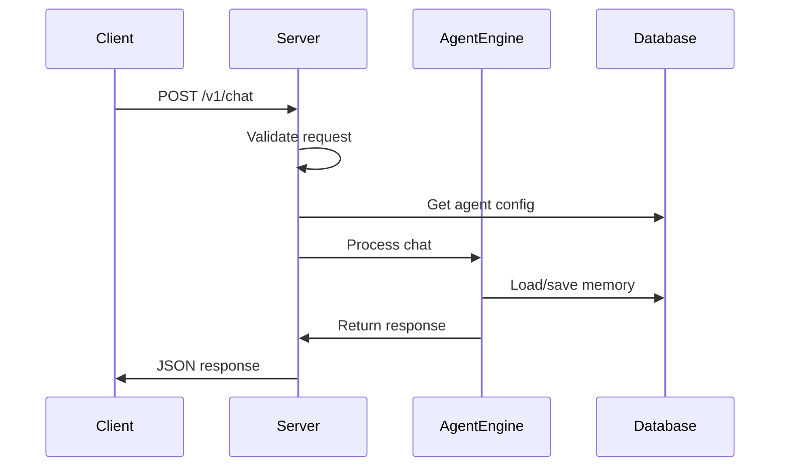
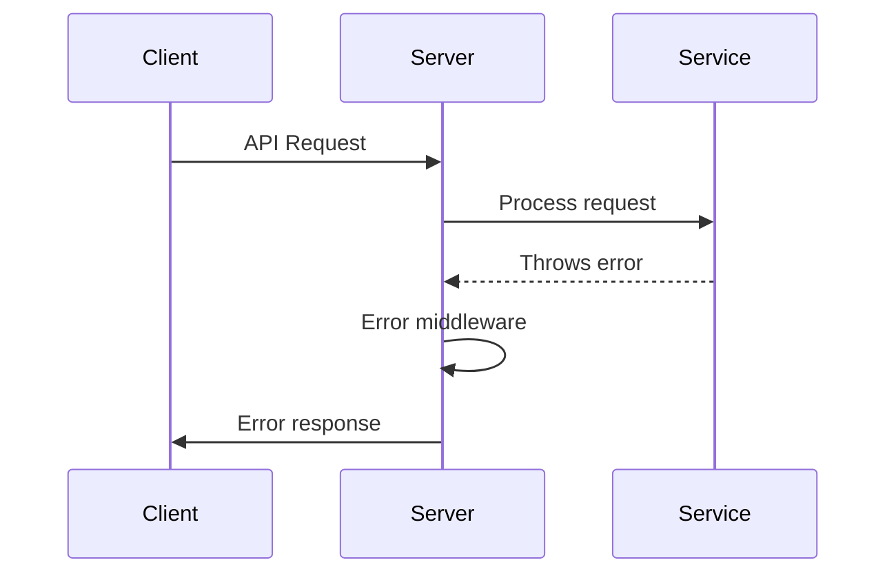

# @starships/server

Express.js HTTP API server for the Starships platform. Provides RESTful endpoints for chat processing, agent management, and memory operations with comprehensive middleware and error handling.

## 🚀 Features

- **RESTful API**: Complete HTTP API with standardized endpoints
- **Express.js 5**: Modern Express with enhanced performance
- **CORS Support**: Cross-origin resource sharing configuration
- **Error Handling**: Comprehensive error middleware
- **Request Validation**: Input validation and sanitization
- **Health Checks**: System health monitoring endpoints
- **Docker Support**: Production-ready containerization

## 📦 Installation

```bash
# Install dependencies
pnpm install

# Build the package
pnpm build

# Start development server
pnpm dev

# Start production server
pnpm start
```

## 🏗️ Architecture

### Server Structure

```
src/
├── index.ts                 # Main server entry point
├── config/
│   └── environment.ts      # Environment configuration
├── routes/
│   ├── agents.ts          # Agent management endpoints
│   ├── starships.ts       # Starship management endpoints
│   ├── chat.ts            # Chat processing endpoints
│   ├── memory.ts          # Memory management endpoints
│   ├── vision.ts          # Vision chamber endpoints
│   └── redeploy.ts        # Deployment webhook
└── services/
    └── AgentService.ts    # Business logic services
```

## 🔧 API Endpoints

### Chat Endpoints

#### Send Message
```http
POST /v1/chat
Content-Type: application/json

{
  "agent_id": "agent-123",
  "user_id": "user-456", 
  "channel_id": "channel-789",
  "message": "Hello, how are you?",
  "stream": false
}
```

**Response:**
```json
{
  "reply": "Hello! I'm doing well, thank you for asking. How can I help you today?",
  "usage": {
    "prompt_tokens": 15,
    "completion_tokens": 20
  }
}
```

### Starship Endpoints

#### List User's Starships
```http
GET /starships
Authorization: Bearer <token>
```

**Response:**
```json
{
  "starships": [
    {
      "id": "starship-123",
      "slug": "enterprise",
      "ownerId": "user-456",
      "class": "cruiser",
      "name": "Enterprise",
      "maxActiveExpeditions": 5,
      "maxAgents": 6,
      "status": "active",
      "createdAt": "2024-01-15T10:30:00Z",
      "updatedAt": "2024-01-15T10:30:00Z"
    }
  ]
}
```

#### Create Starship
```http
POST /starships
Authorization: Bearer <token>
Content-Type: application/json

{
  "name": "Enterprise",
  "class": "cruiser"
}
```

**Response:**
```json
{
  "starship": {
    "id": "starship-123",
    "slug": "enterprise",
    "ownerId": "user-456",
    "class": "cruiser",
    "name": "Enterprise",
    "maxActiveExpeditions": 5,
    "maxAgents": 6,
    "status": "active",
    "createdAt": "2024-01-15T10:30:00Z",
    "updatedAt": "2024-01-15T10:30:00Z"
  }
}
```

#### Update Starship
```http
PUT /starships/:id
Authorization: Bearer <token>
Content-Type: application/json

{
  "name": "Enterprise NX-01",
  "status": "inactive",
  "maxActiveExpeditions": 3
}
```

**Response:**
```json
{
  "starship": {
    "id": "starship-123",
    "name": "Enterprise NX-01",
    "status": "inactive",
    "maxActiveExpeditions": 3,
    "updatedAt": "2024-01-15T11:00:00Z"
  }
}
```

### Agent Endpoints

#### List Agents
```http
GET /agents
Authorization: Bearer <token>
```

**Response:**
```json
[
  {
    "id": "agent-123",
    "name": "Assistant",
    "model": "gpt-4",
    "systemPrompt": "You are a helpful assistant",
    "starshipId": "starship-123",
    "category": "general",
    "tags": ["assistant", "general"],
    "isPublic": false,
    "authorId": "user-456"
  }
]
```

#### Create Agent
```http
POST /agents
Authorization: Bearer <token>
Content-Type: application/json

{
  "name": "Code Assistant",
  "model": "gpt-4",
  "systemPrompt": "You are a helpful coding assistant",
  "starshipId": "starship-123",
  "category": "coding",
  "tags": ["coding", "development"],
  "isPublic": false
}
```

**Response:**
```json
{
  "id": "agent-456",
  "name": "Code Assistant",
  "model": "gpt-4",
  "systemPrompt": "You are a helpful coding assistant",
  "starshipId": "starship-123",
  "category": "coding",
  "tags": ["coding", "development"],
  "isPublic": false,
  "authorId": "user-456",
  "createdAt": "2024-01-15T10:30:00Z",
  "updatedAt": "2024-01-15T10:30:00Z"
}
```

#### Update Agent Starship Assignment
```http
PUT /agents/:id/starship
Authorization: Bearer <token>
Content-Type: application/json

{
  "starshipId": "starship-789"
}
```

**Response:**
```json
{
  "message": "Agent starship assignment updated successfully",
  "agent": {
    "id": "agent-456",
    "starshipId": "starship-789",
    "updatedAt": "2024-01-15T11:00:00Z"
  }
}
```

#### Get Agents by Starship
```http
GET /agents/by-starship/:starshipId
Authorization: Bearer <token>
```

**Response:**
```json
[
  {
    "id": "agent-123",
    "name": "Assistant",
    "starshipId": "starship-123",
    "category": "general"
  }
]
```

### Memory Endpoints

#### Clear Memory
```http
DELETE /v1/memory/:sessionKey
```

**Response:**
```json
{
  "success": true,
  "message": "Memory cleared successfully"
}
```

#### Reset All Memory
```http
POST /v1/memory/reset
```

**Response:**
```json
{
  "success": true,
  "message": "All memory cleared successfully"
}
```

### Administrative Endpoints

#### Health Check
```http
GET /health
```

**Response:**
```json
{
  "status": "healthy",
  "timestamp": "2024-01-15T10:30:00Z",
  "uptime": 3600,
  "version": "1.0.0"
}
```

#### Redeploy Webhook
```http
POST /redeploy
Authorization: Bearer <webhook-secret>
```

**Response:**
```json
{
  "success": true,
  "message": "Redeployment triggered"
}
```

## 🔧 Configuration

### Environment Variables

```env
# Server Configuration
PORT=4000
NODE_ENV=production
CORS_ORIGIN=http://localhost:3000

# Database Configuration  
NEO4J_URI=bolt://localhost:7687
NEO4J_USERNAME=neo4j
NEO4J_PASSWORD=password

# LLM Provider Configuration
OPENAI_API_KEY=your_openai_key
ANTHROPIC_API_KEY=your_anthropic_key

# Security
WEBHOOK_SECRET=your_webhook_secret
API_KEY=your_api_key

# Logging
LOG_LEVEL=info
LOG_FORMAT=json
```

### Server Configuration

```typescript
interface ServerConfig {
  port: number;
  cors: {
    origin: string | string[];
    credentials: boolean;
  };
  rateLimit: {
    windowMs: number;
    max: number;
  };
  security: {
    webhookSecret: string;
    apiKey?: string;
  };
}
```

## 🛡️ Middleware

### Core Middleware
```typescript
import express from 'express';
import cors from 'cors';

const app = express();

// Body parsing
app.use(express.json({ limit: '10mb' }));
app.use(express.urlencoded({ extended: true }));

// CORS configuration
app.use(cors({
  origin: process.env.CORS_ORIGIN,
  credentials: true,
  methods: ['GET', 'POST', 'PUT', 'DELETE', 'OPTIONS'],
  allowedHeaders: ['Content-Type', 'Authorization']
}));

// Security headers
app.use((req, res, next) => {
  res.header('X-Content-Type-Options', 'nosniff');
  res.header('X-Frame-Options', 'DENY');
  res.header('X-XSS-Protection', '1; mode=block');
  next();
});
```

### Request Validation
```typescript
import { body, validationResult } from 'express-validator';

// Chat request validation
export const validateChatRequest = [
  body('agent_id').isString().notEmpty(),
  body('user_id').isString().notEmpty(),
  body('message').isString().notEmpty(),
  body('channel_id').optional().isString(),
  body('stream').optional().isBoolean(),
  
  (req: Request, res: Response, next: NextFunction) => {
    const errors = validationResult(req);
    if (!errors.isEmpty()) {
      return res.status(400).json({
        error: 'Validation failed',
        details: errors.array()
      });
    }
    next();
  }
];
```

### Error Handling
```typescript
// Global error handler
app.use((err: Error, req: Request, res: Response, next: NextFunction) => {
  console.error('Server error:', err);
  
  if (err.name === 'ValidationError') {
    return res.status(400).json({
      error: 'Validation failed',
      message: err.message
    });
  }
  
  if (err.name === 'UnauthorizedError') {
    return res.status(401).json({
      error: 'Unauthorized',
      message: 'Invalid or missing authentication'
    });
  }
  
  res.status(500).json({
    error: 'Internal server error',
    message: process.env.NODE_ENV === 'development' ? err.message : 'Something went wrong'
  });
});
```

## 🔄 Request/Response Flow

### Chat Processing Flow


### Error Handling Flow


## 🧪 Testing

### Test Structure
```
tests/
├── setup.ts                 # Test configuration
├── testUtils.ts             # Test utilities
├── mocks/                   # Mock implementations
│   └── @starships/
│       └── agent-engine.ts  # Engine mocks
└── unit/                    # Unit tests
    ├── agents.spec.ts       # Agent endpoints
    ├── chat.spec.ts         # Chat endpoints
    ├── health.spec.ts       # Health checks
    └── memory.spec.ts       # Memory endpoints
```

### Running Tests
```bash
# Run all tests
pnpm test

# Run with coverage
pnpm test --coverage

# Run specific test file
pnpm test chat.spec.ts

# Run in watch mode
pnpm test --watch
```

### Test Examples
```typescript
import request from 'supertest';
import { app } from '../src/index';

describe('Chat Endpoints', () => {
  it('should process chat request', async () => {
    const response = await request(app)
      .post('/v1/chat')
      .send({
        agent_id: 'test-agent',
        user_id: 'test-user',
        message: 'Hello'
      })
      .expect(200);
      
    expect(response.body).toHaveProperty('reply');
    expect(response.body.reply).toBeDefined();
  });
  
  it('should validate required fields', async () => {
    const response = await request(app)
      .post('/v1/chat')
      .send({
        agent_id: 'test-agent'
        // Missing user_id and message
      })
      .expect(400);
      
    expect(response.body).toHaveProperty('error', 'Validation failed');
  });
});
```

## 🐳 Docker Deployment

### Dockerfile
```dockerfile
FROM node:20-alpine

WORKDIR /app

# Copy package files
COPY package*.json ./
COPY pnpm-lock.yaml ./

# Install dependencies
RUN npm install -g pnpm
RUN pnpm install --frozen-lockfile

# Copy source code
COPY . .

# Build application
RUN pnpm build

# Expose port
EXPOSE 4000

# Health check
HEALTHCHECK --interval=30s --timeout=3s --start-period=5s --retries=3 \
  CMD curl -f http://localhost:4000/health || exit 1

# Start server
CMD ["pnpm", "start"]
```

### Docker Compose
```yaml
version: '3.8'

services:
  server:
    build: .
    ports:
      - "4000:4000"
    environment:
      - NODE_ENV=production
      - NEO4J_URI=bolt://neo4j:7687
      - NEO4J_USERNAME=neo4j
      - NEO4J_PASSWORD=password
    depends_on:
      - neo4j
    restart: unless-stopped
    
  neo4j:
    image: neo4j:5.15
    ports:
      - "7474:7474"
      - "7687:7687"
    environment:
      - NEO4J_AUTH=neo4j/password
      - NEO4J_PLUGINS=["apoc"]
    volumes:
      - neo4j_data:/data
      - neo4j_logs:/logs
    restart: unless-stopped

volumes:
  neo4j_data:
  neo4j_logs:
```

## 🚀 Performance

### Optimization Features
- **Connection Pooling**: Database connection management
- **Request Compression**: Gzip compression for responses
- **Caching**: In-memory caching for frequently accessed data
- **Rate Limiting**: Protection against abuse
- **Health Monitoring**: Performance metrics and monitoring

### Performance Metrics
```typescript
interface PerformanceMetrics {
  requestsPerSecond: number;
  averageResponseTime: number;
  errorRate: number;
  memoryUsage: number;
  cpuUsage: number;
}
```

### Monitoring Endpoints
```http
GET /metrics         # Prometheus metrics
GET /health          # Health status
GET /health/detailed # Detailed health information
```

## 🔍 Troubleshooting

### Common Issues

1. **Server won't start**
   ```bash
   # Check port availability
   lsof -i :4000
   
   # Check environment variables
   printenv | grep -E "(PORT|NEO4J|OPENAI|ANTHROPIC)"
   ```

2. **Database connection issues**
   ```bash
   # Test Neo4j connection
   cypher-shell -u neo4j -p password
   
   # Check database logs
   docker logs neo4j-container
   ```

3. **API key errors**
   ```bash
   # Verify API keys
   curl -H "Authorization: Bearer $OPENAI_API_KEY" \
        https://api.openai.com/v1/models
   ```

4. **Memory leaks**
   ```bash
   # Monitor memory usage
   docker stats server-container
   
   # Check Node.js heap
   node --inspect src/index.js
   ```

### Debug Mode
```bash
# Enable debug logging
DEBUG=starships:* pnpm dev

# Enable Node.js debugging
node --inspect-brk dist/index.js
```

## 📚 Dependencies

### Core Dependencies
- **express**: Web framework for Node.js
- **cors**: Cross-origin resource sharing
- **dotenv**: Environment variable loading
- **@starships/agent-engine**: Core AI processing
- **@starships/models**: Database layer
- **@starships/protocol**: Shared types

### Development Dependencies
- **jest**: Testing framework
- **supertest**: HTTP testing utilities
- **@types/express**: TypeScript definitions
- **tsx**: TypeScript execution

## 📄 License

Private package - Part of the Starships AI platform. 