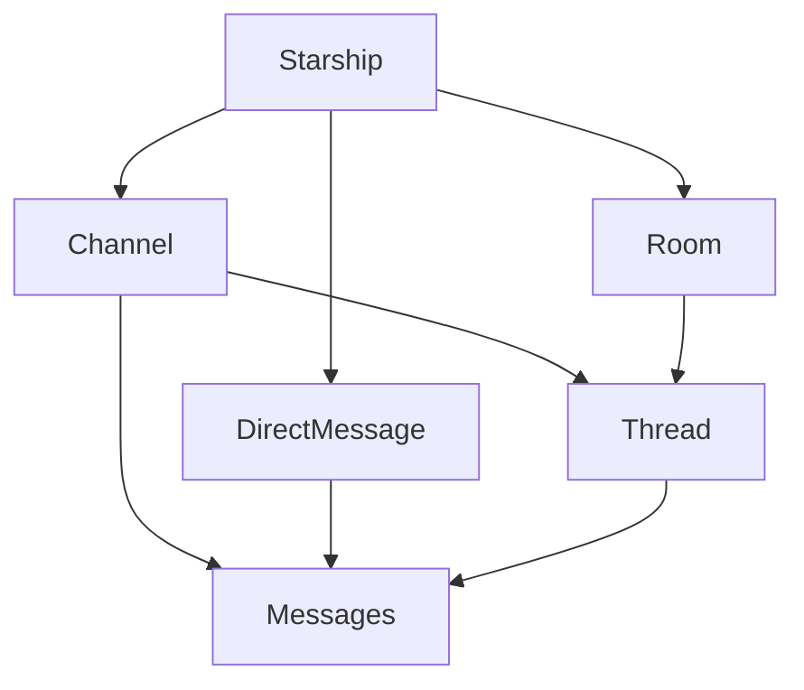

## Why this page exists

The Starships product surface includes **channels, rooms, direct messages, and threads**, but the server implements them using a shared primitive: the **conversation**.

This page explains the **theory** (how to think about these primitives) so agents and humans can choose the right API/connector action and avoid common misunderstandings.

## Core mental model

### “Conversation-backed” is the main pattern

A **conversation** is the universal container for:

- **Message history**
- **Agent turns** (execution/streaming state)
- **Notification preferences**
- **Membership / participants** (for restricted conversations)

Higher-level concepts are implemented as *tables that reference* a backing conversation id:

- **channel** → `channels.conversation_id`
- **room** → `rooms.conversation_id`
- **direct message** → `direct_messages.conversation_id`
- **thread** → a conversation whose `parent_conversation_id` is set

### IDs

- **conversationId**: the primary identifier used by almost all conversation-related APIs.
- **channelId / roomId**: in practice these are also **conversation ids** (because channels/rooms are conversation-backed).

## Object relationships

Notes:

- Channel messages typically live **directly in the channel conversation**.
- Rooms are typically **containers for threads**; messages mostly live in the **child thread conversations**.

## Threads: two related (but distinct) mechanisms

Threads show up in two ways:

### 1) Child conversations (the actual thread)

A thread is a **child conversation**:

- `thread.id` is a conversation id
- `thread.parent_conversation_id = parentConversationId`

This is the canonical structure used by:

- **room threads**
- **channel threads**

### 2) “Message linking” (how UIs discover a thread from a message)

A common UX pattern is “start a thread from a specific message”. In Starships this is implemented by **linking** a parent message to a child conversation:

- A message can store `linkedConversationId` (the child conversation id).
- The UI can then render “this message has a thread” without scanning all child conversations.

Important: **linking is metadata**, not the thread itself.

- You can have a child conversation (thread) without any linking message.
- Linking helps discovery, navigation, and notifications for channel-style threads.

## Permissions model (starship access vs conversation membership)

There are two layers of access checks:

1) **Starship access**: is the user allowed to access this starship at all?
2) **Conversation membership**: is this particular conversation restricted?

### Public vs private containers

- **Public channels / rooms**: starship access is sufficient to read.
- **Private channels / rooms**: require membership, with bypasses:
  - **instance admin** can always access
  - **starship owner** can always access (only for resources that truly belong to that starship)
- **Direct messages**: always treated as restricted (membership-based).

### “Participants” (authoritative)

Starships stores conversation access control and participation in **`conversation_participants`**.
This is the single source of truth for:

- private channel / room membership
- direct message membership
- “which agents and users are part of this conversation?”

## Notifications model (conversation-scoped)

Notification preferences are stored per user per conversation (conceptually: `conversationId + userId → level`):

- Levels: `all`, `mentions`, `mute`
- Channels and rooms expose notification-level endpoints directly.
- Threads reuse the same mechanism, but with an important constraint:
  - Thread notification-level is only supported for **threads whose parent is a channel**.

Why: “thread notification level” is currently modeled as a channel-thread concept, not a room-thread concept.

## Lifecycle patterns (how things are created and evolve)

### Create a channel / room

- Create backing conversation (title set from name).
- Insert into `channels` or `rooms` table.
- If private, add creator as `admin` member/participant (idempotent).

### Create a direct message (DM)

- DMs are created via the DM API and may be **reused** if an identical DM already exists.
  - user↔agent DMs are “one DM per (user, agent, starship)”
  - user↔user DMs are “one DM per (pair of users, starship)” with DB-level normalization.

### Create a thread

- Create a conversation with `parentConversationId` set.
- Optionally link a message to it via `linkedConversationId` for “thread from message” UX.

## Agent turns (what happens when you send a message)

When you call `POST /conversations/:conversationId/messages`:

- The server persists the user message.
- It decides whether the message will trigger agent execution.
- If it will trigger, the server enforces:
  - billing/credits gate
  - starship-level concurrency gate
  - conversation-level “turn guard” to prevent double-billing / double-turns
- Turns can end in states like `completed` or `waiting_for_tools` (tool approval flow).

## Streaming (how live updates work)

Conversation streaming is implemented as **SSE** on the messages endpoint:

- `GET /conversations/:conversationId/messages` with `Accept: text/event-stream` (or `?stream=true`)
- The server sends an initial **snapshot** (bounded message tail + current turn status), then emits **delta events**.
- Reconnect uses stream ids (e.g. `Last-Event-ID`) and/or query cursor fields.

Notifications use a similar SSE pattern under `/starships/:starshipId/notifications`.

## Connector actions vs HTTP (how agents should choose)

General rule: prefer `connector_action` when a Starships connector action exists, because it lets the host inject auth/base URLs consistently.

However, some surfaces are **HTTP-only** today (no seeded Starships connector actions), notably:

- rooms CRUD + room pins
- thread-only endpoints (children listing, linked-message, thread notification-level)
- message edit/delete/reactions/linking
- DM endpoints

When in doubt, check the relevant reference page in this cluster.
